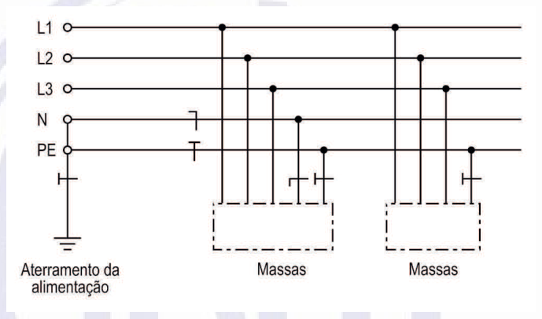
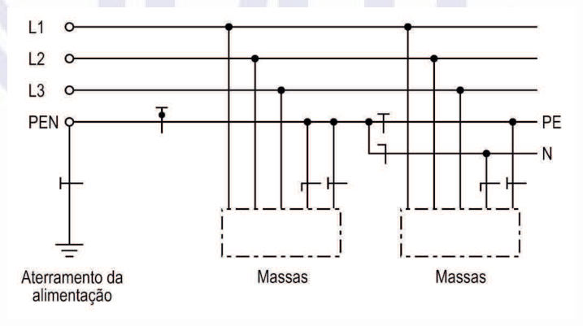
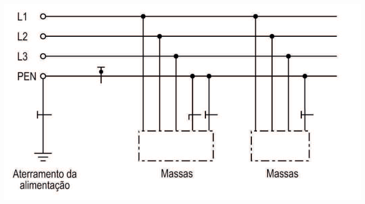
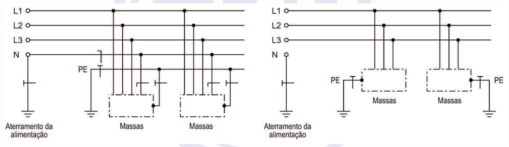
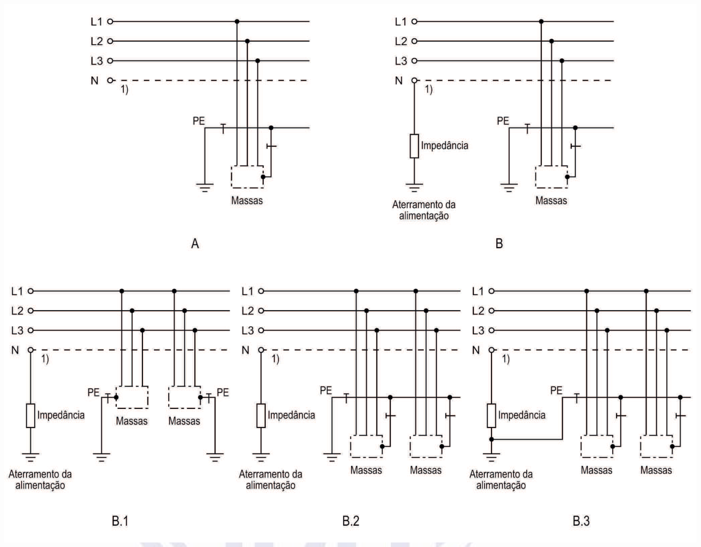

[Arquivo único](../nbr-5410.md)

## 4 Princípios fundamentais e determinação das características gerais

### 4.1 Princípios fundamentais

Os princípios que orientam os objetivos e as prescrições desta Norma são relacionados em 4.1.1 a 4.1.15.

#### 4.1.1 Proteção contra choques elétricos

As pessoas e os animais devem ser protegidos contra choques elétricos, seja o risco associado a contato acidental com parte viva perigosa, seja a falhas que possam colocar uma massa acidentalmente sob tensão.

#### 4.1.2 Proteção contra efeitos térmicos

A instalação elétrica deve ser concebida e construída de maneira a excluir qualquer risco de incêndio de materiais inflamáveis, devido a temperaturas elevadas ou arcos elétricos. Além disso, em serviço normal, não deve haver riscos de queimaduras para as pessoas e os animais.

#### 4.1.3 Proteção contra sobrecorrentes

As pessoas, os animais e os bens devem ser protegidos contra os efeitos negativos de temperaturas ou solicitações eletromecânicas excessivas resultantes de sobrecorrentes a que os condutores vivos possam ser submetidos.

#### 4.1.4 Circulação de correntes de falta

Condutores que não os condutores vivos e outras partes destinadas a escoar correntes de falta devem poder suportar essas correntes sem atingir temperaturas excessivas.

NOTAS

1 Convém lembrar que tais partes estão sujeitas à circulação desde pequenas correntes de fuga a correntes de falta direta à terra ou à massa, passando por correntes de falta de intensidade inferior à de uma falta direta.

2 No caso dos condutores vivos, considera-se que sua suportabilidade às correntes de falta deve ser assegurada mediante proteção contra sobrecorrentes, como enunciado em 4.1.3.

#### 4.1.5 Proteção contra sobretensões

As pessoas, os animais e os bens devem ser protegidos contra as conseqüências prejudiciais de ocorrências que possam resultar em sobretensões, como faltas entre partes vivas de circuitos sob diferentes tensões, fenômenos atmosféricos e manobras.

#### 4.1.6 Serviços de segurança

Equipamentos destinados a funcionar em situações de emergência, como incêndios, devem ter seu funcionamento assegurado a tempo e pelo tempo julgado necessário.

#### 4.1.7 Desligamento de emergência

Sempre que forem previstas situações de perigo em que se faça necessário desenergizar um circuito, devem ser providos dispositivos de desligamento de emergência, facilmente identificáveis e rapidamente manobráveis.

#### 4.1.8 Seccionamento

A alimentação da instalação elétrica, de seus circuitos e de seus equipamentos deve poder ser seccionada para fins de manutenção, verificação, localização de defeitos e reparos.

#### 4.1.9 Independência da instalação elétrica

A instalação elétrica deve ser concebida e construída livre de qualquer influência mútua prejudicial entre instalações elétricas e não elétricas.

#### 4.1.10 Acessibilidade dos componentes

Os componentes da instalação elétrica devem ser dispostos de modo a permitir espaço suficiente tanto para a instalação inicial quanto para a substituição posterior de partes, bem como acessibilidade para fins de operação, verificação, manutenção e reparos.

#### 4.1.11 Seleção dos componentes

Os componentes da instalação elétrica devem ser conforme as normas técnicas aplicáveis e possuir características compatíveis com as condições elétricas, operacionais e ambientais a que forem submetidos. Se o componente selecionado não reunir, originalmente, essas características, devem ser providas medidas compensatórias, capazes de compatibilizá-las com as exigências da aplicação.

#### 4.1.12 Prevenção de efeitos danosos ou indesejados

Na seleção dos componentes, devem ser levados em consideração os efeitos danosos ou indesejados que o componente possa apresentar, em serviço normal (incluindo operações de manobra), sobre outros componentes ou na rede de alimentação. Entre as características e fenômenos suscetíveis de gerar perturbações ou comprometer o desempenho satisfatório da instalação podem ser citados:

- o fator de potência;

- as correntes iniciais ou de energização;

- o desequilíbrio de fases;

- as harmônicas.

#### 4.1.13 Instalação dos componentes

Toda instalação elétrica requer uma cuidadosa execução por pessoas qualificadas, de forma a assegurar, entre outros objetivos, que:

- as características dos componentes da instalação, como indicado em 4.1.11, não sejam comprometidas durante sua montagem;

- os componentes da instalação, e os condutores em particular, fiquem adequadamente identificados;

- nas conexões, o contato seja seguro e confiável;

- os componentes sejam instalados preservando-se as condições de resfriamento previstas;

- os componentes da instalação suscetíveis de produzir temperaturas elevadas ou arcos elétricos fiquem dispostos ou abrigados de modo a eliminar o risco de ignição de materiais inflamáveis; e

- as partes externas de componentes sujeitas a atingir temperaturas capazes de lesionar pessoas fiquem dispostas ou abrigadas de modo a garantir que as pessoas não corram risco de contatos acidentais com essas partes.

#### 4.1.14 Verificação da instalação

As instalações elétricas devem ser inspecionadas e ensaiadas antes de sua entrada em funcionamento, bem como após cada reforma, com vista a assegurar que elas foram executadas de acordo com esta Norma.

#### 4.1.15 Qualificação profissional

O projeto, a execução, a verificação e a manutenção das instalações elétricas devem ser confiados somente a pessoas qualificadas a conceber e executar os trabalhos em conformidade com esta Norma.

### 4.2 Determinação das características gerais

Na concepção de uma instalação elétrica devem ser determinadas as seguintes características:

- a) utilização prevista e demanda (ver 4.2.1);

- b) esquema de distribuição (ver 4.2.2);

- c) alimentações disponíveis (ver 4.2.3);

- d) necessidade de serviços de segurança e de fontes apropriadas (ver 4.2.4);

- e) exigências quanto à divisão da instalação (ver 4.2.5);

- f) influências externas às quais a instalação for submetida (ver 4.2.6);

- g) riscos de incompatibilidade e de interferências (ver 4.2.7);

- h) requisitos de manutenção (ver 4.2.8).

#### 4.2.1 Utilização e demanda – Potência de alimentação

##### 4.2.1.1 Generalidades

**4.2.1.1.1** A determinação da potência de alimentação é essencial para a concepção econômica e segura de uma instalação, dentro de limites adequados de elevação de temperatura e de queda de tensão.

**4.2.1.1.2** Na determinação da potência de alimentação de uma instalação ou de parte de uma instalação devem ser computados os equipamentos de utilização a serem alimentados, com suas respectivas potências nominais e, em seguida, consideradas as possibilidades de não-simultaneidade de funcionamento destes equipamentos, bem como capacidade de reserva para futuras ampliações.

##### 4.2.1.2 Previsão de carga

A previsão de carga de uma instalação deve ser feita obedecendo-se às prescrições de 4.2.1.2.1 a 4.2.1.2.3.

**4.2.1.2.1** Geral:

- a) a carga a considerar para um equipamento de utilização é a potência nominal por ele absorvida, dada pelo fabricante ou calculada a partir da tensão nominal, da corrente nominal e do fator de potência;

- b) nos casos em que for dada a potência nominal fornecida pelo equipamento (potência de saída), e não a absorvida, devem ser considerados o rendimento e o fator de potência.

**4.2.1.2.2** Iluminação:

- a) as cargas de iluminação devem ser determinadas como resultado da aplicação da ABNT NBR 5413;

- b) para os aparelhos fixos de iluminação a descarga, a potência nominal a ser considerada deve incluir a potência das lâmpadas, as perdas e o fator de potência dos equipamentos auxiliares.

> **NOTA** Em 9.5.2.1 são fixados critérios mínimos para pontos de iluminação em locais de habitação.

**4.2.1.2.3** Pontos de tomada:

- a) em locais de habitação, os pontos de tomada devem ser determinados e dimensionados de acordo com 9.5.2.2;

- b) em *halls* de serviço, salas de manutenção e salas de equipamentos, tais como casas de máquinas, salas de bombas, barriletes e locais análogos, deve ser previsto no mínimo um ponto de tomada de uso geral. Aos circuitos terminais respectivos deve ser atribuída uma potência de no mínimo 1000 VA;

- c) quando um ponto de tomada for previsto para uso específico, deve ser a ele atribuída uma potência igual à potência nominal do equipamento a ser alimentado ou à soma das potências nominais dos equipamentos a serem alimentados. Quando valores precisos não forem conhecidos, a potência atribuída ao ponto de tomada deve seguir um dos dois seguintes critérios:

- potência ou soma das potências dos equipamentos mais potentes que o ponto pode vir a alimentar, ou

- potência calculada com base na corrente de projeto e na tensão do circuito respectivo;

- d) os pontos de tomada de uso específico devem ser localizados no máximo a 1,5 m do ponto previsto para a localização do equipamento a ser alimentado;

- e) os pontos de tomada destinados a alimentar mais de um equipamento devem ser providos com a quantidade adequada de tomadas.

#### 4.2.2 Esquema de distribuição

O esquema de distribuição pode ser classificado de acordo com os seguintes critérios:

- a) esquema de condutores vivos;

- b) esquema de aterramento.

##### 4.2.2.1 Esquema de condutores vivos

São considerados os seguintes esquemas de condutores vivos:

- a) corrente alternada:

- monofásico a dois condutores;

- monofásico a três condutores;

- bifásico a três condutores;

- trifásico a três condutores;

- trifásico a quatro condutores;

- b) corrente contínua:

- dois condutores;

- três condutores.

##### 4.2.2.2 Esquema de aterramento

Nesta Norma são considerados os esquemas de aterramento descritos em 4.2.2.2.1 a 4.2.2.3, cabendo as seguintes observações sobre as ilustrações e símbolos utilizados:

- a) as figuras 1 a 5, que ilustram os esquemas de aterramento, devem ser interpretadas de forma genérica. Elas utilizam como exemplo sistemas trifásicos. As massas indicadas não simbolizam um único, mas sim qualquer número de equipamentos elétricos. Além disso, as figuras não devem ser vistas com conotação espacial restrita. Deve-se notar, neste particular, que como uma mesma instalação pode eventualmente abranger mais de uma edificação, as massas devem necessariamente compartilhar o mesmo eletrodo de aterramento, se pertencentes a uma mesma edificação, mas podem, em princípio, estar ligadas a eletrodos de aterramento distintos, se situadas em diferentes edificações, com cada grupo de massas associado ao eletrodo de aterramento da edificação respectiva. Nas figuras são utilizados os seguintes símbolos:

- b) na classificação dos esquemas de aterramento é utilizada a seguinte simbologia:

- primeira letra – Situação da alimentação em relação à terra:

- T = um ponto diretamente aterrado;

- I = isolação de todas as partes vivas em relação à terra ou aterramento de um ponto através de

impedância;

- segunda letra – Situação das massas da instalação elétrica em relação à terra:

- T = massas diretamente aterradas, independentemente do aterramento eventual de um ponto da alimentação;

- N = massas ligadas ao ponto da alimentação aterrado (em corrente alternada, o ponto aterrado é normalmente o ponto neutro);

- outras letras (eventuais) – Disposição do condutor neutro e do condutor de proteção:

- S = funções de neutro e de proteção asseguradas por condutores distintos;

- C = funções de neutro e de proteção combinadas em um único condutor (condutor PEN).

###### 4.2.2.2.1 Esquema TN

O esquema TN possui um ponto da alimentação diretamente aterrado, sendo as massas ligadas a esse ponto através de condutores de proteção. São consideradas três variantes de esquema TN, de acordo com a disposição do condutor neutro e do condutor de proteção, a saber:

- a) esquema TN-S, no qual o condutor neutro e o condutor de proteção são distintos (figura 1);

- b) esquema TN-C-S, em parte do qual as funções de neutro e de proteção são combinadas em um único condutor (figura 2);

- c) esquema TN-C, no qual as funções de neutro e de proteção são combinadas em um único condutor, na totalidade do esquema (figura 3).

**Figura 1 — Esquema TN-S**

[imagem revisada]
Esquema de alimentação TN-S. Terminais L1, L2 e L3 (fases) e N e PE (condutores separados),
à esquerda, com símbolo de aterramento da alimentação na parte inferior esquerda.
As fases L1, L2 e L3 descem por derivações com pontos de conexão até duas caixas tracejadas
rotuladas "Massas", uma no centro e outra à direita. As linhas N e PE também atendem as caixas
por derivações com pontos de conexão e símbolos de seccionamento.
[/imagem]

**Figura 2 — Esquema TN-C-S**

[imagem revisada]
Esquema TN-C-S. À esquerda, terminais L1, L2, L3 e PEN com aterramento da alimentação; o PEN
é uma linha única com derivações às massas, rotuladas "Massas". Na parte direita da figura,
PE e N aparecem como linhas separadas, com a linha PE atendendo as massas.
[/imagem]

> **NOTA** As funções de neutro e de condutor de proteção são combinadas num único condutor em parte do esquema.

**Figura 3 —Esquema TN-C**

[imagem revisada]
Esquema TN-C. Terminais L1, L2, L3 e PEN, à esquerda, com aterramento da alimentação na parte
inferior esquerda. O PEN é uma linha horizontal contínua com derivações às duas caixas
tracejadas rotuladas "Massas".
[/imagem]

> **NOTA** As funções de neutro e de condutor de proteção são combinadas num único condutor, na totalidade do esquema.

###### 4.2.2.2.2 Esquema TT

O esquema TT possui um ponto da alimentação diretamente aterrado, estando as massas da instalação ligadas a eletrodo(s) de aterramento eletricamente distinto(s) do eletrodo de aterramento da alimentação (figura 4).

**Figura 4 — Esquema TT**

[imagem revisada]
Dois esquemas lado a lado. No da esquerda, terminais L1, L2, L3 e N, com linha PE, aterramento
da alimentação e caixas "Massas" ligadas por derivações. No da direita, terminais L1, L2, L3 e N,
com caixas "Massas" ligadas a terminais PE que têm símbolo de aterramento próprio, separado do
aterramento da alimentação.
[/imagem]

###### 4.2.2.2.3 Esquema IT

No esquema IT todas as partes vivas são isoladas da terra ou um ponto da alimentação é aterrado através de impedância (figura 5). As massas da instalação são aterradas, verificando-se as seguintes possibilidades:

- massas aterradas no mesmo eletrodo de aterramento da alimentação, se existente; e

- massas aterradas em eletrodo(s) de aterramento próprio(s), seja porque não há eletrodo de aterramento da alimentação, seja porque o eletrodo de aterramento das massas é independente do eletrodo de aterramento da alimentação.

**Figura 5 — Esquema IT**

[imagem revisada]
Cinco esquemas, identificados por A, B, B.1, B.2 e B.3, todos com terminais L1, L2, L3 e N (linha
tracejada, com a nota "1)") e caixas tracejadas "Massas". Em A, o N não tem ligação e a linha PE
atende as massas. Em B, o N tem uma impedância ligada ao aterramento da alimentação. Em B.1, a
impedância está no N e cada conjunto de massas tem PE e aterramento próprios. Em B.2 e B.3, a
impedância está no N e as massas são ligadas à linha PE comum; em B.3, a impedância também se
liga à linha PE. Rótulos: L1, L2, L3, N, PE, Impedância, Aterramento da alimentação, Massas.
[/imagem]

[^p25-1]: O neutro pode ser ou não distribuído; A = sem aterramento da alimentação; B = alimentação aterrada através de impedância;

B.1 = massas aterradas em eletrodos separados e independentes do eletrodo de aterramento da alimentação;

B.2 = massas coletivamente aterradas em eletrodo independente do eletrodo de aterramento da alimentação;

B.3 = massas coletivamente aterradas no mesmo eletrodo da alimentação.

#### 4.2.3 Alimentações

**4.2.3.1** Devem ser determinadas as seguintes características das fontes de suprimento de energia com as quais a instalação for provida:

- a) natureza da corrente e freqüência;

- b) valor da tensão nominal;

- c) valor da corrente de curto-circuito presumida no ponto de suprimento;

- d) possibilidade de atendimento dos requisitos da instalação, incluindo a demanda de potência.

> **NOTA** As faixas de tensão em corrente alternada ou contínua em que devem ser classificadas as instalações, conforme a tensão nominal, são dadas no anexo A.

**4.2.3.2** As características relacionadas em 4.2.3.1 devem ser obtidas junto à empresa distribuidora de energia elétrica, no que se refere ao suprimento via rede pública de distribuição, e devem ser determinadas, quando se tratar de fonte própria.

#### 4.2.4 Serviços de segurança

Quando for imposta a necessidade de serviços de segurança, as fontes de alimentação para tais serviços devem possuir capacidade, confiabilidade e disponibilidade adequadas ao funcionamento especificado. Em 6.6 são apresentadas prescrições para a alimentação de serviços de segurança.

> **NOTA** Esta Norma não inclui, nesta edição, prescrições específicas para alimentações de reserva destinadas a outros serviços que não os de segurança.

#### 4.2.5 Divisão da instalação

**4.2.5.1** A instalação deve ser dividida em tantos circuitos quantos necessários, devendo cada circuito ser concebido de forma a poder ser seccionado sem risco de realimentação inadvertida através de outro circuito.

**4.2.5.2** A divisão da instalação em circuitos deve ser de modo a atender, entre outras, às seguintes exigências:

- a) segurança — por exemplo, evitando que a falha em um circuito prive de alimentação toda uma área;

- b) conservação de energia — por exemplo, possibilitando que cargas de iluminação e/ou de climatização sejam acionadas na justa medida das necessidades;

- c) funcionais — por exemplo, viabilizando a criação de diferentes ambientes, como os necessários em auditórios, salas de reuniões, espaços de demonstração, recintos de lazer, etc.;

- d) de produção — por exemplo, minimizando as paralisações resultantes de uma ocorrência;

- e) de manutenção — por exemplo, facilitando ou possibilitando ações de inspeção e de reparo.

**4.2.5.3** Devem ser previstos circuitos distintos para partes da instalação que requeiram controle específico, de tal forma que estes circuitos não sejam afetados pelas falhas de outros (por exemplo, circuitos de supervisão predial).

**4.2.5.4** Na divisão da instalação devem ser consideradas também as necessidades futuras. As ampliações previsíveis devem se refletir não só na potência de alimentação, como tratado em 4.2.1, mas também na taxa de ocupação dos condutos e dos quadros de distribuição.

**4.2.5.5** Os circuitos terminais devem ser individualizados pela função dos equipamentos de utilização que alimentam. Em particular, devem ser previstos circuitos terminais distintos para pontos de iluminação e para pontos de tomada.

> **NOTA** Para locais de habitação, ver também 9.5.3.

**4.2.5.6** As cargas devem ser distribuídas entre as fases, de modo a obter-se o maior equilíbrio possível.

**4.2.5.7** Quando a instalação comportar mais de uma alimentação (rede pública, geração local, etc.), a distribuição associada especificamente a cada uma delas deve ser disposta separadamente e de forma claramente diferenciada das demais. Em particular, não se admite que componentes vinculados especificamente a uma determinada alimentação compartilhem, com elementos de outra alimentação, quadros de distribuição e linhas, incluindo as caixas dessas linhas, salvo as seguintes exceções:

- a) circuitos de sinalização e comando, no interior de quadros;

- b) conjuntos de manobra especialmente projetados para efetuar o intercâmbio das fontes de alimentação;

- c) linhas abertas e nas quais os condutores de uma e de outra alimentação sejam adequadamente identificados.

#### 4.2.6 Classificação das influências externas

Esta subseção estabelece uma classificação e uma codificação das influências externas que devem ser consideradas na concepção e na execução das instalações elétricas. Cada condição de influência externa é designada por um código que compreende sempre um grupo de duas letras maiúsculas e um número, como descrito a seguir:

- a) a primeira letra indica a categoria geral da influência externa:

- A = meio ambiente;

- B = utilização;

- C = construção das edificações;

- b) a segunda letra (A, B, C, ...) indica a natureza da influência externa;

- c) o número (1, 2, 3, ...) indica a classe de cada influência externa.

NOTAS

1 A codificação indicada nesta subseção não é destinada à marcação dos componentes. Essa questão (marcação dos componentes) é tratada nas normas dos próprios componentes e, de forma integrada, em normas mais gerais como, por exemplo, a que define e classifica os graus de proteção providos por invólucros (ver IEC 60529) ou a que define as classes de proteção contra choques elétricos (ver IEC 61140).

2 Como há uma tendência de se associar a idéia de “influências externas” predominantemente a fatores como temperatura ambiente, condições climáticas, presença de água e solicitações mecânicas, é importante destacar que a classificação aqui apresentada cobre uma gama muito mais extensa de variáveis de influência, todas tendo seu peso em aspectos como seleção dos componentes, adequação de medidas de proteção, etc. Por exemplo, a qualificação das pessoas (sua consciência e seu preparo para lidar com os riscos da eletricidade), situações que reforçam ou prejudicam a resistência elétrica do corpo humano (pele seca, pele molhada, imersão, etc.) e o nível de contato das pessoas com o potencial da terra são “influências externas” que podem decidir se uma medida de proteção contra choques é ou não aceitável em determinado local, dependendo de como essas condições de influências externas aí se apresentam.

##### 4.2.6.1 Meio ambiente

###### 4.2.6.1.1 Temperatura ambiente

A temperatura ambiente (ver tabela 1) a considerar para um componente é a temperatura no local onde deve ser instalado, incluída a influência dos demais componentes instalados no local e em funcionamento, e excluída a contribuição térmica do próprio componente considerado.

**Tabela 1 — Temperatura ambiente**

<table><tr><th rowspan="2">Código</th><th rowspan="2">Classificação</th><th colspan="2">Faixas de temperatura</th><th rowspan="2">Aplicações e exemplos</th></tr><tr><td>Limite inferior oC</td><td>Limite superior oC</td></tr><tr><td>AA1</td><td>Frigorífico</td><td>– 60</td><td>+ 5</td><td rowspan="2">Câmaras frigoríficas</td></tr><tr><td>AA2</td><td>Muito frio</td><td>– 40</td><td>+ 5</td></tr><tr><td>AA3</td><td>Frio</td><td>– 25</td><td>+ 5</td><td>-</td></tr><tr><td>AA4</td><td>Temperado</td><td>– 5</td><td>+ 40</td><td>-</td></tr><tr><td>AA5</td><td>Quente</td><td>+ 5</td><td>+ 40</td><td>Interior de edificações</td></tr><tr><td>AA6</td><td>Muito quente</td><td>+ 5</td><td>+ 60</td><td>-</td></tr><tr><td>AA7</td><td>Extrema</td><td>– 25</td><td>+ 55</td><td></td></tr><tr><td>AA8</td><td></td><td>– 50</td><td>+ 40</td><td></td></tr></table>

> **NOTAS 1** As classes de temperatura ambiente são aplicáveis apenas quando não houver influência da umidade.Caso contrário, ver 4.2.6.1.2. 2 O valor médio em um período de 24 h não deve exceder o limite superior menos 5ºC. 3 Para certos ambientes pode ser necessário combinar duas faixas de temperatura. Por exemplo, instalações ao ar livre podem ser submetidas a temperaturas entre – 5ºC e + 50ºC, correspondentes a AA4 + AA6. 4 Instalações submetidas a temperaturas diferentes das indicadas devem ser objeto de prescrições particulares.

###### 4.2.6.1.2 Condições climáticas do ambiente (influências combinadas de temperatura e umidade)

Conforme tabela 2.

**Tabela 2 — Condições climáticas do ambiente**

<table><tr><th rowspan="3">Código</th><th colspan="6">Características</th><th rowspan="3">Aplicações e exemplos</th></tr><tr><td colspan="2">Temperatura do ar °C</td><td colspan="2">Umidade relativa %</td><td colspan="2">Umidade absoluta g/m³</td></tr><tr><td>Limite inferior</td><td>Limite superior</td><td>Limite inferior</td><td>Limite superior</td><td>Limite inferior</td><td>Limite superior</td></tr><tr><td>AB1</td><td>– 60</td><td>+ 5</td><td>3</td><td>100</td><td>0,003</td><td>7</td><td>Ambientes internos e externos com temperaturas extremamente baixas</td></tr><tr><td>AB2</td><td>– 40</td><td>+ 5</td><td>10</td><td>100</td><td>0,1</td><td>7</td><td>Ambientes internos e externos com temperaturas baixas</td></tr><tr><td>AB3</td><td>– 25</td><td>+ 5</td><td>10</td><td>100</td><td>0,5</td><td>7</td><td>Ambientes internos e externos com temperaturas baixas</td></tr><tr><td>AB4</td><td>– 5</td><td>+ 40</td><td>5</td><td>95</td><td>1</td><td>29</td><td>Locais abrigados sem controle da temperatura e da umidade. Uso de calefação possível</td></tr><tr><td>AB5</td><td>+ 5</td><td>+ 40</td><td>5</td><td>85</td><td>1</td><td>25</td><td>Locais abrigados com temperatura ambiente controlada</td></tr><tr><td>AB6</td><td>+ 5</td><td>+ 60</td><td>10</td><td>100</td><td>1</td><td>35</td><td>Ambientes internos e externos com temperaturas extremamente altas, protegidos contra baixas temperaturas ambientes. Ocorrência de radiação solar e de calor</td></tr><tr><td>AB7</td><td>– 25</td><td>+ 55</td><td>10</td><td>100</td><td>0,5</td><td>29</td><td>Ambientes internos e abrigados sem controle da temperatura e da umidade. Podem ter aberturas para o exterior e são sujeitos a radiação solar</td></tr><tr><td>AB8</td><td>– 50</td><td>+ 40</td><td>15</td><td>100</td><td>0,04</td><td>36</td><td>Ambientes externos e sem proteção contra intempéries, sujeitos a altas e baixas temperaturas</td></tr></table>

> **NOTAS 1** Todos os valores especificados são limites, com baixa probabilidade de serem excedidos. 2 Os valores de umidade relativa, inferiores e superiores, são limitados pelos valores correspondentes de umidade absoluta. O apêndice B da IEC 60364-5-51:2001 traz informações sobre a interdependência da temperatura do ar, umidade relativa e umidade absoluta para as classes de condições climáticas especificadas.

###### 4.2.6.1.3 Altitude

Conforme tabela 3.

**Tabela 3 — Altitude**

<table><tr><th>Código</th><th>Classificação</th><th>Características</th><th>Aplicações e exemplos</th></tr><tr><td>AC1</td><td>Baixa</td><td>≤ 2 000 m</td><td rowspan="2">Para alguns componentes, podem ser necessárias medidas especiais a partir de 1 000 m de altitude</td></tr><tr><td>AC2</td><td>Alta</td><td>> 2 000 m</td></tr></table>

###### 4.2.6.1.4 Presença de água

Conforme tabela 4.

**Tabela 4 — Presença de água**

| Código | Classificação | Características | Aplicações e exemplos |
| --- | --- | --- | --- |
| AD1 | Desprezível | A probabilidade de presença de água é remota | Locais em que as paredes geralmente não apresentam umidade, mas podem apresentá-la durante curtos períodos, e secam rapidamente com uma boa aeração |
| AD2 | Gotejamento | Possibilidade de gotejamento de água na vertical | Locais em que a umidade se condensa ocasionalmente, sob forma de gotas de água, ou em que há presença ocasional de vapor de água |
| AD3 | Precipitação | Possibilidade de chuva caindo em ângulo máximo de 60o com a vertical | Locais em que a água forma uma película contínua nas paredes e/ou pisos |
| AD4 | Aspersão | Possibilidade de “chuva” de qualquer direção | A aspersão corresponde ao efeito de uma “chuva” vinda de qualquer direção. São exemplos de componentes sujeitos a aspersão certas luminárias de uso externo e painéis elétricos de canteiros de obras ao tempo |
| AD5 | Jatos | Possibilidade de jatos de água sob pressão, em qualquer direção | Locais em que ocorrem lavagens com água sob pressão, como passeios públicos, áreas de lavagem de veículos, etc. |
| AD6 | Ondas | Possibilidade de ondas de água | Locais situados à beira-mar, como praias, *piers*, ancoradouros, etc. |
| AD7 | Imersão | Possibilidade de imersão em água, parcial ou total, de modo intermitente | Locais sujeitos a inundação e/ou onde a água possa se elevar pelo menos a 15 cm acima do ponto mais alto do componente da instalação elétrica, estando sua parte mais baixa a no máximo 1 m abaixo da superfície da água |
| AD8 | Submersão | Submersão total em água, de modo permanente | Locais onde os componentes da instalação elétrica sejam totalmente submersos, sob uma pressão superior a 10 kPa (0,1 bar, ou 1 mca) |

###### 4.2.6.1.5 Presença de corpos sólidos

Conforme tabela 5.

**Tabela 5 — Presença de corpos sólidos**

| Código | Classificação | Características | Aplicações e exemplos |
| --- | --- | --- | --- |
| AE1 | Desprezível | Ausência de poeira em quantidade apreciável e de corpos estranhos | — |
| AE2 | Pequenos objetos | Presença de corpos sólidos cuja menor dimensão seja igual ou superior a 2,5 mm[^p30-1] | Ferramentas, material granulado, etc. |
| AE3 | Objetos muito pequenos | Presença de corpos sólidos cuja menor dimensão seja igual ou superior a 1 mm[^p31-1] | Fios metálicos, arames, etc. |
| AE4 | Poeira leve | Presença de leve deposição de poeira | Deposição de poeira maior que 10 mg/m² e no máximo igual a 35 mg/m² por dia |
| AE5 | Poeira moderada | Presença de média deposição de poeira | Deposição de poeira maior que 35 mg/m² e no máximo igual a 350 mg/m² por dia |
| AE6 | Poeira intensa | Presença de elevada deposição de poeira | Deposição de poeira maior que 350 mg/m² e no máximo igual a 1000 mg/m² por dia |

[rodape]
PENDENTE: definição da nota [^p30-1] não localizada no PDF.
[/rodape]

[rodape]
PENDENTE: definição da nota [^p31-1] não localizada no PDF.
[/rodape]

> **NOTA** Nas condições AE2 e AE3 pode existir poeira, desde que esta não tenha influência significativa sobre os componentes elétricos.

###### 4.2.6.1.6 Presença de substâncias corrosivas ou poluentes

Conforme tabela 6.

**Tabela 6 — Presença de substâncias corrosivas ou poluentes**

| Código | Classificação | Características | Aplicações e exemplos |
| --- | --- | --- | --- |
| AF1 | Desprezível | A quantidade ou natureza dos agentes corrosivos ou poluentes não é significativa | — |
| AF2 | Atmosférica | Presença significativa de agentes corrosivos ou poluentes de origem atmosférica | Instalações próximas da orla marítima ou de estabelecimentos industriais que produzam poluição atmosférica significativa, tais como indústrias químicas, fábricas de cimento, etc. Este tipo de poluição provém principalmente da emissão de poeiras abrasivas, isolantes ou condutivas |
| AF3 | Intermitente ou acidental | Presença intermitente ou acidental de produtos químicos corrosivos ou poluentes de uso corrente | Locais onde se manipulam produtos químicos em pequenas quantidades e onde o contato desses produtos com os componentes da instalação seja meramente acidental. Tais condições podem ocorrer em laboratórios de fábricas e outros, ou em locais onde se utilizam hidrocarbonetos (centrais de calefação, oficinas, etc.) |
| AF4 | Permanente | Presença permanente de produtos químicos corrosivos ou poluentes em quantidades significativas | Indústrias químicas, etc. |

###### 4.2.6.1.7 Solicitações mecânicas

Conforme tabela 7.

**Tabela 7 — Solicitações mecânicas**

| Códig o | Classificação | Características | Aplicações e exemplos |
| --- | --- | --- | --- |
| **Impactos (AG)** |  |  |  |
| AG1 | Fracos | Impactos iguais ou inferiores a 0,225 J | Locais domésticos, escritórios (condições de uso doméstico e análogas) |
| AG2 | Médios | Impactos iguais ou inferiores a 2 J | Condições industriais normais |
| AG3 | Severos | Impactos iguais ou inferiores a 20 J | Condições industriais severas |
| **Vibrações (AH)** |  |  |  |
| AH1 | Fracas | Nenhuma vibração(ões) eventual(ais) sem influência significativa | Condições domésticas e análogas, onde os efeitos das vibrações podem ser geralmente desprezados |
| AH2 | Médias | Vibrações com freqüências compreendidas entre 10 Hz e 50 Hz e amplitude igual ou inferior a 0,15 mm | Condições industriais normais |
| AH3 | Severas | Vibrações com freqüências compreendidas entre 10 Hz e 150 Hz e amplitude igual ou inferior a 0,35 mm | Condições industriais severas |

###### 4.2.6.1.8 Presença de flora e mofo

Conforme tabela 8.

**Tabela 8 — Presença de flora e mofo**

| Código | Classificação | Características | Aplicações e exemplos |
| --- | --- | --- | --- |
| AK1 | Desprezível | Sem risco de danos devidos à flora ou ao mofo | — |
| AK2 | Prejudicial | Risco de efeitos prejudiciais | Os riscos dependem das condições locais e da natureza da flora. Pode-se dividi-los em riscos devidos ao desenvolvimento prejudicial da vegetação e riscos devidos à sua abundância |

###### 4.2.6.1.9 Presença de fauna

Conforme tabela 9.

**Tabela 9 — Presença de fauna**

| Código | Classificação | Características | Aplicações e exemplos |
| --- | --- | --- | --- |
| AL1 | Desprezível | Sem risco de danos devidos à fauna | — |
| AL2 | Prejudicial | Risco de efeitos prejudiciais devidos à fauna (insetos, pássaros, pequenos animais) | Os riscos dependem da natureza da fauna. Pode-se dividi-los em: perigos devidos a insetos em quantidades prejudiciais ou de natureza agressiva; presença de pequenos animais ou de pássaros em quantidades prejudiciais ou de natureza agressiva |

###### 4.2.6.1.10 Influências eletromagnéticas, eletrostáticas ou ionizantes

Conforme tabelas 10 a 13.

**Tabela 10 – Fenômenos eletromagnéticos de baixa freqüência (conduzidos ou radiados)**

<table><tr><th>Código</th><th>Classificação</th><th>Características</th><th colspan="2">Aplicações e exemplos</th><th>Referências</th></tr><tr><td colspan="6">Harmônicas e inter-harmônicas (AM1)</td></tr><tr><td>AM1-1</td><td>Nível controlado</td><td>Situação controlada</td><td colspan="2">Aparelhos eletromédicos Instrumentos de medição</td><td>Abaixo da tabela 1 da IEC 61000-2-2:2002</td></tr><tr><td>AM1-2</td><td>Nível normal</td><td>Redes de baixa tensão</td><td colspan="2">Habitações Locais comerciais Indústria leve</td><td>Dentro do estipulado na tabela 1 da IEC 61000-2-2:2002</td></tr><tr><td>AM1-3</td><td>Nível alto</td><td>Redes poluídas</td><td colspan="2">Indústrias ou grandes prédios comerciais alimentados por transformação AT/BT dedicada</td><td>Localmente acima da tabela 1 da IEC 61000-2-2:2002</td></tr><tr><td colspan="6">Tensões de sinalização (tensões sobrepostas para fins de telecomando) (AM2)</td></tr><tr><td>AM2-1</td><td>Nível controlado</td><td>Somente sinais residuais</td><td colspan="2">Instalações protegidas ou parte protegida de uma instalação</td><td>Inferior ao especificado abaixo</td></tr><tr><td>AM2-2</td><td>Nível médio</td><td>Presença de tensões de sinalização na rede</td><td colspan="2">Instalações residenciais, comerciais e industriais</td><td>IEC 61000-2-1 e IEC 61000-2-2</td></tr><tr><td>AM2-3</td><td>Nível alto</td><td>Ressonância</td><td colspan="2">Casos especiais</td><td>—</td></tr><tr><td colspan="6">Variações de amplitude da tensão (AM3)</td></tr><tr><td>AM3-1</td><td>Nível controlado</td><td>Uso de UPS</td><td colspan="2">Cargas sensíveis, como equipamentos de tecnologia da informação</td><td>—</td></tr><tr><td>AM3-2</td><td>Nível normal</td><td>Flutuações de tensão Afundamentos de tensão e interrupções</td><td colspan="2">Habitações Locais comerciais Indústrias</td><td>—</td></tr><tr><td colspan="6">Desequilíbrio de Tensão (AM4)</td></tr><tr><td>AM4</td><td>Nível normal</td><td colspan="2">—</td><td>—</td><td>De acordo com a IEC 61000-2-2</td></tr><tr><td colspan="6">Variações de freqüência (AM5)</td></tr><tr><td>AM5</td><td>Nível normal</td><td colspan="2">Pequenas variações de freqüência</td><td>Caso geral</td><td>± 1 Hz de acordo com a IEC 61000-2-2</td></tr><tr><td colspan="6">Tensões induzidas de baixa freqüência (AM6)</td></tr><tr><td>AM6</td><td>Sem classificação</td><td colspan="2">Geradas permanentemente ou na ocorrência de faltas</td><td>Caso geral</td><td>ITU-T</td></tr><tr><td colspan="6">Componentes contínuas em redes c.a. (AM7)</td></tr><tr><td>AM7</td><td>Sem classificação</td><td colspan="2">Ocorrência de falta a jusante de retificadores</td><td>Caso geral</td><td>—</td></tr><tr><td colspan="6">Campos magnéticos radiados (AM8)</td></tr><tr><td>AM8-1</td><td>Nível médio</td><td colspan="2">Produzidos por linhas de energia, transformadores e outros equipamentos de freqüência industrial e suas harmônicas</td><td>Habitações Locais comerciais Indústrias leves</td><td>Nível 2 da IEC 61000-4-8:2001</td></tr><tr><td>AM8-2</td><td>Nível alto</td><td colspan="2">Grande proximidade dos elementos mencionados acima ou de outros similares</td><td>Indústrias pesadas Subestações AT/BT Quadros elétricos Proximidade de linhas ferroviárias</td><td>Nível 4 da IEC 61000-4-8:2001</td></tr><tr><td colspan="6">Campos elétricos (AM9)</td></tr><tr><td>AM9-1</td><td>Nível desprezível</td><td colspan="2">Caso geral</td><td>—</td><td>—</td></tr><tr><td>AM9-2</td><td>Nível médio</td><td rowspan="3" colspan="2">De acordo com o valor da tensão e da localização, interna ou externa à edificação</td><td rowspan="3">Proximidade de linhas aéreas de AT ou subestações de AT</td><td rowspan="3">IEC 61000-2-5</td></tr><tr><td>AM9-3</td><td>Nível alto</td></tr><tr><td>AM9-4</td><td>Nível muito alto</td></tr></table>

**Tabela 11 — Fenômenos eletromagnéticos de alta freqüência conduzidos, induzidos ou radiados**

**(contínuos ou transitórios)**

<table><tr><th>Código</th><th>Classificação</th><th>Características</th><th>Aplicações e exemplos</th><th>Referências</th></tr><tr><td colspan="5">Tensões ou correntes induzidas oscilantes (AM21)</td></tr><tr><td>AM21</td><td>Sem classificação</td><td>Principalmente perturbações de modo comum geradas por campos eletromagnéticos modulados em AM ou FM</td><td>—</td><td>IEC 61000-4-6</td></tr><tr><td colspan="5">Transitórios unidirecionais conduzidos, na faixa do nanossegundo (AM22)</td></tr><tr><td>AM22-1</td><td>Desprezível</td><td>Ambiente protegido</td><td>Salas de computadores, salas de controle</td><td>Nível 1 da IEC 61000-4-4:2004</td></tr><tr><td>AM22-2</td><td>Nível médio</td><td>Ambiente protegido</td><td>__</td><td>Nível 2 da IEC 61000-4-1:2004</td></tr><tr><td>AM22-3</td><td>Nível alto</td><td>Chaveamento de pequenas cargas indutivas, ricochete de contatos de relés Faltas</td><td>Rede de baixa tensão</td><td>Nível 3 da IEC 61000-4-4:2004</td></tr><tr><td>AM22-4</td><td>Nível muito alto</td><td>Subestações AT/BT Equipamentos de manobra a SF6 ou a vácuo</td><td>Indústrias pesadas Quadros de distribuição principais ou intermediários</td><td>Nível 4 da IEC 61000-4-4:2004</td></tr><tr><td colspan="5">Transitórios unidirecionais conduzidos, na faixa do micro ao milissegundo (AM23)</td></tr><tr><td>AM23-1</td><td>Nível controlado</td><td>Circuitos ou instalações equipadas com dispositivos de proteção contra sobretensões, transformadores aterrados</td><td>Situações controladas</td><td>—</td></tr><tr><td>AM23-2</td><td>Nível médio</td><td>Descarga atmosférica distante (mais de 1 km): forma de onda 10 μs/1 000 μs e impedância da fonte 20 Ω – 300 Ω Transitórios de chaveamento (por exemplo, interrupção da corrente de falta por um fusível): forma de onda 0,1 ms/1 ms e impedância da fonte 50 Ω</td><td>Descargas atmosféricas distantes de redes subterrâneas</td><td rowspan="2">4.2.6.1.12, 5.4.2 e 6.3.5</td></tr><tr><td>AM23-3</td><td>Nível alto</td><td>Descarga atmosférica próxima (a menos de 1 km): forma de onda 1,2 μs/50 μs e impedância da fonte 1 Ω – 10 Ω</td><td>Descargas atmosféricas próximas de uma rede aérea ou da edificação</td></tr><tr><td colspan="5">Transitórios oscilantes conduzidos (AM24)</td></tr><tr><td>AM24-1</td><td>Nível médio</td><td>Fenômenos de chaveamento presentes normalmente em instalações de edificações</td><td>Locais residenciais, comerciais e industriais</td><td>IEC 61000-4-12</td></tr><tr><td>AM24-2</td><td>Nível alto</td><td>Fenômenos associados a chaveamentos/manobras</td><td>Subestações AT/MT</td><td>IEC 60255-22-1</td></tr><tr><td colspan="5">Fenômenos radiados de alta freqüência (AM25)</td></tr><tr><td>AM25-1</td><td>Nível desprezível</td><td>Estações de rádio e televisão a mais de 1 km</td><td>Residências e locais comerciais</td><td>Nível 1 da IEC 61000-4-2:2002</td></tr><tr><td>AM25-2</td><td>Nível médio</td><td>Transceptores portáteis a não menos de 1 m</td><td>Indústrias leves</td><td>Nível 2 da IEC 61000-4-2:2002</td></tr><tr><td>AM25-3</td><td>Nível alto</td><td>Transceptores de alta potência nas proximidades</td><td>Indústrias pesadas e aplicações de alta confiabilidade</td><td>Nível 3 da IEC 61000-4-2:2002</td></tr></table>

**Tabela 12 — Descargas eletrostáticas**

<table><tr><th>Código</th><th>Classificação</th><th>Características</th><th>Aplicações e exemplos</th><th>Referências</th></tr><tr><td>AM31-1</td><td>Nível baixo</td><td rowspan="4">Descargas geradas particularmente por pessoas caminhando sobre carpetes sintéticos Nível dependente do tipo de carpete e da umidade do ar</td><td rowspan="4">De acordo com a confiabilidade requerida</td><td>Nível 1 da IEC 61000-4-2:2001</td></tr><tr><td>AM31-2</td><td>Nível médio</td><td>Nível 2 da IEC 61000-4-2:2001</td></tr><tr><td>AM31-3</td><td>Nível alto</td><td>Nível 3 da IEC 61000-4-2:2001</td></tr><tr><td>AM31-4</td><td>Nível muito alto</td><td>Nível 4 da IEC 61000-4-2:2001</td></tr></table>

**Tabela 13 — Radiações ionizantes**

| Código | Classificação | Características | Aplicações e exemplos |
| --- | --- | --- | --- |
| AM41-1 | Sem classificação | Presença de radiações ionizantes perigosas | — |

###### 4.2.6.1.11 Radiação solar

Conforme tabela 14.

**Tabela 14** — **Radiação solar**

| Código | Classificação | Características | Aplicações e exemplos |
| --- | --- | --- | --- |
| AN1 | Desprezível | Intensidade ≤ 500 W/m² | — |
| AN2 | Média | 500 < Intensidade ≤ 700 W/m² | — |
| AN3 | Alta | 700 < Intensidade ≤ 1 120 W/m² | — |

###### 4.2.6.1.12 Descargas atmosféricas

Conforme tabela 15.

**Tabela 15 — Descargas atmosféricas**

| Código | Classificação | Características | Aplicações e exemplos |
| --- | --- | --- | --- |
| AQ1 | Desprezíveis | ≤ 25 dias por ano | — |
| AQ2 | Indiretas | > 25 dias por ano Riscos provenientes da rede de alimentação | Instalações alimentadas por redes aéreas |
| AQ3 | Diretas | Riscos provenientes da exposição dos componentes da instalação | Partes da instalação situadas no exterior das edificações |

###### 4.2.6.1.13 Movimentação do ar

Conforme tabela 16.

**Tabela 16 — Movimentação do ar**

| Código | Classificação | Características | Aplicações e exemplos |
| --- | --- | --- | --- |
| AR1 | Desprezível | Velocidade ≤ 1 m/s | — |
| AR2 | Média | 1 m/s < velocidade ≤ 5 m/s | — |
| AR3 | Forte | 5 m/s < velocidade ≤ 10 m/s | — |

###### 4.2.6.1.14 Vento

Conforme tabela 17.

**Tabela 17 — Vento**

| Código | Classificação | Características | Aplicações e exemplos |
| --- | --- | --- | --- |
| AS1 | Desprezível | Velocidade ≤ 20 m/s | — |
| AS2 | Médio | 20 m/s < velocidade ≤ 30 m/s | — |
| AS3 | Forte | 30 m/s < velocidade ≤ 50 m/s | — |

##### 4.2.6.2 Utilização

###### 4.2.6.2.1 Competência das pessoas

Conforme tabela 18.

**Tabela 18 — Competência das pessoas**

| Código | Classificação | Características | Aplicações e exemplos |
| --- | --- | --- | --- |
| BA1 | Comuns | Pessoas inadvertidas | — |
| BA2 | Crianças | Crianças em locais a elas destinados[^p38-1] | Creches, escolas |
| BA3 | Incapacitadas | Pessoas que não dispõem de completa capacidade física ou intelectual (idosos, doentes) | Casas de repouso, unidades de saúde |
| BA4 | Advertidas | Pessoas suficientemente informadas ou supervisionadas por pessoas qualificadas, de tal forma que lhes permite evitar os perigos da eletricidade (pessoal de manutenção e/ou operação) | Locais de serviço elétrico |
| BA5 | Qualificadas | Pessoas com conhecimento técnico ou experiência tal que lhes permite evitar os perigos da eletricidade (engenheiros e técnicos) | Locais de serviço elétrico fechados |
| **1)Esta classificação não se aplica necessariamente a locais de habitação.** |  |  |  |

[rodape]
PENDENTE: definição da nota [^p38-1] não localizada no PDF.
[/rodape]

###### 4.2.6.2.2 Resistência elétrica do corpo humano

Conforme tabela 19.

**Tabela 19 — Resistência elétrica do corpo humano**

| Código | Classificação | Características | Aplicações e exemplos |
| --- | --- | --- | --- |
| BB1 | Alta | Condições secas | Circunstâncias nas quais a pele está seca (nenhuma umidade, inclusive suor) |
| BB2 | Normal | Condições úmidas | Passagem da corrente elétrica de uma mão à outra ou de uma mão a um pé, com a pele úmida de suor, sendo a superfície de contato significativa |
| BB3 | Baixa | Condições molhadas | Passagem da corrente elétrica entre as duas mãos e os dois pés, estando as pessoas com os pés molhados ao ponto de se poder desprezar a resistência da pele e dos pés |
| BB4 | Muito baixa | Condições imersas | Pessoas imersas na água, por exemplo em banheiras e piscinas |

###### 4.2.6.2.3 Contato das pessoas com o potencial da terra

Conforme tabela 20.

**Tabela 20 — Contato das pessoas com o potencial da terra**

| Código | Classificação | Características | Aplicações e exemplos |
| --- | --- | --- | --- |
| BC1 | Nulo | Locais não-condutivos | Locais cujo piso e paredes sejam isolantes e que não possuam nenhum elemento condutivo |
| BC2 | Raro | Em condições habituais, as pessoas não estão em contato com elementos condutivos ou postadas sobre superfícies condutivas | Locais cujo piso e paredes sejam isolantes, com elementos condutivos em pequena quantidade ou de pequenas dimensões e de tal forma a probabilidade de contato possa ser desprezada |
| BC3 | Freqüente | Pessoas em contato com elementos condutivos ou postadas sobre superfícies condutivas | Locais cujo piso e paredes sejam condutivos ou que possuam elementos condutivos em quantidade ou de dimensões consideráveis |
| BC4 | Contínuo | Pessoas em contato permanente com paredes metálicas e com pequena possibilidade de poder interromper o contato | Locais como caldeiras ou vasos metálicos, cujas dimensões sejam tais que as pessoas que neles penetrem estejam continuamente em contato com as paredes. A redução da liberdade de movimentos das pessoas pode, por um lado, impedi-las de romper voluntariamente o contato e, por outro, aumentar os riscos de contato involuntário |

###### 4.2.6.2.4 Condições de fuga das pessoas em emergências

Conforme tabela 21.

**Tabela 21 — Condições de fuga das pessoas em emergências**

| Código | Classificação | Características | Aplicações e exemplos[^p40-1] |
| --- | --- | --- | --- |
| BD1 | Normal | Baixa densidade de ocupação Percurso de fuga breve | Edificações residenciais com altura inferior a 50 m e edificações não-residenciais com baixa densidade de ocupação e altura inferior a 28 m |
| BD2 | Longa | Baixa densidade de ocupação Percurso de fuga longo | Edificações residenciais com altura superior a 50 m e edificações não-residenciais com baixa densidade de ocupação e altura superior a 28 m |
| BD3 | Tumultuada | Alta densidade de ocupação Percurso de fuga breve | Locais de afluência de público (teatros, cinemas, lojas de departamentos, escolas, etc.); edificações não-residenciais com alta densidade de ocupação e altura inferior a 28 m |
| BD4 | Longa e tumultuada | Alta densidade de ocupação Percurso de fuga longo | Locais de afluência de público de maior porte (shopping centers, grandes hotéis e hospitais, estabelecimento de ensino ocupando diversos pavimentos de uma edificação, etc.); edificações não-residenciais com alta densidade de ocupação e altura superior a 28 m |

[rodape]
PENDENTE: definição da nota [^p40-1] não localizada no PDF.
[/rodape]

> **NOTA** As aplicações e exemplos destinam-se apenas a subsidiar a avaliação de situações reais, fornecendo elementos mais qualitativos do que quantitativos. Os códigos locais de segurança contra incêndio e pânico podem conter parâmetros mais estritos. Ver também ABNT NBR 13570.

###### 4.2.6.2.5 Natureza dos materiais processados ou armazenados

Conforme tabela 22.

**Tabela 22 — Natureza dos materiais processados ou armazenados**

| Código | Classificação | Características | Aplicações e exemplos |
| --- | --- | --- | --- |
| BE1 | Riscos desprezíveis | — | — |
| BE2 | Riscos de incêndio | Presença de substâncias combustíveis, como fibras e líquidos com alto ponto de fulgor | Locais de processamento ou armazenagem de papel , feno, palha, aparas ou gravetos de madeira, fibras de algodão ou lã, hidrocarbonetos, plásticos granulados |
| BE3 | Riscos de explosão | Presença de substâncias inflamáveis, como líquidos com baixo ponto de fulgor, gases e vapores, pós combustíveis sujeitos a explosão e substâncias explosivas | Locais de processamento e armazenagem de pós combustíveis (amido de milho, açúcar, farinhas, resinas fenólicas, plásticos, enxofre, alumínio, magnésio, etc.); indústrias químicas e de petróleo; usinas e depósitos de gás; fábricas e depósitos de explosivos |
| BE4 | Riscos de contaminação | Presença de alimentos, produtos farmacêuticos e análogos, sem proteção | Indústrias alimentícias, grandes cozinhas. Certas precauções podem ser necessárias para evitar que os produtos em processamento sejam contaminados, por exemplo, por fragmentos de lâmpadas |

##### 4.2.6.3 Construção das edificações

###### 4.2.6.3.1 Materiais de construção

Conforme tabela 23.

**Tabela 23 — Materiais de construção**

| Código | Classificação | Características | Aplicações e exemplos |
| --- | --- | --- | --- |
| CA1 | Não-combustíveis | — | — |
| CA2 | Combustíveis | Edificações construídas predominantemente com materiais combustíveis | Edificações de madeira e similares |

###### 4.2.6.3.2 Estrutura das edificações

Conforme tabela 24.

**Tabela 24 — Estrutura das edificações**

| Código | Classificação | Características | Aplicações e exemplos |
| --- | --- | --- | --- |
| CB1 | Riscos desprezíveis | — | — |
| CB2 | Sujeitas a propagação de incêndio | Edificações cuja forma e dimensões facilitem a propagação de incêndio (por exemplo, efeito chaminé) | Edificações de grande altura ou edificações com sistemas de ventilação forçada |
| CB3 | Sujeitas a movimentação | Riscos devidos, por exemplo, a deslocamentos entre partes distintas de uma edificação ou entre esta e o solo; acomodação do terreno ou das fundações | Edificações de grande comprimento ou construídas sobre terrenos não estabilizados |
| CB4 | Flexíveis ou instáveis | Estruturas frágeis ou sujeitas a movimentos (por exemplo, oscilação) | Tendas, estruturas infláveis, divisórias removíveis, forros falsos |

> **NOTA** Para uma classificação mais específica do componente, que vá além daquelas indicadas nas tabelas 1 a 24, consultar as IEC 60721-3-3 e IEC 60721-3-4.

#### 4.2.7 Compatibilidade

**4.2.7.1** Devem ser tomadas medidas apropriadas quando quaisquer características dos componentes da instalação forem suscetíveis de produzir efeitos prejudiciais em outros componentes, em outros serviços ou ao bom funcionamento da fonte de alimentação. Essas características dizem respeito, por exemplo, a:

- sobretensões transitórias;

- variações rápidas de potência;

- correntes de partida;

- correntes harmônicas;

- componentes contínuas;

- oscilações de alta freqüência;

- correntes de fuga.

**4.2.7.2** Todos os componentes da instalação elétrica devem atender às exigências de compatibilidade eletromagnética e ser conforme o que as normas aplicáveis prescrevem, neste particular. Isso não dispensa, porém, a observância de medidas destinadas a reduzir os efeitos das sobretensões induzidas e das perturbações eletromagnéticas em geral, como indicado em 5.4.

#### 4.2.8 Manutenção

Devem-se estimar a freqüência e a qualidade da manutenção com que a instalação pode contar, ao longo de sua vida útil. Esse dado deve ser levado em conta na aplicação das prescrições das seções 5, 6, 7 e 8, de forma que:

- as verificações periódicas, os ensaios, a manutenção e os reparos necessários possam ser realizados de forma fácil e segura;

- a efetividade das medidas de proteção fique garantida;

- a confiabilidade dos componentes, sob o ponto de vista do correto funcionamento da instalação, seja compatível com a vida útil prevista desta.
