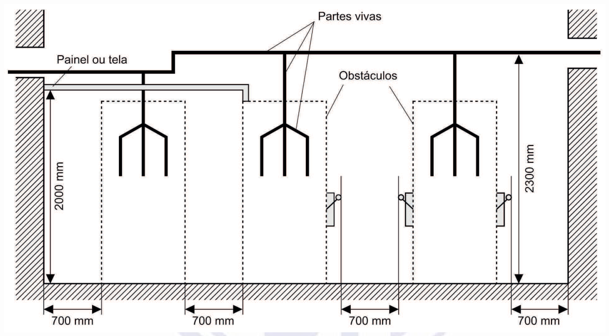
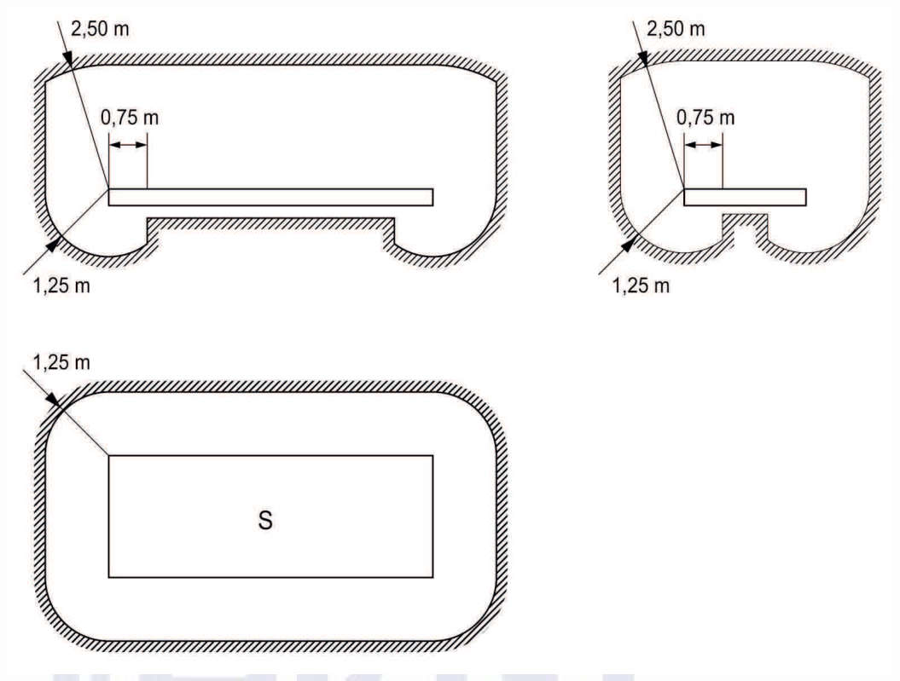
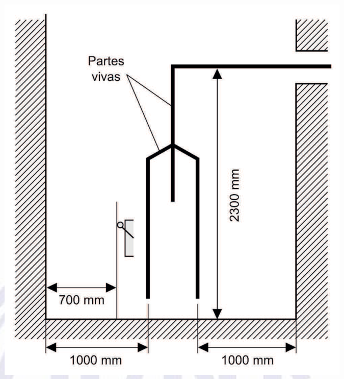
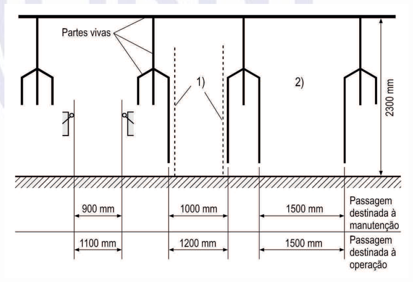

[Arquivo único](../nbr-5410.md)

## 5 Proteção para garantir segurança

### 5.1 Proteção contra choques elétricos

#### 5.1.1 Introdução

##### 5.1.1.1 Princípio fundamental

O princípio que fundamenta as medidas de proteção contra choques especificadas nesta Norma pode ser assim resumido:

- partes vivas perigosas não devem ser acessíveis; e

- massas ou partes condutivas acessíveis não devem oferecer perigo, seja em condições normais, seja, em particular, em caso de alguma falha que as tornem acidentalmente vivas.

Deste modo, a proteção contra choques elétricos compreende, em caráter geral, dois tipos de proteção:

- a) proteção básica (ver 3.2.2) e

- b) proteção supletiva (ver 3.2.3).

NOTAS

1 Os conceitos e princípios da proteção contra choques elétricos aqui adotados são aqueles da IEC 61140.

2 Os conceitos de “proteção básica” e de “proteção supletiva” correspondem, respectivamente, aos conceitos de “proteção contra contatos diretos” e de “proteção contra contatos indiretos” vigentes até a edição anterior desta Norma.

3 Exemplos de proteção básica:

•isolação básica ou separação básica;

- uso de barreira ou invólucro;

- limitação da tensão;

4 Exemplos de proteção supletiva:

- eqüipotencialização e seccionamento automático da alimentação;

- isolação suplementar;

- separação elétrica.

##### 5.1.1.2 Regra geral

A regra geral da proteção contra choques elétricos é que o princípio enunciado em 5.1.1.1 seja assegurado, no mínimo, pelo provimento conjunto de proteção básica e de proteção supletiva, mediante combinação de meios independentes ou mediante aplicação de uma medida capaz de prover ambas as proteções, simultaneamente.

> **NOTA** Exceções são previstas em 5.1.5 e 5.1.6, que indicam, respectivamente, os casos em que se admite uma proteção apenas parcial e os casos em que se admite mesmo omitir qualquer proteção contra choques elétricos.

##### 5.1.1.3 Proteção adicional

Os casos em que se exige proteção adicional contra choques elétricos são especificados em 5.1.3 e na seção 9.

> **NOTA** Ver definição de “proteção adicional” (3.2.4). São exemplos de proteção adicional contra choques elétricos a realização de eqüipotencializações suplementares e o uso de proteção diferencial-residual de alta sensibilidade.

#### 5.1.2 Medidas de proteção

##### 5.1.2.1 Generalidades

As medidas de proteção contra choques elétricos são apresentadas em 5.1.2.2 a 5.1.2.5. A aplicação dessas medidas, em caráter geral, é tratada em 5.1.4. A aplicação dessas medidas em situações ou locais específicos consta na seção 9.

Quanto à proteção adicional, os meios de proteção são apresentados em 5.1.3, juntamente com casos de caráter geral em que ela é obrigatória. A exigência de proteção adicional também figura, implicitamente, em prescrições da seção 9.

NOTAS

1 Diferentes medidas podem coexistir numa mesma instalação.

2 Nesta Norma, na expressão "medida de proteção contra choques", o termo "medida" é usado para designar expressamente providências que atendem à regra geral da proteção contra choques (5.1.1.2), isto é, capazes de prover o correspondente a proteção básica mais proteção supletiva, pelo menos. O vocábulo "meio", na expressão "meio de proteção", é usado para qualificar um recurso enquanto proteção supletiva, ou enquanto proteção básica.

##### 5.1.2.2 Eqüipotencialização e seccionamento automático da alimentação

**5.1.2.2.1** A precondição de proteção básica deve ser assegurada por isolação das partes vivas e/ou pelo uso de barreiras ou invólucros, conforme anexo B.

**5.1.2.2.2** A proteção supletiva deve ser assegurada, conjuntamente, por eqüipotencialização, conforme 5.1.2.2.3, e pelo seccionamento automático da alimentação, conforme 5.1.2.2.4.

NOTAS

1 A eqüipotencialização e o seccionamento automático da alimentação se completam, de forma indissociável, porque quando a eqüipotencialidade não é o suficiente para impedir o aparecimento de tensões de contato perigosas, entra em ação o recurso do seccionamento automático, promovendo o desligamento do circuito em que se manifesta a tensão de contato perigosa.

2 Sobre a aplicação dessa medida de proteção (eqüipotencialização e seccionamento automático da alimentação), ver ainda as prescrições de 5.1.4 e a seção 9.

###### 5.1.2.2.3 Eqüipotencialização

> **NOTA** As prescrições de 5.1.2.2.3.1 a 5.1.2.2.3.6 traduzem princípios básicos da eqüipotencialização aplicada à proteção, contra choques elétricos, apresentados de forma pontual. Em situações concretas, o atendimento de algum deles pode resultar automaticamente no atendimento de outro(s).

**5.1.2.2.3.1** Todas as massas de uma instalação devem estar ligadas a condutores de proteção.

NOTAS

1 Partes condutivas acessíveis de componentes que sejam objeto de outra medida de proteção contra choques elétricos (que não a proteção por eqüipotencialização e seccionamento automático) não devem ser ligadas a condutores de proteção, salvo se seu aterramento ou eqüipotencialização for previsto por razões funcionais e isso não comprometer a segurança proporcionada pela medida de proteção de que são objeto. São exemplos de partes condutivas acessíveis não-aterráveis, como regra geral: invólucros metálicos de componentes classe II (ver 5.1.2.3), massas de equipamentos objeto de separação elétrica individual (ver 5.1.2.4) e massas de equipamentos classe III (alimentados por fonte SELV, ver 5.1.2.5). Sobre classificação dos componentes da instalação quanto à proteção contra choques elétricos (classes I, II e III), ver IEC 61140.

2 Sobre condutores de proteção, ver 6.4.3.

**5.1.2.2.3.2** Em cada edificação deve ser realizada uma eqüipotencialização principal, nas condições especificadas em 6.4.2.1, e tantas eqüipotencializações suplementares quantas forem necessárias.

> **NOTA** Sobre eqüipotencializações suplementares, ver 5.1.3.1.

**5.1.2.2.3.3** Todas as massas da instalação situadas em uma mesma edificação devem estar vinculadas à eqüipotencialização principal da edificação e, dessa forma (ver 6.4.2.1), a um mesmo e único eletrodo de aterramento. Isso sem prejuízo de eqüipotencializações adicionais que se façam necessárias, para fins de proteção contra choques e/ou de compatibilidade eletromagnética.

**5.1.2.2.3.4** Massas simultaneamente acessíveis devem estar vinculadas a um mesmo eletrodo de aterramento, sem prejuízo de eqüipotencializações adicionais que se façam necessárias, para fins de proteção contra choques e/ou de compatibilidade eletromagnética.

**5.1.2.2.3.5** Massas protegidas contra choques elétricos por um mesmo dispositivo, dentro das regras da proteção por seccionamento automático da alimentação (5.1.2.2.4), devem estar vinculadas a um mesmo eletrodo de aterramento, sem prejuízo de eqüipotencializações adicionais que se façam necessárias, para fins de proteção contra choques e/ou de compatibilidade eletromagnética.

> **NOTA** (comum às prescrições de 5.1.2.2.3.3 a 5.1.2.2.3.5) – A “vinculação” referida não deve ser interpretada com o sentido restrito de ligação direta ao eletrodo de aterramento. Na maioria dos casos práticos, aliás, essa ligação é indireta, via condutores de proteção: graças à estrutura ramificada constituída pelos condutores de proteção, cria-se uma interligação natural entre o eletrodo de aterramento e as massas, por mais distantes que se situem.]

**5.1.2.2.3.6** Todo circuito deve dispor de condutor de proteção, em toda sua extensão.

> **NOTA** Um condutor de proteção pode ser comum a mais de um circuito, observado o disposto em 6.4.3.1.5.

**5.1.2.2.3.7** Admite-se que os seguintes elementos sejam excluídos das eqüipotencializações:

- a) suportes metálicos de isoladores de linhas aéreas fixados à edificação que estiverem fora da zona de alcance normal;

- b) postes de concreto armado em que a armadura não é acessível;

- c) massas que, por suas reduzidas dimensões (até aproximadamente 50 mm x 50 mm) ou por sua disposição, não possam ser agarradas ou estabelecer contato significativo com parte do corpo humano, desde que a ligação a um condutor de proteção seja difícil ou pouco confiável.

> **NOTA** Isto se aplica, por exemplo, a parafusos, pinos, placas de identificação e grampos de fixação de condutores.

###### 5.1.2.2.4 Seccionamento automático da alimentação

**5.1.2.2.4.1** Generalidades

O princípio do seccionamento automático da alimentação, sua relação com os diferentes esquemas de aterramento e aspectos gerais referentes à sua aplicação e as condições em que se torna necessária proteção adicional são descritos a seguir:

- a) princípio do seccionamento automático – Um dispositivo de proteção deve seccionar automaticamente a alimentação do circuito ou equipamento por ele protegido sempre que uma falta (entre parte viva e massa ou entre parte viva e condutor de proteção) no circuito ou equipamento der origem a uma tensão de contato superior ao valor pertinente da tensão de contato limite UL;

NOTAS

1 As tensões de contato limite para diferentes situações, em função das influências externas dominantes, são dadas no anexo C.

2 No caso particular dos esquemas IT, em geral não é desejável nem imperioso o seccionamento automático quando da ocorrência de uma primeira falta (ver alínea b) de 5.1.2.2.4.4).

- b) seccionamento automático e esquemas de aterramento – As condições a serem observadas no seccionamento automático da alimentação, incluindo o tempo máximo admissível para atuação do dispositivo de proteção, são aquelas estabelecidas em 5.1.2.2.4.2, para o esquema de aterramento TN, em 5.1.2.2.4.3, para o esquema de aterramento TT, e em 5.1.2.2.4.4, para o esquema de aterramento IT;

- c) tempos de seccionamento maiores (I) – Independentemente do esquema de aterramento, admite-se um tempo de seccionamento maior que os tratados na alínea b, mas não superior a 5 s, para circuitos de distribuição, bem como para circuitos terminais que alimentem unicamente equipamentos fixos, desde que uma falta no circuito de distribuição, circuito terminal ou equipamento fixo (para os quais esteja sendo considerado o tempo de seccionamento de até 5 s) não propague, para equipamentos portáteis ou equipamentos móveis deslocados manualmente em funcionamento, ligados a outros circuitos terminais da instalação, uma tensão de contato superior ao valor pertinente de UL;

- d) tempos de seccionamento maiores (II) – Da mesma forma, como indicado em 5.1.4.4, admitem-se tempos de seccionamento maiores que os máximos impostos por uma determinada situação de influência externa, se forem adotadas providências compensatórias;

- e) proteção adicional – Se, na aplicação do seccionamento automático da alimentação, não for possível atender, conforme o caso, aos tempos de seccionamento máximos de que tratam as alíneas b) , c) ou d), deve-se realizar uma eqüipotencialização suplementar conforme 5.1.3.1.

**5.1.2.2.4.2** Esquema TN

Devem ser obedecidas as prescrições descritas a seguir:

- a) a eqüipotencialização via condutores de proteção, conforme 5.1.2.2.3, deve ser única e geral, envolvendo todas as massas da instalação, e deve ser interligada com o ponto da alimentação aterrado, geralmente o ponto neutro;

- b) recomenda-se o aterramento dos condutores de proteção em tantos pontos quanto possível. Em construções de porte, tais como edifícios de grande altura, a realização de eqüipotencializações locais, entre condutores de proteção e elementos condutivos da edificação, cumpre o papel de aterramento múltiplo do condutor de proteção;

- c) o uso de um mesmo e único condutor para as funções de condutor de proteção e de condutor neutro (condutor PEN) está sujeito ao disposto em 5.4.3.6, às prescrições de 6.4.6.2 e, além disso, só é admitido em instalações fixas;

- d) as características do dispositivo de proteção e a impedância do circuito devem ser tais que, ocorrendo em qualquer ponto uma falta de impedância desprezível entre um condutor de fase e o condutor de proteção ou uma massa, o seccionamento automático se efetue em um tempo no máximo igual ao especificado na tabela 25. Considera-se a prescrição atendida se a seguinte condição for satisfeita:

*Z*s . *I*a ≤ *U*o

onde:

*Z*s é a impedância, em ohms, do percurso da corrente de falta, composto da fonte, do condutor vivo, até o ponto de ocorrência da falta, e do condutor de proteção, do ponto de ocorrência da falta até a fonte;

*I*a é a corrente, em ampères, que assegura a atuação do dispositivo de proteção num tempo no máximo igual ao especificado na tabela 25, ou a 5 s, nos casos previstos na alínea *c)* de 5.1.2.2.4.1;

*U*o é a tensão nominal, em volts, entre fase e neutro, valor eficaz em corrente alternada.

- e) no esquema TN, no seccionamento automático visando proteção contra choques elétricos, podem ser usados os seguintes dispositivos de proteção:

- dispositivos de proteção a sobrecorrente;

- dispositivos de proteção a corrente diferencial-residual (dispositivos DR), observado o que estabelece a alínea f);

- f) não se admite, na variante TN-C do esquema TN, que a função de seccionamento automático visando proteção contra choques elétricos seja atribuída aos dispositivos DR.

NOTAS

1 Para tornar possível o uso do dispositivo DR, o esquema TN-C deve ser convertido, imediatamente a montante do ponto de instalação do dispositivo, em esquema TN-C-S. Isto é: o condutor PEN deve ser desmembrado em dois condutores distintos para as funções de neutro e de PE, sendo esta separação feita do lado fonte do dispositivo DR, passando então o condutor neutro internamente e o condutor PE externamente ao dispositivo.

2 Admite-se também que, na separação entre neutro e PE a que alude a nota 1, o condutor responsável pela função PE não seja ligado ao PEN, do lado fonte do dispositivo DR, mas a um eletrodo de aterramento qualquer cuja resistência seja compatível com a corrente de atuação do dispositivo. Neste caso, porém, o circuito assim protegido deve ser então considerado como conforme o esquema TT, aplicando-se as prescrições de 5.1.2.2.4.3.

**Tabela 25 — Tempos de seccionamento máximos no esquema TN**

Uo Tempo de seccionamento s V Situação 1 Situação 2

<table><tr><th></th><th>115, 120, 127</th><th>0,8</th><th>0,35</th></tr><tr><td></td><td></td><td></td><td></td></tr><tr><td></td><td>220</td><td>0,4</td><td>0,20</td></tr><tr><td></td><td></td><td></td><td></td></tr><tr><td></td><td>254</td><td>0,4</td><td>0,20</td></tr><tr><td></td><td></td><td></td><td></td></tr><tr><td></td><td>277</td><td>0,4</td><td>0,20</td></tr><tr><td></td><td></td><td></td><td></td></tr><tr><td></td><td>400</td><td>0,2</td><td>0,05</td></tr><tr><td></td><td></td><td></td><td></td></tr><tr><td></td><td></td><td></td></tr><tr><td></td><td></td><td></td><td></td></tr><tr><td>1 Uo</td><td></td><td>é a tensão nominal entre fase e neutro, valor eficaz em corrente alternada.</td><td></td></tr><tr><td></td><td></td><td></td><td></td></tr><tr><td>2</td><td>As situações 1 e 2 estão definidas no anexo C.</td><td></td><td></td></tr></table>

> **NOTAS**

**5.1.2.2.4.3** Esquema TT

Devem ser obedecidas as prescrições descritas a seguir:

- a) no esquema TT, no seccionamento automático visando proteção contra choques elétricos, devem ser usados dispositivos a corrente diferencial-residual (dispositivos DR);

- b) a seguinte condição deve ser atendida:

*R*A . *I*Δn ≤ *U*L

onde:

*R*A é a soma das resistências, em ohms, do eletrodo de aterramento e dos condutores de proteção das massas;

*I*Δn é a corrente diferencial-residual nominal do dispositivo DR, em ampères;

*U*L é a tensão de contato limite, em volts.

> **NOTA** As tensões de contato limite para diferentes situações, em função das influências externas dominantes, são dadas no anexo C. Quando, numa mesma instalação, houver massas em situações distintas (por exemplo, algumas massas sob influências externas caracterizáveis como situação 1 e outras massas na situação 2) e vinculadas ao mesmo eletrodo de aterramento, deve ser adotado o menor valor de UL.

**5.1.2.2.4.4** Esquema IT

Devem ser obedecidas as prescrições descritas a seguir:

- a) no esquema IT, como definido em 4.2.2.2.3, a alimentação é isolada da terra ou aterrada através de uma impedância de valor suficientemente elevado. Neste caso, o ponto aterrado é o ponto neutro da alimentação ou um ponto neutro artificial. Na hipótese de ponto neutro artificial, pode-se ligá-lo diretamente à terra se sua impedância de seqüência zero for alta o suficiente;

> **NOTA** A necessidade de reduzir sobretensões e amortecer as oscilações de tensão pode conduzir a uma instalação IT com aterramento via impedância ou pontos neutros artificiais. As características desse aterramento devem ser compatíveis com as da instalação.

- b) numa instalação IT, a corrente de falta, no caso de uma única falta à massa ou à terra, é de pequena intensidade, não sendo imperativo o seccionamento automático da alimentação, se satisfeita a condição da alínea c). Entretanto, devem ser tomadas providências para evitar o risco de tensões de contato perigosas no caso da ocorrência de uma segunda falta, envolvendo outro condutor vivo, conforme prescrito na alínea e);

> **NOTA** Tendo em vista as razões que normalmente motivam a adoção do esquema IT, a opção por esse esquema na prática perde sentido, se a primeira falta não for localizada e eliminada o quanto antes.

- c) para que não seja imperativo o seccionamento automático quando de uma primeira falta à terra ou à massa, a seguinte condição deve ser satisfeita:

*R*A . *I*d ≤ *U*L

onde:

*R*A é a resistência do eletrodo de aterramento das massas, em ohms;

*I*d é a corrente de falta, em ampères, resultante de uma primeira falta direta entre um condutor de fase e uma massa. O valor de *I*d leva em conta as correntes de fuga naturais e a impedância global de aterramento da instalação;

*U*L é a tensão de contato limite.

> **NOTA** As tensões de contato limite para diferentes situações, em função das influências externas dominantes, são dadas no anexo C. Quando, numa mesma instalação, houver massas em situações distintas (por exemplo, algumas massas sob influências externas caracterizáveis como situação 1 e outras massas na situação 2) e ligadas ao mesmo eletrodo de aterramento, deve ser adotado o menor valor de *U*L.

- d) deve ser previsto um dispositivo supervisor de isolamento (DSI), para indicar a ocorrência de uma primeira falta à massa ou à terra. Esse dispositivo deve acionar um sinal sonoro e/ou visual, que deve perdurar enquanto a falta persistir. Caso existam as duas sinalizações, sonora e visual, admite-se que o sinal sonoro possa ser cancelado, mas não o visual, que deve perdurar até que a falta seja eliminada;

> **NOTA** A primeira falta deve ser localizada e eliminada o mais rápido possível. Por essa razão, recomenda-se o uso de sistemas supervisórios de localização de faltas.

- e) o seccionamento automático da alimentação visando proteção contra choques elétricos na ocorrência de uma segunda falta deve ser equacionado seguindo-se as regras definidas para o esquema TN ou TT, dependendo de como as massas estão aterradas:

- quando a proteção envolver massas ou grupos de massas vinculadas a eletrodos de aterramento distintos, as condições aplicáveis são aquelas prescritas para o esquema TT;

- quando a proteção envolver massas ou grupos de massas que estejam todas interligadas por condutor de proteção (vinculadas todas ao mesmo eletrodo de aterramento), as considerações aplicáveis são aquelas do esquema TN, devendo ser atendida a seguinte condição, quando o neutro não for distribuído:

*Z*s ≤*U* / 2 *I*a

ou então a seguinte condição, se o neutro for distribuído:

*Z*’s ≤ *U*o / 2 *I*a

onde:

*Z*s é a impedância, em ohms, do percurso da corrente de falta quando o neutro não é distribuído, composto do condutor de fase e do condutor de proteção do circuito;

*Z*’s é a impedância, em ohms, do percurso da corrente de falta quando o neutro é distribuído, composto do condutor neutro e do condutor de proteção do circuito;

*U* é a tensão nominal entre fases, em volts, valor eficaz em corrente alternada;

*U*o é a tensão nominal entre fase e neutro, em volts, valor eficaz em corrente alternada;

*I*a é a corrente que assegura a atuação do dispositivo de proteção num tempo no máximo igual ao especificado na tabela 26, ou a 5 s, nos casos previstos na alínea c) de 5.1.2.2.4.1;

- f) no esquema IT, no seccionamento automático visando proteção contra choques elétricos na ocorrência de uma segunda falta, podem ser usados os seguintes dispositivos de proteção:

- dispositivos de proteção a sobrecorrente;

- dispositivos de proteção a corrente diferencial-residual (dispositivos DR).

**Tabela 26** — **Tempos de seccionamento máximos no esquema IT (segunda falta)**

<table><tr><th colspan="2">Tensão nominal do circuito</th><th colspan="4">Tempo de seccionamento s</th></tr><tr><td rowspan="2">U V</td><td rowspan="2">Uo V</td><td colspan="2">Neutro não distribuído</td><td colspan="2">Neutro distribuído</td></tr><tr><td>Situação 1</td><td>Situação 2</td><td>Situação 1</td><td>Situação 2</td></tr><tr><td>208, 220, 230</td><td>115, 120, 127</td><td>0,8</td><td>0,4</td><td>5</td><td>1</td></tr><tr><td>380, 400</td><td>220, 230</td><td>0,4</td><td>0,2</td><td>0,8</td><td>0,5</td></tr><tr><td>440, 480</td><td>254, 277</td><td>0,4</td><td>0,2</td><td>0,8</td><td>0,5</td></tr><tr><td>690</td><td>400</td><td>0,2</td><td>0,06</td><td>0,4</td><td>0,2</td></tr></table>

> **NOTAS 1** U é a tensão nominal entre fases, valor eficaz em corrente alternada. 2 Uo é a tensão nominal entre fase e neutro, valor eficaz em corrente alternada. 3 Para valores intermediários de tensão deve ser adotado o valor (da tabela) imediatamente superior.

##### 5.1.2.3 Isolação dupla ou reforçada

###### 5.1.2.3.1 Generalidades

**5.1.2.3.1.1** A isolação dupla ou reforçada é uma medida em que:

- a) a proteção básica é provida por uma isolação básica e a proteção supletiva por uma isolação suplementar; ou

- b) as proteções básica e supletiva, simultaneamente, são providas por uma isolação reforçada entre partes vivas e partes acessíveis.

**5.1.2.3.1.2** A aplicação desta medida como única medida de proteção (por exemplo, na forma de circuitos ou partes da instalação constituídas inteiramente de componentes com dupla isolação ou com isolação reforçada) só é admitida se forem tomadas todas as providências para garantir que eventuais alterações posteriores não venham a colocar em risco a efetividade da medida. Além disso, não se admite, em nenhuma circunstância, a aplicação da isolação dupla ou reforçada como única medida de proteção em linhas que incluam pontos de tomada.

> **NOTA** As providências mencionadas em 5.1.2.3.1.2 podem incluir o controle direto e permanente da parte assim constituída por pessoas qualificadas ou advertidas (BA5 ou BA4, ver tabela 18).

**5.1.2.3.1.3** No uso da isolação dupla ou reforçada como medida de proteção, distinguem-se duas possibilidades:

- a) componentes já providos de origem com isolação dupla ou reforçada;

- b) componentes aos quais a isolação dupla ou reforçada é provida durante a execução da instalação.

No caso da alínea a), as prescrições pertinentes são as de 5.1.2.3.2; no caso da alínea b), as de 5.1.2.3.3. No caso particular de linhas elétricas, devem ser observadas também as prescrições de 5.1.2.3.4.

###### 5.1.2.3.2 Isolação dupla ou reforçada de origem

**5.1.2.3.2.1** Os componentes devem ter sido submetidos aos ensaios de tipo, marcados conforme as normas aplicáveis e ser:

- a) componentes com isolação dupla ou reforçada (equipamentos classe II); ou

- b) conjuntos com isolação total (ver ABNT NBR IEC 60439-1 partes 1 e 3 e IEC 60439 partes 2, 4 e 5).

NOTAS

[simbolo]
PENDENTE: símbolo não transcrito.
[/simbolo]

1 Esses produtos são identificados pelo símbolo .

2 Sobre classificação dos componentes da instalação quanto à proteção contra choques elétricos (classes I, II e III), ver IEC 61140.

**5.1.2.3.2.2** A instalação dos componentes (fixação, ligação dos condutores, etc.) deve ser realizada de modo a não prejudicar a proteção de origem a eles provida, de acordo com as respectivas normas.

###### 5.1.2.3.3 Isolação dupla ou reforçada provida na instalação

**5.1.2.3.3.1** Uma isolação suplementar, no caso de componentes dotados de isolação básica, ou uma isolação dupla ou reforçada, no caso de componentes sem qualquer isolação, deve ser provida na forma de invólucros isolantes que satisfaçam os requisitos de 5.1.2.3.3.2 a 5.1.2.3.3.6. A isolação suplementar, dupla ou reforçada provida deve resultar numa segurança equivalente à dos componentes conforme 5.1.2.3.2.1.

NOTAS

[simbolo]
PENDENTE: símbolo não transcrito.
[/simbolo]

1 O símbolo deve ser fixado em posição visível no exterior e no interior do invólucro.

2 Só se admite o uso de isolação reforçada, no caso de componentes sem qualquer isolação, se as condições não permitirem o uso de isolação dupla.

**5.1.2.3.3.2** O invólucro isolante destinado a prover isolação suplementar (caso de componentes dotados de isolação básica de origem ou de componentes aos quais foi provida, preliminarmente, isolação básica na fase de instalação) deve possuir grau de proteção no mínimo IPXXB ou IP2X.

**5.1.2.3.3.3** O invólucro isolante não deve ser atravessado por partes ou elementos condutivos suscetíveis de propagar um potencial. O invólucro isolante não deve possuir parafusos de material isolante cuja substituição por parafusos metálicos possa comprometer o isolamento proporcionado pelo invólucro.

> **NOTA** Quando o invólucro isolante tiver que ser atravessado por partes de acoplamentos mecânicos (por exemplo, alavancas de comando de dispositivos ou equipamentos contidos no interior do invólucro), estas devem ser arranjadas de forma a não comprometer a proteção (supletiva) proporcionada pelo invólucro.

**5.1.2.3.3.4** Quando o invólucro isolante comportar tampas ou portas que possam ser abertas sem o auxílio de ferramenta ou chave, deve haver uma barreira isolante que impeça o contato acidental das pessoas com partes condutivas que, de outra forma, sem a barreira, poderiam se tornar acessíveis com a abertura da tampa ou porta. Essa barreira deve garantir grau de proteção no mínimo IPXXB ou IP2X e só pode ser removida com o uso de ferramenta.

**5.1.2.3.3.5** Partes condutivas situadas no interior do invólucro isolante não devem ser ligadas a condutor de proteção. Caso seja necessária a travessia do invólucro isolante por condutores de proteção integrantes de circuitos destinados a alimentar outros equipamentos, os condutores de proteção em questão e suas conexões devem ser isolados como se fossem partes vivas e, além disso, suas conexões devem ser adequadamente marcadas ou identificadas.

Da mesma forma, partes condutivas acessíveis e partes condutivas intermediárias não devem ser ligadas a condutor de proteção, salvo se isso for solicitado e instruído nas especificações do equipamento em questão, particularmente por razões que não a proteção contra choques.

**5.1.2.3.3.6** O invólucro não deve prejudicar o funcionamento do equipamento por ele protegido.

###### 5.1.2.3.4 Linhas elétricas

**5.1.2.3.4.1** Admite-se que linhas elétricas que atendam às prescrições de 6.2 sejam realizadas segundo o conceito de isolação dupla ou reforçada, se elas forem:

- a) constituídas de cabos uni ou multipolares, dispostos ou não em condutos e, neste caso, independentemente do tipo de conduto; ou

- b) dispostas em condutos fechados não-metálicos, conforme IEC 61084-1, IEC 60614-1 ou IEC 61386-1, e sob a condição de que sejam utilizados no mínimo condutores isolados.

[simbolo]
PENDENTE: símbolo não transcrito.
[/simbolo]

[simbolo]
PENDENTE: símbolo não transcrito.
[/simbolo]

Entretanto, tais linhas elétricas não devem ser identificadas pelo símbolo , nem pelo símbolo .

**5.1.2.3.4.2** A previsão de que um circuito elétrico se destina a alimentar equipamento(s) classe II não dispensa a presença de condutor de proteção, inclusive nos casos em que a linha elétrica que contém o circuito for realizada conforme 5.1.2.3.4.1.

##### 5.1.2.4 Uso de separação elétrica individual

**5.1.2.4.1** A precondição de proteção básica, no circuito separado, deve ser assegurada por isolação das partes vivas e/ou por barreiras ou invólucros, conforme anexo B, não se excluindo também, com mais razão, a isolação dupla ou reforçada, conforme 5.1.2.3.

**5.1.2.4.2** A proteção supletiva deve ser assegurada pelo preenchimento conjunto das três condições seguintes:

- a) separação entre o circuito objeto da medida (circuito separado) e qualquer outro circuito, incluindo o circuito primário que o alimenta, na forma de separação de proteção;

- b) isolação (básica) entre o circuito separado e a terra;

- c) limitação da carga alimentada (pelo circuito separado) a um único equipamento.

Estas condições impõem, portanto, a existência de uma fonte de separação, que deve ser conforme os requisitos de 5.1.2.4.3, e a observância dos cuidados pertinentes na realização do circuito separado, conforme 5.1.2.4.4.

> **NOTA** Recomenda-se que o produto da tensão nominal do circuito separado, em volts, pelo comprimento da linha elétrica que o constitui, em metros, não seja superior a 100 000 e que o comprimento da linha elétrica não seja superior a 500 m.

###### 5.1.2.4.3 Fonte de separação

**5.1.2.4.3.1** A fonte do circuito separado, consoante o estabelecido em 5.1.2.4.2, deve apresentar separação de proteção. Isto significa que a fonte deve ser:

- a) um transformador de separação conforme IEC 61558-2-4 e/ou conforme outras normas específicas da série IEC 61558, como a IEC 61558-2-5; ou

- b) uma fonte que assegure um grau de segurança equivalente ao do transformador de separação especificado acima, por exemplo um conjunto motor-gerador adequado.

**5.1.2.4.3.2** As fontes de separação móveis devem ser conforme 5.1.2.3.

**5.1.2.4.3.3** As fontes de separação fixas devem ser:

- a) conforme 5.1.2.3; ou

- b) tais que o circuito secundário esteja separado do circuito primário e do invólucro por uma isolação que satisfaça às condições de 5.1.2.3.

###### 5.1.2.4.4 Circuito separado

**5.1.2.4.4.1** Partes vivas do circuito separado não devem ser conectadas, em nenhum ponto, a um outro circuito, à terra ou a um condutor de proteção.

> **NOTA** Em particular, partes vivas de dispositivos como relés, contatores e chaves auxiliares devem manter, em relação a qualquer parte de outros circuitos, incluindo aqueles com os quais estabelecem acoplamento magnético, um grau de separação equivalente ao da separação de proteção.

**5.1.2.4.4.2** Os cabos e cordões flexíveis devem ser visíveis em todo e qualquer trecho sujeito a danos mecânicos e em toda a extensão do trecho.

**5.1.2.4.4.3** Recomenda-se que o circuito separado constitua uma linha elétrica exclusiva, fisicamente separada das linhas de outros circuitos. Caso seja inevitável o compartilhamento de uma mesma linha elétrica pelos condutores do circuito separado e de outros circuitos, a linha deve ser constituída por

- a) condutores isolados em conduto fechado isolante; ou

- b) cabo multipolar sem cobertura metálica (compartilhamento das veias de um cabo multipolar),

sendo todos os condutores isolados para a mais alta tensão nominal presente, exigindo-se, ainda, que cada circuito seja protegido contra sobrecorrentes.

**5.1.2.4.4.4** As partes condutivas acessíveis (massas) do circuito separado não devem ser ligadas a condutores de proteção, a massas de outros circuitos ou à terra.

> **NOTA** Se as massas do circuito separado forem suscetíveis de entrar em contato, fortuita ou deliberadamente, com massas de outros circuitos, a proteção contra choques elétricos não mais depende unicamente da proteção provida pela separação elétrica, mas da medida de proteção de que as outras massas forem objeto.

##### 5.1.2.5 Uso de extrabaixa tensão: SELV e PELV

> **NOTA** Os circuitos SELV não têm qualquer ponto aterrado nem massas aterradas. Os circuitos PELV podem ser aterrados ou ter massas aterradas.

**5.1.2.5.1** Dependendo da tensão nominal do sistema SELV ou PELV e das condições de uso, a proteção básica é proporcionada por:

- a) limitação da tensão; ou

- b) isolação básica ou uso de barreiras ou invólucros.

Assim, as partes vivas de um sistema SELV ou PELV não precisam necessariamente ser inacessíveis, podendo dispensar isolação básica, barreira ou invólucro, se:

- a) a tensão nominal do sistema SELV ou PELV não for superior a 25 V, valor eficaz, em corrente alternada, ou a 60 V em corrente contínua sem ondulação, e o sistema for usado sob condições de influências externas cuja severidade, do ponto de vista da segurança contra choques elétricos, não ultrapasse aquela correspondente à situação 1 definida no anexo C; ou

- b) a tensão nominal do sistema SELV ou PELV não for superior a 12 V, valor eficaz, em corrente alternada, ou a 30 V em corrente contínua sem ondulação, e o sistema for usado sob condições de influências externas cuja severidade, do ponto de vista da segurança contra choques elétricos, não ultrapasse aquela correspondente à situação 2 definida no anexo C; e

- c) adicionalmente, no caso de sistemas PELV, se as massas e/ou partes vivas cujo aterramento for previsto estiverem vinculadas, via condutores de proteção, à eqüipotencialização principal.

Não sendo satisfeitas essas condições, as partes vivas do sistema SELV ou PELV devem ser providas de isolação básica e/ou de barreiras ou invólucros, conforme anexo B.

De todo modo, a tensão nominal do sistema SELV ou PELV não pode exceder o limite superior da faixa I (ver anexo A): 50 V em corrente alternada ou 120 V em corrente contínua sem ondulação.

> **NOTA** Uma tensão contínua “sem ondulação” é convencionalmente definida como apresentando uma taxa de ondulação não superior a 10% em valor eficaz; o valor de crista máximo não deve ultrapassar 140 V, para um sistema em corrente contínua sem ondulação com 120 V nominais, ou 70 V para um sistema em corrente contínua sem ondulação com 60 V nominais.

**5.1.2.5.2** Nos sistemas SELV e PELV a proteção supletiva é assegurada por:

- a) separação de proteção entre o sistema SELV ou PELV e quaisquer outros circuitos que não sejam SELV ou PELV, incluindo o circuito primário da fonte SELV ou PELV;

- b) isolação básica entre o sistema SELV ou PELV e outros sistemas SELV ou PELV; e

- c) especificamente no caso de sistemas SELV, isolação básica entre o sistema SELV e a terra.

A fonte do sistema SELV ou PELV deve ser conforme os requisitos de 5.1.2.5.3 e os circuitos SELV e PELV conforme 5.1.2.5.4.

###### 5.1.2.5.3 Fontes SELV ou PELV

**5.1.2.5.3.1** São admitidas como fontes SELV ou PELV aquelas listadas em 5.1.2.5.3.2 a 5.1.2.5.3.5.

NOTAS

1 Se o sistema em extrabaixa tensão for alimentado, a partir de um sistema de tensão mais elevada, por algo que não assegure pelo menos separação básica entre os dois sistemas, como ocorre no caso de autotransformadores, dispositivos semicondutores, etc., o circuito de saída é considerado como fazendo parte do circuito de entrada e deve ser objeto da medida de proteção aplicada ao circuito de entrada.

2 Se o sistema em extrabaixa tensão for alimentado, a partir de um sistema de tensão mais elevada, por um equipamento que assegure pelo menos separação básica entre os dois sistemas, mas não preenche os requisitos das opções listadas em 5.1.2.5.3.2 a 5.1.2.5.3.5, ele pode ser classificado como de extrabaixa tensão funcional, apenas (abreviadamente, FELV). Mas não é considerado como medida de proteção e, conseqüentemente, o sistema e sua fonte devem ser objeto da medida de proteção aplicada ao sistema de tensão mais elevada do qual deriva, sendo esta medida, geralmente, a proteção por eqüipotencialização de proteção e seccionamento automático da alimentação.

**5.1.2.5.3.2** O transformador de separação de segurança deve ser conforme a IEC 61558-2-6.

**5.1.2.5.3.3** Fonte de corrente que garanta um grau de segurança equivalente ao do transformador de separação de segurança especificado em 5.1.2.5.3.2 (por exemplo, um conjunto motor-gerador com enrolamentos apresentando uma isolação equivalente).

> **NOTA** Conversores a semicondutores que produzem extrabaixa tensões de saída em corrente contínua (ver IEC 60146-2) requerem um circuito interno em tensão de corrente alternada para alimentar o estágio retificador. Por razões físicas, essa tensão interna em corrente alternada excede a tensão em corrente contínua de saída. Todavia, a separação de proteção exigida da fonte SELV ou PELV, entre o circuito de saída em extrabaixa tensão e o circuito primário de tensão superior que o alimenta, não se aplica a esse circuito interno em tensão de corrente alternada do conversor a semicondutor.

**5.1.2.5.3.4** Fonte eletroquímica (por exemplo, pilhas ou acumuladores) ou outra fonte que não dependa de circuitos de tensão mais elevada (por exemplo, grupo motor térmico-gerador).

**5.1.2.5.3.5** Certos dispositivos eletrônicos, conforme as normas aplicáveis, nos quais tenham sido tomadas providências para assegurar que, mesmo em caso de falta interna, a tensão nos terminais de saída não possa ser superior aos limites indicados em 5.1.2.5.1. Entretanto, valores mais elevados podem ser admitidos se for assegurado que, em caso de contato com uma parte viva ou de falta entre uma parte viva e massa, a tensão nos terminais de saída é imediatamente reduzida a um valor igual ou inferior a esses limites.

NOTAS

1 Equipamentos para ensaios de isolamento e dispositivos supervisores de isolamento são exemplos de tais dispositivos.

2 Mesmo que a tensão detectada inicialmente nos terminais de saída seja mais elevada, a prescrição de 5.1.2.5.3.5 pode ser considerada atendida se, após medida com um voltímetro apresentando resistência interna mínima de 3 000 Ω, a tensão nos terminais de saída se situar então dentro dos limites especificados em 5.1.2.5.1.

**5.1.2.5.3.6** As versões móveis de fontes SELV ou PELV devem, adicionalmente, ser conforme 5.1.2.3.

###### 5.1.2.5.4 Circuitos SELV e PELV

**5.1.2.5.4.1** A separação de proteção a que se refere a prescrição de 5.1.2.5.2, entre as partes vivas dos circuitos SELV ou PELV e partes vivas de outros circuitos que não sejam SELV ou PELV, deve ser assegurada por:

- a) isolação dupla ou reforçada, dimensionada para a tensão mais elevada presente; ou

- b) isolação básica e blindagem de proteção, também dimensionada para a tensão mais elevada presente.

> **NOTA** Deve ser provida, entre as partes vivas de dispositivos como relés, contatores e chaves auxiliares e quaisquer partes de um circuito de tensão mais elevada, uma separação de proteção pelo menos equivalente àquela existente entre os enrolamentos primário e secundário de um transformador de separação de segurança.

**5.1.2.5.4.2** Consoante 5.1.2.5.2, deve ser provida isolação básica:

- a) entre as partes vivas de um circuito SELV ou PELV e entre elas e as partes vivas de outros circuitos SELV ou PELV;

- b) entre as partes vivas de um circuito SELV e a terra.

**5.1.2.5.4.3** As formas de separação de proteção relacionadas em 5.1.2.5.4.1 conduzem às seguintes possibilidades de realização das linhas elétricas SELV ou PELV, sendo admitida qualquer uma delas:

- a) condutores dos circuitos SELV e/ou PELV providos de cobertura não-metálica ou envolvidos por um invólucro isolante, adicionalmente à sua isolação básica;

- b) condutores dos circuitos SELV e/ou PELV providos de sua isolação básica, separados dos condutores dos circuitos em outras tensões por uma cobertura metálica aterrada ou uma blindagem metálica aterrada;

- c) compartilhamento pelo circuito SELV e/ou PELV e outros circuitos em outras tensões, de um mesmo cabo multipolar, desde que os condutores, em especial os dos circuitos SELV e/ou PELV, sejam isolados para a tensão mais elevada presente;

- d) condutores SELV e/ou PELV e condutores de outros circuitos em outras tensões, todos providos de sua isolação básica, formando um agrupamento, desde que os condutores, em especial os dos circuitos SELV e/ou PELV, sejam isolados para a tensão mais elevada presente;

- e) condutores de circuitos SELV e/ou PELV fisicamente separados dos condutores de qualquer outro circuito.

**5.1.2.5.4.4** Os plugues e as tomadas de corrente de circuitos SELV e PELV devem satisfazer as seguintes prescrições:

- a) não deve ser possível inserir o plugue SELV ou PELV em tomadas de outras tensões;

- b) a tomada SELV ou PELV deve impedir a introdução de plugues referentes a outras tensões;

- c) as tomadas do sistema SELV não devem possuir contato para condutor de proteção.

**5.1.2.5.4.5** Partes vivas dos circuitos SELV não devem ser conectadas à terra ou a partes vivas ou condutores de proteção de outros circuitos.

**5.1.2.5.4.6** As massas dos circuitos SELV não devem ser intencionalmente conectadas

- à terra,

- a condutores de proteção ou massas de outros circuitos e/ou

- a elementos condutivos, exceto, neste caso, se a conexão a elementos condutivos for uma necessidade inerente à utilização do equipamento alimentado em SELV e desde que se possa descartar o risco da propagação, para a massa SELV, de diferença de potencial superior à tensão de contato limite válida para a situação de influências externas pertinente (ver anexo c).

> **NOTA** – Se as massas dos circuitos SELV forem suscetíveis de entrar em contato, fortuita ou deliberadamente, com massas de outros circuitos, a proteção contra choques não mais depende somente da proteção proporcionada pelo sistema SELV, mas também da medida de proteção aplicada a esses outros circuitos.

**5.1.2.5.4.7** Os sistemas PELV e/ou suas massas podem ser aterrados.

#### 5.1.3 Proteção adicional

##### 5.1.3.1 Eqüipotencialização suplementar

**5.1.3.1.1** A eqüipotencialização suplementar deve ser realizada sempre que as condições associadas à medida de proteção por eqüipotencialização e seccionamento automático da alimentação (ver 5.1.2.2) não puderem ser integralmente satisfeitas e em todos os casos da seção 9 em que for exigida.

NOTAS

1 A eqüipotencialização suplementar não dispensa a necessidade de seccionamento da alimentação por outras razões — por exemplo, proteção contra incêndio, sobreaquecimento do equipamento, etc.

2 A eqüipotencialização suplementar pode envolver toda a instalação, uma parte desta, um equipamento ou um local.

3 Requisitos adicionais podem ser necessários para locais específicos (ver seção 9) ou para outras finalidades.

**5.1.3.1.2** A eqüipotencialização suplementar deve abranger todos os elementos condutivos simultaneamente acessíveis, sejam massas de equipamentos fixos, sejam elementos condutivos da edificação ou de suas utilidades, incluindo as armaduras do concreto armado. A essa eqüipotencialização devem ser conectados os condutores de proteção de todos os equipamentos, incluindo os condutores de proteção das tomadas de corrente.

> **NOTA** Nenhuma ligação visando eqüipotencialização ou aterramento, incluindo as conexões às armaduras do concreto, pode ser usada como alternativa aos condutores de proteção dos circuitos. Como especificado em 5.1.2.2.3.6, todo circuito deve dispor de condutor de proteção, em toda sua extensão (ver também 6.4.3.1.5).

**5.1.3.1.3** Em caso de dúvida, a efetividade da eqüipotencialização suplementar deve ser verificada assegurando-se que a resistência R entre qualquer massa e qualquer elemento condutivo simultaneamente acessível (seja outra massa ou elemento condutivo não pertencente à instalação elétrica) atenda à seguinte condição:

*R* ≤ *U*L / *I*a

onde:

*U*L é a tensão de contato limite, em volts;

*I*a é a corrente de atuação do dispositivo de proteção, em ampères, correspondendo a:

- *I*Δn para dispositivos de proteção a corrente diferencial-residual;

- corrente de atuação em 5 s para dispositivos a sobrecorrente.

> **NOTA** As tensões de contato limite, para diferentes situações, estão indicadas no anexo C.

##### 5.1.3.2 Uso de dispositivo diferencial-residual de alta sensibilidade

###### 5.1.3.2.1 Generalidades

**5.1.3.2.1.1** O uso de dispositivos de proteção a corrente diferencial-residual com corrente diferencial-residual nominal *I*Δn igual ou inferior a 30 mA é reconhecido como proteção adicional contra choques elétricos.

> **NOTA** A proteção adicional provida pelo uso de dispositivo diferencial-residual de alta sensibilidade visa casos como os de falha de outros meios de proteção e de descuido ou imprudência do usuário.

**5.1.3.2.1.2** A utilização de tais dispositivos não é reconhecida como constituindo em si uma medida de proteção completa e não dispensa, em absoluto, o emprego de uma das medidas de proteção estabelecidas em 5.1.2.2 a 5.1.2.5.

###### 5.1.3.2.2 Casos em que o uso de dispositivo diferencial-residual de alta sensibilidade como proteção adicional é obrigatório

Além dos casos especificados na seção 9, e qualquer que seja o esquema de aterramento, devem ser objeto de proteção adicional por dispositivos a corrente diferencial-residual com corrente diferencial-residual nominal *I*Δn igual ou inferior a 30 mA:

- a) os circuitos que sirvam a pontos de utilização situados em locais contendo banheira ou chuveiro (ver 9.1);

- b) os circuitos que alimentem tomadas de corrente situadas em áreas externas à edificação;

- c) os circuitos de tomadas de corrente situadas em áreas internas que possam vir a alimentar equipamentos no exterior;

- d) os circuitos que, em locais de habitação, sirvam a pontos de utilização situados em cozinhas, copas- cozinhas, lavanderias, áreas de serviço, garagens e demais dependências internas molhadas em uso normal ou sujeitas a lavagens;

- e) os circuitos que, em edificações não-residenciais, sirvam a pontos de tomada situados em cozinhas, copas-cozinhas, lavanderias, áreas de serviço, garagens e, no geral, em áreas internas molhadas em uso normal ou sujeitas a lavagens.

NOTAS

1 No que se refere a tomadas de corrente, a exigência de proteção adicional por DR de alta sensibilidade se aplica às tomadas com corrente nominal de até 32 A.

2 A exigência não se aplica a circuitos ou setores da instalação concebidos em esquema IT, visando garantir continuidade de serviço, quando essa continuidade for indispensável à segurança das pessoas e à preservação de vidas, como, por exemplo, na alimentação de salas cirúrgicas ou de serviços de segurança.

3 Admite-se a exclusão, na alínea d), dos pontos que alimentem aparelhos de iluminação posicionados a uma altura igual ou superior a 2,50 m.

4 Quando o risco de desligamento de congeladores por atuação intempestiva da proteção, associado à hipótese de ausência prolongada de pessoas, significar perdas e/ou conseqüências sanitárias relevantes, recomenda-se que as tomadas de corrente previstas para a alimentação de tais equipamentos sejam protegidas por dispositivo DR com característica de alta imunidade a perturbações transitórias, que o próprio circuito de alimentação do congelador seja, sempre que possível, independente e que, caso exista outro dispositivo DR a montante do de alta imunidade, seja garantida seletividade entre os dispositivos (sobre seletividade entre dispositivos DR, ver 6.3.6.3.2). Alternativamente, ao invés de dispositivo DR, a tomada destinada ao congelador pode ser protegida por separação elétrica individual, recomendando-se que também aí o circuito seja independente e que caso haja dispositivo DR a montante, este seja de um tipo imune a perturbações transitórias.

5A proteção dos circuitos pode ser realizada individualmente, por ponto de utilização ou por circuito ou por grupo de circuitos.

#### 5.1.4 Aplicação das medidas de proteção contra choques elétricos

**5.1.4.1** Diferentes medidas de proteção contra choques elétricos podem ser aplicadas e coexistir numa mesma instalação.

**5.1.4.2** A medida de caráter geral a ser utilizada na proteção contra choques é a eqüipotencialização e seccionamento automático da alimentação (ver 5.1.2.2). As outras medidas de proteção contra choques elétricos descritas nesta Norma são admitidas ou mesmo exigidas em situações mais pontuais, para compensar dificuldades no provimento da medida de caráter geral ou para compensar sua insuficiência em locais ou situações em que os riscos de choque elétrico são maiores ou suas conseqüências mais perigosas.

**5.1.4.3** A medida de proteção por eqüipotencialização e seccionamento automático da alimentação não é aplicável na situação 3 definida no anexo C.

**5.1.4.4** Na aplicação da medida de proteção por eqüipotencialização e seccionamento automático da alimentação, admite-se que os tempos máximos de seccionamento na situação 2 sejam aqueles válidos para a situação 1 se pelo menos uma das seguintes providências compensatórias for adotada:

- a) eqüipotencialização suplementar, conforme 5.1.3.1. A condição prescrita em 5.1.3.1.3 deve ser satisfeita para o valor de tensão de contato limite UL referente à situação 2;

- b) emprego de dispositivos a corrente diferencial-residual com corrente diferencial-residual nominal não superior a 30 mA, conforme 5.1.3.2.1.

> **NOTA** As situações 1, 2 e 3 estão definidas no anexo C.

**5.1.4.5** Nos sistemas SELV ou PELV (ver 5.1.2.5) em que os circuitos SELV ou PELV são, total ou parcialmente, partes vivas acessíveis, a tensão nominal do circuito SELV ou PELV não deve ser superior a:

- a) 25 V, valor eficaz, em corrente alternada, ou 60 V em corrente contínua sem ondulação, se o sistema for usado na situação 1 definida no anexo C; ou

- b) 12 V, valor eficaz, em corrente alternada, ou 30 V em corrente contínua sem ondulação, se o sistema for usado na situação 2 definida no anexo C.

**5.1.4.6** As medidas de proteção contra choques a serem aplicadas em instalações ou locais específicos são aquelas descritas nas subseções pertinentes da seção 9. Isso inclui locais ou situações em que as pessoas podem estar imersas (situação 3, conforme anexo C).

**5.1.4.7** Se, na aplicação de uma medida de proteção, certas condições a ela associadas não puderem ser satisfeitas, devem ser adotadas providências suplementares para garantir, no conjunto, uma segurança equivalente à obtida caso a medida original seja integralmente aplicada.

**5.1.4.8** Deve-se assegurar que não haja qualquer influência mútua prejudicial entre diferentes medidas de proteção aplicadas numa mesma instalação, parte ou componente da instalação.

#### 5.1.5 Proteção parcial contra choques elétricos

##### 5.1.5.1 Generalidades

São considerados meios de proteção parcial contra choques elétricos o uso de obstáculos, conforme 5.1.5.3, e a colocação fora de alcance, conforme 5.1.5.4.

> **NOTA** O uso de obstáculos e a colocação fora do alcance destinam-se a evitar contato com partes vivas e são classificáveis, portanto, como meios de proteção básica. Além disso, a proteção básica que proporcionam é considerada apenas parcial.

##### 5.1.5.2 Casos em que se admite proteção parcial contra choques elétricos

Admite-se uma proteção parcial contra choques elétricos, mediante o uso de obstáculos e/ou colocação fora de alcance, conforme 5.1.5.3 e 5.1.5.4, respectivamente, em locais acessíveis somente a pessoas advertidas (BA4 - tabela 18) ou qualificadas (BA5 - tabela 18) e desde que:

- a) a tensão nominal dos circuitos existentes nestes locais não seja superior aos limites da faixa de tensões II (ver anexo A); e

- b) os locais sejam sinalizados de forma clara e visível por meio de indicações apropriadas.

##### 5.1.5.3 Uso de obstáculos

> **NOTA** Os obstáculos são destinados a impedir o contato involuntário com partes vivas, mas não o contato que pode resultar de uma ação deliberada de ignorar ou contornar o obstáculo.

**5.1.5.3.1** Os obstáculos devem impedir:

- a) uma aproximação física não intencional das partes vivas; ou

- b) contatos não intencionais com partes vivas durante atuações sobre o equipamento, estando o equipamento em serviço normal.

**5.1.5.3.2** Os obstáculos podem ser removíveis sem auxílio de ferramenta ou chave, mas devem ser fixados de forma a impedir qualquer remoção involuntária.

**5.1.5.3.3** As distâncias mínimas a serem observadas nas passagens destinadas à operação e/ou manutenção são aquelas indicadas na tabela 27 e ilustradas na figura 6.

> **NOTA** Em circunstâncias particulares, pode ser desejável a adoção de valores maiores, visando a segurança.

**5.1.5.3.4** As passagens cuja extensão for superior a 20 m devem ser acessíveis nas duas extremidades. Recomenda-se que passagens de serviço menores, mas com comprimento superior a 6 m, também sejam acessíveis nas duas extremidades.

**Tabela 27 — Distâncias mínimas a serem obedecidas nas passagens destinadas à operação e/ou**

**manutenção quando for assegurada proteção parcial por meio de obstáculos**

Situação Distância

1. Distância entre obstáculos, entre manípulos de dispositivos elétricos (punhos, 700 mm volantes, alavancas etc.), entre obstáculos e parede ou entre manípulos e parede 2. Altura da passagem sob tela ou painel 2 000 mm

> **NOTA** As distâncias indicadas são válidas considerando-se todas as partes dos painéis devidamente montadas e fechadas.

**Figura 6 — Passagens com proteção parcial por meio de obstáculos**

[imagem]
Corte com partes vivas aéreas (conjuntos em forma de garfo sob uma barra horizontal) e um painel
ou tela (faixa cinza horizontal) que delimita, com obstáculos tracejados, passagens sob as partes
vivas. Cotas: altura de 2300 mm, 2000 mm do piso até a tela e afastamentos de 700 mm entre as
marcas no piso. Há dois pontos de comando (símbolo de interruptor) entre as partes vivas.
Rótulos: "Painel ou tela", "Obstáculos", "Partes vivas", "2300 mm", "2000 mm", "700 mm".
[/imagem]

##### 5.1.5.4 Colocação fora de alcance

**5.1.5.4.1** Partes simultaneamente acessíveis que apresentem potenciais diferentes devem se situar fora da zona de alcance normal.

NOTAS

1 Considera-se que duas partes são simultaneamente acessíveis quando o afastamento entre elas não ultrapassa 2,50 m.

2 Define-se como “zona de alcance normal” o volume indicado na figura 7.

**Figura 7 — Zona de alcance normal**

[imagem]
Três vistas em planta com contornos de zona de alcance (faixas hachuradas). Nas duas vistas
superiores, há uma bancada (retângulo) com contorno que se afasta dela. Na vista inferior, um
retângulo central rotulado "S" tem contorno uniforme. Cotas: 2,50 m, 1,25 m e 0,75 m, com setas
indicando as distâncias a partir da borda do retângulo.
[/imagem]

Onde : S = superfície sobre a qual se postam ou circulam pessoas.

**5.1.5.4.2** Se, em espaços nos quais for prevista normalmente a presença ou circulação de pessoas (qualificadas e/ou advertidas), houver obstáculo (por exemplo, corrimão ou tela) com grau de proteção inferior a IPXXB ou IP2X, limitando a mobilidade no plano horizontal, a demarcação da zona de alcance normal deve ser feita a partir deste obstáculo. No plano vertical, a delimitação da zona de alcance normal deve observar os 2,50 m da superfície S, tal como indicado na figura 7, independentemente da existência de qualquer obstáculo com grau de proteção inferior a IPXXB ou IP2X entre a superfície S e as partes vivas.

> **NOTA** Os afastamentos delimitadores da zona de alcance normal são válidos para a hipótese de risco de as partes vivas serem tocadas diretamente com as mãos, sem considerar elementos como ferramentas ou escadas.

**5.1.5.4.3** Em locais onde objetos condutivos compridos ou volumosos forem manipulados habitualmente, os afastamentos exigidos em 5.1.5.4.1 e 5.1.5.4.2 devem ser aumentados levando-se em conta as dimensões de tais objetos.

#### 5.1.6 Omissão da proteção contra choques elétricos

**5.1.6.1** Admite-se omitir a proteção contra choques elétricos nos locais acessíveis somente a pessoas advertidas (BA4 - tabela 18) ou qualificadas (BA5 - tabela 18) e se as condições de 5.1.6.2 a 5.1.6.7 forem simultaneamente satisfeitas.

**5.1.6.2** A pessoa BA4 ou BA5 (tabela 18) deve estar devidamente instruída com relação às condições do local e às tarefas a serem nele executadas.

**5.1.6.3** Os locais devem ser sinalizados de forma clara e visível, por meio de indicações apropriadas.

**5.1.6.4** Não deve ser possível ingressar nos locais sem o auxílio ou a liberação de algum dispositivo especial.

**5.1.6.5** As portas de acesso aos locais devem permitir a fácil saída das pessoas, abrindo no sentido da fuga (abrindo para fora). A abertura das portas, pelo lado interno dos locais, deve ser possível sem o uso de chaves, mesmo que as portas sejam fechadas a chave pelo lado de fora.

**5.1.6.6** As distâncias mínimas a serem observadas nas passagens destinadas à operação e/ou manutenção são aquelas indicadas na tabela 28 e ilustradas nas figuras 8 e 9.

> **NOTA** Em circunstâncias particulares, pode ser desejável a adoção de valores maiores, visando a segurança.

**5.1.6.7** As passagens cuja extensão for superior a 20 m devem ser acessíveis nas duas extremidades. Recomenda-se que passagens de serviço menores, mas com comprimento superior a 6 m, também sejam acessíveis nas duas extremidades.

**Tabela 28 — Distâncias mínimas a serem obedecidas nas passagens destinadas à operação e/ou**

**manutenção desprovidas de qualquer proteção contra contatos com partes vivas**

| Situação | Distância |
| --- | --- |
| 1.Apenas um dos lados da passagem apresenta partes vivas não protegidas (ver figura 8) 1.1 Largura da passagem entre parede e partes vivas ..................................................... 1.2 Passagem livre defronte manípulos (punhos, volantes, alavancas, etc.) de dispositivos elétricos ............................................................................................................. | 1 000 mm 700 mm |
| 2.Os dois lados da passagem apresentam partes vivas (ver figura 9) 2.1 Largura da passagem entre partes e/ou condutores vivos de cada lado: a) passagem destinada exclusivamente à manutenção, prevendo-se que qualquer trabalho de manutenção seja precedido da colocação de barreiras protetoras............... b) passagem destinada exclusivamente à manutenção, não estando previsto que os trabalhos de manutenção sejam precedidos da colocação de barreiras protetoras ........ c) passagem destinada tanto à operação quanto à manutenção, prevendo-se que todo trabalho de manutenção seja precedido da colocação de barreiras protetoras ........................................................................................................................ d) passagem destinada tanto à operação quanto à manutenção, não estando previsto que os trabalhos de manutenção sejam precedidos da colocação de barreiras protetoras ......................................................................................................................... 2.2 Passagem livre defronte manípulos (punhos, volantes, alavancas, etc.) de dispositivos elétricos: a) passagem destinada à manutenção b) passagem destinada à operação | 1 000 mm 1 500 mm 1 200 mm 1 500 mm 900 mm 1 100 mm |

3.Altura das partes vivas acima do piso 2 300 mm

**Figura 8 — Passagens sem proteção com partes vivas de um único lado**

[imagem]
Corte com paredes hachuradas laterais e uma linha de partes vivas aéreas (conjuntos em forma de
garfo) ligadas por um condutor horizontal, com altura de 2300 mm. Um ponto de comando (símbolo de
interruptor) fica a 700 mm da parede. Cotas de passagem de 1000 mm em cada lado do conjunto.
Rótulos: "Partes vivas", "700 mm", "2300 mm", "1000 mm".
[/imagem]

**Figura 9 — Passagens sem proteção com partes vivas dos dois lados**

[imagem]
Vista lateral de uma linha de partes vivas aéreas ligadas a um condutor horizontal, com altura
de 2300 mm. Dois pontos de comando (símbolo de interruptor) ficam no piso, à esquerda. A figura
mostra duas linhas de cotas, uma acima da outra: a primeira com 900 mm, 1000 mm e 1500 mm, e a
segunda com 1100 mm, 1200 mm e 1500 mm. A linha superior está rotulada "Passagem destinada à
manutenção" e a inferior "Passagem destinada à operação". Há notas "1)" e "2)" e o rótulo
"Partes vivas".
[/imagem]

[^p63-1]: Caso em que todo trabalho de manutenção é precedido da colocação de barreiras protetoras (ver 2.1-a) e 2.1-c) da tabela 28).

[^p63-2]: Caso em que os trabalhos de manutenção não são precedidos da colocação de barreiras protetoras (ver 2.1-b) e 2.1-

- d) da tabela 28).

### 5.2 Proteção contra efeitos térmicos

#### 5.2.1 Generalidades

As pessoas, bem como os equipamentos e materiais fixos adjacentes a componentes da instalação elétrica, devem ser protegidos contra os efeitos térmicos prejudiciais que possam ser produzidos por esses componentes, tais como:

- a) risco de queimaduras;

- b) combustão ou degradação dos materiais;

- c) comprometimento da segurança de funcionamento dos componentes instalados.

> **NOTA** A proteção contra as sobrecorrentes é tratada em 5.3.

#### 5.2.2 Proteção contra incêndio

##### 5.2.2.1 Regras gerais

**5.2.2.1.1** Os componentes da instalação não devem representar perigo de incêndio para os materiais adjacentes. Devem ser observadas, além das prescrições desta Norma, as respectivas instruções dos fabricantes.

**5.2.2.1.2** Os componentes fixos cujas superfícies externas possam atingir temperaturas suscetíveis de provocar incêndio nos materiais adjacentes devem ser:

- a) montados sobre ou envolvidos por materiais que suportem tais temperaturas e sejam de baixa condutividade térmica; ou

- b) separados dos elementos construtivos da edificação por materiais que suportem tais temperaturas e sejam de baixa condutividade térmica; ou

- c) montados de modo a guardar afastamento suficiente de qualquer material cuja integridade possa ser prejudicada por tais temperaturas e garantir uma segura dissipação de calor, aliado à utilização de materiais de baixa condutividade térmica.

**5.2.2.1.3** Quando um componente da instalação, fixo ou estacionário, for suscetível de produzir, em operação normal, arcos ou centelhamento, ele deve ser:

- a) totalmente envolvido por material resistente a arcos; ou

- b) separado, por materiais resistentes a arcos, de elementos construtivos da edificação sobre os quais os arcos possam ter efeitos térmicos prejudiciais; ou

- c) montado a uma distância suficiente dos elementos construtivos sobre os quais os arcos possam ter efeitos térmicos prejudiciais, de modo a permitir a segura extinção do arco.

Os materiais resistentes a arcos mencionados devem ser incombustíveis, apresentar baixa condutividade térmica e possuir espessura capaz de assegurar estabilidade mecânica.

**5.2.2.1.4** Os componentes fixos que apresentem efeito de concentração de calor devem estar suficientemente afastados de qualquer objeto fixo ou elemento construtivo, de modo a não submetê-lo, em condições normais, a uma temperatura perigosa.

**5.2.2.1.5** Componentes da instalação que contenham líquidos inflamáveis em volume significativo devem ser objeto de precauções para evitar que, em caso de incêndio, o líquido inflamado, a fumaça e gases tóxicos se propaguem para outras partes da edificação. Tais precauções podem ser, por exemplo:

- a) construção de um fosso de drenagem, para coletar vazamentos do líquido e assegurar a extinção das chamas, em caso de incêndio;

- b) instalação dos componentes numa câmara resistente ao fogo, ventilada apenas por atmosfera externa, e previsão de soleiras, ou outros meios, para evitar que o líquido inflamado se propague para outras partes da edificação.

NOTAS

1 Em geral, considera-se “significativo” um volume igual ou superior a 25 L. Para volumes inferiores a 25 L, é suficiente alguma providência que evite o vazamento do líquido.

2 É recomendável que a alimentação seja interrompida tão logo um incêndio se inicie.

**5.2.2.1.6** Os materiais de invólucros aplicados a componentes da instalação durante a execução da obra devem suportar a maior temperatura que o componente possa vir a atingir. Só se admitem invólucros de material combustível se forem tomadas medidas preventivas contra o risco de ignição, tais como revestimento com material incombustível, ou de difícil combustão, e baixa condutividade térmica.

##### 5.2.2.2 Proteção contra incêndio em locais BD2, BD3 e BD4

**5.2.2.2.1** As prescrições de 5.2.2.2.2 a 5.2.2.2.5 são aplicáveis, adicionalmente àquelas de 5.2.2.1, às instalações elétricas de locais classificáveis como BD2, BD3 e BD4 (tabela 21). Quando não discriminado expressamente a qual ou quais desses locais a prescrição se refere, isso significa que ela é aplicável aos três.

NOTAS

1 Conforme definido em 4.2.6.2.4 (tabela 21), a classificação BD de um local refere-se às condições que ele apresenta sob o ponto de vista da fuga das pessoas em situações de emergência. As condições BD2, BD3 e BD4 são assim descritas:

- BD2: baixa densidade de ocupação, percurso de fuga longo;

- BD3: alta densidade de ocupação, percurso de fuga breve;

- BD4: alta densidade de ocupação, percurso de fuga longo.

2 A legislação referente a edificações e à segurança contra incêndios pode conter disposições que detalhem e regulamentem as condições BD ou análogas.

**5.2.2.2.2** As linhas elétricas não devem ser dispostas em rota de fuga (vias de escape), a menos que fique garantido, pelo tempo especificado nas normas aplicáveis a elementos construtivos de saídas de emergência, ou por 2 h na inexistência de tais normas,

- a) que a linha elétrica não venha a propagar nem contribuir para a propagação de um incêndio; e

- b) que a linha elétrica não venha a atingir temperatura alta o suficiente para inflamar materiais adjacentes.

Se aparente, a linha deve ser posicionada fora da zona de alcance normal ou possuir proteção contra os danos mecânicos que possam ocorrer durante uma fuga.

A linha deve ser tão curta quanto possível.

> **NOTA** Sobre zona de alcance normal, ver figura 7.

**5.2.2.2.3** Em áreas comuns, em áreas de circulação e em áreas de concentração de público, em locais BD2, BD3 e BD4, as linhas elétricas embutidas devem ser totalmente imersas em material incombustível, enquanto as linhas aparentes e as linhas no interior de paredes ocas ou de outros espaços de construção devem atender a uma das seguintes condições:

- a) no caso de linhas constituídas por cabos fixados em paredes ou em tetos, os cabos devem ser não- propagantes de chama, livres de halogênio e com baixa emissão de fumaça e gases tóxicos;

- b) no caso de linhas constituídas por condutos abertos, os cabos devem ser não-propagantes de chama, livres de halogênio e com baixa emissão de fumaça e gases tóxicos. Já os condutos, caso não sejam metálicos ou de outro material incombustível, devem ser não-propagantes de chama, livres de halogênio e com baixa emissão de fumaça e gases tóxicos;

- c) no caso de linhas em condutos fechados, os condutos que não sejam metálicos ou de outro material incombustível devem ser não-propagantes de chama, livres de halogênios e com baixa emissão de fumaça e gases tóxicos. Na primeira hipótese (condutos metálicos ou de outro material incombustível), podem ser usados condutores e cabos apenas não-propagantes de chama; na segunda, devem ser usados cabos não-propagantes de chama, livres de halogênio e com baixa emissão de fumaça e gases tóxicos.

> **NOTA** Para efeito desta prescrição, um poço (espaço de construção vertical) pode ser considerado linha elétrica embutida quando possuir grau de proteção IP5X, no mínimo, for acessível somente através do uso de chave ou ferramenta e observar os requisitos de 6.2.9.6.8.

**5.2.2.2.4** Nos locais BD3 e BD4, os dispositivos de manobra e de proteção, exceto certos dispositivos destinados a facilitar a fuga nas emergências, devem ser acessíveis apenas às pessoas autorizadas. Se situados em áreas de circulação, os dispositivos devem ser alojados em gabinetes ou caixas de material incombustível ou de difícil combustão.

**5.2.2.2.5** Não se admite, nas instalações elétricas de locais BD3 ou BD4 e em saídas de emergência, o uso de componentes contendo líquidos inflamáveis.

> **NOTA** Os capacitores auxiliares individuais incorporados aos equipamentos (por exemplo, capacitores de lâmpadas de descarga e capacitores de partida de motores) não estão sujeitos a esta prescrição.

##### 5.2.2.3 Proteção contra incêndio em locais BE2

**5.2.2.3.1** As prescrições de 5.2.2.3.2 a 5.2.2.3.13 são aplicáveis, adicionalmente àquelas de 5.2.2.1, às instalações elétricas de locais classificáveis como BE2.

NOTAS

1 Conforme definido em 4.2.6.2.5 (tabela 22), a classificação BE de um local baseia-se na natureza dos materiais que são nele processados ou armazenados. Em particular, locais BE2 são aqueles que apresentam maior risco de incêndio devido à presença de substâncias combustíveis em quantidade apreciável.

2 A legislação de segurança contra incêndios, de segurança do trabalho, etc. pode conter disposições que detalhem e regulamentem a quantidade de material combustível, a área ou o volume de locais BE2 e outros aspectos.

3 Para locais com riscos de explosão, ver ABNT NBR 9518 e IEC 60079-14.

**5.2.2.3.2** Os equipamentos elétricos devem ser limitados aos que o local exige, para as atividades aí desenvolvidas. Admite-se, porém, que o local seja percorrido ou atravessado por outras linhas elétricas, além daquelas destinadas a atender pontos situados no local, desde que atendidas as condições descritas em 5.2.2.3.7.

**5.2.2.3.3** Quando for previsto um acúmulo de poeira combustível, sobre os invólucros dos componentes elétricos, capaz de suscitar risco de incêndio, devem ser tomadas precauções para impedir que esses invólucros atinjam as temperaturas de ignição da poeira.

**5.2.2.3.4** Os componentes da instalação devem ser selecionados e instalados de modo tal que seu aquecimento normal, bem como o sobreaquecimento previsível em caso de falta ou de operação em sobrecarga, não possam provocar um incêndio. As providências pertinentes podem basear-se nas características construtivas originais do componente ou em cuidados na sua instalação. Quando a temperatura das superfícies dos componentes não for suscetível de provocar a combustão de materiais situados nas proximidades, não é necessária nenhuma medida.

**5.2.2.3.5** Os dispositivos de proteção, comando e seccionamento devem ser dispostos fora dos locais BE2, a menos que eles sejam alojados em invólucros com grau de proteção adequado a tais locais, no mínimo IP4X.

**5.2.2.3.6** Quando as linhas elétricas não forem totalmente embutidas (imersas) em material incombustível, devem ser tomadas precauções para garantir que elas não venham a propagar chama. Em particular, os condutores e cabos devem ser não-propagantes de chama.

**5.2.2.3.7** As linhas elétricas que atravessem um local BE2, mas que não se destinem a atender pontos aí situados, devem satisfazer as seguintes condições:

- a) devem ser conforme 5.2.2.3.6;

- b) não devem conter nenhuma conexão no trecho interno ao local, a menos que essas conexões sejam contidas em invólucros resistentes ao fogo;

- c) devem ser protegidas contra sobrecorrentes conforme 5.2.2.3.11.

**5.2.2.3.8** Motores comandados automaticamente ou à distância, ou que não sejam continuamente supervisionados, devem ser protegidos contra sobreaquecimento por sensores térmicos.

**5.2.2.3.9** As luminárias devem ser adequadas aos locais e providas de invólucros que apresentem grau de proteção no mínimo IP4X. Se o local oferecer risco de danos mecânicos às luminárias, elas devem ter suas lâmpadas e outros componentes protegidos por coberturas plásticas, grelhas ou coberturas de vidro resistentes a impactos, com exceção dos porta-lâmpadas (a menos que comportem tais acessórios).

**5.2.2.3.10** Quando for necessário limitar os riscos de incêndio suscitados pela circulação de correntes de falta, o circuito correspondente deve ser:

- a) protegido por dispositivo a corrente diferencial-residual (dispositivo DR) com corrente diferencial-residual nominal de atuação de no máximo 500 mA; ou

- b) supervisionado por um DSI (dispositivo supervisor de isolamento) ou por um dispositivo supervisor a corrente diferencial-residual, ajustados para sinalizar a ocorrência de falta em bases no máximo equivalentes àquelas da alínea a).

Pode-se incorporar à linha do circuito em questão um condutor nu de supervisão. Essa função pode ser realizada pelo condutor de proteção, se atendida a característica especificada.

**5.2.2.3.11** Os circuitos que alimentem ou atravessem locais BE2 devem ser protegidos contra sobrecargas e contra curtos-circuitos por dispositivos de proteção situados a montante desses locais.

**5.2.2.3.12** Não se admite, no caso de circuitos SELV e PELV, a possibilidade de que trata 5.1.2.5.1. Qualquer que seja a tensão nominal do circuito SELV ou PELV, as partes vivas devem ser:

- a) contidas em invólucros com grau de proteção IP2X ou IPXXB; ou

- b) providas de isolação capaz de suportar uma tensão de ensaio de 500 V durante 1 min.

**5.2.2.3.13** Os condutores PEN não são admitidos nos locais BE2, exceto para circuitos que apenas atravessem o local.

##### 5.2.2.4 Proteção contra incêndio em locais CA2

**5.2.2.4.1** As prescrições desta subseção são aplicáveis, adicionalmente àquelas de 5.2.2.1, às instalações elétricas de locais classificáveis como CA2.

> **NOTA** Conforme definido em 4.2.6.3.1 (tabela 23), locais CA2 são aqueles construídos predominantemente com materiais combustíveis.

**5.2.2.4.2** Devem ser tomadas precauções para garantir que os componentes da instalação elétrica não possam provocar a combustão de paredes, tetos e pisos.

##### 5.2.2.5 Proteção contra incêndio em locais CB2

**5.2.2.5.1** As prescrições desta subseção são aplicáveis, adicionalmente àquelas de 5.2.2.1, às instalações elétricas de locais classificáveis como CB2.

> **NOTA** Conforme definido em 4.2.6.3.2 (tabela 24), edificações CB2 são aquelas cuja estrutura facilita a propagação de incêndio.

**5.2.2.5.2** Devem ser tomadas precauções para que as instalações elétricas não possam propagar incêndios (por exemplo, efeito chaminé).

> **NOTA** Podem ser previstos detectores de incêndio que acionem medidas destinadas a bloquear a propagação do incêndio — por exemplo, fechamento de registros corta-fogo (“dampers”) em dutos ou galerias.

#### 5.2.3 Proteção contra queimaduras

As partes acessíveis de componentes da instalação posicionados dentro da zona de alcance normal não devem atingir temperaturas que possam causar queimaduras em pessoas, respeitando os valores máximos indicados na tabela 29. Todas as partes da instalação que em serviço normal possam atingir, ainda que por curtos períodos, temperaturas superiores aos limites da tabela 29, devem ser dispostas ou abrigadas de modo a garantir que as pessoas não corram risco de contato acidental com essas partes.

**Tabela 29 — Temperaturas máximas, em serviço normal, das partes acessíveis de componentes da**

**instalação posicionados dentro da zona de alcance normal**

<table><tr><th>Partes acessíveis</th><th>Material das partes acessíveis</th><th>Temperaturas máximas °C</th></tr><tr><td rowspan="2">Alavancas, volantes ou punhos de dispositivos de manobra</td><td>Metálico</td><td>55</td></tr><tr><td>Não-metálico</td><td>65</td></tr><tr><td rowspan="2">Previstas para serem tocadas, mas não empunhadas</td><td>Metálico</td><td>70</td></tr><tr><td>Não-metálico</td><td>80</td></tr><tr><td rowspan="2">Não destinadas a serem tocadas em serviço normal</td><td>Metálico</td><td>80</td></tr><tr><td>Não-metálico</td><td>90</td></tr></table>

> **NOTAS 1** Esta prescrição não se aplica a componentes cujos limites de temperatura das superfícies acessíveis sejam fixados por norma específica. 2 A distinção entre superfícies metálicas e não-metálicas depende da condutividade térmica da superfície considerada. Camadas de tinta ou de verniz não são consideradas suficientes para modificar a condutividade térmica da superfície. Por outro lado, certos revestimentos plásticos podem reduzir sensivelmente a condutividade térmica de uma superfície metálica e permitir considerá-la como não-metálica. 3 Admitem-se temperaturas mais elevadas, no caso de dispositivos de manobra, se a parte em questão for acessível somente após abertura do invólucro ou cobertura que a envolve, e se não for acionada freqüentemente. 4 Sobre zona de alcance normal, ver figura 7.

### 5.3 Proteção contra sobrecorrentes

#### 5.3.1 Generalidades

**5.3.1.1** Os condutores vivos devem ser protegidos, por um ou mais dispositivos de seccionamento automático contra sobrecargas e contra curtos-circuitos. Excetuam-se os casos em que as sobrecorrentes forem limitadas, previstos em 5.3.7, e os casos em que for possível ou mesmo recomendável omitir tais proteções, tratados em 5.3.4.3, 5.3.4.4 e 5.3.5.3.

**5.3.1.2** A proteção contra sobrecargas e a proteção contra curtos-circuitos devem ser coordenadas conforme 5.3.6.

**5.3.1.3** Os dispositivos previstos em 5.3.1.1 destinam-se a interromper sobrecorrentes antes que elas se tornem perigosas, devido aos seus efeitos térmicos e mecânicos, ou resultem em uma elevação de temperatura prejudicial à isolação, às conexões, às terminações e à circunvizinhança dos condutores.

> **NOTA** A proteção dos condutores realizada de acordo com esta seção não garante necessariamente a proteção dos equipamentos ligados a esses condutores.

#### 5.3.2 Proteção de acordo com a natureza dos circuitos

##### 5.3.2.1 Proteção dos condutores de fase

**5.3.2.1.1** A detecção de sobrecorrentes deve ser prevista em todos os condutores de fase, admitindo-se a exceção indicada em 5.3.2.1.2, e deve provocar o seccionamento do condutor em que a sobrecorrente for detectada, não precisando, necessariamente, provocar o seccionamento dos outros condutores vivos.

NOTAS

1 Se o seccionamento de uma só fase puder causar perigo, por exemplo, no caso de motores trifásicos, devem ser tomadas precauções apropriadas.

2 No caso de locais de habitação, ver 9.5.4.

**5.3.2.1.2** No esquema TT, nos circuitos alimentados entre fases e nos quais o condutor neutro não seja distribuído, a detecção de sobrecorrente pode ser omitida em um dos condutores de fase, desde que as seguintes condições sejam simultaneamente satisfeitas:

- a) exista, no mesmo circuito ou a montante, uma proteção diferencial que provoque o seccionamento de todos os condutores de fase;

- b) o condutor neutro não seja distribuído a partir de um ponto neutro artificial nos circuitos situados a jusante do dispositivo diferencial citado na alínea anterior.

##### 5.3.2.2 Proteção do condutor neutro

###### 5.3.2.2.1 Esquemas TT e TN

**5.3.2.2.1.1** Quando a seção do condutor neutro for pelo menos igual ou equivalente à dos condutores de fase, não é necessário prever detecção de sobrecorrente no condutor neutro, nem dispositivo de seccionamento nesse condutor.

**5.3.2.2.1.2** Quando a seção do condutor neutro for inferior à dos condutores de fase, é necessário prever detecção de sobrecorrente no condutor neutro, adequada à seção desse condutor. Essa detecção deve provocar o seccionamento dos condutores de fase, mas não necessariamente do condutor neutro. No entanto, admite-se omitir a detecção de sobrecorrente no condutor neutro, se as duas condições seguintes forem simultaneamente atendidas:

- a) o condutor neutro estiver protegido contra curtos-circuitos pelo dispositivo de proteção dos condutores de fase do circuito;

- b) a corrente máxima suscetível de percorrer o condutor neutro em serviço normal for claramente inferior ao valor da capacidade de condução de corrente desse condutor.

> **NOTA** Considera-se a condição da alínea b) satisfeita se a potência transportada pelo circuito for distribuída tão uniformemente quanto possível entre as diferentes fases (por exemplo, se a soma das potências absorvidas pelos equipamentos de utilização alimentados entre cada fase e o neutro for muito inferior à potência total transportada pelo circuito em questão). A seção do condutor neutro deve ser no mínimo igual aos valores especificados em 6.2.6.2.

###### 5.3.2.2.2 Esquema IT

Nos esquemas IT, recomenda-se não distribuir o condutor neutro. No entanto, se ele for distribuído, é necessário prever, em todos os circuitos, detecção de sobrecorrente no condutor neutro, que deve seccionar todos os condutores vivos do circuito correspondente, incluindo o próprio condutor neutro. Essa medida não é necessária, desde que:

- a) o condutor neutro considerado seja efetivamente protegido contra curtos-circuitos por um dispostivo de proteção instalado a montante, atendidas as prescrições de 5.3.5.5; ou

- b) o circuito considerado seja protegido por um dispositivo de proteção a corrente diferencial-residual com uma corrente diferencial-residual nominal menor ou igual a 0,15 vez a capacidade de condução de corrente do condutor neutro correspondente. Esse dispositivo deve seccionar todos os condutores vivos do circuito correspondente, incluindo o condutor neutro.

##### 5.3.2.3 Seccionamento e fechamento do condutor neutro

Quando exigido o seccionamento do condutor neutro, as operações de abertura e fechamento dos circuitos correspondentes devem ser de modo a garantir que o condutor neutro não seja seccionado antes nem restabelecido após os condutores de fase.

#### 5.3.3 Natureza dos dispositivos de proteção

Os dispositivos de proteção devem ser escolhidos entre os indicados em 5.3.3.1 a 5.3.3.3.

##### 5.3.3.1 Dispositivos capazes de prover simultaneamente proteção contra correntes de sobrecarga e contra correntes de curto-circuito

Esses dispositivos de proteção devem poder interromper qualquer sobrecorrente inferior ou igual à corrente de curto-circuito presumida no ponto em que o dispositivo for instalado. Eles devem satisfazer as prescrições de 5.3.4 e de 5.3.5.5.1. Tais dispositivos podem ser:

- a) disjuntores conforme ABNT NBR 5361, ABNT NBR IEC 60947-2, ABNT NBR NM 60898 ou IEC 61009-2.1;

- b) dispositivos fusíveis tipo gG, conforme ABNT NBR IEC 60269-1 e ABNT NBR IEC 60269-2 ou ABNT NBR IEC 60269-3;

- c) disjuntores associados a dispositivos fusíveis, conforme ABNT NBR IEC 60947-2 ou ABNT NBR NM 60898.

NOTAS

1 O termo dispositivo fusível compreende todas as partes constituintes do dispositivo de proteção.

2 O uso de dispositivo com capacidade de interrupção inferior à corrente de curto-circuito presumida no ponto de instalação está sujeito às prescrições de 5.3.5.5.1.

3 Tendo em vista que um dos parâmetros para o equacionamento da proteção contra curtos-circuitos conforme 5.3.5.5 é a integral de joule (energia) que o dispositivo de proteção deixa passar, deve-se atentar para o fato de que a ABNT NBR 5361 não prevê o fornecimento desta característica, devendo a mesma ser fornecida pelo fabricante do dispositivo.

##### 5.3.3.2 Dispositivos capazes de prover apenas proteção contra correntes de sobrecarga

Tais dispositivos geralmente possuem característica de atuação a tempo inverso e podem apresentar uma capacidade de interrupção inferior à corrente de curto-circuito presumida no ponto de instalação. Devem satisfazer às prescrições de 5.3.4.

##### 5.3.3.3 Dispositivos capazes de prover apenas proteção contra correntes de curto-circuito

Tais dispositivos podem ser utilizados quando a proteção contra sobrecargas for provida por outros meios ou nos casos em que se admite omitir a proteção contra sobrecargas (ver 5.3.4). Esses dispositivos devem poder interromper qualquer corrente de curto-circuito inferior ou igual à corrente de curto-circuito presumida e devem satisfazer as prescrições de 5.3.5. Podem ser utilizados:

- a) disjuntores conforme ABNT NBR 5361, ABNT NBR IEC 60947-2, ABNT NBR NM 60898 ou IEC 61009-2.1;

- b) dispositivos fusíveis com fusíveis tipo gG, gM ou aM, conforme ABNT NBR IEC 60269-1 e ABNT NBR IEC 60269-2 ou ABNT NBR IEC 60269-3.

> **NOTA** Tendo em vista que um dos parâmetros para o equacionamento da proteção contra curtos-circuitos conforme

5.3.5.5 é a integral de joule (energia) que o dispositivo de proteção deixa passar, deve-se atentar para o fato de que a ABNT NBR 5361 não prevê o fornecimento desta característica, devendo esta ser fornecida pelo fabricante do dispositivo.

#### 5.3.4 Proteção contra correntes de sobrecarga

> **NOTA** Os condutores vivos protegidos contra sobrecargas conforme as prescrições desta seção são considerados igualmente protegidos contra qualquer falta capaz de produzir sobrecorrentes na faixa das correntes de sobrecarga.

##### 5.3.4.1 Coordenação entre condutores e dispositivos de proteção

Para que a proteção dos condutores contra sobrecargas fique assegurada, as características de atuação do dispositivo destinado a provê-la devem ser tais que:

- a) *I*B ≤*I*n ≤*I*z; e

- b) *I*2 ≤ 1,45 *I*z

Onde:

*I*B é a corrente de projeto do circuito;

*I*z é a capacidade de condução de corrente dos condutores, nas condições previstas para sua instalação (ver 6.2.5);

*I*n é a corrente nominal do dispositivo de proteção (ou corrente de ajuste, para dispositivos ajustáveis), nas condições previstas para sua instalação;

*I*2 é a corrente convencional de atuação, para disjuntores, ou corrente convencional de fusão, para fusíveis.

> **NOTA** A condição da alínea b) é aplicável quando for possível assumir que a temperatura limite de sobrecarga dos condutores (ver tabela 35) não venha a ser mantida por um tempo superior a 100 h durante 12 meses consecutivos, ou por 500 h ao longo da vida útil do condutor. Quando isso não ocorrer, a condição da alínea b) deve ser substituída ≤ por: *I*2 *I*z *.*

##### 5.3.4.2 Localização dos dispositivos que asseguram proteção contra sobrecargas

**5.3.4.2.1** Devem ser providos dispositivos que assegurem proteção contra sobrecargas em todos os pontos onde uma mudança (por exemplo, de seção, de natureza, de maneira de instalar ou de constituição) resulte em redução do valor da capacidade de condução de corrente dos condutores. As exceções a essa regra são indicadas em 5.3.4.2.2 e 5.3.4.3.

**5.3.4.2.2** O dispositivo destinado a proteger uma linha elétrica contra sobrecargas pode não ser posicionado exatamente no ponto especificado em 5.3.4.2.1, mas deslocado ao longo do percurso da linha, se a parte da linha compreendida entre, de um lado, a mudança de seção, de natureza, de maneira de instalar ou de constituição e, do outro lado, o dispositivo de proteção, não possuir nenhuma derivação, nenhuma tomada de corrente e atender a uma das duas condições seguintes:

- a) estar protegida contra curtos-circuitos de acordo com as prescrições de 5.3.5;

- b) seu comprimento não exceder 3 m, ser instalada de modo a reduzir ao mínimo o risco de curto-circuito e não estar situada nas proximidades de materiais combustíveis (ver 5.3.5.5.1).

Além disso, essa possibilidade de deslocamento não é admitida em esquemas IT.

##### 5.3.4.3 Omissão da proteção contra sobrecargas

**5.3.4.3.1** As possibilidades de omissão da proteção contra sobrecargas enunciadas em 5.3.4.3.2 não são válidas para instalações em locais que apresentem riscos de incêndio ou de explosão (condições BE2 e BE3, tabela 22), instalações sujeitas a prescrições específicas que derroguem ou não reconheçam essas possibilidades, e instalações conforme o esquema IT. As possibilidades de omissão válidas para esquemas IT são dadas em 5.3.4.3.3.

**5.3.4.3.2** Admite-se omitir a proteção contra sobrecargas:

- a) em linha que, situada a jusante de uma mudança de seção, de natureza, de maneira de instalar ou de constituição, seja efetivamente protegida contra sobrecargas por um dispositivo de proteção localizado a montante;

- b) em linha não sujeita à circulação de correntes de sobrecarga, protegida contra curtos-circuitos de acordo com as prescrições de 5.3.5 e que não possua derivação ou tomada de corrente;

- c) nas linhas de sinal, incluindo circuitos de comando.

**5.3.4.3.3** Em esquemas IT, admite-se omitir a proteção contra sobrecargas se o circuito em questão for protegido por dispositivo a corrente diferencial-residual que seguramente atue na ocorrência de uma segunda falta. Admite-se ainda, no caso particular de esquema IT sem distribuição do condutor neutro, que o dispositivo de proteção contra sobrecargas seja omitido em uma das fases, se o circuito contar com dispositivo de proteção a corrente diferencial-residual.

##### 5.3.4.4 Casos em que é recomendada a omissão da proteção contra sobrecargas por razões de segurança

Recomenda-se omitir o dispositivo de proteção contra sobrecargas em circuitos que alimentem equipamentos de utilização, nos casos em que o desligamento inesperado do circuito suscitar uma situação de perigo ou, inversamente, desabilitar equipamentos indispensáveis numa situação de perigo. São exemplos de tais casos:

- a) circuitos de excitação de máquinas rotativas;

- b) circuitos de alimentação de eletroimãs para elevação de cargas;

- c) circuitos secundários de transformadores de corrente;

- d) circuitos de motores usados em serviços de segurança (bombas de incêndio, sistemas de extração de fumaça etc.).

> **NOTA** Nesses casos pode ser interessante prever dispositivo de sinalização de sobrecargas.

##### 5.3.4.5 Proteção contra sobrecargas de condutores em paralelo

**5.3.4.5.1** Quando a proteção de condutores em paralelo contra sobrecargas for provida por dispositivo único, os condutores não devem conter nenhuma derivação nem dispositivos de seccionamento ou manobra.

**5.3.4.5.2** Quando a proteção de condutores em paralelo contra sobrecargas for provida por dispositivo único e a corrente total se dividir igualmente entre esses condutores (condutores percorridos por correntes de mesma intensidade), o valor de *I*Z a ser utilizado no equacionamento das condições exigidas em 5.3.4.1 é a soma das capacidades de condução de corrente dos vários condutores.

> **NOTA** Assume-se que os condutores em paralelo são percorridos por correntes de mesma intensidade se os requisitos de 6.2.5.7 forem atendidos.

**5.3.4.5.3** Se o uso de condutores em paralelo for inevitável, face à impraticabilidade de se utilizar um único condutor por fase, e as correntes nos condutores em paralelo forem desiguais, a corrente de projeto e a proteção contra sobrecargas devem ser equacionadas individualmente, para cada um dos condutores em paralelo.

> **NOTA** As correntes nos condutores em paralelo são consideradas desiguais quando a diferença entre quaisquer duas delas for maior que 10% da corrente que caberia a cada condutor se a corrente total (corrente de projeto) se dividisse igualmente entre eles. O anexo D traz orientação a respeito (ver D.2).

#### 5.3.5 Proteção contra correntes de curto-circuito

##### 5.3.5.1 Determinação das correntes de curto-circuito presumidas

As correntes de curto-circuito presumidas devem ser determinadas em todos os pontos da instalação julgados necessários. Essa determinação pode ser efetuada por cálculo ou por medição.

##### 5.3.5.2 Localização dos dispositivos que asseguram proteção contra curtos-circuitos

**5.3.5.2.1** Devem ser providos dispositivos que assegurem proteção contra curtos-circuitos em todos os pontos onde uma mudança (por exemplo, redução de seção) resulte em alteração do valor da capacidade de condução de corrente dos condutores. As exceções a essa regra são indicadas em 5.3.5.2.2 e 5.3.5.3.

**5.3.5.2.2** O dispositivo destinado a prover proteção contra curtos-circuitos pode não ser posicionado exatamente no ponto especificado em 5.3.5.2.1, se a parte da linha compreendida entre a redução de seção ou outra mudança e a localização cogitada para o dispositivo atender a uma das duas condições seguintes:

- a) não exceder 3 m de comprimento, for realizada de modo a reduzir ao mínimo o risco de um curto-circuito (por exemplo, com uma proteção reforçada contra influências externas) e não estiver situada nas proximidades de materiais combustíveis;

- b) estiver protegida contra curtos-circuitos, atendendo-se aí ao disposto em 5.3.5.5.2, por um dispositivo de proteção localizado a montante.

##### 5.3.5.3 Casos em que se pode omitir a proteção contra curtos-circuitos

Admite-se omitir a proteção contra curtos-circuitos nos casos enumerados a seguir, desde que a linha seja realizada de modo a reduzir ao mínimo o risco de curto-circuito (por exemplo, com uma proteção reforçada contra influências externas) e não se situe nas proximidades de materiais combustíveis:

- a) linhas ligando geradores, transformadores, retificadores e baterias de acumuladores aos quadros de comando ou distribuição correspondentes, estando os dispositivos de proteção localizados nesse quadro;

- b) circuitos cujo desligamento possa significar perigos para a instalação correspondente, tais como os citados em 5.3.4.4;

- c) certos circuitos de medição.

##### 5.3.5.4 Proteção contra curtos-circuitos de condutores em paralelo

Na proteção contra curtos-circuitos de condutores em paralelo pode ser usado um único dispositivo de proteção, nas condições de 5.3.5.4.1 e 5.3.5.4.2, ou mais de um dispositivo, nas condições de 5.3.5.4.3.

**5.3.5.4.1** Admite-se que a proteção de condutores em paralelo contra curtos-circuitos seja provida por um único dispositivo, se as características desse dispositivo garantirem atuação efetiva mesmo na situação mais adversa, como a de uma falta que venha a ocorrer no ponto mais desfavorável de qualquer dos condutores em paralelo. Deve ser considerada a divisão da corrente de curto-circuito entre os condutores em paralelo e, além disso, o fato de que uma falta pode ser alimentada por ambas as extremidades de um condutor em paralelo.

**5.3.5.4.2** Se a efetividade de atuação exigida em 5.3.5.4.1 não puder ser garantida, admite-se ainda assim o uso de dispositivo único, se a linha for realizada de modo a reduzir ao mínimo o risco de curto-circuito, em todos os condutores em paralelo (por exemplo, provendo-se proteção contra danos mecânicos), e não se situar nas proximidades de materiais combustíveis.

**5.3.5.4.3** Quando a proteção de condutores em paralelo contra curtos-circuitos for provida com o uso de mais de um dispositivo, devem ser observados os seguintes critérios:

- a) para dois condutores em paralelo, deve ser previsto um dispositivo de proteção contra curtos-circuitos na origem de cada condutor em paralelo;

- b) para mais de dois condutores em paralelo, deve ser previsto um dispositivo de proteção contra curtos- circuitos em cada extremidade (extremidade “fonte” e extremidade “carga”) de cada condutor em paralelo.

> **NOTA** O anexo D traz orientação a respeito(ver D.3).

##### 5.3.5.5 Características dos dispositivos destinados a prover proteção contra correntes de curto- circuito

Todo dispositivo destinado a prover proteção contra curtos-circuitos deve atender às condições especificadas em 5.3.5.5.1 e 5.3.5.5.2.

**5.3.5.5.1** A capacidade de interrupção do dispositivo deve ser no mínimo igual à corrente de curto-circuito presumida no ponto onde for instalado. Só se admite um dispositivo com capacidade de interrupção inferior se houver, a montante, um outro dispositivo com a capacidade de interrupção necessária; neste caso, as características dos dois dispositivos devem ser coordenadas de tal forma que a energia que eles deixam passar não seja superior à que podem suportar, sem danos, o dispositivo situado a jusante e as linhas por eles protegidas.

> **NOTA** Em certos casos pode ser necessário conferir as características do dispositivo de jusante quanto a esforços dinâmicos e energia de arco. Detalhes das características que necessitam coordenação devem ser obtidos com os fabricantes dos dispositivos.

**5.3.5.5.2** A integral de Joule que o dispositivo deixa passar deve ser inferior ou igual à integral de Joule necessária para aquecer o condutor desde a temperatura máxima para serviço contínuo até a temperatura limite de curto-circuito, o que pode ser indicado pela seguinte expressão:

∫0ti2*dt* *k*2 *S*2

≤

onde:

∫0ti2*dt* é a integral de Joule (energia) que o dispositivo de proteção deixa passar, em ampères quadrados–segundo;

*k*2*S*2 é a integral de Joule (energia) capaz de elevar a temperatura do condutor desde a temperatura máxima para serviço contínuo até a temperatura de curto-circuito, supondo-se aquecimento adiabático. O valor de *k* é indicado na tabela 30 e *S* é a seção do condutor, em milímetros quadrados.

> **NOTA** Para curtos-circuitos de qualquer duração em que a assimetria da corrente não seja significativa, e para curtos-circuitos assimétricos de duração 0,1 s ≤ t ≤ 5 s, pode-se escrever:

*I*2 *. t* ≤ *k2 S2*

onde:

*I* é a corrente de curto-circuito presumida simétrica, em ampères, valor eficaz;

*t* é a duração do curto-circuito, em segundos.

**Tabela 30 — Valores de k para condutores com isolação de PVC, EPR ou XLPE**

<table><tr><th rowspan="6">Material do condutor</th><th colspan="6">Isolação do condutor</th></tr><tr><td colspan="4">PVC</td><td rowspan="2" colspan="2">EPR/XLPE</td></tr><tr><td colspan="2">≤ 300 mm²</td><td colspan="2">> 300 mm²</td></tr><tr><td colspan="6">Temperatura</td></tr><tr><td>Inicial</td><td>Final</td><td>Inicial</td><td>Final</td><td>Inicial</td><td>Final</td></tr><tr><td>70°C</td><td>160°C</td><td>70°C</td><td>140°C</td><td>90°C</td><td>250°C</td></tr><tr><td>Cobre</td><td colspan="2">115</td><td colspan="2">103</td><td colspan="2">143</td></tr><tr><td>Alumínio</td><td colspan="2">76</td><td colspan="2">68</td><td colspan="2">94</td></tr><tr><td>Emendas soldadas em condutores de cobre</td><td colspan="2">115</td><td colspan="2">–</td><td colspan="2">–</td></tr></table>

> **NOTAS 1** Outros valores de k, para os casos mencionados abaixo, ainda não estão normalizados: – condutores de pequena seção (principalmente para seções inferiores a 10 mm²); – curtos-circuitos de duração superior a 5 s; – outros tipos de emendas nos condutores; – condutores nus. 2 Os valores de k indicados na tabela são baseados na IEC 60724.

**5.3.5.5.3** A corrente nominal do dispositivo destinado a prover proteção contra curtos-circuitos pode ser superior à capacidade de condução de corrente dos condutores do circuito.

#### 5.3.6 Coordenação entre a proteção contra sobrecargas e a proteção contra curtos-circuitos

##### 5.3.6.1 Proteções providas pelo mesmo dispositivo

O dispositivo destinado a prover proteção contra sobrecargas, selecionado de acordo com 5.3.4, pode prover também a proteção contra curtos-circuitos da linha situada a jusante do ponto em que for instalado se o dispositivo possuir uma capacidade de interrupção pelo menos igual à corrente de curto-circuito presumida nesse ponto e atender ao disposto em 5.3.5.5.2.

##### 5.3.6.2 Proteções providas por dispositivos distintos

No caso de a proteção contra sobrecargas ser provida por um dispositivo e a proteção contra curtos-circuitos por outro dispositivo, distinto, aplicam-se ao primeiro as disposições de 5.3.4 e, ao segundo, as disposições de 5.3.5. Mas as características dos dois dispositivos devem ser coordenadas de tal maneira que a energia que o dispositivo de proteção contra curtos-circuitos deixa passar, durante um curto-circuito, não seja superior à que pode suportar, sem danos, o dispositivo de proteção contra sobrecargas.

#### 5.3.7 Limitação das sobrecorrentes através das características da alimentação

São considerados naturalmente protegidos contra sobrecorrentes os condutores alimentados por uma fonte com impedância, tal que a corrente máxima por ela fornecida não seja superior à capacidade de condução de corrente dos condutores. É o caso, por exemplo, de certos transformadores para campainha, certos transformadores de solda e certos geradores movidos por motor térmico.

### 5.4 Proteção contra sobretensões e perturbações eletromagnéticas

#### 5.4.1 Proteção contra sobretensões temporárias

**5.4.1.1** Determinadas ocorrências podem fazer com que os circuitos fase–neutro sejam submetidos a sobretensões que podem atingir o valor da tensão entre fases. Essas ocorrências são:

- a) perda do condutor neutro em esquemas TN e TT, em sistemas trifásicos com neutro, bifásicos com neutro e monofásicos a três condutores;

- b) falta à terra envolvendo qualquer dos condutores de fase em um esquema IT.

No caso b), os componentes da instalação elétrica devem ser selecionados de forma a que sua tensão nominal de isolamento seja pelo menos igual ao valor da tensão nominal entre fases da instalação (ver 6.1.3.1.1). No caso a), deve-se adotar idêntica providência quando tais sobretensões, associadas à probabilidade de ocorrência, constituírem um risco inaceitável.

**5.4.1.2** Em instalações segundo o esquema TT, deve-se verificar se as sobretensões temporárias provocadas pela ocorrência de falta à terra na média tensão são compatíveis com a tensão suportável à freqüência industrial dos componentes da instalação BT. Esta condição é considerada atendida se:

- a) *R* × *I*m ≤ 250 V, quando a falta à terra for eliminada pela proteção primária da subestação de transformação MT/BT em um tempo superior a 5 s; ou

- b) *R* × *I*m ≤ 1 200 V, quando a falta à terra for eliminada pela proteção primária da subestação de transformação MT/BT em tempo inferior ou igual a 5 s,

onde

*R* é a resistência de aterramento das massas da subestação de transformação MT/BT; e

*I*m é a parte da corrente de falta à terra na média tensão que circula pelo eletrodo de aterramento das massas da subestação de transformação MT/BT.

> **NOTA** (comum a 5.4.1.1 e 5.4.1.2) – Na seleção dos dispositivos de proteção contra surtos (DPS), o exame da máxima tensão de operação contínua a que eles estarão sujeitos, no ponto previsto para sua instalação, deve levar em conta a probabilidade de sobretensões temporárias no ponto em questão e sua magnitude. Ver 6.3.5.2.4-b.

**5.4.1.3** A verificação prescrita em 5.4.1.2 pode se limitar aos equipamentos BT da subestação de transformação MT/BT se o eletrodo de aterramento do condutor neutro for eletricamente distinto do eletrodo de aterramento das massas da subestação de transformação.

#### 5.4.2 Proteção contra sobretensões transitórias

##### 5.4.2.1 Proteção contra sobretensões transitórias em linhas de energia

**5.4.2.1.1** Deve ser provida proteção contra sobretensões transitórias, com o uso dos meios indicados em 5.4.2.1.2, nos seguintes casos:

- a) quando a instalação for alimentada por linha total ou parcialmente aérea, ou incluir ela própria linha aérea, e se situar em região sob condições de influências externas AQ2 (mais de 25 dias de trovoadas por ano);

- b) quando a instalação se situar em região sob condições de influências externas AQ3 (ver tabela 15).

> **NOTA** Admite-se que a proteção contra sobretensões exigida em 5.4.2.1.1 possa não ser provida se as conseqüências dessa omissão, do ponto de vista estritamente material, constituírem um risco calculado e assumido. Em nenhuma hipótese a proteção pode ser dispensada se essas conseqüências puderem resultar em risco direto ou indireto à segurança e à saúde das pessoas.

**5.4.2.1.2** A proteção contra sobretensões requerida em 5.4.2.1.1 deve ser provida:

- a) por dispositivos de proteção contra surtos (DPSs), conforme 6.3.5.2; ou

- b) por outros meios que garantam uma atenuação das sobretensões no mínimo equivalente àquela obtida conforme a alínea a).

##### 5.4.2.2 Proteção contra sobretensões transitórias em linhas de sinal

**5.4.2.2.1** Toda linha externa de sinal, seja de telefonia, de comunicação de dados, de vídeo ou qualquer outro sinal eletrônico, deve ser provida de proteção contra surtos nos pontos de entrada e/ou saída da edificação, conforme 6.3.5.3.

NOTAS

1 A prescrição é aplicável a linhas metálicas e abrange não apenas as linhas que se conectam a uma rede pública, como, por exemplo, as de telefonia ou de TV por assinatura, mas também as linhas associadas a antenas externas e as linhas de interligação com edificações vizinhas.

2 Os pontos de entrada e/ou saída da edificação referidos em 5.4.2.2.1 correspondem ao conceito de PTR (ponto de terminação de rede) especificado nas ABNT NBR 13300 e ABNT NBR 14306.

3 Como indicado na nota de 6.4.2.1.2, a entrada de linhas externas de sinal deve se dar no mesmo ponto da edificação em que ocorre a entrada da linha de energia.

**5.4.2.2.2** Além dos pontos de entrada/saída, conforme 5.4.2.2.1, pode ser necessário prover proteção contra surtos também em outros pontos, ao longo da instalação interna e, em particular, junto aos equipamentos mais sensíveis, quando não possuírem proteção incorporada.

##### 5.4.2.3 Seleção dos componentes da instalação sob o critério de sua suportabilidade às sobretensões transitórias

Os componentes da instalação devem ser selecionados de modo que o valor nominal de sua tensão de impulso suportável não seja inferior àqueles indicados na tabela 31.

> **NOTA** A tensão de impulso suportável caracteriza o nível de sobretensões transitórias que o isolamento de um produto é capaz de suportar, sem disrupções. Esse valor deve ser informado pelo fabricante e deve ser igual ou superior ao prescrito pela norma do produto em questão. Os valores mínimos indicados na tabela 31 são os valores referenciais dados pela IEC 60664-1 (ver anexo E).

**Tabela 31— Suportabilidade a impulso exigível dos componentes da instalação**

<table><tr><th rowspan="2" colspan="2">Tensão nominal da instalação V</th><th colspan="4">Tensão de impulso suportável requerida kV</th></tr><tr><td colspan="4">Categoria de produto</td></tr><tr><td rowspan="3">Sistemas trifásicos</td><td rowspan="3">Sistemas monofásicos com neutro</td><td>Produto a ser utilizado na entrada da instalação</td><td>Produto a ser utilizado em circuitos de distribuição e circuitos terminais</td><td>Equipamentos de utilização</td><td>Produtos especialme nte protegidos</td></tr><tr><td colspan="4">Categoria de suportabilidade a impulsos</td></tr><tr><td>IV</td><td>III</td><td>II</td><td>I</td></tr><tr><td>120/208 127/220</td><td>115–230 120–240 127–254</td><td>4</td><td>2,5</td><td>1,5</td><td>0,8</td></tr><tr><td>220/380, 230/400, 277/480</td><td>–</td><td>6</td><td>4</td><td>2,5</td><td>1,5</td></tr><tr><td>400/690</td><td>–</td><td>8</td><td>6</td><td>4</td><td>2,5</td></tr></table>

> **NOTAS 1** O anexo E traz orientação sobre esta tabela. 2 Valores válidos especificamente para seccionadores e interruptores-seccionadores são dados na tabela 50. 3 Para componentes associados a linhas de sinal utilizados na entrada da instalação (categoria IV de suportabilidade), a tensão de impulso suportável mínima é de 1 500 V (ver IEC 61663-2).

#### 5.4.3 Prevenção de influências eletromagnéticas nas instalações e seus componentes

**5.4.3.1** As blindagens, armações, coberturas e capas metálicas das linhas externas, bem como os condutos de tais linhas, quando metálicos, devem ser incluídos na eqüipotencialização principal, conforme 6.4.2.1.1.

NOTAS

1 Dependendo do caso, a vinculação dos revestimentos metálicos da linha à eqüipotencialização principal não precisa ser mediante ligação direta ao BEP, podendo ser indireta — por exemplo, mediante ligação ao BEL mais próximo do ponto em que a linha entra ou sai da edificação ou mediante ligação direta ao eletrodo de aterramento da edificação (como ilustrado, conceitual e genericamente, na figura G.3 do anexo G). É o caso de uma linha de energia que sai da edificação para alimentar outra edificação, vizinha, ou para alimentar estruturas ou construções anexas; de uma linha de sinal que também se dirija a edificação vizinha; e de linha de sinal associada a uma antena externa.

2 As eqüipotencializações locais (BEL) de uma edificação devem incluir a armadura do concreto.

**5.4.3.2** No caso de linhas de sinal, quando a conexão da blindagem ou capa metálica à eqüipotencialização, conforme 5.4.3.1, puder suscitar ruído ou corrosão eletrolítica, essa conexão pode ser efetuada com a interposição de DPS do tipo curto-circuitante.

**5.4.3.3** Da mesma forma, na instalação interna à edificação, quando a blindagem ou capa metálica de uma linha de sinal for conectada a uma eqüipotencialização local ou a terminal vinculado à massa de um equipamento e essa conexão puder suscitar ruído ou corrosão eletrolítica, ela pode ser efetuada com a interposição de DPS do tipo curto-circuitante.

> **NOTA** A conexão através de DPS do tipo curto-circuitante deve se restringir a uma das extremidades da linha de sinal.

**5.4.3.4** Toda linha metálica de sinal que interligue edificações deve dispor de condutor de eqüipotencialização paralelo, acompanhando todo seu trajeto, sendo esse condutor conectado às eqüipotencializações, de uma e de outra edificação, às quais a linha de sinal se acha vinculada.

**5.4.3.5** Além da observância de 6.1.7.1 e 6.1.7.2 e das prescrições pertinentes de 6.4, devem ser adotadas as medidas necessárias para reduzir os efeitos das sobretensões induzidas e das interferências eletromagnéticas em níveis aceitáveis.

> **NOTA** São exemplos de medidas que contribuem para a redução dos efeitos das sobretensões induzidas e das interferências eletromagnéticas:

- a) disposição adequada das fontes potenciais de perturbações em relação aos equipamentos sensíveis;

- b) disposição adequada dos equipamentos sensíveis em relação a circuitos e equipamentos com altas correntes como, por exemplo, barramentos de distribuição e elevadores;

- c) uso de filtros e/ou dispositivos de proteção contra surtos (DPSs) em circuitos que alimentam equipamentos sensíveis;

- d) seleção de dispositivos de proteção com temporização adequada, para evitar desligamentos indesejáveis devidos a transitórios;

- e) eqüipotencialização de invólucros metálicos e blindagens;

- f) separação adequada, por distanciamento ou blindagem, entre as linhas de energia e as linhas de sinal, bem como seu cruzamento em ângulo reto;

- g) separação adequada, por distanciamento ou blindagem, das linhas de energia e de sinal em relação aos condutores de descida do sistema de proteção contra descargas atmosféricas;

- h) redução dos laços de indução pela adoção de um trajeto comum para as linhas dos diversos sistemas;

- i) utilização de cabos blindados para o tráfego de sinais;

- j) as mais curtas conexões de eqüipotencialização possíveis;

- k) linhas com condutores separados (por exemplo, condutores isolados ou cabos unipolares) contidas em condutos metálicos aterrados ou equivalentes;

- l) evitar o esquema TN-C, conforme disposto em 5.4.3.6;

- m) concentrar as entradas e/ou saídas das linhas externas em um mesmo ponto da edificação (ver nota de 6.4.2.1.2.);

- n) utilizar enlaces de fibra óptica sem revestimento metálico ou enlaces de comunicação sem fio na interligação de redes de sinal dispostas em áreas com eqüipotencializações separadas, sem interligação.

**5.4.3.6** Em toda edificação alimentada por linha elétrica em esquema TN-C, o condutor PEN deve ser separado, a partir do ponto de entrada da linha na edificação, ou a partir do quadro de distribuição principal, em condutores distintos para as funções de neutro e de condutor de proteção. A alimentação elétrica, até aí TN-C, passa então a um esquema TN-S (globalmente, o esquema é TN-C-S).

NOTAS

1 Excetuam-se dessa regra as edificações cuja destinação permita seguramente descartar o uso, imediato ou futuro, de equipamentos eletrônicos interligados por ou compartilhando linhas de sinal (em particular, linhas de sinal baseadas em cabos metálicos).

2 O condutor PEN da linha de energia que chega a uma edificação deve ser incluído na eqüipotencialização principal, conforme exigido em 6.4.2.1.1, e, portanto, conectado ao BEP, direta ou indiretamente (ver 6.4.2.1 e anexo G).

### 5.5 Proteção contra quedas e faltas de tensão

**5.5.1** Devem ser tomadas precauções para evitar que uma queda de tensão ou uma falta total de tensão, associada ou não ao posterior restabelecimento desta tensão, venha a causar perigo para as pessoas ou danos a uma parte da instalação, a equipamentos de utilização ou aos bens em geral. O uso de dispositivos de proteção contra quedas e faltas de tensão pode não ser necessário se os danos a que a instalação e os equipamentos estão sujeitos, nesse particular, representarem um risco aceitável e desde que não haja perigo para as pessoas.

**5.5.2** Para proteção contra quedas e faltas de tensão podem ser usados, por exemplo:

- a) relés ou disparadores de subtensão atuando sobre contatores ou disjuntores;

- b) contatores providos de contato auxiliar de auto-alimentação.

**5.5.3** A atuação dos dispositivos de proteção contra quedas e faltas de tensão pode ser temporizada, se o equipamento protegido puder admitir, sem inconvenientes, uma falta ou queda de tensão de curta duração.

**5.5.4** Se forem utilizados contatores, a temporização na abertura ou no fechamento não deve, em nenhuma circunstância, impedir o seccionamento instantâneo imposto pela atuação de outros dispositivos de comando e proteção.

**5.5.5** Quando o religamento de um dispositivo de proteção for suscetível de causar uma situação de perigo, esse religamento não deve ser automático.

### 5.6 Seccionamento e comando

#### 5.6.1 Introdução

Esta subseção trata das medidas de seccionamento e comando não-automático, local ou à distância, destinadas a evitar ou eliminar perigos com as instalações elétricas ou com equipamentos e máquinas por elas alimentados.

#### 5.6.2 Generalidades

> **NOTA** Sobre seleção e instalação dos dispositivos de seccionamento e de comando, ver 6.3.7.

**5.6.2.1** As medidas descritas nesta subseção não são alternativas às medidas de proteção descritas em

5.1 a 5.5, inclusive.

**5.6.2.2** Qualquer que seja o esquema de aterramento, o condutor de proteção não deve ser seccionado, incluindo o condutor PEN dos esquemas TN-C. No esquema TN-S, não é necessário seccionar o condutor neutro.

#### 5.6.3 Seccionamento

**5.6.3.1** Todos os condutores vivos, em todos os circuitos, devem poder ser seccionados, com exceção daqueles especificados em 5.6.2.2. Um conjunto de circuitos pode compartilhar um dispositivo de seccionamento comum, que pode ser ou não adicional aos meios de seccionamento de que cada circuito for individualmente provido, desde que as condições de serviço permitam o seccionamento comum.

**5.6.3.2** Devem ser previstas medidas adequadas para impedir a energização inadvertida de qualquer equipamento.

NOTAS

1 Essas precauções podem incluir uma ou mais das seguintes medidas:

- travamento do dispositivo de seccionamento com cadeado;

- afixação de placas de advertência;

- instalação em local ou invólucro fechado a chave.

2 Como medida suplementar, as partes vivas podem ser curto-circuitadas e aterradas.

**5.6.3.3** Quando um equipamento ou invólucro contiver partes vivas associadas a mais de uma alimentação, deve ser afixado um aviso que alerte, em caso de acesso às partes vivas, sobre a necessidade de seccionar as diferentes alimentações, a menos que exista um intertravamento que assegure o seccionamento simultâneo de todas elas.

**5.6.3.4** Devem ser previstos meios apropriados para assegurar a descarga de energia elétrica armazenada, quando for o caso.

#### 5.6.4 Seccionamento para manutenção mecânica

**5.6.4.1** Devem ser previstos meios de seccionamento quando a manutenção mecânica envolver risco de acidentes pessoais.

NOTAS

1 A manutenção mecânica aqui referida é aquela realizada em equipamentos mecânicos acionados por energia elétrica, incluindo máquinas rotativas, sistemas de aquecimento e equipamentos eletromagnéticos. As prescrições não se aplicam, portanto, a sistemas ou máquinas cuja força motriz seja outra que não a eletricidade (por exemplo, energia pneumática, hidráulica ou vapor). Nesses casos, o seccionamento da alimentação das partes dependentes de eletricidade pode não ser precaução suficiente.

2 São exemplos de instalações que requerem seccionamento para manutenção mecânica:

- guindastes;

- elevadores;

- escadas rolantes;

- correias transportadoras;

- máquinas-ferramentas;

- bombas.

**5.6.4.2** Devem ser previstas medidas apropriadas para impedir qualquer religamento inadvertido do equipamento durante sua manutenção mecânica, a menos que o dispositivo de seccionamento esteja permanentemente sob controle do pessoal encarregado dessa manutenção.

> **NOTA** Essas precauções podem incluir uma ou mais das seguintes medidas:

- travamento do dispositivo de seccionamento com cadeado;

- afixação de placas de advertência;

•instalação em local ou invólucro fechado a chave.

#### 5.6.5 Seccionamento de emergência e parada de emergência

**5.6.5.1** Devem ser providos meios de seccionamento de emergência a todas as partes da instalação nas quais possa ser necessário desligar a alimentação a fim de eliminar um perigo inesperado.

> **NOTA** São exemplos de instalações que requerem seccionamento de emergência (independentemente da parada de emergência descrita em 5.6.5.5):

- a) bombeamento de líquidos inflamáveis;

- b) sistemas de ventilação;

- c) computadores de grande porte;

- d) lâmpadas de descarga alimentadas em alta tensão (por exemplo, luminosos de neon);

- e) certas edificações de maior porte (por exemplo, lojas de departamentos);

- f) laboratórios elétricos e plataformas de ensaios;

- g) salas de caldeiras;

- h) grandes cozinhas (industriais e comerciais).

**5.6.5.2** O dispositivo de seccionamento de emergência deve seccionar todos os condutores vivos, observadas as restrições de 5.6.2.2.

**5.6.5.3** Os meios de seccionamento de emergência, inclusive a parada de emergência, devem atuar tão diretamente quanto possível sobre os condutores de alimentação pertinentes e garantir que uma única ação seja suficiente para realizar o seccionamento desses condutores.

**5.6.5.4** O seccionamento de emergência deve ser concebido de modo que seu funcionamento não introduza nenhum outro perigo nem interfira na operação completa necessária para eliminar o perigo.

**5.6.5.5** Devem ser previstos meios de parada de emergência quando os movimentos produzidos por acionamentos elétricos puderem causar perigo.

> **NOTA** São exemplos de instalações que requerem parada de emergência:

- escadas rolantes;

- elevadores;

- correias transportadoras;

- portas comandadas eletricamente;

- máquinas-ferramentas;

•instalações de lavagem de veículos.

#### 5.6.6 Comando funcional

##### 5.6.6.1 Generalidades

**5.6.6.1.1** Todo circuito ou parte de circuito que necessite ser comandado independentemente de outras partes da instalação deve ser provido de dispositivo de comando funcional.

**5.6.6.1.2** Os dispositivos de comando funcional não precisam seccionar necessariamente todos os condutores vivos do circuito. Não se admite dispositivo de comando unipolar no condutor neutro.

> **NOTA** Excluem-se os circuitos em que a não-interrupção de todos os condutores vivos possa suscitar situações de risco ou de danos para as pessoas, componentes e equipamentos.

**5.6.6.1.3** Todo equipamento de utilização deve ser provido de dispositivo de comando funcional. Um mesmo dispositivo de comando funcional pode comandar vários equipamentos destinados a funcionar simultaneamente.

> **NOTA** O equipamento de utilização pode vir de fábrica com dispositivo de comando funcional incorporado ou então o dispositivo deve ser provido na instalação.

**5.6.6.1.4** Plugues e tomadas podem ser empregados como dispositivos de comando funcional, desde que sua corrente nominal não seja superior a 20 A.

**5.6.6.1.5** Dispositivos de comando funcional destinados a comutar fontes de alimentação devem atuar sobre todos os condutores vivos e não devem poder colocar as fontes em paralelo, a menos que esta condição esteja prevista no projeto da instalação. Também nestes casos os condutores PEN e de proteção não devem ser seccionados.

##### 5.6.6.2 Circuitos de comando (circuitos auxiliares)

Os circuitos de comando devem ser concebidos, instalados e protegidos de modo a limitar os perigos resultantes de uma falta entre esses circuitos e outras partes condutivas suscetíveis de comprometer o funcionamento adequado (por exemplo, manobra inadvertida) do equipamento comandado.
