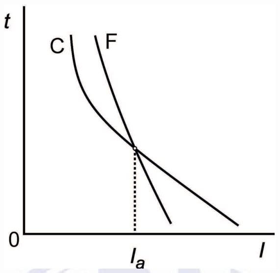
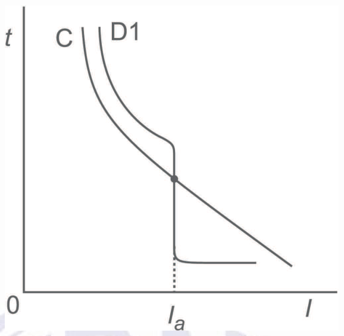
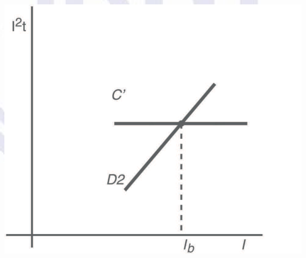
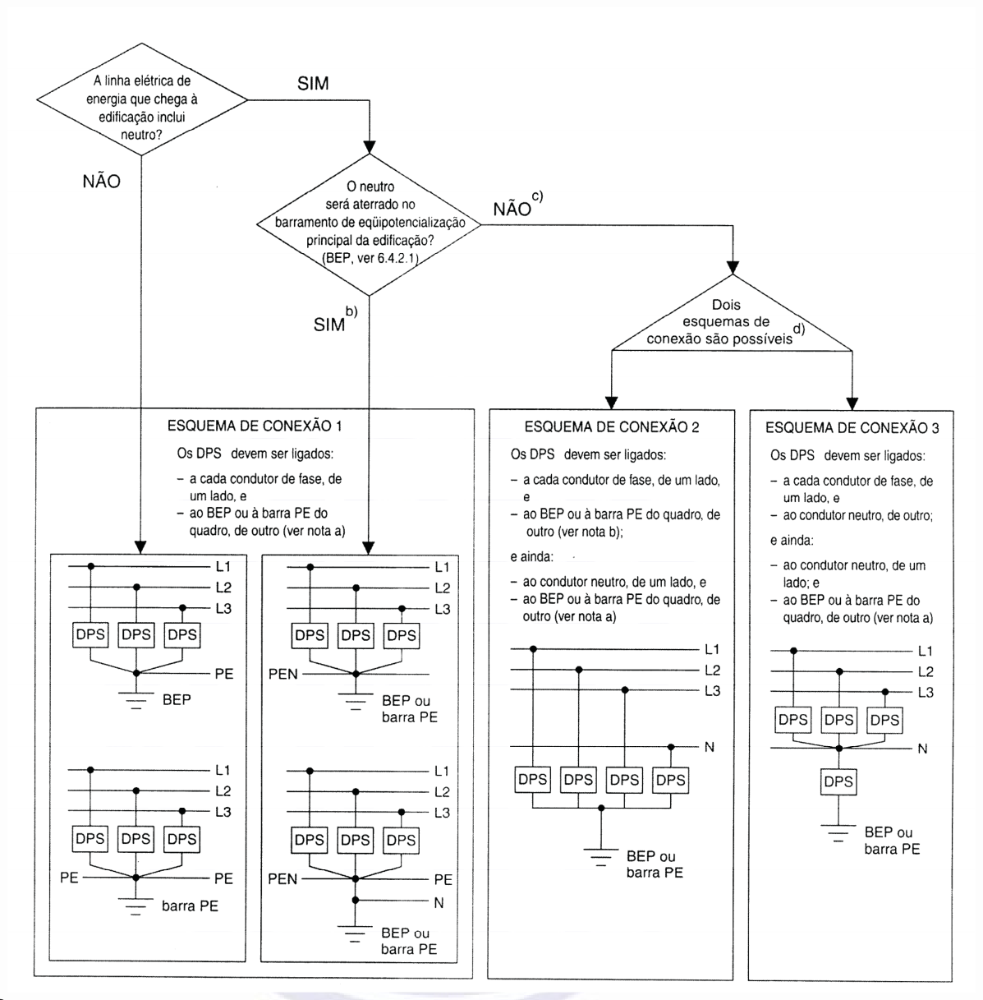
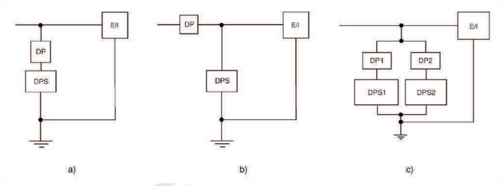

[Arquivo único](../nbr-5410.md)

## 6 Seleção e instalação dos componentes

### 6.1 Prescrições comuns a todos os componentes da instalação

#### 6.1.1 Generalidades

Os componentes devem ser selecionados e instalados de forma a satisfazer as prescrições enunciadas nesta seção, bem como as prescrições aplicáveis das outras seções desta Norma.

#### 6.1.2 Conformidade com as normas

**6.1.2.1** Os componentes da instalação devem satisfazer as normas brasileiras que lhes sejam aplicáveis e, na falta destas, as normas IEC e ISO.

**6.1.2.2** Na inexistência de normas brasileiras, IEC ou ISO, os componentes devem ser selecionados com base em norma regional, norma estrangeira reconhecida ou, na falta destas, mediante acordo especial entre o responsável pela obra na qual a instalação elétrica se insere e o responsável pela instalação elétrica.

#### 6.1.3 Condições de serviço e influências externas

##### 6.1.3.1 Condições de serviço

###### 6.1.3.1.1 Tensão

Os componentes devem ser adequados à tensão nominal (valor eficaz em corrente alternada) da instalação. Se, no esquema IT, o condutor neutro for distribuído, os componentes ligados entre uma fase e o neutro devem ser isolados para a tensão entre fases.

> **NOTA** Para certos componentes pode ser necessário considerar a tensão mais alta ou a mais baixa que possa ocorrer em regime normal.

###### 6.1.3.1.2 Corrente

Os componentes devem ser selecionados considerando-se a corrente de projeto (valor eficaz em corrente alternada) que deve percorrê-los em serviço normal. Deve-se igualmente considerar a corrente suscetível de percorrê-los em condições anormais, levando-se em conta a duração da passagem dessa corrente, em função das características de atuação dos dispositivos de proteção.

###### 6.1.3.1.3 Freqüência

Se a freqüência tiver influência sobre as características dos componentes, a freqüência nominal do componente deve corresponder à freqüência da corrente no circuito pertinente.

###### 6.1.3.1.4 Potência

Os componentes selecionados segundo suas características de potência devem ser adequados às condições normais de serviço, levando-se em conta o regime de funcionamento a que eles devem ser submetidos.

###### 6.1.3.1.5 Compatibilidade

A menos que a instalação dos componentes seja acompanhada de medidas compensatórias adequadas, sua seleção deve ser tal que eles não causem, em serviço normal, incluindo manobras, efeitos prejudiciais aos demais componentes nem comprometam o bom desempenho da alimentação.

##### 6.1.3.2 Influências externas

**6.1.3.2.1** Os componentes da instalação devem ser selecionados e instalados de acordo com as prescrições da tabela 32. Esta tabela indica as características dos componentes em função das influências externas a que estão sujeitos (ver 4.2.6). As características dos componentes são determinadas por um grau de proteção ou por conformidade com ensaios.

**6.1.3.2.2** Quando um componente não possuir características construtivas compatíveis com as influências externas presentes no local, ele pode ser utilizado sob a condição de que lhe seja provida, na execução da instalação, uma proteção complementar apropriada. Esta proteção não deve afetar as condições de funcionamento do componente.

**6.1.3.2.3** Quando diferentes influências externas ocorrerem simultaneamente, seus efeitos podem ser independentes ou mútuos e os graus de proteção devem ser escolhidos de acordo.

**6.1.3.2.4** A escolha das características dos componentes em função das influências externas é necessária não somente para seu funcionamento correto, mas também para garantir a confiabilidade das medidas de proteção especificadas nesta Norma. As medidas de proteção associadas à construção do componente são válidas para dadas condições de influências externas apenas se os ensaios respectivos previstos nas normas do componente forem realizados sob tais condições.

NOTAS

1 Para efeito desta Norma, são consideradas “normais” as seguintes classes de influências externas:

- AA (temperatura ambiente): AA4;

- AB (umidade atmosférica): AB4;

- outras condições ambientais (AC a AS): XX1 de cada parâmetro;

- condições de utilização e de construção das edificações (B e C): XX1 de cada parâmetro, exceto no caso do parâmetro BC, que é BC2.

2 A palavra “normal” que aparece na terceira coluna da tabela 32 significa que um componente que atenda aos requisitos das normas técnicas aplicáveis, dentro das condições de funcionamento por elas definidas como normais, reúne as características necessárias para operar satisfatoriamente sob as influências externas descritas.

**Tabela 32 — Características dos componentes da instalação em função das influências externas**

<table><tr><th>Código</th><th colspan="5">Influências externas</th><th colspan="3">Características exigidas para seleção e instalação dos componentes</th><th>Referências</th></tr><tr><td colspan="10">A – Condições ambientais (4.2.6.1)</td></tr><tr><td colspan="10">AA – Temperatura ambiente (4.2.6.1.1)</td></tr><tr><td rowspan="2"></td><td colspan="5">Faixas de temperatura</td><td rowspan="2" colspan="3"></td><td rowspan="2"></td></tr><tr><td colspan="2">Limite inferior °C</td><td colspan="3">Limite superior oC</td></tr><tr><td>AA1 AA2 AA3 AA4 AA5 AA6 AA7 AA8</td><td colspan="2">– 60<br>– 40<br>– 25<br>– 5 + 5 + 5<br>– 25<br>– 50</td><td colspan="3">+ 5 + 5 + 5 + 40 + 40 + 60 + 55 + 40</td><td colspan="3">Componentes projetados especialmente para a aplicação ou medidas adequadas[^p86-1] Normal (em certos casos podem ser necessárias precauções especiais) Normal Componentes projetados especialmente para a aplicação ou medidas adequadas[^p86-1] Componentes projetados especialmente para a aplicação ou medidas adequadas[^p86-1]</td><td></td></tr><tr><td colspan="10">AB – Condições climáticas do ambiente (4.2.6.1.2)</td></tr><tr><td></td><td>Temperatura do ar °C</td><td colspan="2">Umidade relativa %</td><td colspan="2">Umidade absoluta g/m³</td><td rowspan="2" colspan="3"></td><td rowspan="2"></td></tr><tr><td></td><td>Limiteinferior Limitesuperior</td><td colspan="2">Limiteinferior Limitesuperior</td><td colspan="2">Limiteinferior Limitesuperior</td></tr><tr><td>AB1 AB2 AB3</td><td>– 60 + 5<br>– 40 + 5<br>– 25 + 5</td><td colspan="2">3 100 10 100 10 100</td><td colspan="2">0,003 7 0,1 7 0,5 7</td><td colspan="3">Requer medidas adequadas ²) Requer medidas adequadas ²) Requer medidas adequadas ²)</td><td></td></tr><tr><td colspan="10">AB – Condições climáticas do ambiente (4.2.6.1.2)</td></tr><tr><td>AB4 AB5 AB6 AB7 AB8</td><td>– 5 +40 + 5 +40 + 5 +60<br>– 25 +55<br>– 50 +40</td><td colspan="2">5 95 5 85 10 100 10 100 15 100</td><td colspan="2">1 29 1 25 1 35 0,5 29 0,04 36</td><td colspan="3">Normal Normal Requer medidas adequadas²) Requer medidas adequadas²) Requer medidas adequadas²)</td><td></td></tr><tr><td colspan="10">AC – Altitude (4.2.6.1.3)</td></tr><tr><td>AC1 AC2</td><td colspan="5">≤ 2 000 m > 2 000 m</td><td colspan="3">Normal Podem ser necessárias precauções especiais, como a aplicação de fatores de correção NOTA Para certos componentes podem ser necessárias medidas especiais a partir de 1 000 m)</td><td></td></tr><tr><td colspan="10">AD – Presença de água (4.2.6.1.4)</td></tr><tr><td>AD1 AD2 AD3 AD4 AD5 AD6 AD7 AD8</td><td colspan="5">Desprezível Gotejamento Precipitação Aspersão Jatos Ondas Imersão Submersão</td><td colspan="3">IPX0 IPX1 ou IPX2 IPX3 IPX4 IPX5 IPX6 IPX7 IPX8</td><td></td></tr><tr><td colspan="10">AE – Presença de corpos sólidos (4.2.6.1.5)</td></tr><tr><td>AE1 AE2 AE3 AE4 AE5 AE6</td><td colspan="5">Desprezível Pequenos objetos (2,5 mm) Objetos muito pequenos (1 mm) Poeira leve Poeira moderada Poeira intensa</td><td colspan="3">IP0X IP3X IP4X IP5X caso a penetração de poeira não prejudique o funcionamento do componente IP6X caso a poeira não deva penetrar no componente IP6X</td><td></td></tr><tr><td colspan="10">AF – Presença de substâncias corrosivas ou poluentes (4.2.6.1.6)</td></tr><tr><td>AF1 AF2 AF3 AF4</td><td colspan="4">Desprezível Agentes atmosféricos Intermitente Permanente</td><td colspan="3">Normal Conforme a natureza dos agentes Proteção contra corrosão definida pelas especificações dos componentes Componentes especialmente concebidos, conforme a natureza dos agentes</td><td colspan="2"></td></tr><tr><td colspan="10">AG – Choques mecânicos (4.2.6.1.7)</td></tr><tr><td>AG1 AG2</td><td colspan="4">Fracos Médios</td><td colspan="3">Normal. Por exemplo, componentes para uso doméstico e análogo Componentes para uso industrial, quando aplicável, ou proteção reforçada</td><td colspan="2">IEC 60721-3-3:2002, classes 3M1/3M2/3M3 e IEC 60721-3-4:1987, classes 4M1/4M2/4M3 IEC 60721-3-3:2002, classes 3M4/3M5/3M6 e IEC 60721-3-4:1987, classes 4M4/4M5/4M6</td></tr><tr><td>AG3</td><td colspan="4">Severos</td><td colspan="3">Proteção reforçada</td><td colspan="2">IEC 60721-3-3:2002, classes 3M7/3M8 e IEC 60721-3-4:1987, classes 4M7/4M8</td></tr><tr><td colspan="10">AH – Vibrações (4.2.6.1.7)</td></tr><tr><td>AH1</td><td colspan="4">Fracas</td><td colspan="3">Normal</td><td colspan="2"></td></tr><tr><td>AH2</td><td rowspan="2" colspan="4">Médias Severas</td><td rowspan="2" colspan="3">Componentes projetados especialmente para a aplicação, ou medidas adequadas[^p88-1]</td><td rowspan="2" colspan="2"></td></tr><tr><td>AH3</td></tr><tr><td colspan="10">AK – Presença de flora ou mofo (4.2.6.1.8)</td></tr><tr><td>AK1 AK2</td><td colspan="4">Desprezível Prejudicial</td><td colspan="3">Normal Proteções especiais, tais como:<br>– grau de proteção aumentado (ver AE)<br>– componentes especiais ou revestimentos protegendo os invólucros<br>– medidas para evitar a presença de flora</td><td colspan="2"></td></tr><tr><td colspan="10">AL – Presença de fauna (4.2.6.1.9)</td></tr><tr><td>AL1 AL2</td><td colspan="4">Desprezível Prejudicial</td><td colspan="3">Normal A proteção pode compreender:<br>– grau de proteção adequado contra a penetração de corpos sólidos (ver AE)<br>– resistência mecânica suficiente (ver AG)<br>– precauções para evitar a presença da fauna (como limpeza, uso de pesticidas)<br>– componentes especiais ou revestimentos protegendo os invólucros</td><td colspan="2"></td></tr><tr><td colspan="10">AM – Influências eletromagnéticas, eletrostáticas ou ionizantes (4.2.6.1.10)</td></tr><tr><td colspan="10">AM1 – Harmônicas e inter-harmônicas (4.2.6.1.10)</td></tr><tr><td>AM1-1 AM1-2 AM1-3</td><td colspan="4">Nível controlado Nível normal Nível alto</td><td colspan="3">Devem ser tomadas precauções para que a situação controlada não seja prejudicada Medidas especiais no projeto da instalação, tais como filtros</td><td colspan="2">Inferior à tabela 1 da IEC 61000-2-2:2002 De acordo com a tabela 1 da IEC 61000-2-2:2002 Localmente superior à tabela 1 da IEC 61000-2-2:2002</td></tr><tr><td colspan="10">AM2 – Tensões de sinalização (4.2.6.1.10)</td></tr><tr><td>AM2-1 AM2-2 AM2-3</td><td colspan="4">Nível controlado Nível médio Nível alto</td><td colspan="3">Circuitos de bloqueio, por exemplo Sem requisitos adicionais Requer medidas adequadas</td><td colspan="2">Inferior aos especificados abaixo IEC 61000-2-1 e IEC 61000-2-2</td></tr><tr><td colspan="10">AM3 – Variações de amplitude da tensão (4.2.6.1.10)</td></tr><tr><td>AM3-1 AM3-2</td><td colspan="4">Nível controlado Nível normal</td><td colspan="3">Ver 5.4 e 5.5</td><td colspan="2"></td></tr><tr><td colspan="10">AM4 – Desequilíbrio de tensão (4.2.6.1.10)</td></tr><tr><td>AM4</td><td colspan="4">Nível normal</td><td colspan="3"></td><td colspan="2">De acordo com a IEC 61000-2-2</td></tr><tr><td colspan="10">AM5 – Variações de freqüência (4.2.6.1.10)</td></tr><tr><td>AM5</td><td colspan="4">Nível normal</td><td colspan="3"></td><td colspan="2">± 1 Hz de acordo com a IEC 61000-2-2</td></tr><tr><td colspan="10">AM6 – Tensões induzidas de baixa freqüência (4.2.6.1.10)</td></tr><tr><td>AM6</td><td colspan="4">Sem classificação</td><td colspan="2">Ver 5.4.3 Alta suportabilidade dos sistemas de sinalização e comando de dispositivos de manobra</td><td colspan="3">ITU-T</td></tr><tr><td colspan="10">AM7 – Componentes contínuas em redes c.a. (4.2.6.1.10)</td></tr><tr><td>AM7</td><td colspan="4">Sem classificação</td><td colspan="2">Medidas para limitar seu nível e duração nos equipamentos de utilização ou em suas proximidades</td><td colspan="3"></td></tr><tr><td colspan="10">AM8 – Campos magnéticos radiados (4.2.6.1.10)</td></tr><tr><td>AM8-1 AM8-2</td><td colspan="4">Nível médio Nível alto</td><td colspan="2">Normal Proteção por medidas adequadas, tais como blindagem e/ou separação</td><td colspan="3">Nível 2 da IEC 61000-4-8:2001 Nível 4 da IEC 61000-4-8:2001</td></tr><tr><td colspan="10">AM9 – Campos elétricos (4.2.6.1.10)</td></tr><tr><td>AM9-1 AM9-2 AM9-3 AM9-4</td><td colspan="4">Nível desprezível Nível médio Nível alto Nível muito alto</td><td colspan="2">Normal Ver IEC 61000-2-5 Ver IEC 61000-2-5 Ver IEC 61000-2-5</td><td colspan="3">IEC 61000-2-5</td></tr><tr><td colspan="10">AM21 – Tensões ou correntes induzidas oscilantes (4.2.6.1.10)</td></tr><tr><td>AM21</td><td colspan="4">Sem classificação</td><td colspan="2">Normal</td><td colspan="3">IEC 61000-4-6</td></tr><tr><td colspan="10">AM22 – Transitórios unidirecionais conduzidos, na faixa do nanossegundo (4.2.6.1.10)</td></tr><tr><td>AM22-1 AM22-2 AM22-3 AM22-4</td><td colspan="4">Nível desprezível Nível médio Nível alto Nível muito alto</td><td colspan="2">Requer medidas de proteção (ver 4.2.6.1.10) Requer medidas de proteção (ver 4.2.6.1.10) Equipamento normal Equipamento de alta imunidade</td><td colspan="3">Nível 1 da IEC 61000-4-4:2004 Nível 2 da IEC 61000-4-4:2004 Nível 3 da IEC 61000-4-4:2004 Nível 4 da IEC 61000-4-4:2004</td></tr><tr><td colspan="10">AM23 – Transitórios unidirecionais conduzidos, na faixa do micro ao milissegundo (4.2.6.1.10)</td></tr><tr><td>AM23-1 AM23-2 AM23-3</td><td colspan="4">Nível controlado Nível médio Nível alto</td><td colspan="2">Suportabilidade a impulsos dos componentes e proteção contra sobretensões, levando-se em conta a tensão nominal da instalação e a categoria de suportabilidade, de acordo com 5.4.2</td><td colspan="3">4.2.6.1.12, 5,4.2 e 6.3.5</td></tr><tr><td colspan="10">AM24 – Transitórios oscilantes conduzidos (4.2.6.1.10)</td></tr><tr><td>AM24-1 AM24-2</td><td colspan="4">Nível médio Nível alto</td><td colspan="2">Ver IEC 61000-4-12 Ver IEC 60255-22-1</td><td colspan="3">IEC 61000-4-12 IEC 60255-22-1</td></tr><tr><td colspan="10">AM25 – Fenômenos radiados de alta freqüência (4.2.6.1.10)</td></tr><tr><td>AM25-1 AM25-2 AM25-3</td><td colspan="4">Nível desprezível Nível médio Nível alto</td><td colspan="2">Normal Nível reforçado</td><td colspan="3">Nível 1 da IEC 61000-4-3:2002 Nível 2 da IEC 61000-4-3:2002 Nível 3 da IEC 61000-4-3:2002</td></tr><tr><td colspan="10">AM31 – Descargas eletrostáticas (4.2.6.1.10)</td></tr><tr><td>AM31-1 AM31-2 AM31-3 AM31-4</td><td colspan="4">Nível baixo Nível médio Nível alto Nível muito alto</td><td colspan="2">Normal Normal Normal Reforçada</td><td colspan="3">Nível 1 da IEC 61000-4-2:2001 Nível 2 da IEC 61000-4-2:2001 Nível 3 da IEC 61000-4-2:2001 Nível 4 da IEC 61000-4-2:2001</td></tr><tr><td colspan="10">AM41 – Radiações ionizantes (4.2.6.1.10)</td></tr><tr><td>AM41-1</td><td colspan="4">Sem classificação</td><td colspan="2">Proteções especiais, tais como distanciamento da fonte, interposição de blindagens, invólucro de materiais especiais</td><td colspan="3"></td></tr><tr><td colspan="10">AN – Radiação solar (4.2.6.1.11)</td></tr><tr><td>AN1 AN2 AN3</td><td colspan="4">Desprezível Média Alta</td><td colspan="2">Normal Requer medidas adequadas ²<sup>)</sup> Requer medidas adequadas ²<sup>)</sup>, tais como:<br>– componentes resistentes à radiação ultravioleta<br>– revestimento de cores especiais<br>– interposição de anteparos</td><td colspan="3">IEC 60721-3-3 IEC 60721-3-3 IEC 60721-3-4</td></tr><tr><td colspan="10">AQ – Descargas atmosféricas (4.2.6.1.12)</td></tr><tr><td>AQ1 AQ2 AQ3</td><td colspan="4">Desprezíveis Indiretas Diretas</td><td colspan="2">Normal Ver 5.4.2 e 6.3.5 Ver 5.4.2 e 6.3.5 Quando aplicável, a proteção contra descargas atmosféricas deve ser conforme ABNT NBR 5419</td><td colspan="3"></td></tr><tr><td colspan="10">AR – Movimentação do ar (4.2.6.1.13)</td></tr><tr><td>AR1 AR2 AR3</td><td colspan="4">Desprezível Média Forte</td><td colspan="2">Normal Requer medidas adequadas ²) Requer medidas adequadas ²)</td><td colspan="3"></td></tr><tr><td colspan="10">AS – Vento (4.2.6.1.14)</td></tr><tr><td>AS1 AS2 AS3</td><td colspan="4">Desprezível Médio Forte</td><td colspan="2">Normal Requer medidas adequadas ²) Requer medidas adequadas ²)</td><td colspan="3"></td></tr><tr><td colspan="10">B – Utilização (4.2.6.2)</td></tr><tr><td colspan="10">BA – Competência de pessoas (4.2.6.2.1)</td></tr><tr><td>BA1 BA2 BA3 BA4 BA5</td><td colspan="4">Comuns Crianças Incapacitadas Advertidas Qualificadas</td><td colspan="2">Normal Componente com grau de proteção superior a IP2X Componentes com temperaturas de superfície externa superiores a 80<sup>o</sup>C (60<sup>o</sup>C para creches e locais análogos) devem ser inacessíveis Conforme a natureza da deficiência Componentes não protegidos contra contatos diretos admitidos apenas em locais de acesso restrito a pessoas devidamente autorizadas</td><td colspan="3"></td></tr><tr><td colspan="10">BB – Resistência elétrica do corpo humano (4.2.6.2.2)</td></tr><tr><td>BB1 BB2 BB3 BB4</td><td colspan="4">Alta Normal Baixa Muito baixa</td><td colspan="2">Normal Normal Medidas de proteção adequadas (ver 5.1 e seção 9 e anexo C) Medidas de proteção adequadas (ver 5.1 e seção 9 e anexo C)</td><td colspan="3"></td></tr><tr><td colspan="10">BC – Contatos das pessoas com o potencial da terra (4.2.6.2.3)</td></tr><tr><td>BC1 BC2 BC3 BC4</td><td colspan="4">Nulo Raros Freqüente Contínuo</td><td colspan="2">Condição excepcional, não considerada, na prática, para seleção dos componentes. Componentes classes I, II e III Componentes classes I, II e III Medidas especiais</td><td colspan="3">IEC 61140:2001</td></tr><tr><td colspan="10">BD – Fuga das pessoas em emergências (4.2.6.2.4)</td></tr><tr><td>BD1 BD2 BD3 BD4</td><td colspan="4">Normal Longa Tumultuada Longa e tumultuada</td><td colspan="2">Normal Ver 5.2.2.2</td><td colspan="3"></td></tr><tr><td colspan="10">BE – Natureza dos materiais processados ou armazenados (4.2.6.2.5)</td></tr><tr><td>BE1 BE2 BE3 BE4</td><td colspan="4">Riscos desprezíveis Riscos de incêndio Riscos de explosão Riscos de contaminação</td><td colspan="2">Normal Componentes constituídos de materiais não-propagantes de chama. Precauções para que uma elevação significativa da temperatura ou uma centelha no componente não possa provocar incêndio externamente Componentes adequados para atmosferas explosivas Medidas adequadas, tais como:<br>– proteção contra fragmentos de lâmpadas e de outros objetos frágeis<br>– anteparos contra radiações prejudiciais, como infravermelhas e ultravioletas</td><td colspan="3">5.2.2.3</td></tr><tr><td colspan="10">C – Construção das edificações (4.2.6.3)</td></tr><tr><td colspan="10">CA – Materiais de construção (4.2.6.3.1)</td></tr><tr><td>CA1 CA2</td><td colspan="4">Não-combustíveis Combustíveis</td><td colspan="2">Normal Ver 5.2.2.4</td><td colspan="3"></td></tr><tr><td colspan="10">CB – Estrutura das edificações (4.2.6.3.2)</td></tr><tr><td>CB1</td><td colspan="4">Riscos desprezíveis</td><td colspan="2">Normal</td><td colspan="3"></td></tr><tr><td>CB2</td><td colspan="4">Sujeitas a propagação de incêndio</td><td colspan="3">5.2.2.5</td></tr><tr><td colspan="10">CB – Estrutura das edificações (4.2.6.3.2)</td></tr><tr><td>CB3 CB4</td><td colspan="4">Sujeitas a movimentação Flexíveis ou instáveis</td><td colspan="2">Juntas de contração ou de expansão nas linhas elétricas (em estudo)</td><td colspan="3"></td></tr><tr><td colspan="10"><sup>1)</sup> Podem ser necessárias precauções suplementares (por exemplo, lubrificação especial). <sup>2)</sup> Medidas especiais devem ser acordadas entre o projetista da instalação e o fabricante do componente, por exemplo, componentes especialmente concebidos para a aplicação.</td></tr></table>

[rodape]
PENDENTE: definição da nota [^p86-1] não localizada no PDF.
[/rodape]

[rodape]
PENDENTE: definição da nota [^p88-1] não localizada no PDF.
[/rodape]

> **NOTA** Componentes constituídos de materiais não-propagantes de chama, inclusive de origem não elétrica. Barreiras corta-fogo NOTA Podem ser previstos detectores de incêndio.

#### 6.1.4 Acessibilidade

Os componentes, inclusive as linhas elétricas, devem ser dispostos de modo a facilitar sua operação, inspeção, manutenção e o acesso a suas conexões. O acesso não deve ser significativamente reduzido pela montagem dos componentes em invólucros ou compartimentos.

#### 6.1.5 Identificação dos componentes

##### 6.1.5.1 Generalidades

Placas, etiquetas e outros meios adequados de identificação devem permitir identificar a finalidade dos dispositivos de comando, manobra e/ou proteção, a menos que não exista nenhuma possibilidade de confusão. Se a atuação de um dispositivo de comando, manobra e/ou proteção não puder ser observada pelo operador e disso puder resultar perigo, deve ser provida alguma sinalização à vista do operador.

##### 6.1.5.2 Linhas elétricas

As linhas elétricas devem ser dispostas ou marcadas de modo a permitir sua identificação quando da realização de verificações, ensaios, reparos ou modificações na instalação.

##### 6.1.5.3 Condutores

**6.1.5.3.1** Qualquer condutor isolado, cabo unipolar ou veia de cabo multipolar utilizado como condutor neutro deve ser identificado conforme essa função. Em caso de identificação por cor, deve ser usada a cor azul-clara na isolação do condutor isolado ou da veia do cabo multipolar, ou na cobertura do cabo unipolar.

> **NOTA** A veia com isolação azul-clara de um cabo multipolar pode ser usada para outras funções, que não a de condutor neutro, se o circuito não possuir condutor neutro ou se o cabo possuir um condutor periférico utilizado como neutro.

**6.1.5.3.2** Qualquer condutor isolado, cabo unipolar ou veia de cabo multipolar utilizado como condutor de proteção (PE) deve ser identificado de acordo com essa função. Em caso de identificação por cor, deve ser usada a dupla coloração verde-amarela ou a cor verde (cores exclusivas da função de proteção), na isolação do condutor isolado ou da veia do cabo multipolar, ou na cobertura do cabo unipolar.

**6.1.5.3.3** Qualquer condutor isolado, cabo unipolar ou veia de cabo multipolar utilizado como condutor PEN deve ser identificado de acordo com essa função. Em caso de identificação por cor, deve ser usada a cor azul-claro, com anilhas verde-amarelo nos pontos visíveis ou acessíveis, na isolação do condutor isolado ou da veia do cabo multipolar, ou na cobertura do cabo unipolar.

**6.1.5.3.4** Qualquer condutor isolado, cabo unipolar ou veia de cabo multipolar utilizado como condutor de fase deve ser identificado de acordo com essa função. Em caso de identificação por cor, poder ser usada qualquer cor, observadas as restrições estabelecidas em 6.1.5.3.1, 6.1.5.3.2 e 6.1.5.3.3.

> **NOTA** Por razões de segurança, não deve ser usada a cor de isolação exclusivamente amarela onde existir o risco de confusão com a dupla coloração verde-amarela, cores exclusivas do condutor de proteção.

##### 6.1.5.4 Dispositivos de proteção

Os dispositivos de proteção devem ser dispostos e identificados de forma que seja fácil reconhecer os respectivos circuitos protegidos.

#### 6.1.6 Independência dos componentes

**6.1.6.1** Os componentes devem ser escolhidos e dispostos de modo a impedir qualquer influência prejudicial entre as instalações elétricas e as instalações não-elétricas, bem como entre as instalações elétricas de energia e de sinal da edificação.

**6.1.6.2** Quando os componentes a serem agrupados, num quadro de distribuição, painel, mesa de comando ou conjunto similar, compuserem partes sob diferentes tensões ou percorridas por correntes de natureza distinta, deve ser observada, entre os componentes desses diferentes subsistemas, uma separação capaz de evitar qualquer influência mútua prejudicial..

#### 6.1.7 Compatibilidade eletromagnética

**6.1.7.1** Os níveis de imunidade dos componentes da instalação devem ser especificados levando-se em conta as influências eletromagnéticas (ver 4.2.6.1.10) que podem ocorrer quando em funcionamento normal. Deve-se considerar também o nível de continuidade de serviço previsto ou desejado, tendo em vista o uso da instalação.

**6.1.7.2** Devem ser selecionados componentes com níveis de emissão suficientemente baixos, de modo que eles não venham a gerar interferências eletromagnéticas, por condução ou por propagação no ar, com outros componentes situados interna ou externamente à edificação. Se necessário, devem ser providos meios de atenuação, a fim de reduzir a emissão.

> **NOTA** As IEC/CISPR 11, IEC/CISPR 12, IEC/CISPR 13, IEC/CISPR 14, IEC/CISPR 15, IEC/CISPR 22 e a série IEC 61000 trazem prescrições relativas à compatibilidade eletromagnética que são, muitas delas, aplicáveis a componentes de instalações elétricas.

#### 6.1.8 Documentação da instalação

**6.1.8.1** A instalação deve ser executada a partir de projeto específico, que deve conter, no mínimo:

- a) plantas;

- b) esquemas unifilares e outros, quando aplicáveis;

- c) detalhes de montagem, quando necessários;

- d) memorial descritivo da instalação;

- e) especificação dos componentes (descrição, características nominais e normas que devem atender);

- f) parâmetros de projeto (correntes de curto-circuito, queda de tensão, fatores de demanda considerados, temperatura ambiente etc.).

**6.1.8.2**

Após concluída a instalação, a documentação indicada em 6.1.8.1 deve ser revisada e

atualizada de forma a corresponder fielmente ao que foi executado (documentação "como construído", ou “*as built*”).

> **NOTA** Esta atualização pode ser realizada pelo projetista, pelo executor ou por outro profissional, conforme acordado previamente entre as partes.

**6.1.8.3** As instalações para as quais não se prevê equipe permanente de operação, supervisão e/ou manutenção, composta por pessoal advertido ou qualificado (BA4 ou BA5, tabela 18), devem ser entregues acompanhadas de um manual do usuário, redigido em linguagem acessível a leigos, que contenha, no mínimo, os seguintes elementos:

- a) esquema(s) do(s) quadro(s) de distribuição com indicação dos circuitos e respectivas finalidades, incluindo relação dos pontos alimentados, no caso de circuitos terminais;

- b) potências máximas que podem ser ligadas em cada circuito terminal efetivamente disponível;

- c) potências máximas previstas nos circuitos terminais deixados como reserva, quando for o caso;

- d) recomendação explícita para que não sejam trocados, por tipos com características diferentes, os dispositivos de proteção existentes no(s) quadro(s).

> **NOTA** São exemplos de tais instalações as de unidades residenciais, de pequenos estabelecimentos comerciais, etc.

### 6.2 Seleção e instalação das linhas elétricas

#### 6.2.1 Generalidades

**6.2.1.1** A seleção e a instalação de linhas elétricas devem levar em conta os princípios fundamentais, enunciados em 4.1, que sejam aplicáveis aos condutores, suas terminações e emendas, aos suportes e suspensões a eles associados e aos seus invólucros ou métodos de proteção contra influências externas.

**6.2.1.2** As prescrições apresentadas a seguir são aplicáveis, em particular, aos condutores vivos (fases e neutro, no caso de circuitos em corrente alternada). Sobre condutores de proteção, ver 6.4.3.

#### 6.2.2 Tipos de linhas elétricas

**6.2.2.1** Os tipos de linhas elétricas estão indicados na tabela 33.

**6.2.2.2** Outros tipos de linhas elétricas, além dos constantes na tabela 33, podem ser utilizados, desde que atendam às prescrições gerais desta seção.

**6.2.2.3** As linhas pré-fabricadas (barramentos blindados) devem atender à IEC 60439-2, ser instaladas de acordo com as instruções do fabricante e atender às prescrições de 6.2.4, 6.2.7, 6.2.8 e 6.2.9.

#### 6.2.3 Condutores

> **NOTA** Como as prescrições desta Norma relativas à seleção e instalação das linhas elétricas estão voltadas especialmente para as linhas de energia, os condutores envolvidos são, portanto, condutores ou cabos de potência. Assim, para uma orientação específica sobre cabos de controle, de instrumentação ou para outras linhas elétricas de sinal, recomenda-se a consulta às normas aplicáveis a esses produtos e aos seus fabricantes. A mesma observação é válida para os cabos de potência de uso específico, como os de ligação de equipamentos, incluindo os de alta temperatura.

**6.2.3.1** Todos os condutores devem ser providos, no mínimo, de isolação, a não ser quando o uso de condutores nus ou providos apenas de cobertura for expressamente permitido.

**6.2.3.2** Os cabos uni e multipolares devem atender às seguintes normas:

- a) os cabos com isolação de EPR, à ABNT NBR 7286;

- b) os cabos com isolação de XLPE, à ABNT NBR 7287;

- c) os cabos com isolação de PVC, à ABNT NBR 7288 ou à ABNT NBR 8661.

> **NOTA** Os cabos em conformidade com a ABNT NBR 13249 não são admitidos nas maneiras de instalar previstas na tabela 33, tendo em vista que tais cabos destinam-se tão somente à ligação de equipamentos.

**6.2.3.3** Para os efeitos desta Norma, os condutores com isolação de XLPE que atendam à ABNT NBR 7285, compreendendo condutores isolados e cabos multiplexados, são considerados cabos unipolares e cabos multipolares, respectivamente.

> **NOTA** Embora desprovidos de cobertura, tais condutores apresentam uma isolação espessa o suficiente para garantir resultado equivalente ao de uma dupla camada, isolação mais cobertura.

**6.2.3.4** Os condutores isolados com isolação de PVC de acordo com a ABNT NBR NM 247-3 devem ser não-propagantes de chama.

**6.2.3.5** Os cabos não-propagantes de chama, livres de halogênio e com baixa emissão de fumaça e gases tóxicos devem atender à ABNT NBR 13248.

> **NOTA** Os cabos não-propagantes de chama, livres de halogênio e com baixa emissão de fumaça e gases tóxicos podem ser condutores isolados, cabos unipolares e cabos multipolares.

**6.2.3.6** Os condutores de cobre sem isolação (fios e cabos nus ou com cobertura protetora) devem atender à ABNT NBR 6524.

**6.2.3.7** Os condutores utilizados nas linhas elétricas devem ser de cobre ou alumínio, sendo que, no caso do emprego de condutores de alumínio, devem ser atendidas as prescrições de 6.2.3.8.

**6.2.3.8** O uso de condutores de alumínio só é admitido nas condições estabelecidas em 6.2.3.8.1 e 6.2.3.8.2.

> **NOTA** As restrições impostas ao uso de condutores de alumínio refletem o estado atual da técnica de conexões no Brasil. Soluções técnicas de conexões que atendam às ABNT NBR 9313, ABNT NBR 9326 e ABNT NBR 9513, e que alterem aquelas restrições, devem ser consideradas em norma complementar e futuramente incorporadas a esta Norma.

**6.2.3.8.1** Em instalações de estabelecimentos industriais podem ser utilizados condutores de alumínio, desde que, simultaneamente:

2

- a) a seção nominal dos condutores seja igual ou superior a 16 mm ,

- b) a instalação seja alimentada diretamente por subestação de transformação ou transformador, a partir de uma rede de alta tensão, ou possua fonte própria, e

- c) a instalação e a manutenção sejam realizadas por pessoas qualificadas (BA5, tabela 18).

**6.2.3.8.2** Em instalações de estabelecimentos comerciais podem ser utilizados condutores de alumínio, desde que, simultaneamente:

2

- a) a seção nominal dos condutores seja igual ou superior a 50 mm ,

- b) os locais sejam exclusivamente BD1 (ver tabela 21) e

- c) a instalação e a manutenção sejam realizadas por pessoas qualificadas (BA5, tabela 18).

**6.2.3.8.3** Em locais BD4 (ver tabela 21) não é permitido, em nenhuma circunstância, o emprego de condutores de alumínio.

**Tabela 33 — Tipos de linhas elétricas**

| Método de instalação número | Esquema ilustrativo | Descrição | Método de referência[^p98-1] |
| --- | --- | --- | --- |
| 1 |  | Condutores isolados ou cabos unipolares em eletroduto de seção circular embutido em parede termicamente isolante[^p98-2] | A1 |
| 2 |  | Cabo multipolar em eletroduto de seção circular embutido em parede termicamente isolante[^p98-2] | A2 |
| 3 |  | Condutores isolados ou cabos unipolares em eletroduto aparente de seção circular sobre parede ou espaçado desta menos de 0,3 vez o diâmetro do eletroduto | B1 |
| 4 |  | Cabo multipolar em eletroduto aparente de seção circular sobre parede ou espaçado desta menos de 0,3 vez o diâmetro do eletroduto | B2 |
| 5 |  | Condutores isolados ou cabos unipolares em eletroduto aparente de seção não-circular sobre parede | B1 |
| 6 |  | Cabo multipolar em eletroduto aparente de seção não-circular sobre parede | B2 |
| 7 |  | Condutores isolados ou cabos unipolares em eletroduto de seção circular embutido em alvenaria | B1 |
| 8 |  | Cabo multipolar em eletroduto de seção circular embutido em alvenaria | B2 |
| 11 |  | Cabos unipolares ou cabo multipolar sobre parede ou espaçado desta menos de 0,3 vez o diâmetro do cabo | C |
| 11A |  | Cabos unipolares ou cabo multipolar fixado diretamente no teto | C |
| Método de instalação número | Esquema ilustrativo | Descrição | Método de referência[^p99-1] |
| 11B |  | Cabos unipolares ou cabo multipolar afastado do teto mais de 0,3 vez o diâmetro do cabo | C |
| 12 |  | Cabos unipolares ou cabo multipolar em bandeja não-perfurada, perfilado ou prateleira[^p99-3] | C |
| 13 |  | Cabos unipolares ou cabo multipolar em bandeja perfurada, horizontal ou vertical <sup>4)</sup> | E (multipolar) F (unipolares) |
| 14 |  | Cabos unipolares ou cabo multipolar sobre suportes horizontais, eletrocalha aramada ou tela | E (multipolar) F (unipolares) |
| 15 |  | Cabos unipolares ou cabo multipolar afastado(s) da parede mais de 0,3 vez o diâmetro do cabo | E (multipolar) F (unipolares) |
| 16 |  | Cabos unipolares ou cabo multipolar em leito | E (multipolar) F (unipolares) |
| 17 |  | Cabos unipolares ou cabo multipolar suspenso(s) por cabo de suporte, incorporado ou não | E (multipolar) F (unipolares) |
| 18 |  | Condutores nus ou isolados sobre isoladores | G |
| 21 |  | Cabos unipolares ou cabos multipolares em espaço de construção[^p99-5], sejam eles lançados diretamente sobre a superfície do espaço de construção, sejam instalados em suportes ou condutos abertos (bandeja, prateleira, tela ou leito) dispostos no espaço de construção <sup>5) 6)</sup> | 1,5 D<sub>e</sub> ≤ V < 5 D<sub>e</sub> B2 5 D<sub>e</sub> ≤ V < 50 D<sub>e</sub> B1 |
| Método de instalação número | Esquema ilustrativo | Descrição | Método de referência[^p100-1] |
| 22 |  | Condutores isolados em eletroduto de seção circular em espaço de construção <sup>5) 7)</sup> | 1,5 D<sub>e</sub> ≤ V < 20 D<sub>e</sub> B2 V ≥ 20 D<sub>e</sub> B1 |
| 23 |  | Cabos unipolares ou cabo multipolar em eletroduto de seção circular em espaço de construção <sup>5) 7)</sup> | B2 |
| 24 |  | Condutores isolados em eletroduto de seção não-circular ou eletrocalha em espaço de construção[^p100-5] | 1,5 D<sub>e</sub> ≤ V < 20 D<sub>e</sub> B2 V ≥ 20 D<sub>e</sub> B1 |
| 25 |  | Cabos unipolares ou cabo multipolar em eletroduto de seção não-circular ou eletrocalha em espaço de construção <sup>5)</sup> | B2 |
| 26 |  | Condutores isolados em eletroduto de seção não-circular embutido em alvenaria[^p100-6] | 1,5 ≤ V < 5 D<sub>e</sub> B2 5 D<sub>e</sub> ≤ V < 50 D<sub>e</sub> B1 |
| 27 |  | Cabos unipolares ou cabo multipolar em eletroduto de seção não-circular embutido em alvenaria | B2 |
| 31 32 | 31 32 | Condutores isolados ou cabos unipolares em eletrocalha sobre parede em percurso horizontal ou vertical | B1 |
| 31ª 32ª | 31A 31B | Cabo multipolar em eletrocalha sobre parede em percurso horizontal ou vertical | B2 |
| Método de instalação número | Esquema ilustrativo | Descrição | Método de referência[^p101-1] |
| 33 |  | Condutores isolados ou cabos unipolares em canaleta fechada embutida no piso | B1 |
| 34 |  | Cabo multipolar em canaleta fechada embutida no piso | B2 |
| 35 |  | Condutores isolados ou cabos unipolares em eletrocalha ou perfilado suspensa(o) | B1 |
| 36 |  | Cabo multipolar em eletrocalha ou perfilado suspensa(o) | B2 |
| 41 |  | Condutores isolados ou cabos unipolares em eletroduto de seção circular contido em canaleta fechada com percurso horizontal ou vertical <sup>7)</sup> | 1,5 D<sub>e</sub> ≤ V < 20 D<sub>e</sub> B2 V ≥ 20 D<sub>e</sub> B1 |
| 42 |  | Condutores isolados em eletroduto de seção circular contido em canaleta ventilada embutida no piso | B1 |
| 43 |  | Cabos unipolares ou cabo multipolar em canaleta ventilada embutida no piso | B1 |
| 51 |  | Cabo multipolar embutido diretamente em parede termicamente isolante <sup>2)</sup> | A1 |
| Método de instalação número | Esquema ilustrativo | Descrição | Método de referência[^p102-1] |
| 52 |  | Cabos unipolares ou cabo multipolar embutido(s) diretamente em alvenaria sem proteção mecânica adicional | C |
| 53 |  | Cabos unipolares ou cabo multipolar embutido(s) diretamente em alvenaria com proteção mecânica adicional | C |
| 61 |  | Cabo multipolar em eletroduto(de seção circular ou não) ou em canaleta não-ventilada enterrado(a) | D |
| 61A |  | Cabos unipolares em eletroduto( de seção não-circular ou não) ou em canaleta não-ventilada enterrado(a)<sup>8)</sup> | D |
| 63 |  | Cabos unipolares ou cabo multipolar diretamente enterrado(s), com proteção mecânica adicional[^p102-9] | D |
| 71 |  | Condutores isolados ou cabos unipolares em moldura | A1 |
| 72 72A | 72 72A | 72 - Condutores isolados ou cabos unipolares em canaleta provida de separações sobre parede 72A - Cabo multipolar em canaleta provida de separações sobre parede | B1 B2 |
| 73 |  | Condutores isolados em eletroduto, cabos unipolares ou cabo multipolar embutido(s) em caixilho de porta | A1 |
| Método de instalação número | Esquema ilustrativo | Descrição | Método de referência[^p103-1] |
| 74 |  | Condutores isolados em eletroduto, cabos unipolares ou cabo multipolar embutido(s) em caixilho de janela | A1 |
| 75 75A | 75 75A | 75 - Condutores isolados ou cabos unipolares em canaleta embutida em parede 75A - Cabo multipolar em canaleta embutida em parede | B1 B2 |
| **<sup>1)</sup>Método de referência a ser utilizado na determinação da capacidade de condução de corrente. Ver 6.2.5.1.2. <sup>2)</sup>Assume-se que a face interna da parede apresenta uma condutância térmica não inferior a 10 W/m².K. <sup>3)</sup>Admitem-se também condutores isolados em perfilado, desde que nas condições definidas na nota de 6.2.11.4.1. <sup>4)</sup>A capacidade de condução de corrente para bandeja perfurada foi determinada considerando-se que os furos ocupassem no mínimo 30% da área da bandeja. Se os furos ocuparem menos de 30% da área da bandeja, ela deve ser considerada como “não-perfurada”. <sup>5)</sup>Conforme a ABNT NBR IEC 60050 (826), os poços, as galerias, os pisos técnicos, os condutos formados por blocos alveolados, os forros falsos, os pisos elevados e os espaços internos existentes em certos tipos de divisórias (como, por exemplo, as paredes de gesso acartonado) são considerados espaços de construção. <sup>6)</sup>De é o diâmetro externo do cabo, no caso de cabo multipolar. No caso de cabos unipolares ou condutores isolados, distinguem-se duas situações:<br>– três cabos unipolares (ou condutores isolados) dispostos em trifólio: De deve ser tomado igual a 2,2 vezes o diâmetro do cabo unipolar ou condutor isolado;<br>– três cabos unipolares (ou condutores isolados) agrupados num mesmo plano: De deve ser tomado igual a 3 vezes o diâmetro do cabo unipolar ou condutor isolado. <sup>7)</sup>De é o diâmetro externo do eletroduto, quando de seção circular, ou altura/profundidade do eletroduto de seção não-circular ou da eletrocalha. <sup>8)</sup>Admite-se também o uso de condutores isolados, desde que nas condições definidas na nota de 6.2.11.6.1. <sup>9)</sup>Admitem-se cabos diretamente enterrados sem proteção mecânica adicional, desde que esses cabos sejam providos de armação (ver 6.2.11.6). Deve-se notar, porém, que esta Norma não fornece valores de capacidade de condução de corrente para cabos armados. Tais capacidades devem ser determinadas como indicado na ABNT NBR 11301. NOTA Em linhas ou trechos verticais, quando a ventilação for restrita, deve-se atentar para risco de aumento considerável da temperatura ambiente no topo do trecho vertical.** |  |  |  |

[rodape]
PENDENTE: definição da nota [^p98-1] não localizada no PDF.
[/rodape]

[rodape]
PENDENTE: definição da nota [^p98-2] não localizada no PDF.
[/rodape]

[rodape]
PENDENTE: definição da nota [^p99-1] não localizada no PDF.
[/rodape]

[rodape]
PENDENTE: definição da nota [^p99-3] não localizada no PDF.
[/rodape]

[rodape]
PENDENTE: definição da nota [^p99-5] não localizada no PDF.
[/rodape]

[rodape]
PENDENTE: definição da nota [^p100-1] não localizada no PDF.
[/rodape]

[rodape]
PENDENTE: definição da nota [^p100-5] não localizada no PDF.
[/rodape]

[rodape]
PENDENTE: definição da nota [^p100-6] não localizada no PDF.
[/rodape]

[rodape]
PENDENTE: definição da nota [^p101-1] não localizada no PDF.
[/rodape]

[rodape]
PENDENTE: definição da nota [^p102-1] não localizada no PDF.
[/rodape]

[rodape]
PENDENTE: definição da nota [^p102-9] não localizada no PDF.
[/rodape]

[rodape]
PENDENTE: definição da nota [^p103-1] não localizada no PDF.
[/rodape]

#### 6.2.4 Seleção e instalação em função das influências externas

> **NOTA** As prescrições relativas à seleção e instalação das linhas, sob o ponto de vista das influências externas indicadas em 4.2.6, são apresentadas na tabela 34.

**Tabela 34 — Seleção e instalação de linhas elétricas em função das influências externas**

| Código | Classificação | Seleção e instalação das linhas |
| --- | --- | --- |
| **A – Condições ambientais (4.2.6.1)** |  |  |
| **AA – Temperatura ambiente (4.2.6.1.1)** |  |  |
| AA1 AA2 AA3 AA4 AA5 AA6 AA7 AA8 | – 60°C + 5°C<br>– 40°C + 5°C<br>– 25°C + 5°C + 40°C<br>– 5°C + 5°C + 40°C + 5°C + 60°C<br>– 25°C + 55°C<br>– 50°C + 40°C | Sob temperaturas inferiores a – 10°C, os condutores ou cabos com isolação e/ou cobertura de PVC, bem como os condutos de PVC não devem ser manipulados nem submetidos a esforços mecânicos, visto que o PVC pode tornar-se quebradiço Quando a temperatura ambiente (ou do solo) for superior aos valores de referência (20°C para linhas subterrâneas e 30°C para as demais), as capacidades de condução de corrente dos condutores e cabos isolados devem ser reduzidas de acordo com 6.2.5.3.3 |
| **AC – Altitude (4.2.6.1.3) (sem influência)** |  |  |
| **AD – Presença de água (4.2.6.1.4)** |  |  |
| AD1 AD2 AD3 AD4 AD5 AD6 AD7 AD8 | Desprezível Gotejamento Precipitação Aspersão Jatos Ondas Imersão Submersão | O uso de molduras em madeira só é permitido em AD1 Nas condições AD3 a AD6 só devem ser usadas linhas com proteção adicional à penetração de água, com os graus IP adequados, em princípio sem revestimento metálico externo Os cabos uni e multipolares dotados de cobertura extrudada podem ser usados em qualquer tipo de linha, mesmo com condutos metálicos Cabos uni e multipolares com isolação resistente à água (por exemplo, EPR e XLPE) Cabos especiais para uso submerso |
| **AE – Presença de corpos sólidos (4.2.6.1.5)** |  |  |
| AE1 AE2 AE3 AE4 AE5 AE6 | Desprezível Pequenos objetos Objetos muito pequenos Poeira leve Poeira moderada Poeira intensa | Nenhuma limitação Nenhuma limitação, desde que não haja exposição a danos mecânicos Nenhuma limitação Podem ser necessárias precauções para evitar que a deposição de poeira ou outras substâncias chegue ao ponto de prejudicar a dissipação térmica das linhas elétricas. Isso inclui a seleção de um método de instalação que facilite a remoção da poeira |
| **AF – Presença de substâncias corrosivas ou poluentes (4.2.6.1.6)** |  |  |
| AF1 AF2 AF3 AF4 | Desprezível Atmosférica Intermitente Permanente | Nenhuma limitação As linhas devem ser protegidas contra corrosão ou contra agentes químicos; os cabos uni e multipolares com cobertura extrudada são considerados adequados; os condutores isolados só podem ser usados em eletrodutos que apresentem resistência adequada aos agentes presentes Só é admitido o uso de cabos uni ou multipolares adequados aos agentes químicos presentes |
| **AG – Choques mecânicos (4.2.6.1.7)** |  |  |
| AG1 AG2 AG3 | Fracos Médios Severos | Nenhuma limitação Linhas com proteção leve; os cabos uni e multipolares usuais são considerados adequados; os condutores isolados podem ser usados em eletrodutos que atendam às ABNT NBR 5624 e ABNT NBR 6150 Linhas com proteção reforçada; os cabos uni e multipolares providos de armação metálica são considerados adequados; os condutores isolados podem ser usados em eletrodutos que atendam às ABNT NBR 5597 e ABNT NBR 5598 |
| **AH – Vibrações (4.2.6.1.7)** |  |  |
| AH1 AH2 AH3 | Fracas Médias Severas | Nenhuma limitação Podem ser necessárias linhas flexíveis Só podem ser utilizadas linhas flexíveis constituídas por cabos uni ou multipolares flexíveis ou condutores isolados flexíveis em eletroduto flexível |
| **AK – Presença de flora ou mofo (4.2.6.1.8)** |  |  |
| AK1 AK2 | Desprezível Prejudicial | Nenhuma limitação Deve ser avaliada a necessidade de se utilizar:<br>– cabos providos de armação, se diretamente enterrados<br>– condutores isolados em condutos com grau de proteção adequado<br>– materiais especiais ou revestimento adequado protegendo cabos ou eletrodutos |
| **AL – Presença de fauna (4.2.6.1.9)** |  |  |
| AL1 AL2 | Desprezível Prejudicial | Nenhuma limitação Linhas com proteção especial. Se existir risco devido à presença de roedores e cupins, deve ser usada uma das soluções:<br>– cabos providos de armação<br>– condutores isolados em condutos com grau de proteção adequado<br>– materiais especialmente aditivados ou revestimento adequado em cabos ou eletrodutos |
| **AN – Radiação solar (4.2.6.1.11)** |  |  |
| AN1 AN2 AN3 | Desprezível Média Alta | Nenhuma limitação Os cabos ao ar livre ou em condutos abertos devem ser resistentes às intempéries. A elevação da temperatura da superfície dos condutores ou cabos deve ser levada em conta nos cálculos da capacidade de condução de corrente |
| **B – Utilizações** |  |  |
| **(sem influência) BA – Competência das pessoas (4.2.6.2.1)** |  |  |
| **BB – Resistência elétrica do corpo humano (4.2.6.2.2)** |  |  |
| BB1 BB2 BB3 BB4 | Alta Normal Baixa Muito baixa | Nenhuma limitação Ver 5.1 e seção 9 |
| **BC – Contato das pessoas com o potencial da terra (4.2.6.2.3)** |  |  |
| BC1 BC2 BC3 BC4 | Nulo Raro Freqüente Contínuo | Nenhuma limitação Ver 5.1 e seção 9 |
| **BD – Fuga das pessoas em emergência (4.2.6.2.4)** |  |  |
| BD1 BD2 BD3 BD4 | Normal Longa Tumultuada Longa e tumultuada | Nenhuma limitação Ver 5.2.2.2 |
| **BE – Natureza dos materiais processados ou armazenados (4.2.6.2.5)** |  |  |
| BE1 BE2 BE3 BE4 | Riscos desprezíveis Riscos de incêndio Riscos de explosão Riscos de contaminação | Nenhuma limitação Ver 5.2.2.3 Linhas protegidas por escolha adequada da maneira de instalar (para BE3, ver ABNT NBR 9518) |
| **C – Construção das edificações** |  |  |
| **CA – Materiais de construção (4.2.6.3.1)** |  |  |
| CA1 CA2 | Não-combustíveis Combustíveis | Nenhuma limitação Ver 5.2.2.4 |
| **CB – Estrutura das edificações (4.2.6.3.2)** |  |  |
| CB1 CB2 CB3 CB4 | Riscos desprezíveis Sujeitas à de propagação incêndio Sujeitas a movimentação Flexíveis | Nenhuma limitação Ver 5.2.2.5 Linhas flexíveis ou contendo juntas de dilatação e de expansão Linhas flexíveis |

#### 6.2.5 Capacidades de condução de corrente

##### 6.2.5.1 Introdução

**6.2.5.1.1** As prescrições desta subseção são destinadas a garantir uma vida satisfatória a condutores e isolações submetidos aos efeitos térmicos produzidos pela circulação de correntes equivalentes às suas capacidades de condução de corrente durante períodos prolongados em serviço normal. Outras considerações intervêm na determinação da seção dos condutores, tais como a proteção contra choques elétricos (ver 5.1), proteção contra efeitos térmicos (ver 5.2), proteção contra sobrecorrentes (ver 5.3), queda de tensão (ver 6.2.7), bem como as temperaturas máximas admissíveis pelos terminais dos componentes da instalação aos quais os condutores são ligados.

> **NOTA** São considerados nesta subseção os condutores isolados, cabos unipolares e cabos multipolares cuja tensão nominal não seja superior a 0,6/1 kV, excluídos os cabos armados. Para cabos armados, a capacidade de condução de corrente deve ser determinada como indicado na ABNT NBR 11301.

**6.2.5.1.2** Os métodos de referência são os métodos de instalação, indicados na IEC 60364-5-52, para os quais a capacidade de condução de corrente foi determinada por ensaio ou por cálculo. São eles:

- A1: condutores isolados em eletroduto de seção circular embutido em parede termicamente isolante;

- A2: cabo multipolar em eletroduto de seção circular embutido em parede termicamente isolante;

- B1: condutores isolados em eletroduto de seção circular sobre parede de madeira;

- B2: cabo multipolar em eletroduto de seção circular sobre parede de madeira;

- C: cabos unipolares ou cabo multipolar sobre parede de madeira;

- D: cabo multipolar em eletroduto enterrado no solo;

- E: cabo multipolar ao ar livre;

- F: cabos unipolares justapostos (na horizontal, na vertical ou em trifólio) ao ar livre;

- G: cabos unipolares espaçados ao ar livre.

NOTAS

1 Nos métodos A1 e A2, a parede é formada por uma face externa estanque, isolação térmica e uma face interna em madeira ou material análogo com condutância térmica de no mínimo 10 W/m2.K. O eletroduto, metálico ou de plástico, é fixado junto à face interna (não necessariamente em contato físico com ela).

2 Nos métodos B1 e B2, o eletroduto, metálico ou de plástico, é montado sobre uma parede de madeira, sendo a distância entre o eletroduto e a superfície da parede inferior a 0,3 vez o diâmetro do eletroduto.

3 No método C, a distância entre o cabo multipolar, ou qualquer cabo unipolar, e a parede de madeira é inferior a 0,3 vez o diâmetro do cabo.

4 No método D, o cabo é instalado em eletroduto (seja metálico, de plástico ou de barro) enterrado em solo com resistividade térmica de 2,5 K.m/W, a uma profundidade de 0,7 m.

5 Nos métodos E, F e G, a distância entre o cabo multipolar ou qualquer cabo unipolar e qualquer superfície adjacente é de no mínimo 0,3 vez o diâmetro externo do cabo, para o cabo multipolar, ou no mínimo uma vez o diâmetro do cabo, para os cabos unipolares.

6 No método G, o espaçamento entre os cabos unipolares é de no mínimo uma vez o diâmetro externo do cabo.

Para cada método de instalação dado na tabela 33 é indicado o método de referência no qual ele se enquadra, a ser utilizado para a obtenção da capacidade de condução de corrente.

##### 6.2.5.2 Generalidades

**6.2.5.2.1** A corrente transportada por qualquer condutor, durante períodos prolongados em funcionamento normal, deve ser tal que a temperatura máxima para serviço contínuo dada na tabela 35 não seja ultrapassada. A capacidade de condução de corrente deve determinada conforme 6.2.5.2.2 ou conforme 6.2.5.2.3.

**Tabela 35 — Temperaturas características dos condutores**

| Tipo de isolação | Temperatura máxima para serviço contínuo (condutor) oC | Temperatura limite de sobrecarga (condutor) oC | Temperatura limite de curto-circuito (condutor) oC |
| --- | --- | --- | --- |
| Policloreto de vinila (PVC) até 300 mm2 | 70 | 100 | 160 |
| Policloreto de vinila (PVC) maior que 300 mm2 | 70 | 100 | 140 |
| Borracha etileno-propileno (EPR) | 90 | 130 | 250 |
| Polietileno reticulado (XLPE) | 90 | 130 | 250 |

**6.2.5.2.2** A prescrição de 6.2.5.2.1 é considerada atendida se a corrente nos condutores não for superior às capacidades de condução de corrente adequadamente obtidas das tabelas 36 a 39, corrigidas, se for o caso, pelos fatores indicados nas tabelas 40 a 45.

NOTAS

1 As tabelas 36 a 39 fornecem as capacidades de condução de corrente para os métodos de referência A1, A2, B1, B2, C, D, E, F e G descritos em 6.2.5.1.2, aplicáveis a diversos tipos de linhas, conforme indicado na tabela 33.

2 As capacidades de condução de corrente dadas nas tabelas 36 a 39 referem-se a funcionamento contínuo em regime permanente (fator de carga 100%), em corrente contínua ou em corrente alternada com freqüência de 50 Hz ou 60 Hz.

**6.2.5.2.3** Os valores de capacidade de condução de corrente podem também ser calculados como indicado na ABNT NBR 11301. Dependendo do caso, pode ser necessário levar em conta as características da carga e, para os cabos enterrados, a resistividade térmica real do solo.

**Tabela 36 — Capacidades de condução de corrente, em ampères, para os métodos de referência** **A1, A2, B1, B2, C e D**

**Condutores: cobre e alumínio** **Isolação: PVC** **Temperatura no condutor: 70°C**

|  |  |  |  |  | **Temperaturas de referência do ambiente: 30°C (ar), 20°C (solo)** |  |  |  |  |  |  |  |
| --- | --- | --- | --- | --- | --- | --- | --- | --- | --- | --- | --- | --- |
|  |  |  |  |  |  |  |  |  |  |  |  |  |
|  |  |  |  |  |  | Métodos de referência indicados na tabela 33 |  |  |  |  |  |  |
| Seções |  |  |  |  |  |  |  |  |  |  |  |  |
| nominais |  | A1 |  | A2 | B1 |  | B2 |  | C |  | D |  |
| mm2 |  |  |  |  |  | Número de condutores carregados |  |  |  |  |  |  |
| mm |  |  |  |  |  |  |  |  |  |  |  |  |
|  | 2 | 3 | 2 | 3 | 2 | 3 | 2 | 3 | 2 | 3 | 2 | 3 |
|  |  |  |  |  |  |  |  |  |  |  |  |  |
| (1) | (2) | (3) | (4) | (5) | (6) | (7) | (8) | (9) | (10) | (11) | (12) | (13) |
|  |  |  |  |  |  |  |  |  |  |  |  |  |
|  |  |  |  |  | Cobre |  |  |  |  |  |  |  |
|  |  |  |  |  |  |  |  |  |  |  |  |  |
| 0,5 | 7 | 7 | 7 | 7 | 9 | 8 | 9 | 8 | 10 | 9 | 12 | 10 |
|  |  |  |  |  |  |  |  |  |  |  |  |  |
| 0,75 | 9 | 9 | 9 | 9 | 11 | 10 | 11 | 10 | 13 | 11 | 15 | 12 |
|  |  |  |  |  |  |  |  |  |  |  |  |  |
| 1 | 11 | 10 | 11 | 10 | 14 | 12 | 13 | 12 | 15 | 14 | 18 | 15 |
|  |  |  |  |  |  |  |  |  |  |  |  |  |
| 1,5 | 14,5 | 13,5 | 14 | 13 | 17,5 | 15,5 | 16,5 | 15 | 19,5 | 17,5 | 22 | 18 |
|  |  |  |  |  |  |  |  |  |  |  |  |  |
| 2,5 | 19,5 | 18 | 18,5 | 17,5 | 24 | 21 | 23 | 20 | 27 | 24 | 29 | 24 |
|  |  |  |  |  |  |  |  |  |  |  |  |  |
| 4 | 26 | 24 | 25 | 23 | 32 | 28 | 30 | 27 | 36 | 32 | 38 | 31 |
|  |  |  |  |  |  |  |  |  |  |  |  |  |
| 6 | 34 | 31 | 32 | 29 | 41 | 36 | 38 | 34 | 46 | 41 | 47 | 39 |
|  |  |  |  |  |  |  |  |  |  |  |  |  |
| 10 | 46 | 42 | 43 | 39 | 57 | 50 | 52 | 46 | 63 | 57 | 63 | 52 |
|  |  |  |  |  |  |  |  |  |  |  |  |  |
| 16 | 61 | 56 | 57 | 52 | 76 | 68 | 69 | 62 | 85 | 76 | 81 | 67 |
|  |  |  |  |  |  |  |  |  |  |  |  |  |
| 25 | 80 | 73 | 75 | 68 | 101 | 89 | 90 | 80 | 112 | 96 | 104 | 86 |
|  |  |  |  |  |  |  |  |  |  |  |  |  |
| 35 | 99 | 89 | 92 | 83 | 125 | 110 | 111 | 99 | 138 | 119 | 125 | 103 |
|  |  |  |  |  |  |  |  |  |  |  |  |  |
| 50 | 119 | 108 | 110 | 99 | 151 | 134 | 133 | 118 | 168 | 144 | 148 | 122 |
|  |  |  |  |  |  |  |  |  |  |  |  |  |
| 70 | 151 | 136 | 139 | 125 | 192 | 171 | 168 | 149 | 213 | 184 | 183 | 151 |
|  |  |  |  |  |  |  |  |  |  |  |  |  |
| 95 | 182 | 164 | 167 | 150 | 232 | 207 | 201 | 179 | 258 | 223 | 216 | 179 |
|  |  |  |  |  |  |  |  |  |  |  |  |  |
| 120 | 210 | 188 | 192 | 172 | 269 | 239 | 232 | 206 | 299 | 259 | 246 | 203 |
|  |  |  |  |  |  |  |  |  |  |  |  |  |
| 150 | 240 | 216 | 219 | 196 | 309 | 275 | 265 | 236 | 344 | 299 | 278 | 230 |
|  |  |  |  |  |  |  |  |  |  |  |  |  |
| 185 | 273 | 245 | 248 | 223 | 353 | 314 | 300 | 268 | 392 | 341 | 312 | 258 |
|  |  |  |  |  |  |  |  |  |  |  |  |  |
| 240 | 321 | 286 | 291 | 261 | 415 | 370 | 351 | 313 | 461 | 403 | 361 | 297 |
|  |  |  |  |  |  |  |  |  |  |  |  |  |
| 300 | 367 | 328 | 334 | 298 | 477 | 426 | 401 | 358 | 530 | 464 | 408 | 336 |
|  |  |  |  |  |  |  |  |  |  |  |  |  |
| 400 | 438 | 390 | 398 | 355 | 571 | 510 | 477 | 425 | 634 | 557 | 478 | 394 |
|  |  |  |  |  |  |  |  |  |  |  |  |  |
| 500 | 502 | 447 | 456 | 406 | 656 | 587 | 545 | 486 | 729 | 642 | 540 | 445 |
|  |  |  |  |  |  |  |  |  |  |  |  |  |
| 630 | 578 | 514 | 526 | 467 | 758 | 678 | 626 | 559 | 843 | 743 | 614 | 506 |
|  |  |  |  |  |  |  |  |  |  |  |  |  |
| 800 | 669 | 593 | 609 | 540 | 881 | 788 | 723 | 645 | 978 | 865 | 700 | 577 |
|  |  |  |  |  |  |  |  |  |  |  |  |  |
| 1 000 | 767 | 679 | 698 | 618 | 1 012 | 906 | 827 | 738 | 1 125 | 996 | 792 | 652 |
|  |  |  |  |  |  |  |  |  |  |  |  |  |
|  |  |  |  |  | Alumínio |  |  |  |  |  |  |  |
|  |  |  |  |  |  |  |  |  |  |  |  |  |
| 16 | 48 | 43 | 44 | 41 | 60 | 53 | 54 | 48 | 66 | 59 | 62 | 52 |
|  |  |  |  |  |  |  |  |  |  |  |  |  |
| 25 | 63 | 57 | 58 | 53 | 79 | 70 | 71 | 62 | 83 | 73 | 80 | 66 |
|  |  |  |  |  |  |  |  |  |  |  |  |  |
| 35 | 77 | 70 | 71 | 65 | 97 | 86 | 86 | 77 | 103 | 90 | 96 | 80 |
|  |  |  |  |  |  |  |  |  |  |  |  |  |
| 50 | 93 | 84 | 86 | 78 | 118 | 104 | 104 | 92 | 125 | 110 | 113 | 94 |
|  |  |  |  |  |  |  |  |  |  |  |  |  |
| 70 | 118 | 107 | 108 | 98 | 150 | 133 | 131 | 116 | 160 | 140 | 140 | 117 |
|  |  |  |  |  |  |  |  |  |  |  |  |  |
| 95 | 142 | 129 | 130 | 118 | 181 | 161 | 157 | 139 | 195 | 170 | 166 | 138 |
|  |  |  |  |  |  |  |  |  |  |  |  |  |
| 120 | 164 | 149 | 150 | 135 | 210 | 186 | 181 | 160 | 226 | 197 | 189 | 157 |
|  |  |  |  |  |  |  |  |  |  |  |  |  |
| 150 | 189 | 170 | 172 | 155 | 241 | 214 | 206 | 183 | 261 | 227 | 213 | 178 |
|  |  |  |  |  |  |  |  |  |  |  |  |  |
| 185 | 215 | 194 | 195 | 176 | 275 | 245 | 234 | 208 | 298 | 259 | 240 | 200 |
|  |  |  |  |  |  |  |  |  |  |  |  |  |
| 240 | 252 | 227 | 229 | 207 | 324 | 288 | 274 | 243 | 352 | 305 | 277 | 230 |
|  |  |  |  |  |  |  |  |  |  |  |  |  |
| 300 | 289 | 261 | 263 | 237 | 372 | 331 | 313 | 278 | 406 | 351 | 313 | 260 |
|  |  |  |  |  |  |  |  |  |  |  |  |  |
| 400 | 345 | 311 | 314 | 283 | 446 | 397 | 372 | 331 | 488 | 422 | 366 | 305 |
|  |  |  |  |  |  |  |  |  |  |  |  |  |
| 500 | 396 | 356 | 360 | 324 | 512 | 456 | 425 | 378 | 563 | 486 | 414 | 345 |
|  |  |  |  |  |  |  |  |  |  |  |  |  |
| 630 | 456 | 410 | 416 | 373 | 592 | 527 | 488 | 435 | 653 | 562 | 471 | 391 |
|  |  |  |  |  |  |  |  |  |  |  |  |  |
| 800 | 529 | 475 | 482 | 432 | 687 | 612 | 563 | 502 | 761 | 654 | 537 | 446 |
|  |  |  |  |  |  |  |  |  |  |  |  |  |
| 1 000 | 607 | 544 | 552 | 495 | 790 | 704 | 643 | 574 | 878 | 753 | 607 | 505 |

**Tabela 37** — **Capacidades de condução de corrente, em ampères, para os métodos de** **referência A1, A2, B1, B2, C e D** **Condutores: cobre e alumínio** **Isolação: EPR ou XLPE** **Temperatura no condutor: 90°C** **Temperaturas de referência do ambiente: 30°C (ar), 20°C (solo)**

Métodos de referência indicados na tabela 33

| Seções |  |  |  |  |  |  |  |  |  |  |  |  |
| --- | --- | --- | --- | --- | --- | --- | --- | --- | --- | --- | --- | --- |
| nominais | A1 |  | A2 |  | B1 |  | B2 |  | C |  | D |  |
| mm2 |  |  |  |  |  | Número de condutores carregados |  |  |  |  |  |  |
| mm |  |  |  |  |  |  |  |  |  |  |  |  |
|  | 2 | 3 | 2 | 3 | 2 | 3 | 2 | 3 | 2 | 3 | 2 | 3 |
|  |  |  |  |  |  |  |  |  |  |  |  |  |
| (1) | (2) | (3) | (4) | (5) | (6) | (7) | (8) | (9) | (10) | (11) | (12) | (13) |
|  |  |  |  |  |  |  |  |  |  |  |  |  |
|  |  |  |  |  | Cobre |  |  |  |  |  |  |  |
|  |  |  |  |  |  |  |  |  |  |  |  |  |
| 0,5 | 10 | 9 | 10 | 9 | 12 | 10 | 11 | 10 | 12 | 11 | 14 | 12 |
|  |  |  |  |  |  |  |  |  |  |  |  |  |
| 0,75 | 12 | 11 | 12 | 11 | 15 | 13 | 15 | 13 | 16 | 14 | 18 | 15 |
|  |  |  |  |  |  |  |  |  |  |  |  |  |
| 1 | 15 | 13 | 14 | 13 | 18 | 16 | 17 | 15 | 19 | 17 | 21 | 17 |
|  |  |  |  |  |  |  |  |  |  |  |  |  |
| 1,5 | 19 | 17 | 18,5 | 16,5 | 23 | 20 | 22 | 19,5 | 24 | 22 | 26 | 22 |
|  |  |  |  |  |  |  |  |  |  |  |  |  |
| 2,5 | 26 | 23 | 25 | 22 | 31 | 28 | 30 | 26 | 33 | 30 | 34 | 29 |
|  |  |  |  |  |  |  |  |  |  |  |  |  |
| 4 | 35 | 31 | 33 | 30 | 42 | 37 | 40 | 35 | 45 | 40 | 44 | 37 |
|  |  |  |  |  |  |  |  |  |  |  |  |  |
| 6 | 45 | 40 | 42 | 38 | 54 | 48 | 51 | 44 | 58 | 52 | 56 | 46 |
|  |  |  |  |  |  |  |  |  |  |  |  |  |
| 10 | 61 | 54 | 57 | 51 | 75 | 66 | 69 | 60 | 80 | 71 | 73 | 61 |
|  |  |  |  |  |  |  |  |  |  |  |  |  |
| 16 | 81 | 73 | 76 | 68 | 100 | 88 | 91 | 80 | 107 | 96 | 95 | 79 |
|  |  |  |  |  |  |  |  |  |  |  |  |  |
| 25 | 106 | 95 | 99 | 89 | 133 | 117 | 119 | 105 | 138 | 119 | 121 | 101 |
|  |  |  |  |  |  |  |  |  |  |  |  |  |
| 35 | 131 | 117 | 121 | 109 | 164 | 144 | 146 | 128 | 171 | 147 | 146 | 122 |
|  |  |  |  |  |  |  |  |  |  |  |  |  |
| 50 | 158 | 141 | 145 | 130 | 198 | 175 | 175 | 154 | 209 | 179 | 173 | 144 |
|  |  |  |  |  |  |  |  |  |  |  |  |  |
| 70 | 200 | 179 | 183 | 164 | 253 | 222 | 221 | 194 | 269 | 229 | 213 | 178 |
|  |  |  |  |  |  |  |  |  |  |  |  |  |
| 95 | 241 | 216 | 220 | 197 | 306 | 269 | 265 | 233 | 328 | 278 | 252 | 211 |
|  |  |  |  |  |  |  |  |  |  |  |  |  |
| 120 | 278 | 249 | 253 | 227 | 354 | 312 | 305 | 268 | 382 | 322 | 287 | 240 |
|  |  |  |  |  |  |  |  |  |  |  |  |  |
| 150 | 318 | 285 | 290 | 259 | 407 | 358 | 349 | 307 | 441 | 371 | 324 | 271 |
|  |  |  |  |  |  |  |  |  |  |  |  |  |
| 185 | 362 | 324 | 329 | 295 | 464 | 408 | 395 | 348 | 506 | 424 | 363 | 304 |
|  |  |  |  |  |  |  |  |  |  |  |  |  |
| 240 | 424 | 380 | 386 | 346 | 546 | 481 | 462 | 407 | 599 | 500 | 419 | 351 |
|  |  |  |  |  |  |  |  |  |  |  |  |  |
| 300 | 486 | 435 | 442 | 396 | 628 | 553 | 529 | 465 | 693 | 576 | 474 | 396 |
|  |  |  |  |  |  |  |  |  |  |  |  |  |
| 400 | 579 | 519 | 527 | 472 | 751 | 661 | 628 | 552 | 835 | 692 | 555 | 464 |
|  |  |  |  |  |  |  |  |  |  |  |  |  |
| 500 | 664 | 595 | 604 | 541 | 864 | 760 | 718 | 631 | 966 | 797 | 627 | 525 |
|  |  |  |  |  |  |  |  |  |  |  |  |  |
| 630 | 765 | 685 | 696 | 623 | 998 | 879 | 825 | 725 | 1 122 | 923 | 711 | 596 |
|  |  |  |  |  |  |  |  |  |  |  |  |  |
| 800 | 885 | 792 | 805 | 721 | 1 158 | 1020 | 952 | 837 | 1 311 | 1 074 | 811 | 679 |
|  |  |  |  |  |  |  |  |  |  |  |  |  |
| 1 000 | 1014 | 908 | 923 | 826 | 1332 | 1 173 | 1 088 | 957 | 1 515 | 1 237 | 916 | 767 |
|  |  |  |  |  |  |  |  |  |  |  |  |  |
|  |  |  |  |  | Alumínio |  |  |  |  |  |  |  |
|  |  |  |  |  |  |  |  |  |  |  |  |  |
| 16 | 64 | 58 | 60 | 55 | 79 | 71 | 72 | 64 | 84 | 76 | 73 | 61 |
|  |  |  |  |  |  |  |  |  |  |  |  |  |
| 25 | 84 | 76 | 78 | 71 | 105 | 93 | 94 | 84 | 101 | 90 | 93 | 78 |
|  |  |  |  |  |  |  |  |  |  |  |  |  |
| 35 | 103 | 94 | 96 | 87 | 130 | 116 | 115 | 103 | 126 | 112 | 112 | 94 |
|  |  |  |  |  |  |  |  |  |  |  |  |  |
| 50 | 125 | 113 | 115 | 104 | 157 | 140 | 138 | 124 | 154 | 136 | 132 | 112 |
|  |  |  |  |  |  |  |  |  |  |  |  |  |
| 70 | 158 | 142 | 145 | 131 | 200 | 179 | 175 | 156 | 198 | 174 | 163 | 138 |
|  |  |  |  |  |  |  |  |  |  |  |  |  |
| 95 | 191 | 171 | 175 | 157 | 242 | 217 | 210 | 188 | 241 | 211 | 193 | 164 |
|  |  |  |  |  |  |  |  |  |  |  |  |  |
| 120 | 220 | 197 | 201 | 180 | 281 | 251 | 242 | 216 | 280 | 245 | 220 | 186 |
|  |  |  |  |  |  |  |  |  |  |  |  |  |
| 150 | 253 | 226 | 230 | 206 | 323 | 289 | 277 | 248 | 324 | 283 | 249 | 210 |
|  |  |  |  |  |  |  |  |  |  |  |  |  |
| 185 | 288 | 256 | 262 | 233 | 368 | 330 | 314 | 281 | 371 | 323 | 279 | 236 |
|  |  |  |  |  |  |  |  |  |  |  |  |  |
| 240 | 338 | 300 | 307 | 273 | 433 | 389 | 368 | 329 | 439 | 382 | 322 | 272 |
|  |  |  |  |  |  |  |  |  |  |  |  |  |
| 300 | 387 | 344 | 352 | 313 | 499 | 447 | 421 | 377 | 508 | 440 | 364 | 308 |
|  |  |  |  |  |  |  |  |  |  |  |  |  |
| 400 | 462 | 409 | 421 | 372 | 597 | 536 | 500 | 448 | 612 | 529 | 426 | 361 |
|  |  |  |  |  |  |  |  |  |  |  |  |  |
| 500 | 530 | 468 | 483 | 426 | 687 | 617 | 573 | 513 | 707 | 610 | 482 | 408 |
|  |  |  |  |  |  |  |  |  |  |  |  |  |
| 630 | 611 | 538 | 556 | 490 | 794 | 714 | 658 | 590 | 821 | 707 | 547 | 464 |
|  |  |  |  |  |  |  |  |  |  |  |  |  |
| 800 | 708 | 622 | 644 | 566 | 922 | 830 | 760 | 682 | 958 | 824 | 624 | 529 |
|  |  |  |  |  |  |  |  |  |  |  |  |  |
| 1 000 | 812 | 712 | 739 | 648 | 1061 | 955 | 870 | 780 | 1108 | 950 | 706 | 598 |

**Tabela 38 — Capacidades de condução de corrente, em ampères, para os métodos de**

**referência E, F e G**

**Condutores: cobre e alumínio** **Isolação: PVC** **Temperatura no condutor: 70°C** **Temperatura ambiente de referência: 30°C**

Métodos de referência indicados na tabela 33 Cabos unipolares[^p111-1]

[rodape]
PENDENTE: definição da nota [^p111-1] não localizada no PDF.
[/rodape]

Cabos multipolares Três condutores carregados, Dois Três

Dois Três no mesmo plano condutores condutores

Seções condutores condutores carregados, carregados, Espaçados

nominais carregados carregados justapostos em trifólio Justapostos Horizontal Vertical dos Método E Método E Método F Método F Método F Método G Método G

condutores mm²

(1) (2) (3) (4) (5) (6) (7) (8) Cobre 0,5 11 9 11 8 9 12 10

0,75 14 12 14 11 11 16 13 1 17 14 17 13 14 19 16 1,5 22 18,5 22 17 18 24 21 2,5 30 25 31 24 25 34 29 4 40 34 41 33 34 45 39 6 51 43 53 43 45 59 51 10 70 60 73 60 63 81 71 16 94 80 99 82 85 110 97 25 119 101 131 110 114 146 130 35 148 126 162 137 143 181 162 50 180 153 196 167 174 219 197 70 232 196 251 216 225 281 254 95 282 238 304 264 275 341 311 120 328 276 352 308 321 396 362 150 379 319 406 356 372 456 419 185 434 364 463 409 427 521 480 240 514 430 546 485 507 615 569 300 593 497 629 561 587 709 659 400 715 597 754 656 689 852 795 500 826 689 868 749 789 982 920 630 958 798 1005 855 905 1138 1070 800 1118 930 1169 971 1119 1325 1251

1 000 1 292 1 073 1 346 1 079 1 296 1 528 1 448 Alumínio 16 73 61 73 62 65 84 73 25 89 78 98 84 87 112 99 35 111 96 122 105 109 139 124 50 135 117 149 128 133 169 152 70 173 150 192 166 173 217 196 95 210 183 235 203 212 265 241 120 244 212 273 237 247 308 282 150 282 245 316 274 287 356 327 185 322 280 363 315 330 407 376 240 380 330 430 375 392 482 447

<table><tr><th rowspan="7">Seções nominais dos condutores mm²</th><th colspan="8">Métodos de referência indicados na tabela 33</th></tr><tr><td colspan="2">Cabos multipolares</td><td colspan="6">Cabos unipolares[^p112-1]</td></tr><tr><td rowspan="3">Dois condutores carregados</td><td rowspan="3">Três condutores carregados</td><td rowspan="3">Dois condutores carregados, justapostos</td><td rowspan="3" colspan="2">Três condutores carregados, em trifólio</td><td colspan="3">Três condutores carregados, no mesmo plano</td></tr><tr><td rowspan="2">Justapostos</td><td colspan="2">Espaçados</td></tr><tr><td>Horizontal</td><td>Vertical</td></tr><tr><td>Método E</td><td>Método E</td><td>Método F</td><td colspan="2">Método F</td><td>Método F</td><td>Método G</td><td>Método G</td></tr><tr><td></td><td></td><td></td><td colspan="2"></td><td></td><td></td><td></td></tr><tr><td>(1)</td><td>(2)</td><td>(3)</td><td>(4)</td><td colspan="2">(5)</td><td>(6)</td><td>(7)</td><td>(8)</td></tr><tr><td colspan="9">Alumínio</td></tr><tr><td>300</td><td>439</td><td>381</td><td colspan="2">497</td><td>434</td><td>455</td><td>557</td><td>519</td></tr><tr><td>400</td><td>528</td><td>458</td><td colspan="2">600</td><td>526</td><td>552</td><td>671</td><td>629</td></tr><tr><td>500</td><td>608</td><td>528</td><td colspan="2">694</td><td>610</td><td>640</td><td>775</td><td>730</td></tr><tr><td>630</td><td>705</td><td>613</td><td colspan="2">808</td><td>711</td><td>640</td><td>775</td><td>730</td></tr><tr><td>800</td><td>822</td><td>714</td><td colspan="2">944</td><td>832</td><td>875</td><td>1050</td><td>1000</td></tr><tr><td>1 000</td><td>948</td><td>823</td><td colspan="2">1 092</td><td>965</td><td>1 015</td><td>1 213</td><td>1 161</td></tr><tr><td colspan="9"><sup>1)</sup> Ou, ainda, condutores isolados, quando o método de instalação permitir.</td></tr></table>

[rodape]
PENDENTE: definição da nota [^p112-1] não localizada no PDF.
[/rodape]

**Tabela 39 — Capacidades de condução de corrente, em ampères, para os métodos de**

**referência E, F e G**

**Condutores: cobre e alumínio** **Isolação: EPR ou XLPE** **Temperatura no condutor: 90°C** **Temperatura ambiente de referência: 30°C**

Métodos de referência indicados na tabela 33 Cabos unipolares[^p112-1]

Cabos multipolares Três condutores carregados, Dois Três

Dois Três no mesmo plano condutores condutores

condutores condutores Espaçados

Seções carregados carregados carregados, carregados,Justapostos justapostos em trifólio Horizontal Vertical

nominais dos Método F Método F Método F Método G Método G condutores Método E Método E mm²

(1) (2) (3) (4) (5) (6) (7) (8) Cobre 0,5 13 12 13 10 10 15 12

0,75 17 15 17 13 14 19 16 1 21 18 21 16 17 23 19 1,5 26 23 27 21 22 30 25 2,5 36 32 37 29 30 41 35 4 49 42 50 40 42 56 48 6 63 54 65 53 55 73 63 10 86 75 90 74 77 101 88 16 115 100 121 101 105 137 120 25 149 127 161 135 141 182 161

<table><tr><th rowspan="9">Seções nominais dos condutores mm²</th><th colspan="8">Métodos de referência indicados na tabela 33</th></tr><tr><td colspan="2">Cabos multipolares</td><td colspan="6">Cabos unipolares[^p113-1]</td></tr><tr><td rowspan="3">Dois condutores carregados</td><td rowspan="3">Três condutores carregados</td><td rowspan="3">Dois condutores carregados, justapostos</td><td rowspan="3">Três condutores carregados, em trifólio</td><td colspan="4">Três condutores carregados, no mesmo plano</td></tr><tr><td rowspan="2" colspan="2">Justapostos</td><td colspan="2">Espaçados</td></tr><tr><td>Horizontal</td><td>Vertical</td></tr><tr><td>Método E</td><td>Método E</td><td>Método F</td><td>Método F</td><td colspan="2">Método F</td><td>Método G</td><td>Método G</td></tr><tr><td rowspan="3"></td><td rowspan="3"></td><td rowspan="3"></td><td rowspan="3"></td><td rowspan="3" colspan="2"></td><td></td><td></td></tr><tr><td></td><td></td></tr><tr><td></td><td></td></tr><tr><td>(1)</td><td>(2)</td><td>(3)</td><td>(4)</td><td>(5)</td><td colspan="2">(6)</td><td>(7)</td><td>(8)</td></tr><tr><td colspan="9">Cobre</td></tr><tr><td>35</td><td>185</td><td>158</td><td>200</td><td>169</td><td colspan="2">176</td><td>226</td><td>201</td></tr><tr><td>50</td><td>225</td><td>192</td><td>242</td><td>207</td><td colspan="2">216</td><td>275</td><td>246</td></tr><tr><td>70</td><td>289</td><td>246</td><td>310</td><td>268</td><td colspan="2">279</td><td>353</td><td>318</td></tr><tr><td>95</td><td>352</td><td>298</td><td>377</td><td>328</td><td colspan="2">342</td><td>430</td><td>389</td></tr><tr><td>120</td><td>410</td><td>346</td><td>437</td><td>383</td><td colspan="2">400</td><td>500</td><td>454</td></tr><tr><td>150</td><td>473</td><td>399</td><td>504</td><td>444</td><td colspan="2">464</td><td>577</td><td>527</td></tr><tr><td>185</td><td>542</td><td>456</td><td>575</td><td>510</td><td colspan="2">533</td><td>661</td><td>605</td></tr><tr><td>240</td><td>641</td><td>538</td><td>679</td><td>607</td><td colspan="2">634</td><td>781</td><td>719</td></tr><tr><td>300</td><td>741</td><td>621</td><td>783</td><td>703</td><td colspan="2">736</td><td>902</td><td>833</td></tr><tr><td>400</td><td>892</td><td>745</td><td>940</td><td>823</td><td colspan="2">868</td><td>1 085</td><td>1 008</td></tr><tr><td>500</td><td>1 030</td><td>859</td><td>1 083</td><td>946</td><td colspan="2">998</td><td>1 253</td><td>1 169</td></tr><tr><td>630</td><td>1 196</td><td>995</td><td>1 254</td><td>1 088</td><td colspan="2">1 151</td><td>1 454</td><td>1 362</td></tr><tr><td>800</td><td>1 396</td><td>1 159</td><td>1 460</td><td>1 252</td><td colspan="2">1 328</td><td>1 696</td><td>1 595</td></tr><tr><td>1 000</td><td>1 613</td><td>1 336</td><td>1 683</td><td>1 420</td><td colspan="2">1 511</td><td>1 958</td><td>1 849</td></tr><tr><td colspan="9">Alumínio</td></tr><tr><td>16</td><td>91</td><td>77</td><td>90</td><td colspan="2">76</td><td>79</td><td>103</td><td>90</td></tr><tr><td>25</td><td>108</td><td>97</td><td>121</td><td colspan="2">103</td><td>107</td><td>138</td><td>122</td></tr><tr><td>35</td><td>135</td><td>120</td><td>150</td><td colspan="2">129</td><td>135</td><td>172</td><td>153</td></tr><tr><td>50</td><td>164</td><td>146</td><td>184</td><td colspan="2">159</td><td>165</td><td>210</td><td>188</td></tr><tr><td>70</td><td>211</td><td>187</td><td>237</td><td colspan="2">206</td><td>215</td><td>271</td><td>244</td></tr><tr><td>95</td><td>257</td><td>227</td><td>289</td><td colspan="2">253</td><td>264</td><td>332</td><td>300</td></tr><tr><td>120</td><td>300</td><td>263</td><td>337</td><td colspan="2">296</td><td>308</td><td>387</td><td>351</td></tr><tr><td>150</td><td>346</td><td>304</td><td>389</td><td colspan="2">343</td><td>358</td><td>448</td><td>408</td></tr><tr><td>185</td><td>397</td><td>347</td><td>447</td><td colspan="2">395</td><td>413</td><td>515</td><td>470</td></tr><tr><td>240</td><td>470</td><td>409</td><td>530</td><td colspan="2">471</td><td>492</td><td>611</td><td>561</td></tr><tr><td>300</td><td>543</td><td>471</td><td>613</td><td colspan="2">547</td><td>571</td><td>708</td><td>652</td></tr><tr><td>400</td><td>654</td><td>566</td><td>740</td><td colspan="2">663</td><td>694</td><td>856</td><td>792</td></tr><tr><td>500</td><td>756</td><td>652</td><td>856</td><td colspan="2">770</td><td>806</td><td>991</td><td>921</td></tr><tr><td>630</td><td>879</td><td>755</td><td>996</td><td colspan="2">899</td><td>942</td><td>1 154</td><td>1 077</td></tr><tr><td>800</td><td>1 026</td><td>879</td><td>1 164</td><td colspan="2">1 056</td><td>1 106</td><td>1 351</td><td>1 266</td></tr><tr><td>1 000</td><td>1 186</td><td>1 012</td><td>1 347</td><td colspan="2">1 226</td><td>1 285</td><td>1 565</td><td>1 472</td></tr><tr><td colspan="9"><sup>1)</sup> Ou, ainda, condutores isolados, quando o método de instalação permitir.</td></tr></table>

[rodape]
PENDENTE: definição da nota [^p113-1] não localizada no PDF.
[/rodape]

##### 6.2.5.3 Temperatura ambiente

**6.2.5.3.1** O valor da temperatura ambiente a utilizar é o da temperatura do meio circundante quando o condutor considerado não estiver carregado.

**6.2.5.3.2** Os valores de capacidade de condução de corrente fornecidos pelas tabelas 36 a 39 são referidos a uma temperatura ambiente de 30°C para todas as maneiras de instalar, exceto as linhas enterradas, cujas capacidades são referidas a uma temperatura (no solo) de 20°C.

**6.2.5.3.3** Se os condutores forem instalados em ambiente cuja temperatura difira dos valores indicados em 6.2.5.3.2, sua capacidade de condução de corrente deve ser determinada, usando-se as tabelas 36 a 39, com a aplicação dos fatores de correção dados na tabela 40.

> **NOTA** Os fatores de correção da tabela 40 não consideram o aumento de temperatura devido à radiação solar ou a outras radiações infravermelhas. Quando os condutores forem submetidos a tais radiações, as capacidades de condução de corrente devem ser calculadas pelos métodos especificados na ABNT NBR 11301.

**Tabela 40 — Fatores de correção para temperaturas ambientes diferentes**

**de 30ºC para linhas não-subterrâneas e de 20ºC** **(temperatura do solo) para linhas subterrâneas**

<table><tr><th rowspan="2">Temperatura oC</th><th colspan="2">Isolação</th></tr><tr><td>PVC</td><td>EPR ou XLPE</td></tr><tr><td>Ambiente</td><td colspan="2"></td></tr><tr><td>10</td><td>1,22</td><td>1,15</td></tr><tr><td>15</td><td>1,17</td><td>1,12</td></tr><tr><td>20</td><td>1,12</td><td>1,08</td></tr><tr><td>25</td><td>1,06</td><td>1,04</td></tr><tr><td>35</td><td>0,94</td><td>0,96</td></tr><tr><td>40</td><td>0,87</td><td>0,91</td></tr><tr><td>45</td><td>0,79</td><td>0,87</td></tr><tr><td>50</td><td>0,71</td><td>0,82</td></tr><tr><td>55</td><td>0,61</td><td>0,76</td></tr><tr><td>60</td><td>0,50</td><td>0,71</td></tr><tr><td>65</td><td>–</td><td>0,65</td></tr><tr><td>70</td><td>–</td><td>0,58</td></tr><tr><td>75</td><td>–</td><td>0,50</td></tr><tr><td>80</td><td>–</td><td>0,41</td></tr><tr><td>Do solo</td><td colspan="2"></td></tr><tr><td>10</td><td>1,10</td><td>1,07</td></tr><tr><td>15</td><td>1,05</td><td>1,04</td></tr><tr><td>25</td><td>0,95</td><td>0,96</td></tr><tr><td>30</td><td>0,89</td><td>0,93</td></tr><tr><td>35</td><td>0,84</td><td>0,89</td></tr><tr><td>40</td><td>0,77</td><td>0,85</td></tr><tr><td>45</td><td>0,71</td><td>0,80</td></tr><tr><td>50</td><td>0,63</td><td>0,76</td></tr><tr><td>55</td><td>0,55</td><td>0,71</td></tr><tr><td>60</td><td>0,45</td><td>0,65</td></tr><tr><td>65</td><td>–</td><td>0,60</td></tr><tr><td>70</td><td>–</td><td>0,53</td></tr><tr><td>75</td><td>–</td><td>0,46</td></tr><tr><td>80</td><td>–</td><td>0,38</td></tr></table>

##### 6.2.5.4 Resistividade térmica do solo

Nas tabelas 36 e 37, as capacidades de condução de corrente indicadas para linhas subterrâneas são válidas para uma resistividade térmica do solo de 2,5 K.m/W. Quando a resistividade térmica do solo for superior a 2,5 K.m/W, caso de solos muito secos, os valores indicados nas tabelas devem ser adequadamente reduzidos, a menos que o solo na vizinhança imediata dos condutores seja substituído por terra ou material equivalente com dissipação térmica mais favorável. A tabela 41 fornece fatores de correção para resistividades térmicas do solo diferentes de 2,5 K.m/W.

NOTAS

1 O valor de 2,5 K.m/W é o recomendado pela IEC quando o tipo de solo e a localização geográfica não são especificados.

2 Os valores de capacidade de condução de corrente indicados nas tabelas 36 e 37 para linhas subterrâneas referem- se apenas a percursos no interior ou em torno das edificações. Para outras instalações, quando for possível conhecer valores mais precisos da resistividade térmica do solo, em função da carga, os valores de capacidade de condução de corrente podem ser calculados pelos métodos especificados na ABNT NBR 11301.

**Tabela 41— Fatores de correção para linhas subterrâneas em solo com**

**resistividade térmica diferente de 2,5 K.m/W**

| Resistividade térmica K.m/W | 1 | 1,5 | 2 | 3 |
| --- | --- | --- | --- | --- |
| Fator de correção | 1,18 | 1,1 | 1,05 | 0,96 |

> **NOTAS 1** Os fatores de correção dados são valores médios para as seções nominais abrangidas nas tabelas 36 e 37, com uma dispersão geralmente inferior a 5%. 2 Os fatores de correção são aplicáveis a cabos em eletrodutos enterrados a uma profundidade de até 0,8 m. 3 Os fatores de correção para cabos diretamente enterrados são mais elevados para resistividades térmicas inferiores a 2,5 K.m/W e podem ser calculados pelos métodos indicados na ABNT NBR 11301.

##### 6.2.5.5 Agrupamento de circuitos

**6.2.5.5.1** Os valores de capacidade de condução de corrente fornecidos pelas tabelas 36 a 39 são válidos para o número de condutores carregados que se encontra indicado em cada uma de suas colunas. Para linhas elétricas contendo um total de condutores superior às quantidades indicadas nas tabelas 36 a 39, a capacidade de condução de corrente dos condutores de cada circuito deve ser determinada, usando-se as tabelas 36 a 39, com a aplicação dos fatores de correção pertinentes dados nas tabelas 42 a 45 (fatores de agrupamento).

NOTAS

1 Sobre o número de condutores carregados a ser considerado, por circuito, ver 6.2.5.6.

2 Os fatores de agrupamento das tabelas 42 a 45 são aplicáveis a condutores com mesma temperatura máxima para serviço contínuo. Para grupos contendo condutores com diferentes temperaturas máximas para serviço contínuo, a determinação da capacidade de condução de corrente dos condutores, para todos os circuitos do grupo, deve ser baseada não na temperatura máxima para serviço contínuo do condutor considerado, mas na menor temperatura máxima admissível em serviço contínuo encontrada entre os condutores do grupo, acompanhada da aplicação do fator de agrupamento incorrido.

**6.2.5.5.2** Os condutores para os quais se prevê uma corrente de projeto não superior a 30% de sua capacidade de condução de corrente, já determinada observando-se o fator de agrupamento incorrido, podem ser desconsiderados para efeito de cálculo do fator de correção aplicável ao restante do grupo.

**6.2.5.5.3** As capacidades de condução de corrente indicadas nas tabelas 36 e 37 são válidas para maneiras de instalar que se enquadrem nos métodos de referência A1, A2, B1, B2, C e D, e para:

- a) dois condutores carregados (dois condutores isolados, dois cabos unipolares ou um cabo bipolar);

- b) três condutores carregados (três condutores isolados, três cabos unipolares ou um cabo tripolar).

Para um número maior de condutores agrupados, devem ser aplicados os fatores de correção especificados nas tabelas 42 a 45.

NOTAS

1 Os fatores de agrupamento foram calculados admitindo-se todos os condutores vivos permanentemente carregados com 100% de sua carga. Caso o carregamento seja inferior a 100%, os fatores de correção podem ser aumentados.

2 Os fatores de correção da tabela 42 são aplicáveis a condutores agrupados em feixe, seja em linhas abertas ou fechadas (os fatores pertinentes são os da linha 1 da tabela 42), e a condutores agrupados num mesmo plano e numa única camada (demais linhas da tabela). Já os fatores de correção da tabela 43 são aplicáveis a agrupamentos consistindo em mais de uma camada de condutores. Assim, no caso de agrupamento em camadas, os fatores de correção aplicáveis são os da tabela 42, quando a camada for única, ou os da tabela 43, quando houver mais de uma camada.

3 Os fatores de agrupamento das tabelas 44 e 45 são aplicáveis a linhas subterrâneas: os da tabela 44 a cabos diretamente enterrados e os da tabela 45 a linhas em eletrodutos enterrados.

**Tabela 42 — Fatores de correção aplicáveis a condutores agrupados em feixe (em linhas abertas ou**

**fechadas) e a condutores agrupados num mesmo plano, em camada única**

<table><tr><th rowspan="2">Ref.</th><th rowspan="2">Forma de agrupamento dos condutores</th><th colspan="12">Número de circuitos ou de cabos multipolares</th><th rowspan="2">Tabelas dos métodos de referência</th></tr><tr><td>1</td><td>2</td><td>3</td><td>4</td><td>5</td><td>6</td><td>7</td><td>8</td><td>9 a 11</td><td>12 a 15</td><td>16 a 19</td><td>≥20</td></tr><tr><td>1</td><td>Em feixe: ao ar livre ou sobre superfície; embutidos; em conduto fechado</td><td>1,00</td><td>0,80</td><td>0,70</td><td>0,65</td><td>0,60</td><td>0,57</td><td>0,54</td><td>0,52</td><td>0,50</td><td>0,45</td><td>0,41 0,38</td><td></td><td>36 a 39 (métodos A a F)</td></tr><tr><td>2</td><td>Camada única sobre parede, piso, ou em bandeja não perfurada ou prateleira</td><td>1,00</td><td>0,85</td><td>0,79</td><td>0,75</td><td>0,73</td><td>0,72</td><td>0,72</td><td>0,71</td><td colspan="4">0,70</td><td rowspan="2">36 e 37 (método C)</td></tr><tr><td>3</td><td>Camada única no teto</td><td>0,95</td><td>0,81</td><td>0,72</td><td>0,68</td><td>0,66</td><td>0,64</td><td>0,63</td><td>0,62</td><td colspan="4">0,61</td></tr><tr><td>4</td><td>Camada única em bandeja perfurada</td><td>1,00</td><td>0,88</td><td>0,82</td><td>0,77</td><td>0,75</td><td>0,73</td><td>0,73</td><td>0,72</td><td colspan="4">0,72</td><td rowspan="2">38 e 39 (métodos E e F)</td></tr><tr><td>5</td><td>Camada única sobre leito, suporte etc.</td><td>1,00</td><td>0,87</td><td>0,82</td><td>0,80</td><td>0,80</td><td>0,79</td><td>0,79</td><td>0,78</td><td colspan="4">0,78</td></tr></table>

> **NOTAS 1** Esses fatores são aplicáveis a grupos homogêneos de cabos, uniformemente carregados. 2 Quando a distância horizontal entre cabos adjacentes for superior ao dobro de seu diâmetro externo, não é necessário aplicar nenhum fator de redução. 3 O número de circuitos ou de cabos com o qual se consulta a tabela refere-se<br>– à quantidade de grupos de dois ou três condutores isolados ou cabos unipolares, cada grupo constituindo um circuito (supondo-se um só condutor por fase, isto é, sem condutores em paralelo), e/ou<br>– à quantidade de cabos multipolares que compõe o agrupamento, qualquer que seja essa composição (só condutores isolados, só cabos unipolares, só cabos multipolares ou qualquer combinação). 4 Se o agrupamento for constituído, ao mesmo tempo, de cabos bipolares e tripolares, deve-se considerar o número total de cabos como sendo o número de circuitos e, de posse do fator de agrupamento resultante, a determinação das capacidades de condução de corrente, nas tabelas 36 a 39, deve ser então efetuada:<br>– na coluna de dois condutores carregados, para os cabos bipolares; e<br>– na coluna de três condutores carregados, para os cabos tripolares. 5 Um agrupamento com N condutores isolados, ou N cabos unipolares, pode ser considerado composto tanto de N/2 circuitos com dois condutores carregados quanto de N/3 circuitos com três condutores carregados. 6 Os valores indicados são médios para a faixa usual de seções nominais, com dispersão geralmente inferior a 5%.

**Tabela 43 — Fatores de correção aplicáveis a agrupamentos consistindo em mais de uma camada de**

**condutores – Métodos de referência C (tabelas 36 e 37), E e F (tabelas 38 e 39)**

<table><tr><th rowspan="2" colspan="2"></th><th colspan="5">Quantidade de circuitos trifásicos ou de cabos multipolares por camada</th></tr><tr><td>2</td><td>3</td><td>4 ou 5</td><td>6 a 8</td><td>9 e mais</td></tr><tr><td rowspan="5">Quantidade de camadas</td><td>2</td><td>0,68</td><td>0,62</td><td>0,60</td><td>0,58</td><td>0,56</td></tr><tr><td>3</td><td>0,62</td><td>0,57</td><td>0,55</td><td>0,53</td><td>0,51</td></tr><tr><td>4 ou 5</td><td>0,60</td><td>0,55</td><td>0,52</td><td>0,51</td><td>0,49</td></tr><tr><td>6 a 8</td><td>0,58</td><td>0,53</td><td>0,51</td><td>0,49</td><td>0,48</td></tr><tr><td>9 e mais</td><td>0,56</td><td>0,51</td><td>0,49</td><td>0,48</td><td>0,46</td></tr></table>

> **NOTAS 1** Os fatores são válidos independentemente da disposição da camada, se horizontal ou vertical. 2 Sobre condutores agrupados em uma única camada, ver tabela 42 (linhas 2 a 5 da tabela). 3 Se forem necessários valores mais precisos, deve-se recorrer à ABNT NBR 11301.

**Tabela 44 — Fatores de agrupamento para linhas com cabos diretamente enterrados**

<table><tr><th rowspan="2">Número de circuitos</th><th colspan="5">Distâncias entre cabos[^p117-1] (a)</th></tr><tr><td>Nula</td><td>Um diâmetro de cabo</td><td>0,125 m</td><td>0,25 m</td><td>0,5 m</td></tr><tr><td>2 3 4 5 6</td><td>0,75 0,65 0,60 0,55 0,50</td><td>0,80 0,70 0,60 0,55 0,55</td><td>0,85 0,75 0,70 0,65 0,60</td><td>0,90 0,80 0,75 0,70 0,70</td><td>0,90 0,85 0,80 0,80 0,80</td></tr></table>

[^p117-1]: Cabos multipolares Cabos unipolares NOTA Os valores indicados são aplicáveis para uma profundidade de 0,7 m e uma resistividade térmica do solo de 2,5 K.m/W. São valores médios para as dimensões de cabos abrangidas nas tabelas 36 e 37. Os valores médios arredondados podem apresentar erros de até ± 10% em certos casos. Se forem necessários valores mais precisos, deve-se recorrer à ABNT NBR 11301.

**Tabela 45 — Fatores de agrupamento para linhas em eletrodutos enterrados**<sup>1)</sup>

<table><tr><th colspan="5">Cabos multipolares em eletrodutos – Um cabo por eletroduto</th></tr><tr><td rowspan="2">Número de circuitos</td><td colspan="4">Espaçamento entre eletrodutos (a)</td></tr><tr><td>Nulo</td><td>0,25 m</td><td>0,5 m</td><td>1,0 m</td></tr><tr><td>2 3 4 5 6</td><td>0,85 0,75 0,70 0,65 0,60</td><td>0,90 0,85 0,80 0,80 0,80</td><td>0,95 0,90 0,85 0,85 0,80</td><td>0,95 0,95 0,90 0,90 0,80</td></tr><tr><td colspan="5">Condutores isolados ou cabos unipolares em eletrodutos <sup>2)</sup> – Um condutor por eletroduto</td></tr><tr><td rowspan="2">Número de circuitos (grupos de dois ou três condutores)</td><td colspan="4">Espaçamento entre eletrodutos (a)</td></tr><tr><td>Nulo</td><td>0,25 m</td><td>0,5 m</td><td>1,0 m</td></tr><tr><td>2 3 4 5 6</td><td>0,80 0,70 0,65 0,60 0,60</td><td>0,90 0,80 0,75 0,70 0,70</td><td>0,90 0,85 0,80 0,80 0,80</td><td>0,95 0,90 0,90 0,90 0,90</td></tr><tr><td colspan="5">(a) Cabos multipolares Cabos unipolares</td></tr><tr><td colspan="5"><sup>1)</sup>Os valores indicados são aplicáveis para uma profundidade de 0,7 m e uma resistividade térmica do solo de 2,5 K.m/W. São valores médios para as seções de condutores constantes nas tabelas 36 e 37. Os valores médios arredondados podem apresentar erros de até ±10% em certos casos. Se forem necessários valores mais precisos, deve-se recorrer à ABNT NBR 11301. <sup>2)</sup>Deve-se atentar para as restrições e problemas que envolvem o uso de condutores isolados ou cabos unipolares em eletrodutos metálicos quando se tem um único condutor por eletroduto.</td></tr></table>

**6.2.5.5.4** As capacidades de condução de corrente indicadas nas tabelas 38 e 39 são válidas para maneiras de instalar que se enquadrem nos métodos de referência E, F e G, e para:

- a) dois condutores carregados (dois condutores isolados, dois cabos unipolares ou um cabo bipolar);

- b) três condutores carregados (três condutores isolados, três cabos unipolares ou um cabo tripolar).

Para um número maior de condutores, agrupados, devem ser aplicados os fatores de correção especificados na tabela 42, quando os condutores forem dispostos em feixe ou num mesmo plano, em camada única; ou então os fatores de agrupamento da tabela 43, quando os condutores forem dispostos em mais de uma camada.

NOTAS (comuns a 6.2.5.5.3 e 6.2.5.5.4)

1 Os fatores de redução para agrupamento de circuitos são valores médios calculados para as dimensões de condutores, tipos de cabos e condições de instalação considerados. Deve-se atentar para as notas de cada tabela. Em alguns casos pode ser desejável um cálculo mais preciso.

2 Os fatores de correção foram calculados admitindo-se um agrupamento de condutores semelhantes igualmente carregados. Quando um grupo contiver condutores de dimensões diferentes, devem ser tomadas precauções quanto ao carregamento dos condutores de menor seção (ver 6.2.5.5.5).

**6.2.5.5.5** Os fatores de agrupamento indicados nas tabelas 42 a 45 são válidos para grupos de condutores semelhantes, igualmente carregados. São considerados condutores “semelhantes” aqueles cujas capacidades de condução de corrente baseiam-se na mesma temperatura máxima para serviço contínuo e cujas seções nominais estão contidas no intervalo de três seções normalizadas sucessivas. Quando os condutores de um grupo não preencherem essa condição, os fatores de agrupamento aplicáveis devem ser obtidos recorrendo-se a qualquer das duas alternativas seguintes:

- a) cálculo caso a caso, utilizando, por exemplo, a ABNT NBR 11301; ou

- b) caso não seja viável um cálculo mais específico, adoção do fator *F* da expressão:

*F* √1 *n*

onde:

*F* é o fator de correção;

*n* é o número de circuitos ou de cabos multipolares.

NOTAS

1 O cálculo de fatores de correção para grupos contendo condutores das mais diferentes seções nominais depende da quantidade total de condutores e da combinação de seções, o que torna virtualmente inviável a elaboração de tabelas de uso prático, tantas seriam as variáveis envolvidas.

2 A expressão indicada na alínea b) está a favor da segurança e reduz os perigos de sobrecarga nos condutores de menor seção nominal. Pode, no entanto, resultar no superdimensionamento dos condutores de seções mais elevadas.

##### 6.2.5.6 Número de condutores carregados

**6.2.5.6.1** O número de condutores carregados a ser considerado é aquele indicado na tabela 46, de acordo com o esquema de condutores vivos do circuito. Em particular, no caso de circuito trifásico com neutro, quando a circulação de corrente no neutro não for acompanhada de redução correspondente na carga dos condutores de fase, o neutro deve ser computado como condutor carregado. É o que acontece quando a corrente nos condutores de fase contém componentes harmônicas de ordem três e múltiplos numa taxa superior a 15%. Nessas condições, o circuito trifásico com neutro deve ser considerado como constituído de quatro condutores carregados e a determinação da capacidade de condução de corrente dos condutores deve ser afetada do “fator de correção devido ao carregamento do neutro”. Tal fator, que em caráter geral é de 0,86, independentemente do método de instalação, é aplicável então às capacidades de condução de corrente válidas para três condutores carregados.

NOTAS

1 As tabelas de capacidade de condução de corrente (tabelas 36 a 39) trazem colunas para dois e para três condutores carregados, mas nenhuma coluna válida especificamente para quatro condutores carregados. Por isso a determinação da capacidade de condução de corrente para quatro condutores carregados deve ser feita aplicando-se o fator de 0,86 às capacidades de condução de corrente válidas para três condutores carregados — sem prejuízo dos demais fatores de correção eventualmente aplicáveis, como os referentes a temperatura ambiente, resistividade térmica do solo e agrupamento de circuitos.

2 Alternativamente, o fator de correção devido ao carregamento do neutro pode ser determinado caso a caso, de acordo com o método de instalação, assumindo-se que quatro condutores carregados correspondem a dois circuitos de dois condutores carregados cada. Nessas condições, o fator de correção devido ao carregamento do neutro corresponde então ao fator de agrupamento válido para dois circuitos e para o método de instalação considerado (os fatores de agrupamento são dados nas tabelas 42 a 45, de acordo com o método de instalação), e é aplicável às capacidades de condução de corrente válidas para dois condutores carregados.

3 O fator de correção devido ao carregamento do neutro só é pertinente a circuitos trifásicos com neutro.

4 O fator de correção devido ao carregamento do neutro pode ser dispensado nos casos em que a definição da seção dos condutores embutir um sobredimensionamento dos condutores de fase, nos níveis mencionados em F.2 e F.3.

5 Sobre dimensionamento do condutor neutro, ver 6.2.6.2.

**Tabela 46 — Número de condutores carregados a ser considerado,**

**em função do tipo de circuito**

| Esquema de condutores vivos do circuito | Número de condutores carregados a ser adotado |
| --- | --- |
| Monofásico a dois condutores | 2 |
| Monofásico a três condutores | 2 |
| Duas fases sem neutro | 2 |
| Duas fases com neutro | 3 |
| Trifásico sem neutro | 3 |
| Trifásico com neutro | 3 ou 4[^p120-1] |

[^p120-1]: Ver 6.2.5.6.1.

**6.2.5.6.2** Os condutores utilizados unicamente como condutores de proteção (PE) não são considerados. Os condutores PEN são considerados como condutores neutros.

##### 6.2.5.7 Condutores em paralelo

**6.2.5.7.1** Quando dois ou mais condutores forem ligados em paralelo na mesma fase ou polaridade, isso não deve comprometer o atendimento de 6.2.5.2.1. Para tanto:

- a) devem ser tomadas medidas que garantam igual divisão de corrente entre os condutores em paralelo, conforme 6.2.5.7.2; ou

- b) realizado um estudo específico sobre a divisão da corrente entre os condutores em paralelo, de modo que o atendimento de 6.2.5.2.1 possa ser equacionado para cada condutor, individualmente.

**6.2.5.7.2** A exigência apresentada na alínea a) de 6.2.5.7.1 é considerada atendida se os condutores em paralelo tiverem a mesma constituição, a mesma seção nominal, aproximadamente o mesmo comprimento, não apresentarem derivações ao longo de seu percurso e, além disso, forem:

- a) veias de cabos multipolares ou de cabos multiplexados, qualquer que seja a seção nominal, cada cabo contendo todas as fases ou polaridades e o respectivo neutro, se existir; ou

- b) condutores isolados ou cabos unipolares em trifólio, em formação plana ou em conduto fechado, com seção igual ou inferior a 50 mm² em cobre, ou 70 mm² em alumínio, cada grupo ou conduto fechado contendo todas as fases ou polaridades e o respectivo neutro, se existir; ou, ainda,

- c) cabos unipolares com seção superior a 50 mm² em cobre, ou 70 mm² em alumínio, agrupados segundo configurações especiais adaptadas a cada caso, cada grupo contendo todas as fases e o respectivo neutro, se existir, sendo as configurações definidas de modo a obter-se o maior equilíbrio possível entre as impedâncias dos condutores de cada fase.

##### 6.2.5.8 Variações das condições de instalação num percurso

Quando forem identificadas, ao longo do percurso previsto de uma linha elétrica, diferentes condições de resfriamento (dissipação de calor), as capacidades de condução de corrente dos seus condutores devem ser determinadas com base nas condições mais desfavoráveis encontradas.

#### 6.2.6 Condutores de fase e condutor neutro

##### 6.2.6.1 Seção dos condutores de fase

**6.2.6.1.1** A seção dos condutores de fase, em circuitos de corrente alternada, e dos condutores vivos, em circuitos de corrente contínua, não deve ser inferior ao valor pertinente dado na tabela 47.

**Tabela 47 — Seção mínima dos condutores**<sup>1)</sup>

<table><tr><th colspan="2">Tipo de linha</th><th>Utilização do circuito</th><th>Seção mínima do condutor mm² -material</th></tr><tr><td rowspan="5">Instalações fixas em geral</td><td rowspan="3">Condutores e cabos isolados</td><td>Circuitos de iluminação</td><td>1,5 Cu 16 Al</td></tr><tr><td>Circuitos de força[^p121-2]</td><td>2,5 Cu 16 Al</td></tr><tr><td>Circuitos de sinalização e circuitos de controle</td><td>0,5 Cu[^p121-3]</td></tr><tr><td rowspan="2">Condutores nus</td><td>Circuitos de força</td><td>10Cu 16 Al</td></tr><tr><td>Circuitos de sinalização e circuitos de controle</td><td>4 Cu</td></tr><tr><td rowspan="3" colspan="2">Linhas flexíveis com cabos isolados</td><td>Para um equipamento específico</td><td>Como especificado na norma do equipamento</td></tr><tr><td>Para qualquer outra aplicação</td><td>0,75 Cu[^p121-4]</td></tr><tr><td>Circuitos a extrabaixa tensão para aplicações especiais</td><td>0,75 Cu</td></tr></table>

[rodape]
PENDENTE: definição da nota [^p121-2] não localizada no PDF.
[/rodape]

[rodape]
PENDENTE: definição da nota [^p121-3] não localizada no PDF.
[/rodape]

[^p121-1]: Seções mínimas ditadas por razões mecânicas 2) Os circuitos de tomadas de corrente são considerados circuitos de força. <sup>3)</sup> Em circuitos de sinalização e controle destinados a equipamentos eletrônicos é admitida uma seção mínima de 0,1 mm².

[^p121-4]: Em cabos multipolares flexíveis contendo sete ou mais veias é admitida uma seção mínima de 0,1 mm².

**6.2.6.1.2** A seção dos condutores deve ser determinada de forma a que sejam atendidos, no mínimo, todos os seguintes critérios:

- a) a capacidade de condução de corrente dos condutores deve ser igual ou superior à corrente de projeto do circuito, incluindo as componentes harmônicas, afetada dos fatores de correção aplicáveis (ver 6.2.5);

- b) a proteção contra sobrecargas, conforme 5.3.4 e 6.3.4.2;

- c) a proteção contra curtos-circuitos e solicitações térmicas, conforme 5.3.5 e 6.3.4.3;

- d) a proteção contra choques elétricos por seccionamento automático da alimentação em esquemas TN e IT, quando pertinente (5.1.2.2.4);

- e) os limites de queda de tensão, conforme 6.2.7; e

- f) as seções mínimas indicadas em 6.2.6.1.1.

##### 6.2.6.2 Condutor neutro

**6.2.6.2.1** O condutor neutro não pode ser comum a mais de um circuito.

**6.2.6.2.2** O condutor neutro de um circuito monofásico deve ter a mesma seção do condutor de fase.

**6.2.6.2.3** Quando, num circuito trifásico com neutro, a taxa de terceira harmônica e seus múltiplos for superior a 15%, a seção do condutor neutro não deve ser inferior à dos condutores de fase, podendo ser igual à dos condutores de fase se essa taxa não for superior a 33%.

NOTAS

1 Tais níveis de correntes harmônicas são encontrados, por exemplo, em circuitos que alimentam luminárias com lâmpadas de descarga, incluindo as fluorescentes.

2 O caso de taxas superiores a 33% é tratado em 6.2.6.2.5.

**6.2.6.2.4** A seção do condutor neutro de um circuito com duas fases e neutro não deve ser inferior à seção dos condutores de fase, podendo ser igual à dos condutores de fase se a taxa de terceira harmônica e seus múltiplos não for superior a 33%.

> **NOTA** O caso de taxas superiores a 33% é tratado em 6.2.6.2.5.

**6.2.6.2.5** Quando, num circuito trifásico com neutro ou num circuito com duas fases e neutro, a taxa de terceira harmônica e seus múltiplos for superior a 33%, pode ser necessário um condutor neutro com seção superior à dos condutores de fase.

NOTAS

1 Tais níveis de correntes harmônicas são encontrados, por exemplo, em circuitos que alimentam principalmente computadores ou outros equipamentos de tecnologia de informação.

2 Para se determinar a seção do condutor neutro, com confiança, é necessária uma estimativa segura do conteúdo de terceira harmônica das correntes de fase e do comportamento imposto à corrente de neutro pelas condições de desequilíbrio em que o circuito pode vir a operar. O anexo F fornece subsídios para esse dimensionamento.

**6.2.6.2.6** Num circuito trifásico com neutro e cujos condutores de fase tenham uma seção superior a 25 mm², a seção do condutor neutro pode ser inferior à dos condutores de fase, sem ser inferior aos valores indicados na tabela 48, em função da seção dos condutores de fase, quando as três condições seguintes forem simultaneamente atendidas:

- a) o circuito for presumivelmente equilibrado, em serviço normal;

- b) a corrente das fases não contiver uma taxa de terceira harmônica e múltiplos superior a 15%; e

- c) o condutor neutro for protegido contra sobrecorrentes conforme 5.3.2.2.

> **NOTA** Os valores da tabela 48 são aplicáveis quando os condutores de fase e o condutor neutro forem do mesmo metal.

**Tabela 48 — Seção reduzida do condutor neutro**<sup>1)</sup>

| Seção dos condutores de fase mm² | Seção reduzida do condutor neutro mm² |
| --- | --- |
| S ≤ 25 | S |
| 35 | 25 |
| 50 | 25 |
| 70 | 35 |
| 95 | 50 |
| 120 | 70 |
| 150 | 70 |
| 185 | 95 |
| 240 | 120 |
| 300 | 150 |
| 400 | 185 |

[^p123-1]: As condições de utilização desta tabela são dadas em 6.2.6.2.6.

#### 6.2.7 Quedas de tensão

**6.2.7.1** Em qualquer ponto de utilização da instalação, a queda de tensão verificada não deve ser superior aos seguintes valores, dados em relação ao valor da tensão nominal da instalação:

- a) 7%, calculados a partir dos terminais secundários do transformador MT/BT, no caso de transformador de propriedade da(s) unidade(s) consumidora(s);

- b) 7%, calculados a partir dos terminais secundários do transformador MT/BT da empresa distribuidora de eletricidade, quando o ponto de entrega for aí localizado;

- c) 5%, calculados a partir do ponto de entrega, nos demais casos de ponto de entrega com fornecimento em tensão secundária de distribuição;

- d) 7%, calculados a partir dos terminais de saída do gerador, no caso de grupo gerador próprio.

NOTAS

1 Estes limites de queda de tensão são válidos quando a tensão nominal dos equipamentos de utilização previstos for coincidente com a tensão nominal da instalação.

2 Ver definição de “ponto de entrega” (3.4.3).

3 Nos casos das alíneas a), b) e d), quando as linhas principais da instalação tiverem um comprimento superior a 100 m, as quedas de tensão podem ser aumentadas de 0,005% por metro de linha superior a 100 m, sem que, no entanto, essa suplementação seja superior a 0,5%.

4 Para circuitos de motores, ver também 6.5.1.2.1, 6.5.1.3.2 e 6.5.1.3.3.

**6.2.7.2** Em nenhum caso a queda de tensão nos circuitos terminais pode ser superior a 4%.

**6.2.7.3** Quedas de tensão maiores que as indicadas em 6.2.7.1 são permitidas para equipamentos com corrente de partida elevada, durante o período de partida, desde que dentro dos limites permitidos em suas normas respectivas.

**6.2.7.4** Para o cálculo da queda de tensão num circuito deve ser utilizada a corrente de projeto do circuito.

NOTAS

1 A corrente de projeto inclui as componentes harmônicas.

2 Para circuitos de motores, ver também 6.5.1.2.1, 6.5.1.3.2 e 6.5.1.3.3.

#### 6.2.8 Conexões

**6.2.8.1** As conexões de condutores entre si e com outros componentes da instalação devem garantir continuidade elétrica durável, adequada suportabilidade mecânica e adequada proteção mecânica.

**6.2.8.2** Na seleção dos meios de conexão devem ser considerados:

- a) o material dos condutores, incluindo sua isolação;

- b) a quantidade de fios e formato dos condutores;

- c) a seção dos condutores;

- d) o número de condutores a serem conectados conjuntamente.

> **NOTA** É aconselhável evitar o uso de conexões soldadas em circuitos de energia. Se tais conexões forem utilizadas, elas devem ter resistência à fluência e a solicitações mecânicas compatível com a aplicação.

**6.2.8.3** As conexões devem ser acessíveis para verificação, ensaios e manutenção, exceto nos seguintes casos:

- a) emendas de cabos enterrados; e

- b) emendas imersas em compostos ou seladas.

**6.2.8.4** Se necessário, devem ser tomadas precauções para que a temperatura atingida nas conexões, em serviço normal, não afete a isolação das partes condutoras conectadas.

**6.2.8.5** As conexões devem poder suportar os esforços impostos pelas correntes, seja em condições normais, seja em condições de falta. Além disso, as conexões não devem sofrer modificações inadmissíveis em decorrência de seu aquecimento, do envelhecimento dos isolantes e das vibrações que ocorrem em serviço normal. Em particular, devem ser consideradas as influências da dilatação térmica e das tensões eletroquímicas, que variam de metal para metal, bem como as influências da temperatura que afetam a resistência mecânica dos materiais.

**6.2.8.6** Devem ser tomadas precauções para evitar que partes condutoras de corrente energizem partes metálicas normalmente isoladas de partes vivas ou a capa metálica dos cabos, quando existente.

**6.2.8.7** Salvo nos casos de linhas aéreas e de linhas de contato alimentando equipamentos móveis, as conexões de condutores entre si e com equipamentos não devem ser submetidas a nenhum esforço de tração ou de torção.

**6.2.8.8** Nas linhas elétricas constituídas por condutos fechados só se admitem conexões contidas em invólucros apropriados, tais como caixas, quadros, etc., que garantam a necessária acessibilidade e proteção mecânica.

**6.2.8.9** As conexões devem ser realizadas de modo que a pressão de contato independa do material isolante.

**6.2.8.10** É vedada a aplicação de solda a estanho na terminação de condutores, para conectá-los a bornes ou terminais de dispositivos ou equipamentos elétricos.

**6.2.8.11** Os meios de conexão utilizados na ligação direta de condutores de alumínio a terminais de dispositivos ou equipamentos elétricos que admitam tal conexão devem atender aos requisitos das normas aplicáveis a conexões para alumínio.

> **NOTA** Na falta de meios de conexão adequados para conexão direta com alumínio, o condutor deve ser emendado com um condutor de cobre, através de conector especial, e então ligado ao equipamento.

**6.2.8.12** As conexões para alumínio com aperto por meio de parafuso devem ser executadas de forma a garantir pressão adequada sobre o condutor de alumínio. Esta pressão é assegurada pelo controle de torque durante o aperto do parafuso. O torque adequado deve ser fornecido pelo fabricante do conector ou do equipamento que inclua os conectores.

**6.2.8.13** As conexões prensadas devem ser realizadas por meio de ferramentas adequadas ao tipo e tamanho de conector utilizado, de acordo com as recomendações do fabricante do conector.

**6.2.8.14** Em condutores de alumínio somente são admitidas emendas por meio de conectores por compressão ou solda adequada.

**6.2.8.15** A conexão entre cobre e alumínio deve ser realizada exclusivamente por meio de conectores adequados a este fim.

#### 6.2.9 Condições gerais de instalação

##### 6.2.9.1 Proteção contra influências externas

A proteção contra influências externas conferida pela maneira de instalar deve ser assegurada de maneira contínua.

##### 6.2.9.2 Extremidades das linhas

A continuidade da proteção contra influências externas, referida em 6.2.9.1, deve incluir as extremidades das linhas elétricas, especialmente os pontos em que elas penetram nos equipamentos, assegurando-se a estanqueidade, quando necessária.

> **NOTA** A estanqueidade pode ser provida, por exemplo, por prensa-cabos.

##### 6.2.9.3 Travessias de paredes

Nas travessias de paredes, as linhas elétricas devem ser providas de proteção mecânica adicional, exceto se sua robustez for o suficiente para garantir a integridade nos trechos de travessia.

##### 6.2.9.4 Proximidade de linhas não-elétricas

**6.2.9.4.1** Quando as linhas elétricas se situarem nas proximidades de linhas não-elétricas, o afastamento entre as superfícies externas de ambas deve garantir que a intervenção em uma delas não represente risco de danificação à outra.

**6.2.9.4.2** As linhas elétricas não devem ser dispostas nas proximidades de canalizações que produzam calor, fumaça ou vapores cujos efeitos podem ser prejudiciais à instalação, a menos que as linhas sejam protegidas contra esses efeitos, como, por exemplo, interpondo-se um anteparo adequado entre a linha elétrica e aquelas canalizações.

**6.2.9.4.3** Não se admitem linhas elétricas no interior de dutos de exaustão de fumaça ou de dutos de ventilação.

**6.2.9.4.4** Quando a linha elétrica, no todo ou em parte, seguir o mesmo percurso de canalizações que possam gerar condensações (tais como tubulações de água e de vapor), ela não deve ser disposta abaixo dessas canalizações, a menos que sejam tomadas precauções para protegê-la dos efeitos da condensação.

##### 6.2.9.5 Proximidade de outras linhas elétricas

Circuitos sob tensões que se enquadrem uma(s) na faixa I e outra(s) na faixa II definidas no anexo A não devem compartilhar a mesma linha elétrica, a menos que todos os condutores sejam isolados para a tensão mais elevada presente ou, então, que seja atendida uma das seguintes condições:

- a) os condutores com isolação apenas suficiente para a aplicação a que se destinam forem instalados em compartimentos separados do conduto a ser compartilhado;

- b) forem utilizados eletrodutos separados.

> **NOTA** Esses requisitos não levam em conta cuidados específicos visando compatibilidade eletromagnética. Sobre proteção contra perturbações eletromagnéticas, ver 5.4 e 6.4.

##### 6.2.9.6 Barreiras corta-fogo

**6.2.9.6.1** Quando uma linha elétrica atravessar elementos da construção, tais como pisos, paredes, coberturas, tetos, etc., as aberturas remanescentes à passagem da linha devem ser obturadas de modo a preservar a característica de resistência ao fogo de que o elemento for dotado.

> **NOTA** No caso de linhas dispostas em poços verticais, ver 6.2.9.6.8.

**6.2.9.6.2** Linhas elétricas tais como as constituídas por eletrodutos ou condutos fechados equivalentes e as pré-fabricadas, que penetrem em elementos da construção cuja resistência ao fogo seja conhecida e especificada, devem ser obturadas internamente, de forma a garantir pelo menos o mesmo o grau de resistência ao fogo do elemento em questão, e também obturadas externamente, conforme 6.2.9.6.1.

**6.2.9.6.3** As prescrições de 6.2.9.6.1 e 6.2.9.6.2 são consideradas atendidas se a obturação provida for de um modelo que tenha sido submetido a ensaio de tipo.

**6.2.9.6.4** Os eletrodutos ou condutos fechados equivalentes que sejam não-propagantes de chama e cuja área de seção transversal interna seja de no máximo 710 mm² não precisam ser obturados internamente, desde que:

- a) os eletrodutos ou condutos equivalentes apresentem grau de proteção IP33; e

- b) todas as extremidades da linha que terminem em um compartimento construtivamente separado do compartimento do qual ela provém satisfaçam o grau de proteção IP33.

**6.2.9.6.5** Toda obturação destinada a cumprir com 6.2.9.6.1 e/ou 6.2.9.6.2 deve atender às prescrições das alíneas a) a c), bem como às de 6.2.9.6.6:

- a) deve ser compatível com os materiais da linha elétrica com os quais tiver contato;

- b) deve permitir as dilatações e contrações da linha elétrica sem que isso reduza sua efetividade como barreira corta-fogo;

- c) deve apresentar estabilidade mecânica adequada, capaz de suportar os esforços que podem sobrevir de danos causados pelo fogo aos meios de fixação e de suporte da linha elétrica.

> **NOTA** Esta prescrição é considerada atendida:

- se a fixação da linha elétrica for reforçada com grampos, abraçadeiras ou suportes, instalados a não mais de 750 mm da obturação e capazes de suportar as cargas mecânicas esperadas em conseqüência da ruptura dos suportes situados do lado da parede já atingido pelo fogo e de tal forma que nenhum esforço seja transmitido à obturação; ou

•se a concepção da própria obturação garantir uma sustentação adequada, na situação considerada.

**6.2.9.6.6** As obturações devem poder suportar as mesmas influências externas a que a linha elétrica for submetida e, além disso:

- a) devem ter uma resistência aos produtos de combustão equivalente à dos elementos da construção nos quais forem aplicadas;

- b) devem apresentar um grau de proteção contra penetração de água pelo menos igual ao requerido dos elementos da construção nos quais forem aplicadas; e

- c) devem ser protegidas, tanto quanto as linhas, contra gotas de água que, escorrendo ao longo da linha, possam vir a se concentrar no ponto obturado, a menos que os materiais utilizados sejam todos resistentes à umidade, originalmente e/ou após finalizada a obturação.

**6.2.9.6.7** Nos espaços de construção e nas galerias devem ser tomadas precauções adequadas para evitar a propagação de um incêndio.

**6.2.9.6.8** No caso de linhas elétricas dispostas em poços verticais atravessando diversos níveis, cada travessia de piso deve ser obturada de modo a impedir a propagação de incêndio. Admite-se que essa obturação das travessias possa não ser provida nas seguintes situações:

- a) no caso de linhas constituídas por cabos fixados em paredes ou em tetos, quando os cabos forem não-propagantes de chama, livres de halogênio e com baixa emissão de fumaça e gases tóxicos;

- b) no caso de linha em conduto aberto, quando os cabos forem não-propagantes de chama, livres de halogênio e com baixa emissão de fumaça e gases tóxicos e o conduto, caso não seja metálico ou de outro material incombustível, também for não-propagante de chama, livre de halogênio e com baixa emissão de fumaça e gases tóxicos;

- c) no caso de linha em conduto fechado, quando o conduto for metálico ou de outro material incombustível ou, ainda, caso não seja metálico ou de outro material incombustível, quando o conduto for não-propagante de chama, livre de halogênio e com baixa emissão de fumaça e gases tóxicos. Na primeira hipótese (conduto metálico ou de outro material incombustível), os condutores e cabos podem ser apenas não-propagantes de chama; na segunda, os cabos devem ser não-propagantes de chama, livres de halogênio e com baixa emissão de fumaça e gases tóxicos.

#### 6.2.10 Disposição dos condutores

**6.2.10.1** Os cabos multipolares só devem conter os condutores de um mesmo e único circuito.

**6.2.10.2** Admite-se que os condutos fechados contenham condutores de mais de um circuito nos seguintes casos:

- a) quando as quatro condições seguintes forem simultaneamente atendidas:

- os circuitos pertencerem à mesma instalação, isto é, se originarem do mesmo dispositivo geral de manobra e proteção;

- as seções nominais dos condutores de fase estiverem contidas dentro de um intervalo de três valores normalizados sucessivos;

- todos os condutores tiverem à mesma temperatura máxima para serviço contínuo; e

- todos os condutores forem isolados para a mais alta tensão nominal presente; ou

- b) no caso dos circuitos de força, de comando e/ou sinalização de um mesmo equipamento.

**6.2.10.3** Os condutores de um mesmo circuito, incluindo o condutor de proteção, devem estar nas proximidades imediatas uns dos outros.

**6.2.10.4** Quando forem usados condutores em paralelo, eles devem ser reunidos em tantos grupos quantos forem os condutores em paralelo, cada grupo contendo um condutor de cada fase ou polaridade. Os condutores de cada grupo devem estar instalados nas proximidades imediatas uns dos outros.

> **NOTA** Em particular, no caso de condutos fechados metálicos, todos os condutores vivos de um mesmo circuito devem estar contidos em um mesmo conduto.

#### 6.2.11 Prescrições para instalação

##### 6.2.11.1 Eletrodutos

**6.2.11.1.1** É vedado o uso, como eletroduto, de produtos que não sejam expressamente apresentados e comercializados como tal.

> **NOTA** Esta proibição inclui, por exemplo, produtos caracterizados por seus fabricantes como “mangueiras”.

**6.2.11.1.2** Nas instalações elétricas abrangidas por esta Norma só são admitidos eletrodutos não-propagantes de chama.

**6.2.11.1.3** Só são admitidos em instalação embutida os eletrodutos que suportem os esforços de deformação característicos da técnica construtiva utilizada.

**6.2.11.1.4** Em qualquer situação, os eletrodutos devem suportar as solicitações mecânicas, químicas, elétricas e térmicas a que forem submetidos nas condições da instalação.

**6.2.11.1.5** Nos eletrodutos só devem ser instalados condutores isolados, cabos unipolares ou cabos multipolares.

> **NOTA** Isso não exclui o uso de eletrodutos para proteção mecânica, por exemplo, de condutores de aterramento.

**6.2.11.1.6** As dimensões internas dos eletrodutos e de suas conexões devem permitir que, após montagem da linha, os condutores possam ser instalados e retirados com facilidade. Para tanto:

- a) a taxa de ocupação do eletroduto, dada pelo quociente entre a soma das áreas das seções transversais dos condutores previstos, calculadas com base no diâmetro externo, e a área útil da seção transversal do eletroduto, não deve ser superior a:

- 53% no caso de um condutor;

- 31% no caso de dois condutores;

- 40% no caso de três ou mais condutores;

- b) os trechos contínuos de tubulação, sem interposição de caixas ou equipamentos, não devem exceder 15 m de comprimento para linhas internas às edificações e 30 m para as linhas em áreas externas às edificações, se os trechos forem retilíneos. Se os trechos incluírem curvas, o limite de 15 m e o de 30 m devem ser reduzidos em 3 m para cada curva de 90°.

> **NOTA** Quando não for possível evitar a passagem da linha por locais que impeçam, por algum motivo, a colocação de caixa intermediária, o comprimento do trecho contínuo pode ser aumentado, desde que seja utilizado um eletroduto de tamanho nominal imediatamente superior para cada 6 m, ou fração, de aumento da distância máxima calculada segundo os critérios da alínea b). Assim, um aumento, por exemplo, de 9 m implica um eletroduto com tamanho dois degraus acima do inicialmente definido, com base na taxa de ocupação máxima indicada na alínea a).

**6.2.11.1.7** Em cada trecho de tubulação delimitado, de um lado e de outro, por caixa ou extremidade de linha, qualquer que seja essa combinação (caixa–caixa, caixa–extremidade ou extremidade–extremidade), podem ser instaladas no máximo três curvas de 90° ou seu equivalente até no máximo 270°. Em nenhuma hipótese devem ser instaladas curvas com deflexão superior a 90°.

**6.2.11.1.8** As curvas, quando originadas do dobramento do eletroduto, sem o uso de acessório específico, não devem resultar em redução das dimensões internas do eletroduto.

**6.2.11.1.9** Devem ser empregadas caixas:

- a) em todos os pontos da tubulação onde houver entrada ou saída de condutores, exceto nos pontos de transição de uma linha aberta para a linha em eletrodutos, os quais, nestes casos, devem ser rematados com buchas;

- b) em todos os pontos de emenda ou de derivação de condutores;

- c) sempre que for necessário segmentar a tubulação, para atendimento do disposto em 6.2.11.1.6-b).

**6.2.11.1.10** A localização das caixas deve ser de modo a garantir que elas sejam facilmente acessíveis. Elas devem ser providas de tampas ou, caso alojem interruptores, tomadas de corrente e congêneres, fechadas com os espelhos que completam a instalação desses dispositivos. As caixas de saída para alimentação de equipamentos podem ser fechadas com as placas destinadas à fixação desses equipamentos.

> **NOTA** Admite-se a ausência de tampa em caixas de derivação ou de passagem instaladas em forros ou pisos falsos, desde que essas caixas efetivamente só se tornem acessíveis com a remoção das placas do forro ou do piso falso e que se destinem exclusivamente a emenda e/ou derivação de condutores, sem acomodar nenhum dispositivo ou equipamento.

**6.2.11.1.11** Os condutores devem formar trechos contínuos entre as caixas, não se admitindo emendas e derivações senão no interior das caixas. Condutores emendados ou cuja isolação tenha sido danificada e recomposta com fita isolante ou outro material não devem ser enfiados em eletrodutos.

**6.2.11.1.12** Na montagem das linhas a serem embutidas em concreto armado, os eletrodutos devem ser dispostos de modo a evitar sua deformação durante a concretagem. As caixas, bem como as bocas dos eletrodutos, devem ser fechadas com vedações apropriadas que impeçam a entrada de argamassas ou nata de concreto durante a concretagem.

**6.2.11.1.13** As junções dos eletrodutos embutidos devem ser efetuadas com auxílio de acessórios estanques aos materiais de construção.

**6.2.11.1.14** Os eletrodutos só devem ser cortados perpendicularmente a seu eixo. Deve ser retirada toda rebarba suscetível de danificar a isolação dos condutores.

**6.2.11.1.15** Nas juntas de dilatação, os eletrodutos rígidos devem ser seccionados, o que pode exigir certas medidas compensatórias, como, por exemplo, o uso de luvas flexíveis ou cordoalhas destinadas a garantir a continuidade elétrica de um eletroduto metálico.

**6.2.11.1.16** Quando necessário, os eletrodutos rígidos isolantes devem ser providos de juntas de expansão para compensar as variações térmicas.

**6.2.11.1.17** A enfiação dos condutores só deve ser iniciada depois que a montagem dos eletrodutos for concluída, não restar nenhum serviço de construção suscetível de danificá-los e a linha for submetida a uma limpeza completa.

**6.2.11.1.18** Para facilitar a enfiação dos condutores, podem ser utilizados:

- a) guias de puxamento; e/ou

- b) talco, parafina ou outros lubrificantes que não prejudiquem a isolação dos condutores.

> **NOTA** Os guias de puxamento só devem ser introduzidos após finalizadas as tubulações, e não durante sua execução.

##### 6.2.11.2 Molduras

**6.2.11.2.1** Nas molduras só devem ser instalados condutores isolados ou cabos unipolares.

**6.2.11.2.2** As ranhuras das molduras devem possuir dimensões que facilitem o alojamento dos condutores.

**6.2.11.2.3** Cada ranhura deve ser ocupada apenas por um único e mesmo circuito.

**6.2.11.2.4** As molduras não devem ser embutidas na alvenaria, nem cobertas por papel de parede, tecido ou qualquer outro material, devendo permanecer aparentes.

##### 6.2.11.3 Bandejas, leitos, prateleiras, suportes horizontais e fixação direta dos cabos em paredes ou tetos

**6.2.11.3.1** Nas linhas elétricas em que os condutos forem bandejas, leitos, prateleiras ou suportes horizontais, e nas linhas em que os cabos forem diretamente fixados em paredes ou tetos, só devem ser utilizados cabos unipolares ou cabos multipolares.

**6.2.11.3.2** Para a fixação direta dos cabos em paredes ou tetos, podem ser usadas abraçadeiras, argolas ou outros meios.

> **NOTA** Não se recomenda o uso de materiais magnéticos quando estes estiverem sujeitos à indução significativa de corrente.

**6.2.11.3.3** Os meios de fixação, as bandejas, leitos, prateleiras ou suportes devem ser escolhidos e dispostos de maneira a não danificar os cabos nem comprometer seu desempenho. Eles devem possuir propriedades que lhes permitam suportar sem danos as influências externas a que forem submetidos.

**6.2.11.3.4** Nos percursos verticais deve ser assegurado que o esforço de tração imposto pelo peso dos cabos não resulte em deformação ou ruptura dos condutores. Esse esforço de tração também não deve recair sobre as conexões.

**6.2.11.3.5** Nas bandejas, leitos e prateleiras, os cabos devem ser dispostos, preferencialmente, em uma única camada. Admite-se, no entanto, a disposição em várias camadas, desde que o volume de material combustível representado pelos cabos (isolações, capas e coberturas) não ultrapasse:

- a) 3,5 dm<sup>3</sup> por metro linear, para cabos de categoria BF da ABNT NBR 6812;

- b) 7 dm<sup>3</sup> por metro linear, para cabos de categoria AF ou AF/R da ABNT NBR 6812.

> **NOTA** A limitação do volume de material combustível destina-se a minimizar ou mesmo evitar que os cabos contribuam para a propagação de incêndio.

##### 6.2.11.4 Canaletas e perfilados

**6.2.11.4.1** Nas canaletas instaladas sobre paredes, em tetos ou suspensas e nos perfilados, podem ser instalados condutores isolados, cabos unipolares e cabos multipolares. Os condutores isolados só podem ser utilizados em canaletas ou perfilados de paredes não-perfuradas e com tampas que só possam ser removidas com auxílio de ferramenta.

> **NOTA** Admite-se o uso de condutores isolados em canaletas ou perfilados sem tampa ou com tampa desmontável sem auxílio de ferramenta, ou em canaletas ou perfilados com paredes perfuradas, com ou sem tampa, desde que estes condutos:

- a) sejam instalados em locais só acessíveis a pessoas advertidas (BA4) ou qualificadas (BA5), conforme tabela 18; ou

- b) sejam instalados a uma altura mínima de 2,50 m do piso.

**6.2.11.4.2** As canaletas instaladas sobre paredes, em tetos ou suspensas e os perfilados devem ser escolhidos e dispostos de modo a não danificar os cabos nem comprometer seu desempenho. Eles devem possuir propriedades que lhes permitam suportar sem danos as influências externas a que forem submetidos.

**6.2.11.4.3** Nas canaletas instaladas no solo podem ser utilizados cabos unipolares ou cabos multipolares.

**6.2.11.4.4** Sob o ponto de vista das influências externas AD (presença de água, tabela 4), as canaletas instaladas no solo são classificadas como AD4.

**6.2.11.4.5** Nas canaletas encaixadas no piso podem ser utilizados condutores isolados, cabos unipolares ou cabos multipolares. Os condutores isolados só podem ser utilizados se contidos em eletrodutos.

##### 6.2.11.5 Espaços de construção

Nos espaços de construção podem ser utilizados condutores isolados e cabos unipolares ou multipolares, conforme os métodos de instalação 21, 22, 23, 24 e 25 da tabela 33, desde que os condutores ou cabos possam ser instalados ou retirados sem intervenção nos elementos de construção do prédio.

##### 6.2.11.6 Linhas enterradas

**6.2.11.6.1** Em linhas enterradas (cabos diretamente enterrados ou contidos em eletrodutos enterrados), só são admitidos cabos unipolares ou multipolares. Adicionalmente, em linhas com cabos diretamente enterrados desprovidas de proteção mecânica adicional só são admitidos cabos armados.

> **NOTA** Admite-se o uso de condutores isolados em eletroduto enterrado se, no trecho enterrado, não houver nenhuma caixa de passagem e/ou derivação enterrada e for garantida a estanqueidade do eletroduto.

**6.2.11.6.2** Os cabos devem ser protegidos contra as deteriorações causadas por movimentação de terra, contato com corpos rígidos, choque de ferramentas em caso de escavações, bem como contra umidade e ações químicas causadas pelos elementos do solo.

**6.2.11.6.3** Como prevenção contra os efeitos de movimentação de terra, os cabos devem ser instalados, em terreno normal, pelo menos a 0,70 m da superfície do solo. Essa profundidade deve ser aumentada para 1 m na travessia de vias acessíveis a veículos, incluindo uma faixa adicional de 0,50 m de largura de um lado e de outro dessas vias. Essas profundidades podem ser reduzidas em terreno rochoso ou quando os cabos estiverem protegidos, por exemplo, por eletrodutos que suportem sem danos as influências externas presentes.

**6.2.11.6.4** Deve ser observado um afastamento mínimo de 0,20 m entre duas linhas elétricas enterradas que venham a se cruzar.

**6.2.11.6.5** Deve ser observado um afastamento mínimo de 0,20 m entre uma linha elétrica enterrada e qualquer linha não elétrica cujo percurso se avizinhe ou cruze com o da linha elétrica. Esse afastamento, medido entre os pontos mais próximos das duas linhas, pode ser reduzido se as linhas elétricas e as não elétricas forem separadas por meios que proporcionem uma segurança equivalente.

**6.2.11.6.6** As linhas elétricas enterradas devem ser sinalizadas, ao longo de toda a sua extensão, por um elemento de advertência (por exemplo, fita colorida) não sujeito a deterioração, situado, no mínimo, a 0,10 m acima da linha.

##### 6.2.11.7 Linhas sobre isoladores

**6.2.11.7.1** Nas linhas com condutores fixados sobre isoladores podem ser utilizados condutores nus, condutores isolados, condutores isolados em feixe, cabos unipolares, cabos multipolares e barras.

> **NOTA** O uso de barras deve ser limitado aos locais de serviço elétrico.

**6.2.11.7.2** Essa maneira de instalar não é admitida em locais de habitação.

**6.2.11.7.3** As linhas sobre isoladores devem obedecer às prescrições de 5.1.5.4.

**6.2.11.7.4** Em edificações de uso comercial ou assemelhado, as linhas com condutores nus são admitidas como linhas de contato alimentando lâmpadas ou equipamentos móveis, desde que alimentadas em SELV.

**6.2.11.7.5** O uso de condutores nus sobre isoladores em estabelecimentos industriais ou assemelhados deve ser limitado aos locais de serviço elétrico ou a utilizações específicas (por exemplo, alimentação de pontes rolantes).

**6.2.11.7.6** Na instalação de condutores nus ou barras sobre isoladores, devem ser considerados:

- a) os esforços a que eles podem ser submetidos em serviço normal;

- b) os esforços eletrodinâmicos a que eles podem ser submetidos em condições de curto-circuito;

- c) a dilatação devida a variações de temperatura, que podem acarretar a flambagem dos condutores ou a destruição dos isoladores; pode ser necessário prever juntas de dilatação. Além disso, deve-se tomar precauções contra vibrações excessivas dos condutores, utilizando suportes suficientemente próximos.

##### 6.2.11.8 Linhas aéreas externas

**6.2.11.8.1** Nas linhas aéreas externas podem ser utilizados condutores nus ou providos de cobertura resistente às intempéries, condutores isolados com isolação resistente às intempéries, ou cabos multiplexados resistentes às intempéries montados sobre postes ou estruturas.

**6.2.11.8.2** Quando uma linha aérea alimentar locais que apresentem riscos de explosão (BE3 – tabela 22), ela deve ser convertida em linha enterrada a uma distância mínima de 20 m do local de risco.

**6.2.11.8.3** Os condutores nus devem ser instalados de forma que seu ponto mais baixo observe as seguintes alturas mínimas em relação ao solo:

- a) 5,50 m, onde houver tráfego de veículos pesados;

- b) 4,50 m, onde houver tráfego de veículos leves;

- c) 3,50 m, onde houver passagem exclusiva de pedestres.

**6.2.11.8.4** Os condutores nus devem ficar fora do alcance de janelas, sacadas, escadas, saídas de incêndio, terraços ou locais análogos. Para que esta prescrição seja satisfeita, os condutores devem atender a uma das condições seguintes:

- a) estar a uma distância horizontal igual ou superior a 1,20 m;

- b) estar acima do nível superior das janelas;

- c) estar a uma distância vertical igual ou superior a 3,50 m acima do piso de sacadas, terraços ou varandas;

- d) estar a uma distância vertical igual ou superior a 0,50 m abaixo do piso de sacadas, terraços ou varandas.

##### 6.2.11.9 Linhas pré-fabricadas

Os invólucros ou coberturas das linhas pré-fabricadas devem assegurar proteção contra contatos acidentais com partes vivas. Devem possuir grau de proteção no mínimo IP2X e atender às prescrições de B.2.

### 6.3 Dispositivos de proteção, seccionamento e comando

#### 6.3.1 Generalidades

As prescrições desta subseção tratam da seleção e instalação dos dispositivos destinados a prover as funções de proteção, seccionamento e comando requeridas e especificadas na seção 5 e devem ser observadas em conjunto tanto com aquelas medidas quanto com as disposições de caráter geral relativas à seleção e instalação dos componentes da instalação elétrica apresentadas em 6.1.

#### 6.3.2 Prescrições comuns

**6.3.2.1** Os contatos móveis de todos os pólos de dispositivos multipolares devem estar acoplados mecanicamente, de forma que eles se abram ou se fechem praticamente juntos; todavia, os contatos destinados ao neutro podem se fechar antes e se abrir após os outros contatos.

**6.3.2.2** Em circuitos polifásicos não devem ser inseridos dispositivos unipolares no condutor neutro, com a exceção prevista em 6.3.7.2.7. Em circuitos monofásicos não devem ser inseridos dispositivos unipolares no condutor neutro, a menos que exista, a montante, um dispositivo a corrente diferencial-residual que atenda às regras de 5.1.2.2.

**6.3.2.3** Dispositivos destinados a prover mais de uma função devem satisfazer todas as prescrições desta subseção aplicáveis a cada uma das funções.

#### 6.3.3 Dispositivos destinados a assegurar o seccionamento automático da alimentação visando proteção contra choques elétricos

##### 6.3.3.1 Dispositivos de proteção a sobrecorrente

###### 6.3.3.1.1 Esquema TN

No esquema TN, os dispositivos a sobrecorrente devem ser selecionados e instalados de acordo com as prescrições de 5.1.2.2.4.2-d, 5.3.2, 5.3.5.2 e 6.3.4.3.

###### 6.3.3.1.2 Esquema TT

No esquema TT, não se admite o emprego de dispositivo a sobrecorrente no seccionamento automático visando proteção contra choques elétricos (ver 5.1.2.2.4.3-a).

###### 6.3.3.1.3 Esquema IT

No esquema IT, os dispositivos a sobrecorrente destinados a prover proteção no caso de uma segunda falta devem ser selecionados conforme as prescrições de 5.1.2.2.4.4-e) e 6.3.3.1.1.

##### 6.3.3.2 Dispositivos de proteção a corrente diferencial-residual (dispositivos DR)

> **NOTA** O uso de dispositivos DR não dispensa, em nenhuma hipótese, o uso de condutor de proteção. Como especificado em 5.1.2.2.3.6, todo circuito deve dispor de condutor de proteção, em toda sua extensão (ver também 6.4.3.1.5).

**6.3.3.2.1** Em circuitos de corrente contínua só devem ser usados dispositivos DR capazes de detectar correntes diferenciais-residuais contínuas. Eles devem ser capazes, também, de interromper as correntes do circuito tanto em condições normais quanto em situações de falta.

> **NOTA** São exemplos de dispositivos DR aptos a detectar correntes de falta contínuas, lisas e pulsantes, além de correntes de falta senoidais, os dispositivos DR do tipo B conforme a IEC 61008-2-1 e IEC 61009-2-1.

**6.3.3.2.2** Em circuitos de corrente alternada nos quais a corrente de falta pode conter componente contínua só devem ser utilizados dispositivos DR capazes de detectar também correntes diferenciais- residuais com essas características.

> **NOTA** São exemplos de dispositivos DR aptos a detectar correntes de falta c.a. com componente contínua, além de correntes de falta senoidais, os dispositivos DR do tipo A conforme a IEC 61008-2-1 e IEC 61009-2-1.

**6.3.3.2.3** Em circuitos de corrente alternada nos quais não se prevêem correntes de falta que não sejam senoidais, podem ser utilizados dispositivos DR capazes de detectar apenas correntes diferenciais-residuais senoidais. Tais dispositivos podem ser utilizados também na proteção de circuitos que possuam, a jusante, dispositivos DR capazes de detectar as correntes de falta não-senoidais que os circuitos por eles protegidos possam apresentar.

> **NOTA** São exemplos de dispositivos DR capazes de detectar correntes diferenciais-residuais senoidais, apenas, os dispositivos DR do tipo AC conforme a IEC 61008-2-1 e IEC 61009-2-1.

**6.3.3.2.4** Os dispositivos DR devem garantir o seccionamento de todos os condutores vivos do circuito protegido. Nos esquema TN-S, o condutor neutro pode não ser seccionado se as condições de alimentação permitirem considerá-lo como apresentando, seguramente, o mesmo potencial da terra.

**6.3.3.2.5** O circuito magnético dos dispositivos DR deve envolver todos os condutores vivos do circuito, inclusive o neutro, mas nenhum condutor de proteção; todo condutor de proteção deve passar exteriormente ao circuito magnético.

**6.3.3.2.6** Os dispositivos DR devem ser selecionados e os circuitos elétricos divididos de tal forma que as correntes de fuga à terra suscetíveis de circular durante o funcionamento normal das cargas alimentadas não possam provocar a atuação intempestiva do dispositivo.

> **NOTA** Normas de dispositivo DR, como a IEC 61008-2-1 e a IEC 61009-2-1 estabelecem que um dispositivo DR deve seguramente atuar para qualquer corrente igual ou superior à sua corrente de disparo nominal; que ele não *deve* atuar para correntes inferiores a 50% da corrente de disparo nominal; e que ele pode atuar com correntes entre 50% e 100% da corrente de disparo nominal. Assim, visando continuidade de serviço, a estruturação dos circuitos e a definição do número e características dos dispositivos DR devem ser de modo a garantir que nenhum circuito venha a apresentar corrente de fuga total, em condições normais, superior a 50% da corrente de disparo do dispositivo DR destinado a protegê-lo.

**6.3.3.2.7** Admite-se o uso de dispositivos DR com fonte auxiliar que não atuem automaticamente no caso de falha da fonte auxiliar se a instalação na qual o dispositivo for utilizado tiver sua operação, supervisão e manutenção sob responsabilidade de pessoas advertidas (BA4) ou qualificadas (BA5) conforme tabela 18.

> **NOTA** A fonte auxiliar pode ser a própria rede de alimentação.

**6.3.3.2.8** No esquema TN-S e no trecho TN-S do esquema TN-C-S, o dispositivo DR pode ser utilizado normalmente na proteção contra choques elétricos por seccionamento automático da alimentação, tanto quanto o dispositivo a sobrecorrente, e pode constituir, ainda, alternativa a dificuldades no atendimento de 5.1.2.2.4.2-d) com o uso de dispositivo a sobrecorrente. Equipamentos ou partes da instalação em que haja tal dificuldade podem ser então protegidas por dispositivo DR. Caso não seja possível ligar as massas do circuito assim protegido a condutor de proteção a montante do dispositivo DR, elas podem ser ligadas coletivamente a algum eletrodo de aterramento cuja resistência de aterramento seja compatível com a corrente de atuação do dispositivo DR. Mas o circuito em questão converte-se num esquema TT e deve ser assim considerado, ficando sujeito às prescrições de 5.1.2.2.4.3, observando-se ainda as disposições pertinentes de 5.1.2.2.3, em particular os requisitos de 5.1.2.2.3.3, 5.1.2.2.3.4 e 5.1.2.2.3.5.

**6.3.3.2.9** No esquema IT, quando a função de seccionamento automático visando proteção contra choques elétricos for provida por dispositivo DR e o seccionamento na ocorrência de uma primeira falta for indesejado, a corrente diferencial-residual de não-atuação do dispositivo deve ser superior ou, no mínimo, igual à corrente de primeira falta, admitindo-se falta direta para a terra envolvendo qualquer dos condutores de fase.

##### 6.3.3.3 Dispositivos supervisores de isolamento (DSI)

O DSI previsto em 5.1.2.2.4.4-d) deve indicar qualquer redução significativa no nível de isolamento da instalação, para que a causa desta redução seja encontrada antes da ocorrência da segunda falta, evitando- se, assim, o desligamento da alimentação. Qualquer modificação no ajuste do DSI, presumivelmente inferior ao valor indicado na tabela 60, só deve ser possível mediante liberação de mecanismo de bloqueio e por pessoal autorizado.

#### 6.3.4 Dispositivos de proteção contra sobrecorrentes

##### 6.3.4.1 Disposições gerais

**6.3.4.1.1** Nos dispositivos fusíveis em que o porta-fusível é do tipo rosqueado, as conexões da base devem ser de modo a que o contato central se situe do lado “fonte”.

**6.3.4.1.2** As bases de dispositivos fusíveis em que o porta-fusível é do tipo plugável devem ser dispostas de modo a evitar que a manipulação do porta-fusível possa resultar em contato acidental entre partes condutoras pertencentes a bases contíguas.

**6.3.4.1.3** Os dispositivos fusíveis destinados a uso por pessoas que não sejam advertidas nem qualificadas (ver tabela 18), incluindo ações de substituição ou de retirada dos fusíveis, devem ter características construtivas que atendam às prescrições de segurança da ABNT NBR IEC 60269-3. Admitem-se dispositivos fusíveis ou dispositivos combinados próprios para uso por pessoas advertidas ou qualificadas (ver tabela 18), e em situações nas quais a troca ou retirada dos fusíveis só possa ser realizada por essas pessoas, se os dispositivos forem instalados de modo a garantir que a retirada ou colocação do fusível seja feita sem qualquer risco de contato acidental com partes vivas.

**6.3.4.1.4** Os disjuntores sujeitos a ações ou intervenções de pessoas que não sejam advertidas nem qualificadas (ver tabela 18) devem ter características construtivas ou ser instalados de modo a que não seja possível alterar o ajuste de seus disparadores de sobrecorrente senão mediante ação voluntária que requeira o uso de chave ou ferramenta e que resulte em indicação visível de sua ocorrência.

> **NOTA** A violação de lacre é um exemplo do que se considera “indicação visível” de tais alterações.

##### 6.3.4.2 Seleção dos dispositivos de proteção contra sobrecargas

A corrente nominal ou de ajuste do dispositivo de proteção deve ser selecionada conforme 5.3.4.1. No caso de cargas cíclicas, os valores de *I*<sub>n</sub> e de *I*<sub>2</sub> devem ser selecionados com base nos valores de *I*<sub>B</sub> e de *I*<sub>z</sub> para cargas constantes termicamente equivalentes às cargas cíclicas.

> **NOTA** Em certos casos, para evitar atuação indesejada, deve ser considerado o valor de crista das correntes de carga.

##### 6.3.4.3 Seleção dos dispositivos de proteção contra curtos-circuitos

###### 6.3.4.3.1 Dispositivos fusíveis

Para aplicação das prescrições de 5.3.5 a curtos-circuitos de duração no máximo igual a 5 s, os dispositivos fusíveis devem atender à seguinte condição:

*Ia* ≤*Ikmin*

onde:

*Ia* é a corrente correspondente à intersecção das curvas C e F da figura 10, e

*Ikmin* é a corrente de curto-circuito mínima presumida.



**Figura 10 — Interseção da curva de suportabilidade térmica do condutor com a**

[imagem]
Gráfico com eixo vertical t (tempo) e eixo horizontal I (corrente), com origem 0. Duas curvas
descendentes, rotuladas C e F, se cruzam em um ponto. Uma linha pontilhada desce desse ponto até
o eixo I, no valor Ia. Não há escalas numéricas na figura.
[/imagem]

Legenda:

C = curva de suportabilidade térmica do condutor; F = curva de fusão do fusível (limite superior da faixa de atuação).

**curva de fusão do fusível**

###### 6.3.4.3.2 Disjuntores

Para aplicação das prescrições de 5.3.5 a curtos-circuitos de duração no máximo igual a 5 s, os disjuntores devem atender às duas condições a seguir:

- a) I<sub>a</sub> ≤ I<sub>kmin</sub>;

- b) *I*<sub>b</sub> ≥*I*<sub>k</sub>*.*

onde:

*I*<sub>a</sub> é a corrente correspondente à interseção das curvas C e D1 da figura 11;

*Ikmin* é a corrente de curto-circuito mínima presumida;

*I*<sub>b</sub> é a corrente correspondente à interseção das curvas C' e D2 da figura 12; e

*I*<sub>k</sub> é a corrente de curto-circuito máxima presumida no ponto de instalação do disjuntor.



**Figura 11 — Interseção da curva de suportabilidade térmica do condutor com a**

[imagem]
Gráfico com eixo vertical t (tempo) e eixo horizontal I (corrente), com origem 0. Duas curvas
descendentes, rotuladas C e D1. A curva D1 fica acima e à direita da curva C, com uma inflexão
próxima ao valor Ia. Uma reta descendente cruza as duas curvas e passa por um ponto marcado. Uma
linha pontilhada desce desde o ponto de Ia até o eixo I. Após Ia, a curva D1 segue em trecho quase
horizontal. Rótulos: t, I, 0, C, D1, Ia.
[/imagem]

Legenda:

C = curva de suportabilidade térmica do condutor; D1 = curva de atuação do disjuntor.

**curva de atuação do disjuntor**



**Figura 12 — Interseção da curva da integral de joule (I2t) suportável pelo condutor com a curva da**

[imagem]
Gráfico com eixo vertical I²t e eixo horizontal I, com origem 0. Uma reta horizontal, rotulada C',
e uma reta inclinada, rotulada D2, se cruzam em um ponto marcado. Uma linha pontilhada desce desse
ponto até o valor Ib no eixo I. Rótulos: I²t, I, C', D2, Ib.
[/imagem]

Legenda:

C' = curva I<sup>2</sup>t admissível do condutor (trecho da curva); D2 = curva característica I<sup>2</sup>t do disjuntor (trecho da curva).

**integral de joule (I2t) que o disjuntor deixa passar**

NOTAS (comuns a 6.3.4.3.1 e 6.3.4.3.2)

1 Para correntes de curto-circuito cuja duração seja superior a vários períodos, a integral de joule *I*<sup>2</sup>*t* do dispositivo de proteção pode ser calculada multiplicando-se o quadrado do valor eficaz da corrente de atuação *I(t)* do dispositivo de proteção pelo tempo de atuação *t*. Para correntes de curto-circuito de duração menor, devem-se consultar as características *I*<sup>2</sup>*t* fornecidas pelo fabricante.

2 Para efeito de verificação das condições especificadas em 6.3.4.3.1 e 6.3.4.3.2, considera-se a corrente de curto- circuito mínima presumida como aquela correspondente a um curto-circuito de impedância desprezível que ocorra no ponto mais distante da linha protegida.

#### 6.3.5 Dispositivos de proteção contra surtos (DPS)

##### 6.3.5.1 Generalidades

Esta subseção trata da seleção e instalação de dispositivos destinados a prover proteção contra sobretensões transitórias nas instalações de edificações, cobrindo tanto as linhas de energia quanto as linhas de sinal.

##### 6.3.5.2 Proteção em linhas de energia

###### 6.3.5.2.1 Uso e localização dos DPSs

Nos casos em que for necessário o uso de DPS, como previsto em 5.4.2.1.1, e nos casos em que esse uso for especificado, independentemente das considerações de 5.4.2.1.1, a disposição dos DPS deve respeitar os seguintes critérios:

- a) quando o objetivo for a proteção contra sobretensões de origem atmosférica transmitidas pela linha externa de alimentação, bem como a proteção contra sobretensões de manobra, os DPS devem ser instalados junto ao ponto de entrada da linha na edificação ou no quadro de distribuição principal, localizado o mais próximo possível do ponto de entrada; ou

- b) quando o objetivo for a proteção contra sobretensões provocadas por descargas atmosféricas diretas sobre a edificação ou em suas proximidades, os DPS devem ser instalados no ponto de entrada da linha na edificação.

NOTAS

1 Ver definição de “ponto de entrada (na edificação)” (3.4.4).

2 Excepcionalmente, no caso de instalações existentes, de unidades consumidoras em edificações de uso individual atendidas pela rede pública de distribuição em baixa tensão, admite-se que os DPS sejam dispostos junto à caixa de medição, desde que a barra PE aí usada para conexão dos DPS seja interligada ao barramento de eqüipotencialização principal da edificação (BEP), conforme exigido em 6.4.2.1, e desde que a caixa de medição não diste mais de 10 m do ponto de entrada na edificação.

3 Podem ser necessários DPS adicionais, para a proteção de equipamentos sensíveis. Estes DPS devem ser coordenados com os DPS de montante e de jusante (ver 6.3.5.2.4-f).

4 Quando os DPS fizerem parte da instalação fixa, mas não estiverem alojados em quadros de distribuição (por exemplo, incorporados a tomadas de corrente), sua presença deve ser indicada por meio de etiqueta, ou algum tipo de identificador similar, na origem ou o mais próximo possível da origem do circuito no qual se encontra inserido.

###### 6.3.5.2.2 Instalação dos DPS no ponto de entrada ou no quadro de distribuição principal

Quando os DPS forem instalados, conforme indicado em 6.3.5.2.1, junto ao ponto de entrada da linha elétrica na edificação ou no quadro de distribuição principal, o mais próximo possível do ponto de entrada, eles serão dispostos no mínimo como mostra a figura 13.

NOTAS

1 A disposição dos DPS conforme a figura 13 cobre essencialmente a proteção de modo comum, não excluindo, portanto, uma proteção complementar de modo diferencial (conexão de DPS entre condutores vivos).

2 Quando a edificação contiver mais de uma linha de energia externa, devem ser providos DPS no mínimo no ponto de entrada ou de saída de cada linha.



**Figura 13 — Esquemas de conexão dos DPS no ponto de entrada da linha de energia ou**

[imagem]
Fluxograma de decisão para escolher o esquema de conexão dos DPS. Primeira decisão: a linha
elétrica de energia que chega à edificação inclui neutro? NÃO leva ao esquema de conexão 1. SIM
leva à segunda decisão: o neutro será aterrado no barramento de equipotencialização principal da
edificação (BEP, ver 6.4.2.1)? SIM (nota b) leva ao esquema de conexão 1; NÃO (nota c) leva à
terceira decisão: dois esquemas de conexão são possíveis (nota d), que levam aos esquemas de
conexão 2 e 3.
Esquema 1: DPS ligados a cada condutor de fase, de um lado, e ao BEP ou à barra PE, de outro. Há
duas variantes: com PE ou PEN e BEP, e com barra PE.
Esquema 2: DPS ligados a cada condutor de fase, de um lado, e ao BEP ou à barra PE, de outro; e
ao condutor neutro, de um lado, e ao BEP ou à barra PE, de outro.
Esquema 3: DPS ligados a cada condutor de fase, de um lado, e ao condutor neutro, de outro; e ao
condutor neutro, de um lado, e ao BEP ou à barra PE, de outro.
Notas a), b), c) e d) estão no texto original.
```mermaid
flowchart TD
  A["A linha elétrica de energia que chega à edificação inclui neutro?"] -->|NÃO| E1["ESQUEMA DE CONEXÃO 1"]
  A -->|SIM| B["O neutro será aterrado no barramento de equipotencialização principal da edificação? (BEP, ver 6.4.2.1)"]
  B -->|SIM b)| E1
  B -->|NÃO c)| D["Dois esquemas de conexão são possíveis d)"]
  D --> E2["ESQUEMA DE CONEXÃO 2"]
  D --> E3["ESQUEMA DE CONEXÃO 3"]
```
[/imagem]

NOTAS

- a) A ligação ao BEP ou à barra PE depende de onde, exatamente, os DPS serão instalados e de como o BEP é implementado, na prática. Assim, a ligação será no BEP quando:

- o BEP se situar a montante do quadro de distribuição principal (com o BEP localizado, como deve ser, nas proximidades imediatas do ponto de entrada da linha na edificação) e os DPS forem instalados então junto do BEP, e não no quadro; ou

- os DPS forem instalados no quadro de distribuição principal da edificação e a barra PE do quadro acumular a função de BEP. Por conseqüência, a ligação será na barra PE, propriamente dita, quando os DPS forem instalados no quadro de distribuição e a barra PE do quadro não acumular a função de BEP.

- b) A hipótese configura um esquema que entra TN C e que prossegue instalação adentro TN C, ou que entra TN C e em seguida passa a TN S (aliás, como requer a regra geral de 5.4.3.6). O neutro de entrada, necessariamente PEN, deve ser aterrado no BEP, direta ou indiretamente (ver figura G.2). A passagem do esquema TN C a TN S, com a separação do condutor PEN de chegada em condutor neutro e condutor PE, seria feita no quadro de distribuição principal (globalmente, o esquema é TN-C-S).

- c) A hipótese configura três possibilidades de esquema de aterramento: TT (com neutro), IT com neutro e linha que entra na edificação já em esquema TN S.

- d) Há situações em que um dos dois esquemas se torna obrigatório, como a do caso relacionado na alínea b) de 6.3.5.2.6

**no quadro de distribuição principal da edificação**

###### 6.3.5.2.3 Conexão dos DPS em pontos ao longo da instalação

Quando, além dos DPS especificados em 6.3.5.2.2, forem necessários DPS adicionais, conforme previsto na nota 3 de 6.3.5.2.1, esses DPS devem ser ligados, observando-se a mesma orientação contida na figura 13. Assim, os DPS devem ser ligados:

- a) em esquema TN-S, esquema TT com neutro e esquema IT com neutro:

- entre cada fase e PE e entre neutro e PE (esquema de conexão 2); ou

- entre cada fase e neutro e entre neutro e PE (esquema de conexão 3);

- b) em circuitos sem neutro, qualquer que seja o esquema de aterramento:

- entre cada fase e PE (esquema de conexão 1);

- c) em esquema TN-C:

- entre cada fase e PE (PEN) (esquema de conexão 1).

NOTAS

1 A disposição dos DPS é aqui também considerada mínima, pois não exclui uma proteção complementar de modo diferencial (conexão de DPS entre condutores vivos).

2 Todo DPS disposto ao longo da instalação deve ser coordenado com aqueles a montante e a jusante (ver 6.3.5.2.4 f).

###### 6.3.5.2.4 Seleção dos DPS

Os DPS devem atender à IEC 61643-1 e ser selecionados com base no mínimo nas seguintes características: nível de proteção, máxima tensão de operação contínua, suportabilidade a sobretensões temporárias, corrente nominal de descarga e/ou corrente de impulso e suportabilidade à corrente de curto- circuito. Além disso, quando utilizados em mais de um ponto da instalação (em cascata), os DPS devem ser selecionados levando-se em conta também sua coordenação. As condições a serem satisfeitas, na seleção do DPS, são apresentadas nas alíneas a) a f) a seguir.

- a) nível de proteção (*U*<sub>p</sub>) – O nível de proteção do DPS deve ser compatível com a categoria II de suportabilidade a impulsos indicada na tabela 31. No caso de conexões conforme o esquema 3 (ver figura 13), o nível de proteção exigido refere-se ao nível global, isto é, entre fase e PE. Quando o nível de proteção exigido, qualquer que seja o esquema de conexão, não puder ser atendido com um só conjunto de DPS, devem ser providos DPS suplementares, devidamente coordenados, de modo que o nível de proteção requerido seja satisfeito.

NOTAS

1 A exigência de que o nível de proteção seja compatível com a categoria II de suportabilidade a impulsos significa que numa instalação com tensão nominal de, por exemplo, 220/380 V, o nível de proteção *U*<sub>p</sub> do DPS não deve ser superior a 2,5 kV. O requisito refere-se à proteção de modo comum e é válido, em particular, quando o DPS é único, posicionado no ponto de entrada ou no quadro de distribuição principal. Os DPS adicionais e, em particular, aqueles destinados à proteção de equipamentos alimentados entre fase e neutro (proteção diferencial), devem ter um nível de proteção menor.

2 A efetividade da proteção provida por um DPS depende dos cuidados em sua instalação e, portanto, da observância das prescrições pertinentes contidas nesta Norma. Este aspecto é ainda mais crítico no caso de DPS conectado entre fase e neutro.

- b) máxima tensão de operação contínua (Uc) – A tensão máxima de operação contínua (Uc) do DPS deve ser igual ou superior aos valores indicados na tabela 49.

**Tabela 49 — Valor mínimo de Uc exigível do DPS, em função do esquema de aterramento**

<table><tr><th colspan="4">DPS conectado entre</th><th colspan="5">Esquema de aterramento</th></tr><tr><td>Fase</td><td>Neutro</td><td>PE</td><td>PEN</td><td>TT</td><td>TN-C</td><td>TN-S</td><td>IT com neutro distribuído</td><td>IT sem neutro distribuído</td></tr><tr><td>X</td><td>X</td><td></td><td></td><td>1,1 U<sub>o</sub></td><td></td><td>1,1 U<sub>o</sub></td><td>1,1 U<sub>o</sub></td><td></td></tr><tr><td>X</td><td></td><td>X</td><td></td><td>1,1 U<sub>o</sub></td><td></td><td>1,1 U<sub>o</sub></td><td>√3 U<sub>o</sub></td><td>U</td></tr><tr><td>X</td><td></td><td></td><td>X</td><td></td><td>1,1 U<sub>o</sub></td><td></td><td></td><td></td></tr><tr><td></td><td>X</td><td>X</td><td></td><td>Uo</td><td></td><td>Uo</td><td>Uo</td><td></td></tr></table>

> **NOTAS 1** Ausência de indicação significa que a conexão considerada não se aplica ao esquema de aterramento. 2 Uo é a tensão fase–neutro. 3 U é a tensão entre fases. 4 Os valores adequados de Uc podem ser significativamente superiores aos valores mínimos da tabela.

- c) sobretensões temporárias – O DPS deve atender aos ensaios pertinentes especificados na IEC 61643-1.

> **NOTA** A IEC 61643-1 prevê que o DPS suporte as sobretensões temporárias decorrentes de faltas na instalação BT e que os DPS conectáveis ao PE, e quando assim conectados, não ofereçam nenhum risco à segurança em caso de destruição provocada por sobretensões temporárias devidas a faltas na média tensão e por perda do neutro.

- d) corrente nominal de descarga (*I*<sub>n</sub>) e corrente de impulso (*I*<sub>imp</sub>) – Na seleção da corrente nominal de descarga e/ou da corrente de impulso do DPS, distinguem-se três situações:

- quando o DPS for destinado à proteção contra sobretensões de origem atmosférica transmitidas pela linha externa de alimentação e contra sobretensões de manobra, sua corrente nominal de descarga *I*<sub>n</sub> não deve ser inferior a 5 kA (8/20 µs) para cada modo de proteção. Todavia, *I*<sub>n</sub> não deve ser inferior a 20 kA (8/20 µs) em redes trifásicas, ou a 10 kA (8/20 µs) em redes monofásicas, quando o DPS for usado entre neutro e PE, no esquema de conexão 3 indicado na figura 13;

- quando o DPS for destinado à proteção contra sobretensões provocadas por descargas atmosféricas diretas sobre a edificação ou em suas proximidades, sua corrente de impulso *I*<sub>imp</sub> deve ser determinada com base na IEC 61312-1; se o valor da corrente não puder ser determinado, *I*<sub>imp</sub> não deve ser inferior a 12,5 kA para cada modo de proteção. No caso de DPS usado entre neutro e PE, no esquema de conexão 3 (ver figura 13), *I*<sub>imp</sub> também deve ser determinada conforme a IEC 61312-1; ou, caso o valor da corrente não possa ser determinado, *I*<sub>imp</sub> não deve ser inferior a 50 kA para uma rede trifásica ou 25 kA para uma rede monofásica;

> **NOTA** O ensaio para a determinação da corrente de impulso (*I*<sub>imp</sub>) de um DPS é baseado num valor de crista de corrente, dado em kA, e num valor de carga, dado em coulombs (A.s). Não é fixada uma forma de onda particular para a realização desse ensaio e, portanto, essa forma de onda pode ser a 10/350 μs, a 10/700 μs, a 10/1 000 μs ou, ainda, a 8/20 μs, não se descartando outras. Também não são fixadas restrições quanto ao tipo de DPS que pode ser submetido a tal ensaio — curto-circuitante, não-curto-circuitante, ou combinado.

- quando o DPS for destinado, simultaneamente, à proteção contra todas as sobretensões relacionadas nas duas situações anteriores, os valores de *I*<sub>n</sub> e de *I*<sub>imp</sub> do DPS devem ser determinados, individualmente, como especificado acima.

- e) suportabilidade à corrente de curto-circuito – Tendo em vista a possibilidade de falha do DPS, sua suportabilidade a correntes de curto-circuito, já levando em conta a ação do dispositivo de proteção contra sobrecorrentes que o integrar ou for especificado pelo fabricante, deve ser igual ou superior à corrente de curto-circuito presumida no ponto em que vier a ser instalado. Além disso, quando o DPS incorporar centelhador(es), a capacidade de interrupção de corrente subseqüente declarada pelo fabricante deve ser igual ou superior à corrente de curto-circuito presumida no ponto de instalação do dispositivo. Para os DPS a serem conectados entre neutro e PE, a capacidade de interrupção de corrente subseqüente deve ser de no mínimo 100 A, em esquema TN ou TT, e deve ser a mesma dos DPS conectados entre fase e neutro, no caso de esquema IT.

- f) coordenação dos DPS – Os fabricantes de DPS devem fornecer, em sua documentação, instruções claras e suficientes sobre como obter coordenação entre os DPS dispostos ao longo da instalação.

###### 6.3.5.2.5 Falha do DPS e proteção contra sobrecorrentes

A possibilidade de falha interna, fazendo com que o DPS entre em curto-circuito, impõe a necessidade de dispositivo de proteção contra sobrecorrentes, para eliminar tal curto-circuito. As alíneas a) a c) a seguir apresentam os cuidados a serem observados com vista ao risco de falha do DPS, bem como as alternativas de arranjos que permitem, na hipótese de falha do DPS, priorizar a continuidade do serviço ou a continuidade da proteção.

> **NOTA** Para maior clareza e simplicidade, convencionou-se adotar, nesta subseção, a abreviação DP para designar o dispositivo de proteção contra sobrecorrentes.

- a) posicionamento do DP – A proteção contra sobrecorrentes destinada a eliminar um curto-circuito que ocorra por falha do DPS pode ser disposta:

- na própria conexão do DPS, representada pelo DP da figura 14-a, sendo que esse DP pode ser inclusive o desligador interno que eventualmente integra o DPS;

- no circuito ao qual está conectado o DPS, representado pelo DP da figura 14-b, que corresponde geralmente ao próprio dispositivo de proteção contra sobrecorrentes do circuito.

Supondo, como requer esta Norma, que todas as proteções contra sobrecorrentes da instalação sejam devidamente coordenadas (seletivas), a primeira opção de posicionamento do DP (figura 14-a) assegura continuidade de serviço, mas significa ausência de proteção contra qualquer nova sobretensão que venha a ocorrer. Na segunda opção (figura 14-b), por sua vez, a continuidade de serviço pode ser afetada, uma vez que a atuação do DP, devido à falha do DPS, interrompe a alimentação do circuito, situação que perdura até a substituição do DPS.

Uma terceira opção, que oferece maior probabilidade de se obter tanto continuidade de serviço quanto continuidade de proteção, é aquela descrita na figura 14-c. Neste caso, são usados dois DPS idênticos (DPS1 e DPS2), cada um protegido por um DP específico, inserido na conexão do DPS respectivo, sendo os dois DP também idênticos. A maior confiabilidade do esquema decorre, portanto, da redundância adotada.

- b) seleção do DP – O DP destinado a eliminar um curto-circuito que ocorra por falha do DPS, seja ele um DP especificamente previsto para tal (como o DP da figura 14-a), seja ele o próprio DP do circuito ao qual está conectado o DPS (dispositivo DP da figura 14-b), deve possuir corrente nominal inferior ou no máximo igual à indicada pelo fabricante do DPS.

- c) condutores de conexão – A seção nominal dos condutores destinados a conectar um DP especificamente previsto para eliminar um curto-circuito que ocorra por falha do DPS (como o DP da figura 14-a) aos condutores de fase do circuito deve ser dimensionada levando-se em conta a máxima corrente de curto-circuito suscetível de circular pela conexão.



**Figura 14 — Possibilidades de posicionamento do dispositivo de proteção contra sobrecorrentes**

[imagem]
Três possibilidades de posicionamento do dispositivo de proteção contra sobrecorrentes (DP) em
relação ao DPS, todas com a entrada da linha e o equipamento E/I.
a): a linha tem um ponto de derivação; o DP fica em série com o DPS, e o DPS liga-se ao
aterramento, junto com a ligação do E/I.
b): o DP fica na linha antes do ponto de derivação, e o DPS liga-se ao aterramento, junto com o E/I.
c): dois ramos em paralelo, cada um com DP e DPS (DP1 com DPS1 e DP2 com DPS2), que se unem no
ponto de aterramento junto com o E/I.
Rótulos: DP, DPS, DP1, DP2, DPS1, DPS2, E/I, a), b), c).
[/imagem]

DP: dispositivo de proteção contra sobrecorrentes

DPS: dispositivo de proteção contra surtos

E/I: equipamento/instalação a ser protegida contra sobretensões

###### 6.3.5.2.6 Proteção contra choques elétricos e compatibilidade entre os DPS e dispositivos DR

Devem ser atendidas as prescrições a) e b) a seguir:

- a) nenhuma falha do DPS, ainda que eventual, deve comprometer a efetividade da proteção contra choques provida a um circuito ou à instalação;

- b) quando os DPS forem instalados, conforme indicado em 6.3.5.2.1, junto ao ponto de entrada da linha elétrica na edificação ou no quadro de distribuição principal, o mais próximo possível do ponto de entrada, e a instalação for aí dotada de um ou mais dispositivos DR, os DPS podem ser posicionados a montante ou a jusante do(s) dispositivo(s) DR, respeitadas as seguintes condições:

- quando a instalação for TT e os DPS forem posicionados a montante do(s) dispositivo(s) DR, os DPS devem ser conectados conforme o esquema 3 (ver figura 13);

- quando os DPS forem posicionados a jusante do(s) dispositivo(s) DR, estes dispositivos DR, sejam eles instantâneos ou temporizados, devem possuir uma imunidade a correntes de surto de no mínimo 3 kA (8/20 μs).

> **NOTA** Os dispositivos tipo S conforme a IEC 61008-2-1 e 61009-2-1 constituem um exemplo de dispositivo DR que satisfaz tal requisito de imunidade.

###### 6.3.5.2.7 Medição da resistência de isolamento

Os DPS podem ser desconectados para a realização da medição de resistência de isolamento prevista em 7.3.3, caso eles sejam incompatíveis com a tensão de ensaio adotada. Isso exclui os DPS incorporados a tomadas de corrente e conectados ao PE, que devem suportar tal ensaio.

###### 6.3.5.2.8 Indicação do estado do DPS

Quando o DPS, devido à falha ou deficiência, deixar de cumprir sua função de proteção contra sobretensões, esta condição deve ser evidenciada:

- por um indicador de estado; ou

- por um dispositivo de proteção à parte, como previsto em 6.3.5.2.5.

###### 6.3.5.2.9 Condutores de conexão do DPS

O comprimento dos condutores destinados a conectar o DPS (ligações fase–DPS, neutro–DPS, DPS–PE e/ou DPS–neutro, dependendo do esquema de conexão, ver figura 13) deve ser o mais curto possível, sem curvas ou laços. De preferência, o comprimento total, como ilustrado na figura 15-a, não deve exceder 0,5 m. Se a distância a + b indicada na figura 15-a não puder ser inferior a 0,5 m, pode-se adotar o esquema da figura 15-b.

Em termos de seção nominal, o condutor das ligações DPS–PE, no caso de DPS instalados no ponto de entrada da linha elétrica na edificação ou em suas proximidades, deve ter seção de no mínimo 4 mm² em cobre ou equivalente. Quando esse DPS for destinado à proteção contra sobretensões provocadas por descargas atmosféricas diretas sobre a edificação ou em suas proximidades, a seção nominal do condutor das ligações DPS–PE deve ser de no mínimo 16 mm² em cobre ou equivalente.

![Figura 15 — Comprimento máximo total dos condutores de conexão do DPS]](../assets/figura-15.png)

**Figura 15 — Comprimento máximo total dos condutores de conexão do DPS]**

[imagem]
Duas ligações do DPS ao BEP ou à barra PE, com medidas de comprimento dos condutores de conexão.
a): o DPS fica entre a linha (com um fusível) e o BEP ou barra PE; as cotas a e b são somadas e a
figura indica a + b ≤ 0,50 m. O E/I liga-se ao BEP ou barra PE.
b): o condutor do DPS faz um desvio em V antes de chegar ao BEP ou barra PE; a cota b é indicada
com a legenda b < 0,50 m.
Rótulos: DPS, E/I, BEP ou barra PE, a, b, a + b ≤ 0,50 m, b < 0,50 m, a), b).
[/imagem]

##### 6.3.5.3 Proteção em linhas de sinal

###### 6.3.5.3.1 Localização dos DPS

A localização dos DPS destinados à proteção requerida em 5.4.2.2.1 deve ser como segue:

- a) no caso de linha originária da rede pública de telefonia, o DPS deve ser localizado no distribuidor geral (DG) da edificação, situado junto ao BEP (ver nota de 6.4.2.1.2);

- b) no caso de linha externa originária de outra rede pública que não a de telefonia, o DPS deve ser localizado junto ao BEP; e

- c) no caso de linha que se dirija a outra edificação ou a construções anexas e, ainda, no caso de linha associada a antena externa ou a estruturas no topo da edificação, o DPS deve ser localizado junto ao BEL mais próximo (eventualmente, junto ao BEP quando o ponto de saída ou entrada de tal linha se situar, coincidentemente, próximo ao BEP).

###### 6.3.5.3.2 Conexão dos DPS

Os DPS requeridos em 5.4.2.2.1 e os previstos em 5.4.2.2.2 devem ser conectados entre a linha de sinal e a referência de eqüipotencialização mais próxima.

> **NOTA** Dependendo da localização do DPS, a referência de eqüipotencialização mais próxima pode ser o BEP, a barra de terra do DG, BEL, barra PE ou, ainda, caso o DPS seja instalado junto a algum equipamento, o terminal vinculado à massa desse equipamento.

###### 6.3.5.3.3 Seleção do DPS

As alíneas a) a f) a seguir especificam as características exigíveis dos DPS destinados à proteção de linhas de telefonia em par trançado, assumindo que o DPS venha a ser instalado no DG da edificação, como requerido em 6.3.5.3.1. A alínea g), por fim, fixa as características exigíveis do DPS previsto em 5.4.3.2 e em 5.4.3.3, na vinculação da blindagem ou capa metálica de um cabo de sinal a eqüipotencializações ou à massa de um equipamento.

> **NOTA** Os critérios para a seleção de DPS destinados à proteção de outros tipos de linha de sinal estão em estudo.

- a) tipo de DPS – O DPS deve ser do tipo curto-circuitante, simples ou combinado (incorporando limitador de sobretensão em paralelo).

- b) tensão de disparo c.c. – O valor da tensão de disparo c.c. deve ser de no máximo 500 V e no mínimo 200 V, quando a linha telefônica for balanceada aterrada, ou 300 V, quando a linha telefônica for flutuante.

- c) tensão de disparo impulsiva – O valor da tensão de disparo impulsiva do DPS deve ser de no máximo 1 kV.

- d) corrente de descarga impulsiva – A corrente de descarga impulsiva do DPS deve ser de no mínimo 5 kA, quando a blindagem da linha telefônica for aterrada, e de no mínimo 10 kA quando a blindagem não for aterrada. Recomendam-se valores maiores em regiões críticas sob o ponto de vista da intensidade dos raios.

- e) corrente de descarga c.a – O valor da corrente de descarga c.a. do DPS deve ser de no mínimo 10 A. Recomendam-se valores maiores em regiões críticas sob o ponto de vista da intensidade dos raios.

- f) protetor de sobrecorrente – Quando a linha telefônica for balanceada aterrada, o DPS deve incorporar protetor de sobrecorrente, com corrente nominal entre 150 mA e 250 mA. Quando a linha telefônica for flutuante, o DPS pode incorporar ou não protetor de sobrecorrente, mas caso o DPS incorpore tal protetor, a corrente nominal do protetor deve se situar entre 150 mA e 250 mA.

- g) DPS para blindagens e capas metálicas – Quando a blindagem ou capa metálica de uma linha de sinal for conectada a eqüipotencializações ou vinculada à massa de um equipamento com a interposição de DPS, como previsto em 5.4.3.2 e em 5.4.3.3, o DPS a ser utilizado deve ser do tipo curto-circuitante, com tensão disruptiva c.c. entre 200 V e 300 V, corrente de descarga impulsiva de no mínimo 10 kA (8/20 μs) e corrente de descarga c.a. de no mínimo 10 A (60 Hz/1 s).

###### 6.3.5.3.4 Falha do DPS

O DPS deve ser do tipo “falha segura”, incorporando proteção contra sobreaquecimento.

> **NOTA** A proteção contra sobreaquecimento de um DPS para linha de sinal atua curto-circuitando a linha com a terra.

###### 6.3.5.3.5 Condutores de conexão do DPS

As ligações do DPS devem ser as mais curtas e retilíneas possíveis.

#### 6.3.6 Coordenação entre diferentes dispositivos de proteção

##### 6.3.6.1 Seletividade entre dispositivos de proteção contra sobrecorrentes

Quando razões ditadas pela segurança e/ou pela utilização da instalação elétrica exigirem que a continuidade de serviço não seja afetada senão minimamente pela ocorrência de uma falta, os dispositivos situados em série devem ter suas características de atuação selecionadas, de forma a garantir que só o dispositivo responsável pela proteção do circuito onde ocorrer a falta venha a atuar (seletividade).

##### 6.3.6.2 Associação entre dispositivos de proteção a corrente diferencial-residual (DR) e dispositivos de proteção contra sobrecorrentes

**6.3.6.2.1** Quando um dispositivo DR for incorporado ou associado a um dispositivo de proteção contra sobrecorrentes, as características do conjunto de dispositivos (capacidade de interrupção, características de atuação em função da corrente nominal) devem satisfazer as prescrições de 5.3, 6.3.4.2 e 6.3.4.3.

**6.3.6.2.2** Quando um dispositivo DR não for incorporado nem associado a um dispositivo de proteção contra sobrecorrentes:

- a) a proteção contra sobrecorrentes deve ser assegurada por dispositivos aptos à função, conforme 5.3;

- b) o dispositivo DR deve poder suportar, sem danos, as solicitações térmicas e dinâmicas a que ele estiver sujeito em caso de curto-circuito a jusante de seu ponto de instalação; e

- c) o dispositivo DR não deve ser danificado em situações de curto-circuito, mesmo que ele venha a se abrir, em decorrência de um desequilíbrio de corrente ou da circulação de corrente para a terra.

> **NOTA** As solicitações mencionadas dependem do valor da corrente de curto-circuito presumida no ponto de instalação do DR e das características de atuação do dispositivo de proteção contra curtos-circuitos.

##### 6.3.6.3 Seletividade entre dispositivos DR

**6.3.6.3.1** A seletividade entre dispositivos DR em série pode ser exigida por razões de serviço, notadamente quando a segurança estiver envolvida, de modo a manter a alimentação de partes da instalação não diretamente afetadas pela ocorrência de uma falta.

**6.3.6.3.2** Para assegurar a seletividade entre dois dispositivos DR em série, estes dispositivos devem satisfazer, simultaneamente, as seguintes condições:

- a) a característica tempo–corrente de não-atuação do dispositivo DR a montante deve se situar acima da característica tempo–corrente de atuação do dispositivo DR a jusante; e

- b) a corrente diferencial-residual nominal de atuação do dispositivo DR a montante deve ser superior à do dispositivo DR a jusante. No caso de dispositivos DR conforme a IEC 61008-2-1 e a IEC 61009-2-1, a corrente diferencial-residual nominal de atuação do dispositivo DR a montante deve ser pelo menos três vezes o valor da corrente diferencial-residual nominal de atuação do dispositivo DR a jusante.

> **NOTA** Para dispositivos DR conforme a IEC 61008-2-1 e a IEC 61009-2-1, a condição a) pode ser atendida usando- se dispositivo de uso geral a jusante e dispositivo tipo S a montante.

#### 6.3.7 Dispositivos de seccionamento e de comando

##### 6.3.7.1 Generalidades

Todo dispositivo de seccionamento ou de comando deve satisfazer as prescrições relativas à função a que se destina, apresentadas em 5.6. Se o dispositivo for utilizado para mais de uma função, ele deve satisfazer as prescrições de cada uma de suas funções.

> **NOTA** Em certos casos podem ser necessárias prescrições suplementares para as funções combinadas.

##### 6.3.7.2 Dispositivos de seccionamento

**6.3.7.2.1** O dispositivo de seccionamento deve seccionar efetivamente todos os condutores vivos de alimentação do circuito respectivo, observando-se o disposto em 5.6.2.2.

**6.3.7.2.2** Os seccionadores e interruptores-seccionadores devem satisfazer os requisitos de 6.3.7.2.3 a

6.3.7.2.8 e as duas condições seguintes:

- a) a) na condição de novo, limpo e seco, e na posição aberta, suportar, entre os terminais de cada pólo, a tensão de impulso indicada na tabela 50, de acordo com a tensão nominal da instalação;

> **NOTA** Distâncias de abertura maiores que aquelas exigidas no ensaio de tensão de impulso suportável podem ser necessárias para atender a outros aspectos que não o seccionamento.

- b) apresentar uma corrente de fuga entre pólos abertos de no máximo:

- 0,5 mA por pólo, na condição de novo, limpo e seco, e

- 6 mA no fim da vida útil do dispositivo, determinada de acordo com a norma aplicável,

quando ensaiado, entre os terminais de cada pólo, com uma tensão igual a 110% do valor da tensão entre fase e neutro, referido à tensão nominal da instalação. Em caso de ensaio com corrente contínua, o valor da tensão deve ser equivalente ao valor eficaz da tensão de ensaio em corrente alternada.

**Tabela 50 — Tensão de impulso suportável em função da tensão nominal**

<table><tr><th colspan="2">Tensão nominal da instalação</th><th colspan="2">Tensão de impulso suportável para seccionadores e seccionadores-interruptores</th></tr><tr><td>Sistemas trifásicos V</td><td>Sistemas monofásicos com neutro V</td><td>Categoria de sobretensões III kV</td><td>Categoria de sobretensões IV kV</td></tr><tr><td>–</td><td>120 – 240</td><td>3</td><td>5</td></tr><tr><td>220/380, 230/400, 277/480</td><td>–</td><td>5</td><td>8</td></tr><tr><td>400/690, 577/1000</td><td>–</td><td>8</td><td>10</td></tr></table>

> **NOTAS 1** No que se refere a sobretensões atmosféricas, não é feita distinção entre sistemas aterrados e não aterrados. 2 As tensões de impulso suportável se referem a uma altitude de 2 000 m. 3 As categorias de sobretensões, também referidas na tabela 31, são explicadas no anexo E. Os valores de suportabilidade indicados na tabela 31 são valores mínimos e de caráter geral, enquanto os desta tabela referem-se especificamente a seccionadores e interruptores-seccionadores.

**6.3.7.2.3** A distância de abertura entre os contatos do dispositivo deve ser visível ou ser clara e confiavelmente indicada pela marcação “Desligado” ou “Aberto”. Tal indicação deve aparecer somente quando a distância de abertura tiver sido atingida em todos os pólos do dispositivo.

> **NOTA** Essa marcação pode ser realizada com os símbolos “O” e “I” indicando as posições aberta e fechada, respectivamente.

**6.3.7.2.4** Dispositivos a semicondutores não devem ser utilizados como dispositivos de seccionamento.

**6.3.7.2.5** Os dispositivos de seccionamento devem ser concebidos e/ou instalados de modo a impedir qualquer fechamento inadvertido.

> **NOTA** O fechamento inadvertido pode ser causado, por exemplo, por choques mecânicos ou por vibrações.

**6.3.7.2.6** Devem ser tomadas precauções para evitar que dispositivos de seccionamento próprios para operação sem carga sejam acionados inadvertidamente ou sem autorização.

> **NOTA** Esta prescrição pode ser atendida instalando-se o dispositivo em um local ou invólucro fechado a chave, ou travando-o com cadeado. Uma alternativa seria intertravar o dispositivo de seccionamento com outro próprio para operação sob carga.

**6.3.7.2.7** O seccionamento deve ser efetuado por um dispositivo multipolar que seccione todos os pólos da respectiva alimentação. Contudo, com exceção das aplicações prescritas em 6.3.7.3 (seccionamento para manutenção mecânica) e 6.3.7.4 (seccionamento de emergência e parada de emergência), admite-se também o emprego de dispositivos unipolares justapostos, desde que todos os pólos da respectiva alimentação sejam seccionados.

> **NOTA** O seccionamento pode ser realizado, por exemplo, por meio de:

- a) seccionadores e interruptores-seccionadores, multipolares ou unipolares;

- b) plugues e tomadas;

- c) fusíveis (remoção de);

- d)terminais especiais que dispensem a desconexão dos condutores.

**6.3.7.2.8** Os dispositivos de seccionamento devem ser claramente identificados e indicar os circuitos por eles seccionados.

##### 6.3.7.3 Dispositivos de seccionamento para manutenção mecânica

**6.3.7.3.1** Os dispositivos de seccionamento para manutenção mecânica devem ser dispostos, de preferência, no circuito principal de alimentação. Quando forem utilizados interruptores para essa função, eles devem poder interromper a corrente de plena carga da parte correspondente da instalação. Os dispositivos devem seccionar todos os condutores vivos, respeitadas as disposições de 5.6.2.2.

A interrupção do circuito de comando de um motor como medida de seccionamento para manutenção mecânica é admitida somente nos casos em que

- seguranças complementares, por exemplo travamento mecânico, ou

- as Normas Brasileiras ou IEC dos dispositivos de comando utilizados

assegurarem uma condição equivalente ao seccionamento direto da alimentação principal.

> **NOTA** O seccionamento para manutenção mecânica pode ser realizado, por exemplo, por meio de:

- a) seccionadores multipolares;

- b) interruptores-seccionadores multipolares;

- c) disjuntores multipolares;

- d) dispositivos de comando atuando sobre contatores;

- e)plugues e tomadas.

**6.3.7.3.2** Os dispositivos de seccionamento para manutenção mecânica, ou os respectivos dispositivos de comando, devem ser de operação manual.

A distância de abertura entre os contatos do dispositivo deve ser visível ou ser clara e confiavelmente indicada pela marcação “Desligado” ou “Aberto”. Tal indicação deve aparecer somente quando a posição “Desligado” ou “Aberto” for alcançada em todos os pólos do dispositivo.

> **NOTA** Essa marcação pode ser realizada com os símbolos “O” e “I” indicando as posições aberta e fechada, respectivamente.

**6.3.7.3.3** Os dispositivos de seccionamento para manutenção mecânica devem poder ser travados na posição aberta e devem ser instalados de modo a impedir qualquer fechamento inadvertido.

> **NOTA** O fechamento inadvertido pode ser causado, por exemplo, por choques mecânicos ou vibrações.

**6.3.7.3.4** Os dispositivos de seccionamento para manutenção mecânica devem ser localizados, posicionados e identificados de tal forma que a localização e o posicionamento sejam os mais convenientes para a função a que se destinam e que eles possam ser pronta e facilmente reconhecíveis.

##### 6.3.7.4 Dispositivos de seccionamento de emergência e de parada de emergência

**6.3.7.4.1** Os dispositivos de seccionamento de emergência devem poder interromper a corrente de plena carga da parte correspondente da instalação, levando em conta, eventualmente, correntes de rotor bloqueado.

**6.3.7.4.2** Os meios de seccionamento de emergência podem ser constituídos por:

- a) um dispositivo de seccionamento capaz de interromper diretamente a alimentação pertinente; ou

- b) uma combinação de dispositivos, desde que acionados por uma única operação, que interrompa a alimentação pertinente.

Em caso de parada de emergência, pode ser necessário manter a alimentação, por exemplo, para a frenagem de partes móveis.

> **NOTA** O seccionamento de emergência pode ser efetuado, por exemplo, por meio de:

- interruptores multipolares;

- disjuntores multipolares;

- dispositivos de comando atuando sobre contatores.

**6.3.7.4.3** No caso de seccionamento direto do circuito principal, deve ser dada preferência a dispositivos com acionamento manual. Disjuntores, contatores e outros dispositivos acionados por comando à distância devem abrir quando interrompida a alimentação das respectivas bobinas ou disparadores, ou então devem ser empregadas outras técnicas que apresentem segurança equivalente.

**6.3.7.4.4** Os elementos de comando (punhos, botoeiras, etc.) dos dispositivos de seccionamento de emergência devem ser claramente identificados, de preferência pela cor vermelha, com um fundo contrastante.

**6.3.7.4.5** Os elementos de comando devem ser facilmente acessíveis a partir dos locais onde possa ocorrer um perigo e, adicionalmente, quando for o caso, de qualquer outro local de onde um perigo possa ser eliminado à distância.

**6.3.7.4.6** Os elementos de comando de um dispositivo de seccionamento de emergência devem poder ser travados na posição aberta do dispositivo, a menos que esses elementos e os de reenergização do circuito estejam ambos sob o controle da mesma pessoa.

A liberação de um seccionamento de emergência não deve realimentar a parte correspondente da instalação.

**6.3.7.4.7** Os dispositivos de seccionamento de emergência, inclusive os de parada de emergência, devem ser localizados, posicionados e identificados de tal forma que sua localização e disposição sejam as mais convenientes para a função a que se destinam e que eles possam ser pronta e facilmente reconhecíveis.

##### 6.3.7.5 Dispositivos de comando funcional

**6.3.7.5.1** Os dispositivos de comando funcional devem ter características compatíveis com as condições mais severas sob as quais possam funcionar.

**6.3.7.5.2** Os dispositivos de comando funcional podem interromper a corrente sem necessariamente abrir os respectivos pólos.

NOTAS

1 Dispositivos de comando a semicondutores são exemplos de dispositivos capazes de interromper a corrente de um circuito sem abrir os respectivos pólos.

2 O comando funcional pode ser realizado, por exemplo, por meio de:

- interruptores;

- dispositivos a semicondutores;

- disjuntores;

- contatores;

- telerruptores;

•plugues e tomadas com corrente nominal de, no máximo, 20 A.

**6.3.7.5.3** Seccionadores, dispositivos fusíveis e barras (l*inks*) não devem ser utilizados para comando funcional.

### 6.4 Aterramento e eqüipotencialização

#### 6.4.1 Aterramento

##### 6.4.1.1 Eletrodos de aterramento

**6.4.1.1.1** Toda edificação deve dispor de uma infra-estrutura de aterramento, denominada “eletrodo de aterramento”, sendo admitidas as seguintes opções:

- a) preferencialmente, uso das próprias armaduras do concreto das fundações (ver 6.4.1.1.9); ou

- b) uso de fitas, barras ou cabos metálicos, especialmente previstos, imersos no concreto das fundações (ver 6.4.1.1.10); ou

- c) uso de malhas metálicas enterradas, no nível das fundações, cobrindo a área da edificação e complementadas, quando necessário, por hastes verticais e/ou cabos dispostos radialmente (“pés-de- galinha”); ou

- d) no mínimo, uso de anel metálico enterrado, circundando o perímetro da edificação e complementado, quando necessário, por hastes verticais e/ou cabos dispostos radialmente (“pés-de-galinha”).

> **NOTA** Outras soluções de aterramento são admitidas em instalações temporárias; em instalações em áreas descobertas, como em pátios e jardins; em locais de acampamento, marinas e instalações análogas; e na reforma de instalações de edificações existentes, quando a adoção de qualquer das opções indicadas em 6.4.1.1.1 for impraticável.

**6.4.1.1.2** A infra-estrutura de aterramento prevista em 6.4.1.1.1 deve ser concebida de modo que:

- a) seja confiável e satisfaça os requisitos de segurança das pessoas;

- b) possa conduzir correntes de falta à terra sem risco de danos térmicos, termomecânicos e eletromecânicos, ou de choques elétricos causados por essas correntes;

- c) quando aplicável, atenda também aos requisitos funcionais da instalação.

**6.4.1.1.3** Como as opções de eletrodos de aterramento indicadas em 6.4.1.1.1 são também reconhecidas pela ABNT NBR 5419, elas podem e devem ser usadas conjuntamente pelo sistema de proteção contra descargas atmosféricas (SPDA) da edificação, nas condições especificadas naquela norma.

> **NOTA** Mastros de antenas devem ser incorporados ao SPDA, conforme ABNT NBR 5419.

**6.4.1.1.4** Não se admite o uso de canalizações metálicas de água nem de outras utilidades como eletrodo de aterramento, o que não exclui as medidas de eqüipotencialização prescritas em 6.4.2.

**6.4.1.1.5** A infra-estrutura de aterramento requerida em 6.4.1.1.1 deve ser acessível no mínimo junto a cada ponto de entrada de condutores e utilidades e em outros pontos que forem necessários à eqüipotencialização de que trata 6.4.2.

NOTAS

1 Ver definição de “ponto de entrada” (3.4.4).

2 No caso de eletrodo embutido no concreto das fundações, um exemplo de procedimento para torná-lo acessível é descrito em 6.4.1.2.3.

**6.4.1.1.6** Os materiais dos eletrodos de aterramento e as dimensões desses materiais devem ser selecionados de modo a resistir à corrosão e apresentar resistência mecânica adequada. Sob o ponto de vista destes requisitos, a tabela 51 indica os materiais e as dimensões mínimas comumente utilizáveis.

**Tabela 51 — Materiais comumente utilizáveis em eletrodos de aterramento**

- **– Dimensões mínimas do ponto de vista da corrosão e da resistência mecânica,**

**quando os eletrodos forem diretamente enterrados**

<table><tr><th rowspan="2">Material</th><th rowspan="2">Superfície</th><th rowspan="2" colspan="2">Forma</th><th colspan="4">Dimensões mínimas</th></tr><tr><td>Diâmetro mm</td><td>Seção mm²</td><td>Espessura do material mm</td><td>Espessura média do revestimento μm</td></tr><tr><td rowspan="7">Aço</td><td rowspan="5">Zincada a quente[^p151-1] ou inoxidável[^p151-1]</td><td colspan="2">Fita[^p151-2]</td><td></td><td>100</td><td>3</td><td>70</td></tr><tr><td colspan="2">Perfil</td><td></td><td>120</td><td>3</td><td>70</td></tr><tr><td colspan="2">Haste de seção circular[^p151-3]</td><td>15</td><td></td><td></td><td>70</td></tr><tr><td colspan="2">Cabo de seção circular</td><td></td><td>95</td><td></td><td>50</td></tr><tr><td colspan="2">Tubo</td><td>25</td><td></td><td>2</td><td>55</td></tr><tr><td>Capa de cobre</td><td colspan="2">Haste de seção circular[^p151-3]</td><td>15</td><td></td><td></td><td>2 000</td></tr><tr><td>Revestida de cobre por eletrodeposição</td><td colspan="2">Haste de seção circular[^p151-3]</td><td>15</td><td></td><td></td><td>254</td></tr><tr><td rowspan="5">Cobre</td><td rowspan="4" colspan="2">Nu1)</td><td>Fita</td><td></td><td>50</td><td>2</td><td></td></tr><tr><td>Cabo de seção circular</td><td></td><td>50</td><td></td><td></td></tr><tr><td>Cordoalha</td><td>1,8 (cada veio)</td><td>50</td><td></td><td></td></tr><tr><td>Tubo</td><td>20</td><td></td><td>2</td><td></td></tr><tr><td colspan="2">Zincada</td><td></td><td>50</td><td>2</td><td>40</td></tr><tr><td colspan="8"><sup>1)</sup> Pode ser utilizado para embutir no concreto. <sup>2)</sup> Fita com cantos arredondados. <sup>3)</sup> Para eletrodo de profundidade.</td></tr></table>

[rodape]
PENDENTE: definição da nota [^p151-1] não localizada no PDF.
[/rodape]

[rodape]
PENDENTE: definição da nota [^p151-3] não localizada no PDF.
[/rodape]

[^p151-2]: Fita

**6.4.1.1.7** Deve-se atentar para que alterações nas condições do solo (por exemplo, ressecamento) e eventuais efeitos da corrosão não possam elevar a resistência de aterramento a valores incompatíveis com a proteção contra choques elétricos (caso de esquemas TT e de esquemas IT comparáveis ao esquema TT na situação de dupla falta).

**6.4.1.1.8** Quando forem utilizados diferentes metais na infra-estrutura de aterramento, devem ser tomadas precauções contra os efeitos da corrosão eletrolítica.

**6.4.1.1.9** Nos casos em que a infra-estrutura de aterramento da edificação for constituída pelas próprias armaduras embutidas no concreto das fundações (armaduras de aço das estacas, dos blocos de fundação e vigas baldrames), pode-se considerar que as interligações naturalmente existentes entre estes elementos são suficientes para se obter um eletrodo de aterramento com características elétricas adequadas, sendo dispensável qualquer medida suplementar.

**6.4.1.1.10** Nas fundações em alvenaria, a infra-estrutura de aterramento pode ser constituída por fita, barra ou cabo de aço galvanizado imerso no concreto das fundações, formando um anel em todo o perímetro da edificação. A fita, barra ou cabo deve ser envolvido por uma camada de concreto de no mínimo 5 cm de espessura, a uma profundidade de no mínimo 0,5 m. As seções mínimas da fita, barra ou cabo são aquelas indicadas na tabela 51.

> **NOTA** Se utilizada fita de aço, ela deve ser imersa no concreto na posição vertical.

##### 6.4.1.2 Condutores de aterramento

**6.4.1.2.1** A seção dos condutores de aterramento deve ser dimensionada conforme 6.4.3.1. Para condutores enterrados no solo, a seção não deve ser inferior às indicadas na tabela 52.

**Tabela 52 — Seções mínimas de condutores de aterramento enterrados no solo**

<table><tr><th></th><th>Protegido contra danos mecânicos</th><th>Não protegido contra danos mecânicos</th></tr><tr><td>Protegido contra corrosão</td><td>Cobre: 2,5 mm² 10 mm² Aço:</td><td>Cobre: 16 mm² Aço: 16 mm²</td></tr><tr><td>Não protegido contra corrosão</td><td colspan="2">Cobre: 50 mm² (solos ácidos ou alcalinos) Aço: 80 mm²</td></tr></table>

**6.4.1.2.2** A conexão de um condutor de aterramento ao eletrodo de aterramento deve assegurar as características elétricas e mecânicas requeridas.

NOTAS

1 As ligações ao eletrodo de aterramento, via condutores de aterramento, devem ser tantas quantas necessárias à eqüipotencialização de que trata 6.4.2. Assim, dependendo das circunstâncias, elas podem se resumir a uma única ligação, entre o barramento de eqüipotencialização principal referido em 6.4.2.1.3 e o eletrodo de aterramento, através do chamado “condutor de aterramento principal”; como podem incluir outras, destinadas, por exemplo, à conexão de massas de linhas externas, elementos condutivos de utilidades internas e elementos condutivos da edificação diretamente ao eletrodo de aterramento, como exposto na nota 1 de 6.4.2.1.3.

2 Sobre conexão de condutor de aterramento a eletrodo de aterramento embutido no concreto das fundações, ver 6.4.1.2.3.

**6.4.1.2.3** A conexão de um condutor de aterramento a eletrodo de aterramento embutido no concreto das fundações (a própria armadura do concreto ou, então, fita, barra ou cabo imerso no concreto, ver 6.4.1.1.9 e 6.4.1.1.10) deve ser feita garantindo-se simultaneamente a continuidade elétrica, a capacidade de condução de corrente, a proteção contra corrosão, inclusive eletrolítica, e adequada fixação mecânica. Essa conexão pode ser executada, por exemplo, recorrendo-se a dois elementos intermediários, conforme descrito a seguir:

- a) o primeiro elemento, que realiza a derivação do eletrodo para fora do concreto, deve ser constituído por barra de aço zincada, com diâmetro de no mínimo 10 mm, ou fita de aço zincada de 25 mm x 4 mm e ligada ao eletrodo por solda elétrica. A barra ou fita deve ser protegida contra corrosão;

- b) o segundo elemento, destinado a servir como ponto de conexão do condutor de aterramento, deve ser constituído por barra ou condutor de cobre, ligado ao primeiro elemento por solda exotérmica (ou processo equivalente do ponto de vista elétrico e da corrosão).

NOTAS

1 No caso de o eletrodo ser a armadura do concreto, essa armadura deve ter, no ponto de conexão, uma seção não inferior a 50 mm² e um diâmetro de preferência não inferior a 8 mm.

2 Em alternativa às soldas elétrica e exotérmica, podem ser utilizados conectores adequados, instalados conforme instruções do fabricante e de modo a assegurar uma conexão equivalente, sem danificar o eletrodo nem o condutor de aterramento.

3 Conexões com solda de estanho não asseguram resistência mecânica adequada.

#### 6.4.2 Eqüipotencialização

##### 6.4.2.1 Eqüipotencialização principal

**6.4.2.1.1** Em cada edificação deve ser realizada uma eqüipotencialização principal, reunindo os seguintes elementos:

- a) as armaduras de concreto armado e outras estruturas metálicas da edificação;

- b) as tubulações metálicas de água, de gás combustível, de esgoto, de sistemas de ar-condicionado, de gases industriais, de ar comprimido, de vapor etc., bem como os elementos estruturais metálicos a elas associados;

- c) os condutos metálicos das linhas de energia e de sinal que entram e/ou saem da edificação;

- d) as blindagens, armações, coberturas e capas metálicas de cabos das linhas de energia e de sinal que entram e/ou saem da edificação;

- e) os condutores de proteção das linhas de energia e de sinal que entram e/ou saem da edificação;

- f) os condutores de interligação provenientes de outros eletrodos de aterramento porventura existentes ou previstos no entorno da edificação;

- g) os condutores de interligação provenientes de eletrodos de aterramento de edificações vizinhas, nos casos em que essa interligação for necessária ou recomendável;

- h) o condutor neutro da alimentação elétrica, salvo se não existente ou se a edificação tiver que ser alimentada, por qualquer motivo, em esquema TT ou IT ;

- i) o(s) condutor(es) de proteção principal(is) da instalação elétrica (interna) da edificação.

NOTAS

1 Em uma propriedade deve haver tantas eqüipotencializações principais quantas forem as edificações que a compõem. Admite-se que edículas ou construções adjacentes distantes não mais de 10 m da edificação principal sejam consideradas como eletricamente integradas a esta, se as linhas elétricas de energia e de sinal e as linhas de utilidades a elas destinadas tiverem origem na edificação principal e se a infra-estrutura de aterramento do local não se limitar à edificação principal, mas se estender também às áreas das construções anexas; ou, então, se o eletrodo de aterramento da edificação principal e o(s) das construções anexas forem interligados. Caso contrário, todas as dependências separadas da edificação principal devem também ser providas, individualmente, de uma eqüipotencialização principal.

2 No caso de tubulação metálica de gás, quando for requerida a inserção de luva isolante, esta deve ser provida de centelhador, como determina a ABNT NBR 5419. A luva isolante pode ser necessária para evitar problemas de corrosão ou, de todo modo, especificada pela distribuidora de gás (ver anexo G).

**6.4.2.1.2** Todos os elementos relacionados em 6.4.2.1.1 que forem associados a linhas externas devem ser conectados à eqüipotencialização principal o mais próximo possível do ponto em que entram e/ou saem da edificação.

> **NOTA** Recomenda-se que as entradas e saídas de linhas externas, na edificação, sejam concentradas, sempre que possível, num mesmo ponto.

**6.4.2.1.3** Junto ou próximo do ponto de entrada da alimentação elétrica deve ser provido um barramento, denominado “barramento de eqüipotencialização principal” (BEP), ao qual todos os elementos relacionados em 6.4.2.1.1 possam ser conectados, direta ou indiretamente.

NOTAS

1 Se as demais linhas externas da edificação convergirem para esse mesmo ponto, como recomendado na nota de 6.4.2.1.2, e se os elementos condutivos das utilidades internas forem aí acessíveis, a eqüipotencialização principal pode ser implementada, por exemplo, como mostra a figura G.1: os elementos condutivos das utilidades internas e das linhas externas são ligadas diretamente ao BEP, via condutores de eqüipotencialização, e o BEP é ligado ao eletrodo de aterramento da edificação, via condutor de aterramento principal. Caso as entradas das diferentes linhas externas não sejam convergentes, e eventualmente também afastadas das utilidades internas, a eqüipotencialização principal pode resultar em um arranjo semelhante, por exemplo, ao da figura G.3: alguns elementos são conectados diretamente ao eletrodo de aterramento da edificação, via condutores de aterramento; outros diretamente ao BEP, via condutores de eqüipotencialização; e o BEP conectado, como em todos os casos, ao eletrodo de aterramento da edificação, via condutor de aterramento principal.

2 Admite-se que a barra PE do quadro de distribuição principal da edificação acumule a função de BEP. Para tanto, este quadro deve ser localizado o mais próximo possível do ponto de entrada da linha elétrica na edificação.

3 Ver definição de “ponto de entrada (numa edificação)” (3.4.4).

**6.4.2.1.4** O BEP deve prover uma conexão mecânica e eletricamente confiável. Todos os condutores conectados ao BEP devem ser desconectáveis individualmente, exclusivamente por meio de ferramenta.

**6.4.2.1.5** Nos pontos de conexão dos condutores de eqüipotencialização aos elementos indicados nas alíneas a) e b) de 6.4.2.1.1 deve ser provida etiqueta ou plaqueta com a seguinte inscrição: *“Conexão de* *segurança – Não remova”*. Quando diretamente acessíveis, o próprio BEP e os pontos de conexão com os eletrodos indicados nas alíneas f) e g) de 6.4.2.1.1 também devem ser providos da mesma advertência. A etiqueta ou plaqueta não deve ser facilmente removível.

##### 6.4.2.2 Eqüipotencializações suplementares (eqüipotencializações locais)

A realização de eqüipotencializações suplementares (eqüipotencializações locais) pode ser necessária por razões de proteção contra choques, conforme previsto em 5.1.2.2, ou por razões funcionais, incluindo prevenção contra perturbações eletromagnéticas, conforme previsto em 5.4.3.5.

###### 6.4.2.2.1 Eqüipotencialização suplementar visando proteção contra choques elétricos

Os casos em que se exige ou se recomenda a realização de eqüipotencializações locais com vista à proteção contra choques são tratados em 5.1.3.1 e na seção 9.

> **NOTA** Para eqüipotencialização por razões funcionais, ver 6.4.5.

##### 6.4.2.3 Prescrições para os condutores das eqüipotencializações principal e suplementares

Os condutores de aterramento e os condutores de eqüipotencialização devem atender às prescrições de

6.4.1.2 e de 6.4.4, respectivamente. Os condutores de interligação de eletrodos de aterramento são considerados condutores de eqüipotencialização.

#### 6.4.3 Condutores de proteção (PE)

NOTAS

1 Para condutores de aterramento, ver 6.4.1.2.

2 Para condutores de eqüipotencialização, ver 6.4.4.

##### 6.4.3.1 Seções mínimas

**6.4.3.1.1** A seção de qualquer condutor de proteção deve satisfazer as condições estabelecidas em

5.1.2.2 e ser capaz de suportar a corrente de falta presumida.

A seção dos condutores de proteção deve ser calculada conforme 6.4.3.1.2, ou selecionada de acordo com 6.4.3.1.3. Em ambos os casos devem ser considerados os requisitos de 6.4.3.1.4.

> **NOTA** Os terminais destinados aos condutores de proteção devem ser compatíveis com as seções dimensionadas pelos critérios aqui estabelecidos.

**6.4.3.1.2** A seção dos condutores de proteção não deve ser inferior ao valor determinado pela expressão seguinte, aplicável apenas para tempos de seccionamento que não excedam 5 s:

*S* √*I*<sup>2</sup>*t* *k*

onde:

*S* é a seção do condutor, em milímetros quadrados;

*I* é o valor eficaz, em ampères, da corrente de falta presumida, considerando falta direta;

*t* é o tempo de atuação do dispositivo de proteção responsável pelo seccionamento automático, em segundos;

*k* é um fator que depende do material do condutor de proteção, de sua isolação e outras partes, e das temperaturas inicial e final do condutor. As tabelas 53 a 57 indicam valores de k para diferentes tipos de condutores de proteção.

Caso a aplicação da expressão resulte em seções não padronizadas, devem ser utilizados condutores com a seção padronizada imediatamente superior.

NOTAS

1 O efeito limitador de corrente das impedâncias do circuito e a capacidade limitadora do dispositivo de proteção devem ser levados em conta no cálculo da seção.

2 Para limitações de temperatura em atmosferas explosivas, ver IEC 60079-0.

3 Os limites de temperatura para os diversos tipos de isolação são dados na tabela 35 (ver também IEC 60724).

**Tabela 53 — Fator k para condutor de proteção isolado não incorporado a**

**cabo multipolar e não enfeixado com outros cabos**

<table><tr><th rowspan="2">Material do condutor</th><th colspan="2">Isolação</th></tr><tr><td>PVC<sup>(</sup>*<sup>)</sup></td><td>EPR ou XLPE</td></tr><tr><td>Cobre</td><td>143/133</td><td>176</td></tr><tr><td>Alumínio</td><td>95/88</td><td>116</td></tr><tr><td>Aço</td><td>52/49</td><td>64</td></tr><tr><td colspan="3">(*) O valor mais baixo aplica-se a condutores com seção maior que 300 mm² . NOTAS 1 A temperatura inicial considerada é de 30°C. 2 A temperatura final considerada é:<br>– PVC até 300 mm² : 160°C;<br>– PVC maior que 300 mm² : 140°C;<br>– EPR e XLPE: 250°C.</td></tr></table>

**Tabela 54 — Fator k para condutor de proteção nu em contato com a**

**cobertura de cabo, mas não enfeixado com outros cabos**

<table><tr><th rowspan="2">Material do condutor</th><th colspan="2">Cobertura do cabo</th></tr><tr><td>PVC</td><td>Polietileno</td></tr><tr><td>Cobre</td><td>159</td><td>138</td></tr><tr><td>Alumínio</td><td>105</td><td>91</td></tr><tr><td>Aço</td><td>58</td><td>50</td></tr></table>

> **NOTAS 1** A temperatura inicial considerada é de 30°C. 2 A temperatura final considerada é de 200°C para o PVC e 150°C para o polietileno.

**Tabela 55 — Fator** ***k*** **para condutor de proteção constituído por**

**veia de cabo multipolar ou enfeixado com outros cabos**

**ou condutores isolados**

<table><tr><th rowspan="2">Material do condutor</th><th colspan="2">Isolação</th></tr><tr><td>PVC(*)</td><td>EPR ou XLPE</td></tr><tr><td>Cobre</td><td>115/103</td><td>143</td></tr><tr><td>Alumínio</td><td>76/68</td><td>94</td></tr><tr><td>Aço</td><td>42/37</td><td>52</td></tr><tr><td colspan="3">(*) O valor mais baixo aplica-se a condutores com seção maior que 300 mm² . NOTAS 1 A temperatura inicial considerada é de 70°C para o PVC e 90°C para o EPR e o XLPE. 2 A temperatura final considerada é:<br>– PVC até 300 mm²: 160°C;<br>– PVC maior que 300 mm²: 140°C;<br>– EPR e XLPE: 250°C.</td></tr></table>

**Tabela 56 — Fator k para condutor de proteção constituído**

**pela armação, capa metálica ou condutor concêntrico de um cabo**

<table><tr><th rowspan="2">Material do condutor</th><th colspan="2">Isolação</th></tr><tr><td>PVC</td><td>EPR ou XLPE</td></tr><tr><td>Cobre</td><td>141</td><td>128</td></tr><tr><td>Alumínio</td><td>93</td><td>85</td></tr><tr><td>Chumbo</td><td>26</td><td>23</td></tr><tr><td>Aço</td><td>51</td><td>46</td></tr></table>

> **NOTAS 1** A temperatura inicial considerada é de 60°C para o PVC e 80°C para o EPR e o XLPE. 2 A temperatura final considerada é de 200°C para o PVC, EPR e XLPE.

**Tabela 57 — Fator k para condutor de proteção nu onde não houver risco de que as temperaturas**

**indicadas possam danificar qualquer material adjacente**

<table><tr><th rowspan="2" colspan="2"></th><th colspan="6">Material do condutor</th></tr><tr><td colspan="2">Cobre</td><td colspan="2">Alumínio</td><td colspan="2">Aço</td></tr><tr><td>Condições</td><td>Temperatura inicial °C</td><td>Fator *k*</td><td>Temperatura máxima °C</td><td>Fator *k*</td><td>Temperatura máxima °C</td><td>Fator *k*</td><td>Temperatur a máxima °C</td></tr><tr><td>Visível e em áreas restritas</td><td>30</td><td>228</td><td>500</td><td>125</td><td>300</td><td>82</td><td>500</td></tr><tr><td>Condições normais</td><td>30</td><td>159</td><td>200</td><td>105</td><td>200</td><td>58</td><td>200</td></tr><tr><td>Risco de incêndio</td><td>30</td><td>138</td><td>150</td><td>91</td><td>150</td><td>50</td><td>150</td></tr></table>

**6.4.3.1.3** Em alternativa ao método de cálculo de 6.4.3.1.2, a seção do condutor de proteção pode ser determinada através da tabela 58. Quando a aplicação da tabela conduzir a seções não padronizadas, devem ser escolhidos condutores com a seção padronizada mais próxima. A tabela 58 é valida apenas se o condutor de proteção for constituído do mesmo metal que os condutores de fase. Quando este não for o caso, ver IEC 60364-5-54.

**Tabela 58 — Seção mínima do condutor de proteção**

| Seção dos condutores de fase *S* mm² | Seção mínima do condutor de proteção correspondente mm² |
| --- | --- |
| *S* ≤ 16 | *S* |
| 16 < *S* ≤ 35 | 16 |
| *S* > 35 | *S*/2 |

**6.4.3.1.4** A seção de qualquer condutor de proteção que não faça parte do mesmo cabo ou não esteja contido no mesmo conduto fechado que os condutores de fase não deve ser inferior a:

- a) 2,5 mm² em cobre/16 mm² em alumínio, se for provida proteção contra danos mecânicos;

- b) 4 mm² em cobre/16 mm² em alumínio, se não for provida proteção contra danos mecânicos.

**6.4.3.1.5** Um condutor de proteção pode ser comum a dois ou mais circuitos, desde que esteja instalado no mesmo conduto que os respectivos condutores de fase e sua seção seja dimensionada conforme as seguintes opções:

- a) calculada de acordo com 6.4.3.1.2, para a mais severa corrente de falta presumida e o mais longo tempo de atuação do dispositivo de seccionamento automático verificados nesses circuitos; ou

- b) selecionada conforme a tabela 58, com base na maior seção de condutor de fase desses circuitos.

##### 6.4.3.2 Tipos de condutores de proteção

**6.4.3.2.1** Podem ser usados como condutores de proteção:

- a) veias de cabos multipolares;

- b) condutores isolados, cabos unipolares ou condutores nus em conduto comum com os condutores vivos;

- c) armações, coberturas metálicas ou blindagens de cabos;

- d) eletrodutos metálicos e outros condutos metálicos, desde que atendam às condições a) e b) de 6.4.3.2.2.

**6.4.3.2.2** Quando a instalação contiver linhas pré-fabricadas (barramentos blindados) com invólucros metálicos, esses invólucros podem ser usados como condutores de proteção, desde que satisfaçam simultaneamente as três prescrições seguintes:

- a) sua continuidade elétrica deve ser assegurada por disposições construtivas ou conexões adequadas, que constituam proteção contra deteriorações de natureza mecânica, química ou eletroquímica;

- b) sua condutância seja pelo menos igual à resultante da aplicação de 6.4.3.1;

- c) permitam a conexão de outros condutores de proteção em todos os pontos de derivação predeterminados.

**6.4.3.2.3** Os seguintes elementos metálicos não são admitidos como condutor de proteção:

- a) tubulações de água;

- b) tubulações de gases ou líquidos combustíveis ou inflamáveis;

- c) elementos de construção sujeitos a esforços mecânicos em serviço normal;

- d) eletrodutos flexíveis, exceto quando concebidos para esse fim;

- e) partes metálicas flexíveis;

- f) armadura do concreto (ver nota);

- g) estruturas e elementos metálicos da edificação (ver nota).

> **NOTA** Nenhuma ligação visando eqüipotencialização ou aterramento, incluindo as conexões às armaduras do concreto, pode ser usada como alternativa aos condutores de proteção dos circuitos. Como especificado em 5.1.2.2.3.6, todo circuito deve dispor de condutor de proteção, em toda a sua extensão (ver também 6.4.3.1.5).

##### 6.4.3.3 Continuidade elétrica dos condutores de proteção

**6.4.3.3.1** Os condutores de proteção devem ser adequadamente protegidos contra danos mecânicos, deterioração química ou eletroquímica, bem como esforços eletrodinâmicos e termodinâmicos.

**6.4.3.3.2** As conexões devem ser acessíveis para verificações e ensaios, com exceção daquelas contidas em emendas moldadas ou encapsuladas.

**6.4.3.3.3** É vedada a inserção de dispositivos de manobra ou comando nos condutores de proteção. Admitem-se apenas, e para fins de ensaio, junções desconectáveis por meio de ferramenta.

**6.4.3.3.4** Caso seja utilizada supervisão da continuidade de aterramento, as bobinas ou sensores associados não devem ser inseridos no condutor de proteção.

**6.4.3.3.5** Não se admite o uso da massa de um equipamento como condutor de proteção ou como parte de condutor de proteção para outro equipamento, exceto o caso previsto em 6.4.3.2.2.

##### 6.4.3.4 Condutores PEN

**6.4.3.4.1** O uso de condutor PEN só é admitido em instalações fixas, desde que sua seção não seja inferior a 10 mm² em cobre ou 16 mm² em alumínio e observado o disposto em 5.4.3.6.

> **NOTA** A seção mínima é ditada por razões mecânicas.

**6.4.3.4.2** A isolação de um condutor PEN deve ser compatível com a tensão mais alta a que ele possa ser submetido.

**6.4.3.4.3** Se, em um ponto qualquer da instalação, as funções de neutro e de condutor de proteção forem separadas, com a transformação do condutor PEN em dois condutores distintos, um destinado a neutro e o outro a condutor de proteção, não se admite que o condutor neutro, a partir desse ponto, venha a ser ligado a qualquer ponto aterrado da instalação. Por isso mesmo, esse condutor neutro não deve ser religado ao condutor PE que resultou da separação do PEN original.

> **NOTA** O condutor PEN da linha de energia que chega a uma edificação deve ser incluído na eqüipotencialização principal, conforme exigido em 6.4.2.1.1, e, portanto, conectado ao BEP, direta ou indiretamente.

**6.4.3.4.4** No ponto de separação referido em 6.4.3.4.3 devem ser previstos terminais ou barras distintas para o condutor de proteção e o condutor neutro, devendo o condutor PEN ser ligado ao terminal ou barra destinada ao condutor de proteção. De um condutor PEN podem derivar um ou mais condutores de proteção, assim como um ou mais condutores neutros.

**6.4.3.4.5** Não se admite o uso de elementos condutivos como condutor PEN.

##### 6.4.3.5 Disposição dos condutores de proteção

Quando forem utilizados dispositivos a sobrecorrente na proteção contra choques elétricos por eqüipotencialização e seccionamento automático, o condutor PE de todo circuito assim protegido deve estar incorporado à mesma linha elétrica que contém os condutores vivos ou situado em sua proximidade imediata, sem interposição de elementos ferromagnéticos.

#### 6.4.4 Condutores de eqüipotencialização

##### 6.4.4.1 Seções mínimas

###### 6.4.4.1.1 Condutores de eqüipotencialização principal

A seção dos condutores da eqüipotencialização principal prescrita em 6.4.2.1 não deve ser inferior à metade da seção do condutor de proteção de maior seção da instalação, com um mínimo de 6 mm² em cobre, 16 mm² em alumínio ou 50 mm² em aço. Todavia, a seção pode ser limitada a 25 mm², se o condutor for de cobre, ou a seção equivalente, se for de outro metal.

###### 6.4.4.1.2 Condutores de eqüipotencialização suplementar

Nas eqüipotencializações suplementares, a seção mínima do condutor utilizado para essa finalidade deve ser como segue:

- a) o condutor destinado a eqüipotencializar duas massas da instalação elétrica deve possuir uma condutância igual ou superior à do condutor PE de menor seção ligado a essas massas;

- b) o condutor destinado a eqüipotencializar uma massa da instalação elétrica e um elemento condutivo não pertencente à instalação elétrica deve possuir uma condutância igual ou superior à metade da do condutor de proteção ligado a essa massa; e

- c) em qualquer dos casos a) ou b) anteriores o condutor deve satisfazer o disposto em 6.4.3.1.4.

##### 6.4.4.2 Tipos de condutores de eqüipotencialização

Os seguintes elementos metálicos não são admitidos como condutor de eqüipotencialização:

- a) tubulações de água;

- b) tubulações de gases ou líquidos combustíveis ou inflamáveis;

- c) elementos de construção sujeitos a esforços mecânicos em serviço normal;

- d) eletrodutos flexíveis, exceto quando concebidos para esse fim;

- e) partes metálicas flexíveis.

#### 6.4.5 Eqüipotencialização funcional

> **NOTA** O termo “funcional” é aqui utilizado com o sentido de caracterizar o aterramento e a eqüipotencialização destinados a garantir o bom funcionamento dos circuitos de sinal e a compatibilidade eletromagnética.

**6.4.5.1** O barramento de eqüipotencialização principal (BEP) da edificação pode ser utilizado para fins de aterramento funcional e, para tanto, ele pode ser prolongado, por meio de um condutor de baixa impedância. No caso de edificações com uso extensivo de equipamentos de tecnologia da informação (ETI), esse barramento de eqüipotencialização funcional deve constituir preferencialmente um anel fechado, internamente ao perímetro da edificação.

> **NOTA** A prescrição refere-se, mais exatamente, à possibilidade de utilização direta do BEP para fins de aterramento funcional. Portanto, ela não significa, em absoluto, que se admite aterramento funcional separado, independente. Qualquer elemento que vier a servir de via comum para aterramento ou eqüipotencialização funcional deve ser interligado, direta ou indiretamente, ao BEP.

**6.4.5.2** Ao barramento de eqüipotencialização funcional podem ser ligados:

- a) quaisquer dos elementos que devam ser ligados ao BEP da edificação (ver 6.4.2.1);

- b) condutores de aterramento de dispositivos de proteção contra sobretensão;

- c) condutores de aterramento de antenas de radiocomunicação;

- d) condutor de aterramento do pólo aterrado de fontes de corrente contínua para os ETI;

- e) condutores de aterramento funcional;

- f) condutores de eqüipotencialização suplementares.

> **NOTA** É recomendável incluir as armaduras do concreto da edificação na eqüipotencialização funcional, mediante solda elétrica ou conectores de pressão adequados.

**6.4.5.3** O barramento de eqüipotencialização funcional, de preferência em cobre, pode ser nu ou isolado e deve ser acessível em toda a sua extensão — por exemplo, sobre superfícies ou em eletrocalha ou canaleta. Condutores nus devem ser isolados nos suportes e na travessia de paredes, para evitar corrosão.

**6.4.5.4** A seção do barramento de eqüipotencialização funcional deve ser dimensionada como um condutor de eqüipotencialização principal, de acordo com 6.4.4.1.1.

**6.4.5.5** Os condutores de eqüipotencialização funcional devem ser conforme 6.4.4.1.2.

#### 6.4.6 Aterramento por razões funcionais

**6.4.6.1** Os circuitos PELV e massas de equipamentos classe II e classe III que forem aterrados por razões funcionais, devem estar vinculado (interligados) ao BEP da instalação.

**6.4.6.2** Quando condutores de aterramento funcional conduzirem corrente contínua, devem ser tomadas precauções para impedir corrosão eletrolítica nos condutores e nas partes metálicas próximas (ver também 6.4.7.3).

**6.4.6.3** No dimensionamento da seção dos condutores de aterramento funcional, devem ser consideradas possíveis correntes de falta e, quando o condutor de aterramento funcional for também utilizado como condutor de retorno, a corrente de funcionamento em regime normal e a queda de tensão. Se os dados pertinentes não estiverem disponíveis, deve ser consultado o fabricante do equipamento.

#### 6.4.7 Aterramento combinado (funcional e de proteção)

**6.4.7.1** Condutores destinados a servir simultaneamente como condutor de proteção e condutor de aterramento funcional devem, no mínimo, satisfazer as prescrições relativas a condutor de proteção em toda a sua extensão (ver 6.4.3), bem como o disposto em 6.4.6.3.

**6.4.7.2** O condutor de retorno da alimentação em corrente contínua de um ETI pode ser usado como condutor de proteção e aterramento funcional desde que, na eventualidade da abertura do circuito em questão, a tensão entre duas partes condutivas simultaneamente acessíveis não exceda o valor da tensão de contato limite (ver anexo C).

**6.4.7.3** Se as correntes da alimentação em corrente contínua e de sinal produzirem no condutor de proteção e aterramento funcional uma queda de tensão que possa resultar numa diferença de potencial permanente na instalação, a seção do condutor deve ser tal que a queda de tensão seja limitada a 1 V.

NOTAS

1 O principal objetivo desta prescrição é restringir a corrosão.

2 No cálculo da queda de tensão deve ser ignorado o efeito dos percursos paralelos.

**6.4.7.4** Os tipos de condutores que podem ser usados como condutores de proteção e aterramento funcional são aqueles indicados em 6.4.3.2.

**6.4.7.5** Partes condutivas estruturais de ETI podem ser usadas como condutores de proteção e aterramento funcional, desde que sejam atendidas, simultaneamente, as seguintes condições:

- a) a continuidade elétrica do percurso seja garantida pelo tipo de construção ou pela utilização de técnicas de conexão que impeçam a degradação causada por efeitos mecânicos, químicos e eletroquímicos; essas técnicas compreendem, por exemplo, solda, compressão, rebitagem e fixação por parafusos autotravantes;

- b) a condutividade atenda às prescrições de 6.4.3.1;

- c) quando uma parte de um equipamento puder ser removida, a eqüipotencialização entre as partes restantes deste equipamento não deve ser interrompida, a menos que a alimentação elétrica dessas partes seja previamente seccionada;

- d) no caso de painel ou conjunto de painéis com 10 m ou mais de comprimento, os condutores de proteção e aterramento funcional devem ser conectados, em ambas as extremidades, à malha ou barramento de eqüipotencialização.

### 6.5 Outros componentes

#### 6.5.1 Motores elétricos

##### 6.5.1.1 Generalidades

As prescrições desta subseção tratam especificamente de circuitos que alimentam motores em aplicações industriais e similares normais. São consideradas aplicações industriais e similares normais aquelas que envolvem motores de indução com rotor de gaiola, de potência nominal unitária não superior a 150 kW, operados em regime S1, excluídas as aplicações de motores com potência não superior a 1,5 kW que acionem aparelhos eletrodomésticos e eletroprofissionais. Assume-se que as características dos motores, bem como do regime S1, são aquelas definidas na ABNT NBR 7094.

##### 6.5.1.2 Limitação das perturbações devidas à partida de motores

**6.5.1.2.1** Para evitar perturbações que comprometam a rede de distribuição, a própria instalação e o funcionamento das demais cargas por ela alimentadas, devem ser observados:

- a) as restrições impostas pela empresa distribuidora de energia elétrica à partida de motores;

> **NOTA** Para partida direta de motores com potência acima de 3,7 kW (5 CV), em instalações alimentadas diretamente pela rede de distribuição pública em baixa tensão, deve ser consultada a empresa distribuidora local.

- b) os limites de queda de tensão nos demais pontos de utilização, durante a partida do motor, conforme estabelecido em 6.2.7.1.

Para satisfazer os requisitos das alíneas a) e b), pode ser necessário empregar dispositivos que limitem a corrente de arranque do motor.

**6.5.1.2.2** Em instalações contendo diversos motores, deve-se considerar a possibilidade de partida simultânea de dois ou mais motores.

##### 6.5.1.3 Dimensionamento dos circuitos de motores

###### 6.5.1.3.1 Capacidade de condução de corrente

No dimensionamento dos condutores do circuito terminal que alimenta exclusivamente um motor, deve ser considerada uma corrente de projeto *I*<sub>B</sub> no mínimo igual à corrente nominal do motor, nas condições de utilização.

NOTAS

1 Se o motor possuir fator de serviço declarado pelo fabricante e se for prevista a utilização do motor explorando-se este fator, a corrente de projeto deve ser considerada no mínimo igual à corrente nominal do motor, nas condições de utilização, multiplicada pelo fator de serviço. O fator de serviço é sempre maior que um.

2 Para motores com mais de uma potência e/ou velocidade nominais, a corrente nominal do motor a ser considerada é a que corresponde à maior potência e/ou velocidade.

###### 6.5.1.3.2 Queda de tensão em regime permanente

O dimensionamento dos condutores que alimentam motores deve ser tal que, em regime permanente, as quedas de tensão nos terminais do motor e em outros pontos de utilização da instalação não ultrapassem os limites estabelecidos em 6.2.7.1.

###### 6.5.1.3.3 Queda de tensão na partida do motor

O dimensionamento dos condutores que alimentam motores deve ser tal que, durante a partida do motor, a queda de tensão nos terminais do dispositivo de partida não ultrapasse 10% da respectiva tensão nominal, observados os limites de 6.2.7.1 para os demais pontos de utilização da instalação.

NOTAS

1 Em certas aplicações, a queda de tensão nos terminais do dispositivo de partida do motor pode ser superior a 10% da respectiva tensão nominal, de modo a não prolongar o tempo de aceleração do motor.

2 Para cálculo da queda de tensão, o fator de potência do motor com rotor bloqueado pode ser considerado igual a 0,3.

3 Para proteção contra quedas ou faltas de tensão, ver 5.5.

##### 6.5.1.4 Proteção contra correntes de sobrecarga

A proteção contra correntes de sobrecarga de circuitos que alimentam motores pode ser provida por um dos seguintes meios:

- a) dispositivos de proteção integrados ao motor, sensíveis à temperatura dos enrolamentos;

- b) dispositivos de proteção externos ao motor, sensíveis à corrente do respectivo circuito.

##### 6.5.1.5 Proteção contra correntes de curto-circuito

Quando os condutores dos circuitos que alimentam motores forem protegidos contra correntes de sobrecarga por dispositivos que se limitem a essa proteção, como relés térmicos, a proteção contra correntes de curto- circuito, conforme 5.3.5, pode ser assegurada por dispositivo de proteção exclusivamente contra curtos- circuitos, observadas as disposições de 6.3.4.3.

> **NOTA** Dispositivos que provêem proteção exclusivamente contra curtos-circuitos podem ser disjuntores equipados apenas com disparadores de sobrecorrente instantâneos ou dispositivos fusíveis com característica gM ou aM.

##### 6.5.1.6 Circuitos de comando de motor

**6.5.1.6.1** Os circuitos de comando de motor devem ser concebidos de modo a impedir o religamento automático do motor após parada decorrente de uma queda ou falta de tensão, caso esse religamento possa causar algum perigo.

**6.5.1.6.2** Quando um motor for equipado com frenagem por contracorrente, devem ser tomadas precauções para evitar a inversão do sentido de rotação do motor ao término da frenagem, caso esta inversão possa causar algum perigo.

**6.5.1.6.3** Nos casos em que a segurança dependa do sentido de rotação do motor, devem ser adotadas medidas para evitar a inversão do sentido de rotação, causada, por exemplo, por uma inversão de fases.

NOTAS

1 Devem ser também considerados os riscos que possam decorrer da falta de uma fase.

2 Para seccionamento de emergência e parada de emergência, ver 5.6.5 e 6.3.7.4.

#### 6.5.2 Bateria de acumuladores

##### 6.5.2.1 Acumuladores portáteis ou móveis

A carga de acumuladores portáteis ou móveis deve ser efetuada em locais onde respingos do eletrólito e o contato com seus vapores não sejam prejudiciais. Devem ser asseguradas uma ventilação suficiente e a inexistência de chama nas proximidades.

##### 6.5.2.2 Acumuladores fixos

**6.5.2.2.1** Os acumuladores fixos devem ser instalados em locais de serviço elétrico ou em cubículos fechados, cujo acesso seja autorizado apenas ao pessoal de operação e manutenção.

**6.5.2.2.2** Quando a tensão nominal das baterias de acumuladores for superior a 150 V, deve ser previsto um piso de serviço não-derrapante, isolado do solo e concebido de forma que não seja possível tocar simultaneamente o solo, ou um elemento condutivo ligado ao solo, e um dos elementos da bateria.

**6.5.2.2.3** Os isolantes utilizados nas proximidades imediatas das baterias devem ser não-hidrófilos por natureza ou por tratamento.

#### 6.5.3 Tomadas de corrente e extensões

**6.5.3.1** Todas as tomadas de corrente fixas das instalações devem ser do tipo com contato de aterramento (PE). As tomadas de uso residencial e análogo devem ser conforme ABNT NBR 6147 e ABNT NBR 14136, e as tomadas de uso industrial devem ser conforme IEC 60309-1.

**6.5.3.2** Devem ser tomados cuidados para prevenir conexões indevidas entre plugues e tomadas que não sejam compatíveis. Em particular, quando houver circuitos de tomadas com diferentes tensões, as tomadas fixas dos circuitos de tensão mais elevada, pelo menos, devem ser claramente marcadas com a tensão a elas provida. Essa marcação pode ser feita por placa ou adesivo, fixado no espelho da tomada. Não deve ser possível remover facilmente essa marcação. No caso de sistemas SELV, devem ser atendidas as prescrições de 5.1.2.5.4.4.

#### 6.5.4 Conjuntos de proteção, manobra e comando

> **NOTA** Os quadros de distribuição são considerados como conjuntos de proteção, manobra e comando.

**6.5.4.1** Os conjuntos montados em fábrica devem atender à ABNT NBR IEC 60439-1.

> **NOTA** Enquadram-se também nessa categoria os conjuntos fornecidos na forma de kits que sejam conforme ou derivados de protótipos conforme a ABNT NBR IEC 60439-1 e que tenham sido submetidos com sucesso aos ensaios de tipo pertinentes.

**6.5.4.2**

Conjuntos outros que não os especificados em 6.5.4.1 devem resultar em níveis de

desempenho e segurança equivalentes aos definidos na ABNT NBR IEC 60439-1. Devem ser respeitadas as seguintes distâncias mínimas:

- a) entre partes vivas nuas de polaridades distintas: 10 mm;

- b) entre partes vivas nuas e outras partes condutivas (massas, invólucros): 20 mm.

> **NOTA** A distância especificada em b) deve ser aumentada para 100 mm quando os invólucros possuírem aberturas cuja menor dimensão esteja entre 12 mm e 50 mm.

**6.5.4.3** Os conjuntos devem ser especificados, montados e instalados atendendo-se às prescrições de segurança desta Norma, notadamente aquelas indicadas em 5.1, 5.3 e 6.4.

**6.5.4.4** O grau de proteção do conjunto deve ser compatível com as influências externas previstas.

**6.5.4.5** Os dispositivos de proteção, manobra e comando devem ser instalados e ligados segundo as instruções fornecidas pelo fabricante, respeitadas as prescrições de 6.1.4, 6.1.5, 6.1.6 e 6.3.

**6.5.4.6** Os condutores de alimentação dos componentes e instrumentos fixados nas portas ou tampas devem ser dispostos de tal forma que os movimentos das portas ou tampas não possam causar danos a esses condutores.

**6.5.4.7** Nos quadros de distribuição, deve ser previsto espaço de reserva para ampliações futuras, com base no número de circuitos com que o quadro for efetivamente equipado, conforme tabela 59.

**Tabela 59 — Quadros de distribuição – Espaço de reserva**

| Quantidade de circuitos efetivamente disponível N | Espaço mínimo destinado a reserva (em número de circuitos) |
| --- | --- |
| até 6 | 2 |
| 7 a 12 | 3 |
| 13 a 30 | 4 |
| N >30 | 0,15 N |

> **NOTA** A capacidade de reserva deve ser considerada no cálculo do alimentador do respectivo quadro de distribuição.

**6.5.4.8** Os conjuntos, em especial os quadros de distribuição, devem ser instalados em local de fácil acesso e ser providos de identificação do lado externo, legível e não facilmente removível.

**6.5.4.9** Todos os componentes de um conjunto devem ser identificados, e de tal forma que a correspondência entre componente e respectivo circuito possa ser prontamente reconhecida. Essa identificação deve ser legível, indelével, posicionada de forma a evitar qualquer risco de confusão e, além disso, corresponder à notação adotada no projeto (esquemas e demais documentos).

**6.5.4.10** Os quadros de distribuição destinados a instalações residenciais e análogas devem ser entregues com a seguinte advertência:

**ADVERTÊNCIA**

**1.** Quando um disjuntor ou fusível atua, desligando algum circuito ou a instalação inteira, a causa pode ser uma sobrecarga ou um curto-circuito. Desligamentos freqüentes são sinal de sobrecarga. Por isso, NUNCA troque seus disjuntores ou fusíveis por outros de maior corrente (maior amperagem) simplesmente. Como regra, a troca de um disjuntor ou fusível por outro de maior corrente requer, antes, a troca dos fios e cabos elétricos, por outros de maior seção (bitola).

**2.** Da mesma forma, NUNCA desative ou remova a chave automática de proteção contra choques elétricos (*dispositivo DR*), mesmo em caso de desligamentos sem causa aparente. Se os desligamentos forem freqüentes e, principalmente, se as tentativas de religar a chave não tiverem êxito, isso significa, muito provavelmente, que a instalação elétrica apresenta anomalias internas, que só podem ser identificadas e corrigidas por profissionais qualificados. A DESATIVAÇÃO OU REMOÇÃO DA CHAVE SIGNIFICA A ELIMINAÇÃO DE MEDIDA PROTETORA CONTRA CHOQUES ELÉTRICOS E RISCO DE VIDA PARA OS USUÁRIOS DA INSTALAÇÃO.

**6.5.4.11** A advertência de que trata 6.5.4.10 pode vir de fábrica ou ser provida no local, antes de a instalação ser entregue ao usuário, e não deve ser facilmente removível.

#### 6.5.5 Equipamentos de utilização

##### 6.5.5.1 Ligação dos equipamentos às instalações

A ligação dos equipamentos à instalação pode ser:

- a) diretamente a uma linha fixa (6.5.5.1.1); ou

- b) através de uma linha móvel (6.5.5.1.2).

###### 6.5.5.1.1 Ligação direta dos equipamentos a uma linha fixa

As conexões de um equipamento aos condutores da linha fixa não devem ser submetidas a esforços de tração nem de torção. Na ligação do equipamento à linha fixa devem ser observadas as prescrições de 6.2.7 e 6.2.8.

###### 6.5.5.1.2 Ligação dos equipamentos através de uma linha móvel

> **NOTA** São exemplos de linhas móveis os cordões prolongadores e montagens que cumpram função similar.

A ligação dos equipamentos através de uma linha móvel deve obedecer às prescrições descritas a seguir:

- a) as linhas móveis devem conter o número necessário de condutores, adequadamente agrupados, inclusive o condutor de proteção;

> **NOTA** Só se admitem linhas móveis desprovidas de condutor de proteção se elas se destinarem exclusivamente à alimentação de equipamentos classe II ou classe III (sobre classificação dos componentes da instalação quanto à proteção contra choques elétricos, ver IEC 61140).

- b) as linhas móveis devem satisfazer as prescrições pertinentes de 6.2;

- c) o condutor de proteção de uma linha móvel deve ser identificado pela dupla coloração verde-amarela ou pela cor verde. Quando o circuito incluir neutro, o condutor respectivo deve ser identificado pela cor azul-clara. Nos casos em que o circuito não incluir neutro, o condutor azul-claro de uma linha móvel pode ser utilizado como condutor de fase, mas em nenhuma hipótese como condutor de proteção.

##### 6.5.5.2 Equipamentos de iluminação

**6.5.5.2.1** Os equipamentos de iluminação destinados a locais molhados ou úmidos devem ser especialmente concebidos para tal uso, não permitindo que a água se acumule nos condutores, porta- lâmpadas ou outras partes elétricas.

**6.5.5.2.2** Os equipamentos de iluminação devem ser firmemente fixados. Em particular, a fixação de equipamentos de iluminação pendentes deve ser tal que:

- a) rotações repetidas no mesmo sentido não possam causar danos aos meios de sustentação; e

- b) a sustentação não recaia sobre os condutores de alimentação.

**6.5.5.2.3** Os porta-lâmpadas devem ser selecionados levando-se em conta tanto a corrente quanto a potência absorvida pelas lâmpadas previstas.

**6.5.5.2.4** O contato lateral dos porta-lâmpadas com rosca deve ser ligado ao condutor neutro, quando existente.

**6.5.5.2.5** Em instalações residenciais e assemelhadas só podem ser usados porta-lâmpadas devidamente protegidos contra riscos de contatos acidentais com partes vivas ou equipamentos de iluminação que confiram ao porta-lâmpada, quando não protegido por construção, uma proteção equivalente. Esta mesma prescrição se aplica a qualquer outro tipo de instalação em que a colocação, retirada e/ou substituição de lâmpadas possam vir a ser efetuadas por pessoas que não sejam advertidas (BA4) nem qualificadas (BA5), conforme tabela 18.

##### 6.5.5.3 Aparelhos de aquecimento elétrico de água

A instalação de aquecedores elétricos de água em banheiros deve obedecer às prescrições de 9.1.

##### 6.5.5.4 Equipamentos de aquecimento industriais

###### 6.5.5.4.1 Equipamentos de aquecimento em geral

Aplicam-se as prescrições descritas a seguir:

- a) os equipamentos de aquecimento fixos devem ser instalados de forma a assegurar que o fluxo de calor por eles fornecido se escoe como previsto no projeto;

- b) os equipamentos de aquecimento que comportam elementos incandescentes abertos ou expostos não devem ser instalados em locais que apresentem riscos de explosão (BE3 – tabela 22). O uso de tais equipamentos só é admitido se forem tomadas todas as precauções para evitar que substâncias inflamáveis, inclusive vapores e gases, venham a entrar em contato com os elementos incandescentes;

- c) os equipamentos de aquecimento que, por sua natureza, processem materiais combustíveis (BE2 – tabela 22), tais como estufas e secadores, devem ser dotados de limitador de temperatura que interrompa ou reduza o aquecimento antes que uma temperatura perigosa seja atingida, ou então devem ser construídos de forma a não causar perigo para as pessoas, ou danos para objetos próximos, em caso de sobreaquecimento dos materiais combustíveis contidos no equipamento;

- d) nas instalações de aquecimento a ar forçado (geradores de ar quente), os elementos aquecedores só devem poder ser energizados após estabelecido o fluxo de ar previsto e devem ser automaticamente desenergizados quando o fluxo de ar for interrompido. Além disso, a instalação deve incluir dois limitadores de temperatura independentes, que impeçam que a temperatura nos condutos de ar ultrapasse os limites admissíveis.

###### 6.5.5.4.2 Equipamentos de aquecimento de líquidos

Aplicam-se as prescrições descritas a seguir:

- a) os equipamentos de aquecimento de líquidos combustíveis devem ser dotados de limitador de temperatura que interrompa ou reduza o aquecimento antes que uma temperatura perigosa seja atingida, ou devem ser construídos de forma a não causar perigo para as pessoas, ou danos para os objetos próximos, em caso de sobreaquecimento;

- b) os equipamentos que possuam eletrodos ou resistores não isolados, imersos em líquido condutor, não são admitidos nos esquemas TT ou IT.

### 6.6 Serviços de segurança

**6.6.1** Esta subseção trata dos serviços de segurança, abrangendo prescrições relativas às fontes de segurança e aos circuitos e componentes elétricos dos serviços de segurança. Ela não inclui prescrições específicas para alimentações de reserva destinadas a outros serviços que não os de segurança. Em tudo que não for disposto diferentemente, permanecem válidas e aplicáveis as demais prescrições desta Norma que sejam pertinentes.

> **NOTA** As instalações de segurança devem observar também, no que for pertinente, a legislação referente a edificações, os códigos de segurança contra incêndio e pânico e outros códigos de segurança aos quais a edificação e/ou as atividades nela desenvolvidas possam estar sujeitas.

**6.6.2** A alimentação pode ser classificada de acordo com 6.6.2.1 e 6.6.2.2.

**6.6.2.1** A alimentação para serviços de segurança pode ser:

- a) não-automática, quando sua entrada em serviço depende da ação de um operador;

- b) automática, quando sua entrada em serviço não depende da ação de um operador.

**6.6.2.2** Uma alimentação automática é classificada como segue, em função do tempo de comutação:

- a) sem interrupção: alimentação automática capaz de assegurar suprimento contínuo de energia, sendo o suprimento durante o instante de comutação sob condições especificadas — por exemplo, com uma dada variação de tensão e/ou de freqüência;

- b) com interrupção muito breve: alimentação automática disponível em até 0,15 s;

- c) com interrupção breve: alimentação automática disponível em até 0,5 s;

- d) com interrupção média: alimentação automática disponível em até 15 s;

- e) com interrupção longa: alimentação automática disponível em mais de 15 s.

**6.6.3** Para os serviços de segurança destinados a funcionar em condições de incêndio, as prescrições seguintes devem ser atendidas:

- a) deve ser selecionada uma fonte de segurança que possa manter a alimentação pelo tempo adequado (ver 6.6.6);

- b) todos os componentes devem apresentar adequada resistência ao fogo, seja construtivamente, seja por meio de disposições equivalentes quando de sua instalação.

**6.6.4** No que se refere à proteção contra choques elétricos, a parte da instalação representada pelos serviços de segurança (fontes, linhas e equipamentos alimentados) deve ser, preferencialmente, objeto de medida que não implique seccionamento automático da alimentação na ocorrência de uma falta. Se os serviços de segurança forem concebidos, eletricamente, como um esquema IT, o conjunto deve ser provido de dispositivo supervisor de isolamento (DSI), como exigido em 5.1.2.2.4.4-d).

**6.6.5** Os componentes devem ser dispostos de modo a facilitar a inspeção periódica, os ensaios e a manutenção.

#### 6.6.6 Fontes de segurança

**6.6.6.1** Podem ser usadas como fontes de segurança:

- a) baterias de acumuladores;

- b) geradores independentes da fonte normal;

- c) alimentação derivada da rede pública de distribuição e efetivamente independente da fonte normal.

> **NOTA** A alimentação independente referida na alínea c) pode ser uma entrada efetivamente separada ou derivação de uma mesma entrada. E como a própria alimentação normal geralmente provém da rede pública de distribuição, a independência exigida pressupõe que a falha ou indisponibilidade simultânea de ambas as fontes, a normal e a de segurança, seja uma ocorrência altamente improvável.

**6.6.6.2** As fontes de segurança devem ser instaladas da mesma forma que um equipamento fixo e de tal maneira que não possam ser afetadas por falha da fonte normal.

**6.6.6.3** As fontes de segurança devem ser acessíveis apenas às pessoas advertidas ou qualificadas (BA4 ou BA5), conforme tabela 18.

**6.6.6.4** Na instalação das fontes de segurança devem ser garantidas exaustão e ventilação adequadas, de modo a impedir que eventuais gases ou fumaça delas emanados venham a penetrar áreas ocupadas por pessoas.

**6.6.6.5** Uma fonte de segurança só pode ser utilizada para outros serviços que não os de segurança se isso não comprometer sua disponibilidade para os serviços de segurança. Além dos requisitos de 6.6.8.2, qualquer falta ou perturbação que venha a ocorrer em circuito não destinado a alimentar serviços de segurança não deve provocar a abertura de nenhum circuito que alimente serviços de segurança.

> **NOTA** Em situações de emergência, e quando o serviço de segurança envolvido assim exigir, pode ser necessário o desligamento automático de cargas não vinculadas a serviços de segurança.

**6.6.6.6** As prescrições de 6.6.6.2 a 6.6.6.5 não se aplicam a equipamentos alimentados individualmente por baterias autônomas.

> **NOTA** Entende-se por “bateria autônoma” o conjunto constituído de bateria isenta de manutenção, carregador e dispositivo de teste.

**6.6.6.7** Prescrições específicas para serviços de segurança em que as fontes não podem funcionar em paralelo:

**6.6.6.7.1** Devem ser tomadas todas as precauções para evitar o paralelismo das fontes — por exemplo, com intertravamentos mecânicos.

**6.6.6.7.2** A proteção contra curtos-circuitos e a proteção contra choques elétricos devem ser garantidas qualquer que seja a fonte em funcionamento.

**6.6.6.8** Prescrições específicas para serviços de segurança em que as fontes podem funcionar em paralelo:

> **NOTA** O funcionamento em paralelo de fontes independentes geralmente requer a concordância da empresa distribuidora de energia elétrica, que pode exigir dispositivos especiais, por exemplo, para evitar reversão de potência.

**6.6.6.8.1** A proteção contra curtos-circuitos e a proteção contra choques elétricos devem ser garantidas em todas as situações possíveis: funcionamento de apenas uma das fontes, qualquer que seja, ou funcionamento das fontes em paralelo.

> **NOTA** Podem ser necessárias precauções para limitar a circulação de corrente entre os pontos neutros das fontes. Essas precauções têm em vista, em particular, os efeitos da terceira harmônica.

#### 6.6.7 Circuitos de segurança

**6.6.7.1** Os circuitos dos serviços de segurança devem ser independentes de outros circuitos.

NOTAS

1 Isso significa que nenhuma falta, intervenção ou modificação em circuito não pertencente aos serviços de segurança deve afetar o funcionamento do(s) circuito(s) dos serviços de segurança. Para tanto, pode ser necessário separar os circuitos dos serviços de segurança dos demais circuitos, mediante materiais resistentes ao fogo, condutos e/ou percursos distintos.

2 No caso de equipamentos alimentados individualmente por baterias autônomas, a alimentação para carga da bateria autônoma não precisa ser independente da alimentação de outros circuitos. Entende-se por “bateria autônoma” o conjunto constituído de bateria isenta de manutenção, carregador e dispositivo de teste.

**6.6.7.2** As linhas elétricas contendo circuitos de serviços de segurança não devem atravessar locais com riscos de incêndio (BE2 – tabela 22), a menos que elas sejam resistentes ao fogo. As linhas não devem atravessar, em nenhuma hipótese, locais com riscos de explosão (BE3 – tabela 22).

> **NOTA** Sempre que possível, deve-se evitar que as linhas contendo circuitos de segurança atravessem locais onde haja algum risco de incêndio, mesmo que elas sejam resistentes ao fogo.

**6.6.7.3** A proteção contra sobrecargas pode ser omitida, se a perda da alimentação representar um perigo maior. Caso esta proteção seja omitida, deve-se monitorar a ocorrência de sobrecargas.

**6.6.7.4** Os dispositivos de proteção contra sobrecorrente devem ser selecionados e instalados de modo a evitar que a sobrecorrente em um circuito prejudique o funcionamento correto dos demais circuitos dos serviços de segurança.

**6.6.7.5** Os dispositivos de proteção, manobra e controle, incluindo os controles da iluminação de segurança, devem ser claramente identificados e acessíveis apenas a pessoas advertidas ou qualificadas (BA4 ou BA5), conforme tabela 18.

#### 6.6.8 Equipamentos de utilização

**6.6.8.1** Nos sistemas de iluminação, o tipo de lâmpada deve ser compatível com o tempo de comutação da fonte, para que a iluminância especificada possa ser mantida.

> **NOTA** Sobre luminárias para iluminação de segurança, ver IEC 60598-2-22.

**6.6.8.2** Num equipamento alimentado por dois circuitos distintos, uma falta em um dos circuitos não deve prejudicar a proteção contra choques elétricos, nem o funcionamento correto do outro circuito. O equipamento deve ser ligado aos condutores de proteção dos dois circuitos, a menos que a proteção contra choques elétricos de que o equipamento for dotado não envolva o uso de condutor de proteção.
