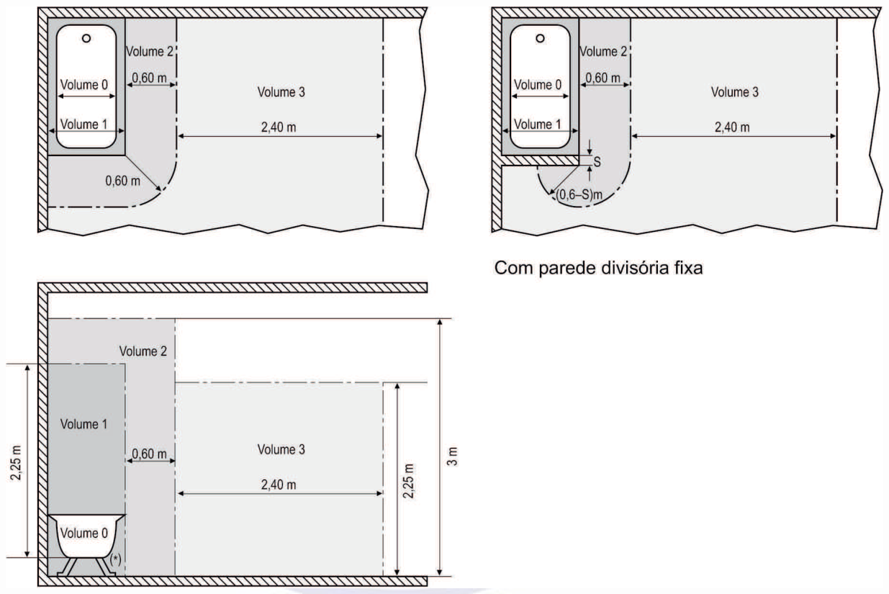
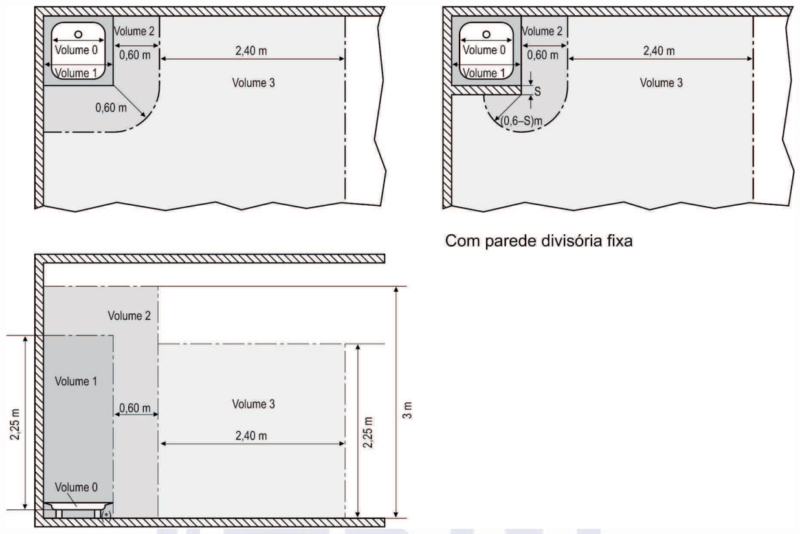
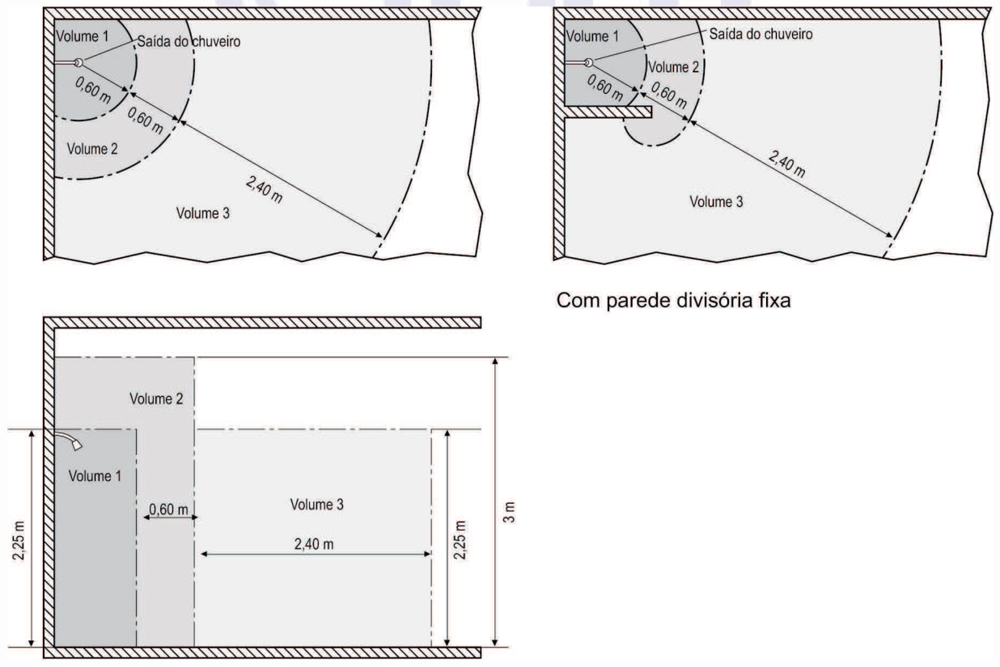
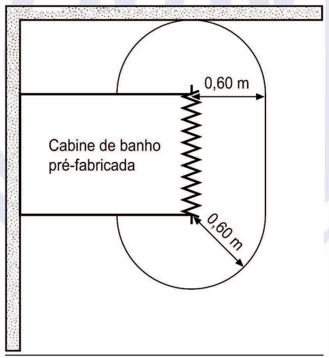
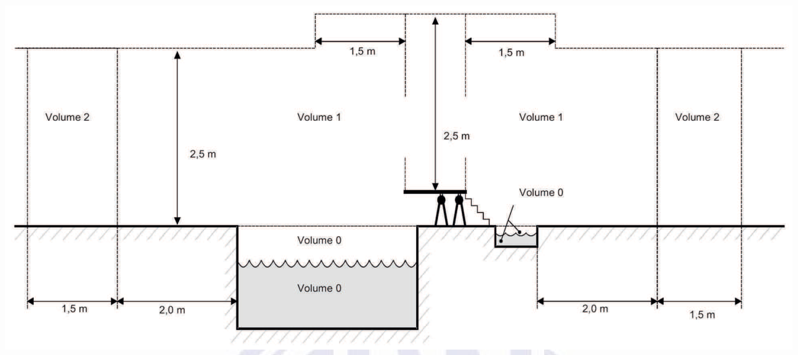
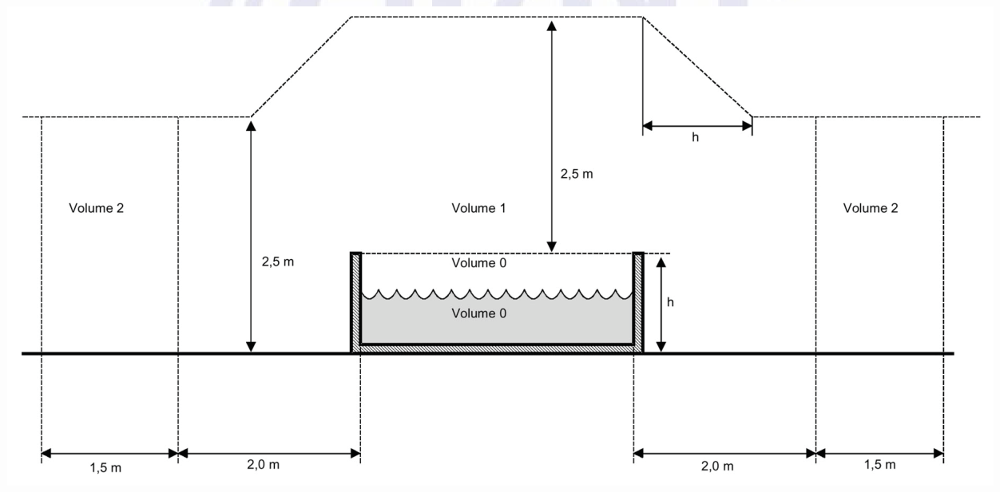
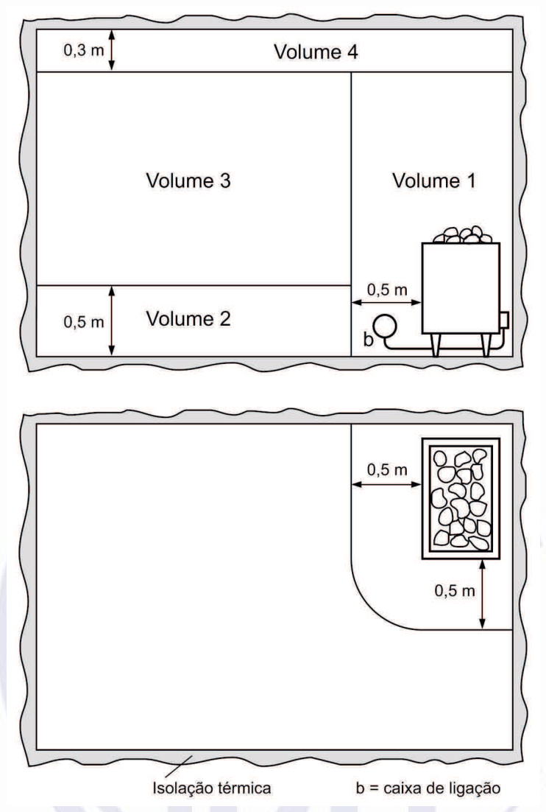

[Arquivo único](../nbr-5410.md)

## 9 Requisitos complementares para instalações ou locais específicos

As prescrições desta seção complementam, modificam ou substituem as prescrições gerais contidas nas seções anteriores desta Norma. Em tudo que não for disposto diferentemente, permanecem válidas e aplicáveis as prescrições gerais pertinentes.

### 9.1 Locais contendo banheira ou chuveiro

#### 9.1.1 Campo de aplicação

Esta subseção contém prescrições complementares aplicáveis a locais contendo banheiras, piso-boxes, boxes e outros compartimentos para banho. Nesses locais o risco de choque elétrico aumenta, devido à redução da resistência do corpo humano e ao contato com o potencial da terra. As prescrições não se aplicam a cabinas de banho pré-fabricadas e cobertas por normas específicas, salvo o mencionado em 9.1.4.3.3.

> **NOTA** Para salas de balneoterapia podem ser necessárias prescrições especiais.

#### 9.1.2 Determinação das características gerais

##### 9.1.2.1 Classificação dos volumes

Para efeito de aplicação de prescrições desta subseção, os locais contendo banheira ou chuveiro são divididos em quatro volumes (ver figuras 16 a 18):

- a) o volume 0 é o volume interior da banheira, do piso-boxe ou do rebaixo do boxe (local inundável em uso normal);

- b) o volume 1 é limitado:

- pelo volume 0;

- pela superfície vertical que circunscreve a banheira, o piso-boxe, o rebaixo do boxe ou, na falta de uma clara delimitação do boxe, por uma superfície vertical situada 0,6 m ao redor do chuveiro ou ducha;

- pelo piso; e

- pelo plano horizontal situado 2,25 m acima do fundo da banheira, do piso do boxe ou, de modo geral, da superfície onde as pessoas possam se postar para o banho;

- c) o volume 2 é limitado:

- pelo volume 1;

- por uma superfície vertical paralela situada 0,60 m ao redor da superfície vertical externa do volume 1;

- pelo piso; e

- pelo plano horizontal situado 3 m acima do piso;

- d) o volume 3 é limitado:

- pela superfície vertical externa do volume 2;

- por uma superfície vertical paralela situada 2,40 m ao redor da superfície vertical externa do volume 2;

- pelo piso; e

- pelo plano horizontal situado 2,25 m acima do piso.

NOTAS

1 Como ilustrado nas figuras 16 a 18, as dimensões dos volumes são medidas levando-se em conta paredes e divisórias fixas.

2 O espaço situado sob a banheira é considerado volume 1, se aberto, e considerado volume 3, se for fechado e acessível apenas através de tampa que só possa ser removida com o uso de ferramenta. O mesmo se aplica ao espaço sob o piso-boxe.

**Figura 16 — Dimensões dos volumes – Banheira**

[imagem revisada]
Volumes ao redor de uma banheira em três vistas: planta, planta com parede divisória fixa e corte.
Na planta, o Volume 0 e o Volume 1 ficam sob a banheira; o Volume 2 é a faixa seguinte, de 0,60 m;
o Volume 3 vai até 2,40 m do Volume 2. Na vista com parede divisória fixa aparece a cota S e a
expressão (0,6–S) m. No corte, as alturas são 2,25 m (Volume 1 e Volume 3) e 3 m (altura do ambiente),
com 0,60 m e 2,40 m horizontais. Há um sinal (*) junto à banheira.
Rótulos: Volume 0, Volume 1, Volume 2, Volume 3, 0,60 m, 2,40 m, 2,25 m, 3 m, S, (0,6–S)m, Com
parede divisória fixa.
[/imagem]

(*) Ver nota 2 de 9.1.2.1.

**Figura 17 — Dimensões dos volumes – Chuveiro ou ducha, com piso-boxe**

[imagem revisada]
Volumes em torno de um chuveiro ou ducha com piso-boxe, em três vistas: planta, planta com parede
divisória fixa e corte. Na planta, o Volume 1 é o quarto de círculo a partir da saída do chuveiro,
com raio de 0,60 m; o Volume 2 é a faixa seguinte, também de 0,60 m; o Volume 3 vai até 2,40 m. No
corte, a saída do chuveiro está a 2,25 m do piso, com altura do ambiente de 3 m.
Rótulos: Volume 1, Volume 2, Volume 3, Saída do chuveiro, 0,60 m, 2,40 m, 2,25 m, 3 m, Com parede
divisória fixa.
[/imagem]

(*) Ver nota 2 de 9.1.2.1.

**Figura 18 — Dimensões dos volumes – Chuveiro ou ducha, sem piso-boxe ou rebaixo**

[imagem revisada]
Volumes em torno de um chuveiro ou ducha sem piso-boxe, em três vistas: planta, planta com parede
divisória fixa e corte. As medidas são as mesmas da figura anterior: Volume 1 com raio de 0,60 m a
partir da saída do chuveiro, Volume 2 em faixa de 0,60 m e Volume 3 até 2,40 m. No corte, a saída
está a 2,25 m do piso e o ambiente tem 3 m de altura.
Rótulos: Volume 1, Volume 2, Volume 3, Saída do chuveiro, 0,60 m, 2,40 m, 2,25 m, 3 m, Com parede
divisória fixa.
[/imagem]

#### 9.1.3 Proteção para garantir segurança

##### 9.1.3.1 Proteção contra choques elétricos

**9.1.3.1.1** No volume 0, admite-se apenas o uso de SELV (ver 5.1.2.5) com tensão nominal não superior a 12 V, sendo que:

- a) as partes vivas do sistema SELV, qualquer que seja sua tensão nominal, devem ser providas:

- de isolação capaz de suportar ensaio de tensão aplicada de 500 V durante 1 min; ou

- de barreiras ou invólucros com grau de proteção pelo menos IP2X ou IPXXB; e

- b) a fonte de segurança deve ser instalada fora do volume 0.

**9.1.3.1.2** Deve ser realizada uma eqüipotencialização suplementar, reunindo todos os elementos condutivos dos volumes 0, 1, 2 e 3 e os condutores de proteção de todas as massas situadas nesses volumes.

NOTAS

1 Como especificado em 5.1.2.5.4.6, as massas dos sistemas SELV não devem ser intencionalmente conectadas à terra, a condutores de proteção ou massas de outros circuitos e/ou a elementos condutivos.

2 Ver também 5.1.3.1.

#### 9.1.4 Seleção e instalação dos componentes

##### 9.1.4.1 Prescrições comuns

Os componentes da instalação elétrica devem possuir pelo menos os seguintes graus de proteção:

- a) no volume 0: IPX7;

- b) no volume 1: IPX4;

- c) no volume 2: IPX3 – IPX5 (em banheiros públicos);

- d) no volume 3: IPX1 – IPX5 (em banheiros públicos).

##### 9.1.4.2 Linhas elétricas

**9.1.4.2.1** Nos volumes 0, 1 e 2, as linhas devem ser limitadas às necessárias à alimentação de equipamentos situados nesses volumes.

**9.1.4.2.2** Nos volumes 0, 1 e 2, as linhas aparentes ou embutidas até uma profundidade de 5 cm devem ser conforme 5.1.2.3.4.

**9.1.4.2.3** No volume 3, podem ser utilizados os seguintes tipos de linha:

- a) linhas aparentes ou embutidas conforme 5.1.2.3.4; ou

- b) linhas constituídas por condutores isolados ou cabos unipolares contidos em eletrodutos metálicos embutidos, desde que tais eletrodutos sejam incluídos na eqüipotencialização suplementar prescrita em

9.1.3.1.2 e que os circuitos neles contidos sejam protegidos por dispositivo DR com corrente diferencial- residual nominal não superior a 30 mA.

**9.1.4.2.4** Nos volumes 0, 1 e 2, as únicas caixas de derivação admitidas são aquelas destinadas às ligações dos equipamentos contidos nestes volumes.

##### 9.1.4.3 Dispositivos de proteção, seccionamento e comando (incluindo tomadas de corrente)

**9.1.4.3.1** Nenhum dispositivo de proteção, seccionamento ou comando pode ser instalado nos volumes 0, 1 e 2.

> **NOTA** Nos volumes 1 e 2 são admitidos cordões isolantes de interruptores acionados a cordão, desde que atendam aos requisitos da IEC 60669-1, bem como elementos de comando (circuitos auxiliares) alimentados em SELV ou funcionando por radiofreqüência, infravermelho ou outro meio que ofereça grau de segurança equivalente.

**9.1.4.3.2** Admitem-se tomadas de corrente, no volume 3, desde que elas sejam:

- a) alimentadas individualmente por transformador de separação de acordo com 5.1.2.4; ou

- b) alimentadas em SELV (ver 5.1.2.5); ou

- c) protegidas por dispositivo DR com corrente diferencial-residual nominal não superior a 30 mA.

**9.1.4.3.3** Nenhum interruptor ou tomada de corrente deve ser instalado a menos de 0,60 m da porta aberta de uma cabine de banho pré-fabricada (figura 19).

**Figura 19 — Cabine de banho pré-fabricada**

[imagem revisada]
Planta de uma cabine de banho pré-fabricada encostada em um canto de paredes. A cabine é um
retângulo rotulado "Cabine de banho pré-fabricada". Na face voltada para o ambiente, uma linha em
zigue-zague marca a abertura. A área ao redor é delimitada por um contorno semicircular, com
afastamentos de 0,60 m em duas direções a partir da cabine.
Rótulos: Cabine de banho pré-fabricada, 0,60 m (duas vezes).
[/imagem]

##### 9.1.4.4 Outros componentes fixos

Estas prescrições não se aplicam a aparelhos alimentados em SELV nas condições de 5.1.2.5 e 9.1.3.1.1.

**9.1.4.4.1** No volume 0, são admitidos somente equipamentos especialmente previstos para uso em banheira.

**9.1.4.4.2** No volume 1 somente podem ser instalados aquecedores de água elétricos classe I ou II.

**9.1.4.4.3** No volume 2, somente podem ser instalados luminárias classe II e aquecedores de água elétricos classe I ou II.

> **NOTA** (comum às prescrições de 9.1.4.4.2 e 9.1.4.4.3) – Sobre classificação dos componentes da instalação quanto à proteção contra choques elétricos (classes I, II e III), ver IEC 61140.

### 9.2 Piscinas

#### 9.2.1 Campo de aplicação

As prescrições complementares desta subseção são aplicáveis aos reservatórios de água de piscinas, incluindo os lava-pés, e às áreas adjacentes às piscinas. Nesses locais, o risco de choque elétrico aumenta, devido à redução da resistência elétrica do corpo humano e ao contato com o potencial de terra.

NOTAS

1 As prescrições desta subseção são igualmente válidas para fontes nas quais pessoas possam adentrar.

2 Para piscinas de uso médico podem ser necessárias prescrições específicas.

#### 9.2.2 Determinação das características gerais

##### 9.2.2.1 Classificação dos volumes

Para efeito de aplicação de prescrições desta subseção, as piscinas e área adjacente são divididas em três volumes (ver figuras 20 e 21):

- a) o volume 0 é o volume interior do reservatório (da piscina e do lava-pés);

- b) o volume 1 é limitado:

- pelo volume 0;

- pela superfície vertical situada a 2 m das bordas do reservatório;

- pelo piso ou superfície na qual as pessoas possam vir a se postar; e

- pelo plano horizontal situado 2,5 m acima do piso ou superfície na qual as pessoas possam vir a se postar.

> **NOTA** Quando a piscina possuir plataformas de salto, trampolins, blocos de partida, escorregadores ou outros elementos nos quais as pessoas possam vir a se postar, o volume 1 deve incluir o volume delimitado pela superfície vertical situada 1,50 m ao redor da plataforma, do trampolim, dos blocos de partida, do escorregador e/ou dos outros elementos nos quais as pessoas possam vir a se postar e pelo plano horizontal situado 2,5 m acima da superfície mais elevada na qual as pessoas possam vir a se postar.

- c) o volume 2 é limitado:

- de um lado, pela superfície vertical externa do volume 1 e uma superfície paralela situada a 1,50 m desta última; e

- por outro lado, pelo piso ou superfície na qual as pessoas possam vir a se postar e o plano horizontal situado a 2,50 m acima desta última.

**Figura 20 — Dimensões dos volumes para reservatórios de piscinas e lava-pés**

[imagem revisada]
Corte de uma piscina e de um lava-pés, com a plataforma de acesso e a escada. Dentro da piscina e do
lava-pés, a água é o Volume 0. Acima da água e ao redor da piscina estão os volumes 1 e 2: o Volume 1
tem altura de 2,5 m sobre a superfície, e o Volume 2 fica nas faixas laterais. As cotas horizontais são
de 1,5 m (faixas do Volume 2) e de 2,0 m (entre a borda e o Volume 1).
Rótulos: Volume 0, Volume 1, Volume 2, 2,5 m, 1,5 m, 2,0 m.
[/imagem]

> **NOTA** As dimensões podem ser medidas levando-se em conta paredes e divisões fixas.

**Figura 21 — Dimensões dos volumes para reservatórios acima do solo**

[imagem revisada]
Corte de um reservatório acima do solo. Dentro do reservatório, a água é o Volume 0, com a
altura h indicada à direita. Acima do reservatório, o Volume 1 tem altura de 2,5 m, medida a
partir do nível superior do reservatório; um contorno tracejado sobe em rampa e desce à direita
com a cota h. Nas faixas laterais, o Volume 2 tem 1,5 m de largura. Entre a borda do reservatório
e o Volume 1, há 2,0 m de cada lado.
Rótulos: Volume 0, Volume 1, Volume 2, 2,5 m, 2,0 m, 1,5 m, h.
[/imagem]

> **NOTA** As dimensões podem ser medidas levando-se em conta paredes e divisões fixas.

#### 9.2.3 Proteção para garantir segurança

##### 9.2.3.1 Proteção contra choques elétricos

**9.2.3.1.1** Nos volumes 0 e 1, admite-se apenas o uso de SELV com tensão nominal não superior a 12 V em corrente alternada, ou 30 V em corrente contínua, sendo que:

- a) as partes vivas do sistema SELV, qualquer que seja sua tensão nominal, devem ser providas de:

- isolação capaz de suportar ensaio de tensão aplicada de 500 V durante 1 min; ou

- barreiras ou invólucros com grau de proteção pelo menos IP2X ou IPXXB; e

- b) a fonte de segurança deve ser instalada fora dos volumes 0, 1 e 2.

> **NOTA** Ver também 5.1.2.5.

**9.2.3.1.2** No volume 2, são admitidas uma ou mais das seguintes medidas de proteção:

- a) SELV (ver 5.1.2.5), sendo a fonte de segurança instalada fora dos volumes 0, 1 e 2;

- b) eqüipotencialização e seccionamento automático da alimentação (ver 5.1.2.2), sendo o seccionamento automático provido por dispositivo DR com corrente diferencial-residual nominal não superior a 30 mA;

- c) separação elétrica individual (ver 5.1.2.4), sendo a fonte de separação instalada fora dos volumes 0, 1 e 2.

**9.2.3.1.3** Admite-se que equipamentos protegidos conforme 9.2.3.1.2 possam ser utilizados no volume 1, para serviços em que isso seja necessário, apenas e tão somente durante a realização do serviço e desde que a piscina não esteja sendo utilizada por nenhuma pessoa. Tais equipamentos, bem como as tomadas de corrente às quais eles possam ser conectados e os dispositivos de comando externos aos quais seu funcionamento possa estar subordinado, devem ser providos de advertência que alerte o usuário para o fato de que os equipamentos só podem ser utilizados quando não houver nenhuma pessoa na piscina.

**9.2.3.1.4** Deve ser realizada uma eqüipotencialização suplementar (eqüipotencialização local), reunindo todos os elementos condutivos dos volumes 0, 1 e 2 e os condutores de proteção de todas as massas situadas nesses volumes.

NOTAS

1 Nessa eqüipotencialização, a função de BEL pode ser desempenhada pela barra PE do quadro de distribuição terminal mais próximo, por algum acessório especialmente previsto ou mesmo pelo terminal PE de algum equipamento, se tal terminal comportar as interligações envolvidas.

2 Como especificado em 5.1.2.5.4.6, as massas dos sistemas SELV não devem ser intencionalmente conectadas à terra, a condutores de proteção ou massas de outros circuitos e/ou a elementos condutivos.

3 Ver também 5.1.3.1.

#### 9.2.4 Seleção e instalação dos componentes

##### 9.2.4.1 Influências externas

Os componentes da instalação elétrica devem possuir pelo menos os seguintes graus de proteção:

- a) no volume 0: IPX8;

- b) no volume 1: IPX5 (IPX4 para pequenas piscinas cobertas que não sejam normalmente submetidas a lavagens com jatos d’água sob pressão);

- c) no volume 2: IPX2 para as piscinas cobertas, IPX4 para as piscinas ao tempo e IPX5 quando o volume estiver sujeito a lavagens com jatos d’água sob pressão.

##### 9.2.4.2 Linhas elétricas

> **NOTA** As prescrições de 9.2.4.2.1 a 9.2.4.2.3 são aplicáveis a linhas aparentes e a linhas embutidas até uma profundidade de 5 cm.

**9.2.4.2.1** Nos volumes 0 e 1, as linhas devem ser limitadas às necessárias à alimentação dos equipamentos situados nesses volumes.

**9.2.4.2.2** Nos volumes 0, 1 e 2, as linhas não devem comportar nenhum revestimento metálico acessível. Os revestimentos metálicos não acessíveis devem ser incluídos na eqüipotencialização suplementar exigida em 9.2.3.1.4.

> **NOTA** De preferência, as linhas devem ser conforme 5.1.2.3.4.

**9.2.4.2.3** Nos volumes 0 e 1 não são admitidas caixas de derivação, exceto aquelas situadas no volume 1 destinadas especificamente a circuitos SELV.

##### 9.2.4.3 Dispositivos de proteção, seccionamento e comando (incluindo tomadas de corrente)

**9.2.4.3.1** Nos volumes 0 e 1 não se admite nenhum dispositivo de proteção, seccionamento e comando, incluindo tomadas de corrente, com exceção do caso especificado em 9.2.4.3.2.

**9.2.4.3.2** Em pequenas piscinas onde a instalação de tomadas de corrente fora do volume 1 não for possível, admite-se sua instalação no volume 1, desde que as tomadas não possuam corpo e/ou cobertura metálica, sejam posicionadas fora do alcance da mão (distância igual ou superior a 1,25 m), a partir do limite do volume 0, e no mínimo a 0,3 m acima do piso. Além disso, as tomadas devem ser:

- a) alimentadas em SELV (ver 5.1.2.5) sob tensão nominal não superior a 25 V em corrente alternada ou 60 V em corrente contínua e sendo a fonte de segurança instalada fora dos volumes 0 e 1; ou

- b) protegidas por dispositivo DR com corrente diferencial-residual nominal não superior a 30 mA; ou

- c) protegidas por separação elétrica individual (ver 5.1.2.4), sendo as fontes de separação, tantas quantas forem as tomadas, instaladas fora dos volumes 0 e 1.

**9.2.4.3.3** No volume 2, admitem-se tomadas de corrente e interruptores, desde que:

- a) os circuitos correspondentes sejam alimentados em SELV (ver 5.1.2.5), sendo a fonte de segurança instalada fora dos volumes 0, 1 e 2; ou

- b) os circuitos correspondentes sejam protegidos por dispositivo DR com corrente diferencial-residual nominal não superior a 30 mA; ou

- c) cada tomada seja protegida por separação elétrica individual (ver 5.1.2.4), sendo a fonte de separação instalada fora dos volumes 0, 1 e 2.

##### 9.2.4.4 Outros componentes

**9.2.4.4.1** As luminárias subaquáticas ou sujeitas a contato com água devem ser conforme a IEC 60598-2-18. Os aparelhos de iluminação subaquáticos instalados em nichos, atrás de vigias estanques, e alimentados pela parte traseira, devem ser conforme as prescrições pertinentes da IEC 60598-2-18 e devem ser montados de modo que não haja nenhum risco de contato entre massas do aparelho ou de seus acessórios de fixação e partes condutivas das vigias.

**9.2.4.4.2** No volume 1, admitem-se equipamentos fixos expressamente destinados a uso em piscinas (por exemplo, grupos de filtração, hidromassagem), alimentados em tensão que não SELV, limitada a 12 V c.a. ou 30 V c.c., se as condições a) a d) a seguir forem simultaneamente atendidas:

- a) os equipamentos devem ser providos, por disposição construtiva ou quando de sua instalação, de invólucro cuja isolação seja equivalente a uma isolação suplementar e que garanta proteção mecânica AG2;

> **NOTA** Essa prescrição é aplicável independentemente de o equipamento ser classe II ou classe I, não dispensando, portanto, a ligação da massa do equipamento a condutor de proteção se o equipamento for classe I (sobre classificação dos componentes da instalação quanto à proteção contra choques elétricos, ver IEC 61140).

- b) o acesso ao equipamento só deve ser possível através de tampa ou porta cuja abertura requeira chave ou ferramenta e que, ao ser aberta, provoque o seccionamento de todos os condutores vivos. O dispositivo responsável pelo seccionamento e a linha de alimentação devem ser de classe II ou providos de proteção equivalente, seja por disposição construtiva, seja na sua instalação;

- c) uma vez aberta a tampa ou porta, o grau de proteção apresentado pelo equipamento deve ser IPXXB, no mínimo;

- d) a alimentação do equipamento deve ser:

- em SELV (ver 5.1.2.5) sob tensão não superior a 25 V c.a. ou 60 V c.c., sendo a fonte de segurança instalada fora dos volumes 0, 1 e 2; ou

- protegida por dispositivo DR com corrente diferencial-residual nominal não superior a 30 mA; ou

- protegida por separação elétrica individual (ver 5.1.2.4), sendo a fonte de separação instalada fora dos volumes 0, 1 e 2.

**9.2.4.4.3** Em pequenas piscinas onde a instalação de luminárias fora do volume 1 não for possível, admite-se sua instalação no volume 1, desde que elas fiquem posicionadas fora de alcance (1,25 m) a partir do volume 0 e possuam invólucro que assegure isolação classe II (ou equivalente) e proteção mecânica AG2. Além disso, as luminárias devem ser:

- a) alimentadas em SELV (ver 5.1.2.5); ou

- b) protegidas por dispositivo DR com corrente diferencial-residual nominal não superior a 30 mA; ou

- c) protegidas por separação elétrica individual (ver 5.1.2.4), sendo as fontes de separação, tantas quantas forem as luminárias, instaladas fora dos volumes 0 e 1.

### 9.3 Compartimentos condutivos

#### 9.3.1 Campo de aplicação

Esta subseção contém prescrições complementares aplicáveis às instalações em compartimentos condutivos e à alimentação dos equipamentos no interior destes compartimentos.

> **NOTA** Compartimento condutivo é um local cujas paredes são constituídas essencialmente de partes metálicas ou condutivas e cujo espaço interno é geralmente limitado, fazendo com que a probabilidade de contato de uma pessoa com as partes condutivas circundantes seja elevada, envolva parte considerável do corpo e, além disso, se dê em circunstâncias nas quais a possibilidade de interrupção desse contato é limitada.

#### 9.3.2 Alimentação de ferramentas portáteis e de aparelhos de medição portáteis

Em compartimentos condutivos, a alimentação de ferramentas portáteis e de aparelhos de medição portáteis deve ser provida com o uso de:

- a) SELV (ver 5.1.2.5), observadas as restrições de 9.3.5; ou

- b) separação elétrica individual (ver 5.1.2.4), observado o disposto em 9.3.6. Deve ser dada preferência ao uso de equipamentos classe II, mas caso seja utilizado um equipamento classe I, este deve possuir pelo menos punhos de material isolante ou punhos com revestimento isolante.

> **NOTA** Sobre classificação dos componentes da instalação quanto à proteção contra choques elétricos (classes I, II e III), ver IEC 61140.

#### 9.3.3 Alimentação de lâmpadas portáteis

Em compartimentos condutivos, a alimentação de lâmpadas portáteis deve ser provida com o uso de:

- a) SELV (5.1.2.5), observadas as restrições de 9.3.5. Admite-se também luminária fluorescente com transformador de dois enrolamentos incorporado alimentado em SELV; ou

- b) separação elétrica individual (5.1.2.4), observado o disposto em 9.3.6. A luminária deve ser classe II.

#### 9.3.4 Alimentação dos equipamentos fixos

Em compartimentos condutivos, os equipamentos fixos podem ser alimentados:

- a) por circuitos protegidos por eqüipotencialização e seccionamento automático da alimentação (ver 5.1.2.2), complementada com a realização de uma eqüipotencialização suplementar, reunindo as massas dos equipamentos fixos e as partes condutivas do compartimento; ou

- b) em SELV (ver 5.1.2.5), observadas as restrições de 9.3.5; ou, ainda,

- c) com o uso de separação elétrica individual (ver 5.1.2.4), observado o disposto em 9.3.6.

#### 9.3.5 SELV

Em compartimentos condutivos, o uso de SELV, conforme 5.1.2.5, deve atender às duas condições seguintes:

- a) as partes vivas do sistema SELV, qualquer que seja sua tensão nominal, devem ser providas de:

- isolação capaz de suportar ensaio de tensão aplicada de 500 V durante 1 min; ou

- barreiras ou invólucros com grau de proteção pelo menos IP2X ou IPXXB; e

- b) a fonte de segurança deve ser instalada fora do compartimento condutivo.

> **NOTA** Se certos equipamentos fixos, tais como aparelhos de medição e de controle, necessitarem de aterramento funcional, implicando assim o uso de PELV, deve ser realizada uma eqüipotencialização envolvendo todas as massas, todos os elementos condutivos no interior do compartimento e o aterramento funcional.

#### 9.3.6 Separação elétrica individual

Em compartimentos condutivos, quando for usada a separação elétrica individual, conforme 5.1.2.4, as fontes de separação, uma para cada equipamento alimentado, devem ser instaladas fora do compartimento condutivo.

### 9.4 Locais contendo aquecedores de sauna

#### 9.4.1 Campo de aplicação

Esta subseção trata de aspectos específicos da instalação elétrica no âmbito de recintos ou locais a serem usados como sauna e nos quais se prevê, portanto, a instalação de aquecedor para tal fim.

#### 9.4.2 Classificação dos volumes

Para efeito de aplicação de prescrições desta subseção, os locais destinados a sauna são divididos em quatro volumes, conforme figura 22.

#### 9.4.3 Proteção para garantir segurança

##### 9.4.3.1 Proteção contra choques elétricos

Em locais destinados a sauna, quando for usada SELV ou PELV, conforme 5.1.2.5, as partes vivas do sistema SELV ou PELV, qualquer que seja sua tensão nominal, devem ser providas de:

- a) isolação capaz de suportar ensaio de tensão aplicada de 500 V durante 1 min; ou

- b) barreiras ou invólucros com grau de proteção pelo menos IP2X ou IPXXB.

#### 9.4.4 Seleção e instalação dos componentes

##### 9.4.4.1 Prescrições comuns

**9.4.4.1.1** Os componentes da instalação elétrica devem possuir grau de proteção no mínimo IP24.

**9.4.4.1.2** No volume 1, assumido como o destinado ao aquecedor (ver figura 22), só se admite a instalação do próprio aquecedor e eventuais acessórios.

**9.4.4.1.3** Os componentes da instalação localizados no volume 2 (ver figura 22), não estão sujeitos a nenhum requisito especial quanto à suportabilidade térmica.

**9.4.4.1.4** No volume 3 (ver figura 22), os componentes devem ser capazes de suportar, em serviço contínuo, uma temperatura de no mínimo 125°C. Os condutores e cabos, em particular, devem possuir isolação capaz de suportar, em serviço contínuo, uma temperatura de no mínimo 170°C.

**9.4.4.1.5** No volume 4 (ver figura 22), só são admitidos dispositivos de controle do aquecedor (termostatos e protetores térmicos) e as linhas respectivas. Aplicam-se aqui as mesmas suportabilidades térmicas especificadas em 9.4.4.1.4.

##### 9.4.4.2 Linhas elétricas

As linhas elétricas devem ser conforme 5.1.2.3.4.

##### 9.4.4.3 Dispositivos de proteção, comando e manobra (incluindo tomadas de corrente)

**9.4.4.3.1** Dispositivos de proteção, comando ou manobra que não integrem o aquecedor da sauna devem ser instalados fora do local da sauna.

**9.4.4.3.2** Não são admitidas tomadas de corrente, em nenhum volume, dentro do local da sauna.

**9.4.4.3.3** Deve ser instalado dispositivo capaz de desligar automaticamente a alimentação do aquecedor quando a temperatura, medida no volume 4, ultrapassar 140°C.

**Figura 22 — Volumes de uma sauna**

[imagem revisada]
Duas plantas de uma sauna, cercada por isolação térmica (faixa ondulada nas bordas).
Na planta superior, o Volume 4 é uma faixa de 0,3 m junto à parede superior; o Volume 3 ocupa a
maior parte da área; o Volume 2 é uma faixa de 0,5 m junto à parede inferior; o Volume 1 fica à
direita e contém o aquecedor de pedras, com distância de 0,5 m até o Volume 3. Há uma caixa de
ligação, marcada com a letra b, ao lado do aquecedor.
Na planta inferior, o aquecedor aparece em planta com as pedras, e a área ao redor tem distância
de 0,5 m nas duas direções a partir do equipamento.
Rótulos: Volume 1, Volume 2, Volume 3, Volume 4, 0,3 m, 0,5 m, b = caixa de ligação, Isolação térmica.
[/imagem]

### 9.5 Locais de habitação

#### 9.5.1 Campo de aplicação

Esta subseção contém prescrições específicas aplicáveis a locais utilizados como habitação, fixa ou temporária, compreendendo as unidades residenciais como um todo e, no caso de hotéis, motéis, flats, apart-hotéis, casas de repouso, condomínios, alojamentos e similares, as acomodações destinadas aos hóspedes, aos internos e a servir de moradia a trabalhadores do estabelecimento.

#### 9.5.2 Previsão de carga

##### 9.5.2.1 Iluminação

**9.5.2.1.1** Em cada cômodo ou dependência deve ser previsto pelo menos um ponto de luz fixo no teto, comandado por interruptor.

NOTAS

1 Nas acomodações de hotéis, motéis e similares pode-se substituir o ponto de luz fixo no teto por tomada de corrente, com potência mínima de 100 VA, comandada por interruptor de parede.

2 Admite-se que o ponto de luz fixo no teto seja substituído por ponto na parede em espaços sob escada, depósitos, despensas, lavabos e varandas, desde que de pequenas dimensões e onde a colocação do ponto no teto seja de difícil execução ou não conveniente.

3 Sobre interruptores para uso doméstico e análogo, ver ABNT NBR 6527.

**9.5.2.1.2** Na determinação das cargas de iluminação, como alternativa à aplicação da ABNT NBR 5413, conforme prescrito na alínea a) de 4.2.1.2.2, pode ser adotado o seguinte critério:

- a) em cômodos ou dependências com área igual ou inferior a 6 m², deve ser prevista uma carga mínima de 100 VA;

- b) em cômodo ou dependências com área superior a 6 m², deve ser prevista uma carga mínima de 100 VA para os primeiros 6 m², acrescida de 60 VA para cada aumento de 4 m² inteiros.

> **NOTA** Os valores apurados correspondem à potência destinada a iluminação para efeito de dimensionamento dos circuitos, e não necessariamente à potência nominal das lâmpadas.

##### 9.5.2.2 Pontos de tomada

###### 9.5.2.2.1 Número de pontos de tomada

O número de pontos de tomada deve ser determinado em função da destinação do local e dos equipamentos elétricos que podem ser aí utilizados, observando-se no mínimo os seguintes critérios:

- a) em banheiros, deve ser previsto pelo menos um ponto de tomada, próximo ao lavatório, atendidas as restrições de 9.1;

- b) em cozinhas, copas, copas-cozinhas, áreas de serviço, cozinha-área de serviço, lavanderias e locais análogos, deve ser previsto no mínimo um ponto de tomada para cada 3,5 m, ou fração, de perímetro, sendo que acima da bancada da pia devem ser previstas no mínimo duas tomadas de corrente, no mesmo ponto ou em pontos distintos;

- c) em varandas, deve ser previsto pelo menos um ponto de tomada;

> **NOTA** Admite-se que o ponto de tomada não seja instalado na própria varanda, mas próximo ao seu acesso, quando a varanda, por razões construtivas, não comportar o ponto de tomada, quando sua área for inferior a 2 m² ou, ainda, quando sua profundidade for inferior a 0,80 m.

- d) em salas e dormitórios devem ser previstos pelo menos um ponto de tomada para cada 5 m, ou fração, de perímetro, devendo esses pontos ser espaçados tão uniformemente quanto possível;

> **NOTA** Particularmente no caso de salas de estar, deve-se atentar para a possibilidade de que um ponto de tomada venha a ser usado para alimentação de mais de um equipamento, sendo recomendável equipá-lo, portanto, com a quantidade de tomadas julgada adequada.

- e) em cada um dos demais cômodos e dependências de habitação devem ser previstos pelo menos:

- um ponto de tomada, se a área do cômodo ou dependência for igual ou inferior a 2,25 m². Admite-se que esse ponto seja posicionado externamente ao cômodo ou dependência, a até 0,80 m no máximo de sua porta de acesso;

- um ponto de tomada, se a área do cômodo ou dependência for superior a 2,25 m² e igual ou inferior a 6 m² ;

- um ponto de tomada para cada 5 m, ou fração, de perímetro, se a área do cômodo ou dependência for superior a 6 m², devendo esses pontos ser espaçados tão uniformemente quanto possível.

###### 9.5.2.2.2 Potências atribuíveis aos pontos de tomada

A potência a ser atribuída a cada ponto de tomada é função dos equipamentos que ele poderá vir a alimentar e não deve ser inferior aos seguintes valores mínimos:

- a) em banheiros, cozinhas, copas, copas-cozinhas, áreas de serviço, lavanderias e locais análogos, no mínimo 600 VA por ponto de tomada, até três pontos, e 100 VA por ponto para os excedentes, considerando-se cada um desses ambientes separadamente. Quando o total de tomadas no conjunto desses ambientes for superior a seis pontos, admite-se que o critério de atribuição de potências seja de no mínimo 600 VA por ponto de tomada, até dois pontos, e 100 VA por ponto para os excedentes, sempre considerando cada um dos ambientes separadamente;

- b) nos demais cômodos ou dependências, no mínimo 100 VA por ponto de tomada.

##### 9.5.2.3 Aquecimento elétrico de água

A conexão do aquecedor elétrico de água ao ponto de utilização deve ser direta, sem uso de tomada de corrente.

#### 9.5.3 Divisão da instalação

**9.5.3.1** Todo ponto de utilização previsto para alimentar, de modo exclusivo ou virtualmente dedicado, equipamento com corrente nominal superior a 10 A deve constituir um circuito independente.

**9.5.3.2** Os pontos de tomada de cozinhas, copas, copas-cozinhas, áreas de serviço, lavanderias e locais análogos devem ser atendidos por circuitos exclusivamente destinados à alimentação de tomadas desses locais.

**9.5.3.3** Em locais de habitação, admite-se, como exceção à regra geral de 4.2.5.5, que pontos de tomada, exceto aqueles indicados em 9.5.3.2, e pontos de iluminação possam ser alimentados por circuito comum, desde que as seguintes condições sejam simultaneamente atendidas:

- a) a corrente de projeto (IB) do circuito comum (iluminação mais tomadas) não deve ser superior a 16 A;

- b) os pontos de iluminação não sejam alimentados, em sua totalidade, por um só circuito, caso esse circuito seja comum (iluminação mais tomadas); e

- c) os pontos de tomadas, já excluídos os indicados em 9.5.3.2, não sejam alimentados, em sua totalidade, por um só circuito, caso esse circuito seja comum (iluminação mais tomadas).

#### 9.5.4 Proteção contra sobrecorrentes

Todo circuito terminal deve ser protegido contra sobrecorrentes por dispositivo que assegure o seccionamento simultâneo de todos os condutores de fase.

> **NOTA** Isso significa que o dispositivo de proteção deve ser multipolar, quando o circuito for constituído de mais de uma fase. Dispositivos unipolares montados lado a lado, apenas com suas alavancas de manobra acopladas, não são considerados dispositivos multipolares.
