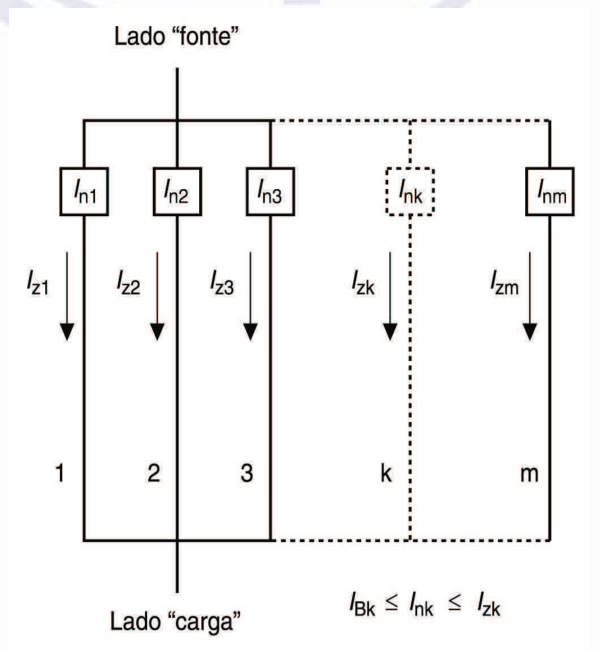
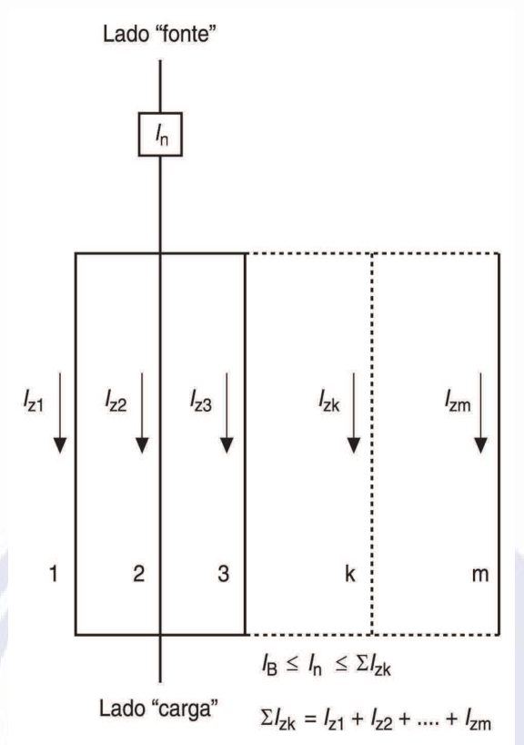
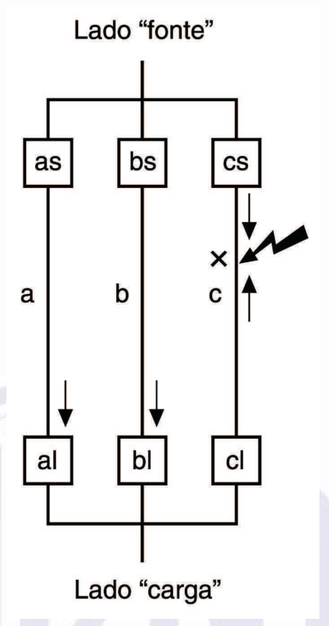
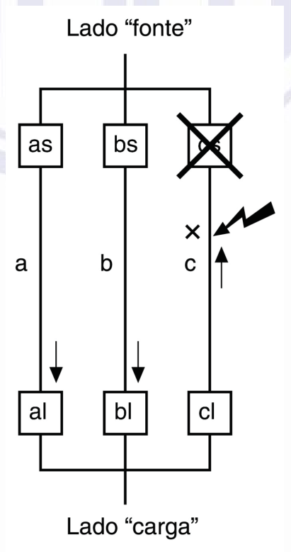

[Arquivo único](../nbr-5410.md)

## Anexo D (informativo) Proteção de condutores em paralelo contra sobrecorrentes

### D.1 Introdução

Na proteção contra sobrecorrentes de condutores em paralelo, todos eles devem ser adequadamente protegidos. Para dois condutores de mesma seção nominal, mesmo comprimento, mesma maneira de instalar e percorridos por correntes aproximadamente iguais, os requisitos para essa proteção são simples. Arranjos mais complexos demandam considerações mais detalhadas, que passam pelos casos de divisão desigual de corrente entre os condutores e de corrente de falta fluindo por múltiplos percursos. Este anexo fornece subsídios nesse sentido.

### D.2 Proteção contra sobrecarga de condutores em paralelo

Ocorrendo uma sobrecarga em um circuito com condutores em paralelo, a corrente em cada condutor aumenta na mesma proporção da sobrecarga. Se a corrente total se dividir igualmente entre os condutores em paralelo, pode-se utilizar um único dispositivo para a proteção de todos os condutores. Neste caso, a capacidade de condução de corrente (*I*z) total dos condutores em paralelo é a soma de suas capacidades de condução de corrente individuais, devidamente corrigidas com a aplicação dos fatores pertinentes (fator de correção por agrupamento e outros que sejam aplicáveis).

A divisão de corrente entre condutores em paralelo é função da sua impedância. Para cabos unipolares de grande seção, a componente reativa da impedância é maior que a componente resistiva e terá um efeito significativo na divisão de corrente. A componente reativa depende da posição física relativa de cada cabo. Por exemplo, em um circuito composto de dois cabos de grande seção por fase — de mesmo comprimento, construção e seção nominal —, a divisão de correntes pode ser 70% / 30%, ao invés de 50% / 50%, se a disposição dos cabos for desfavorável (por exemplo, cabos de mesma fase agrupados).

Quando a divisão de corrente entre condutores em paralelo for desigual (por exemplo, uma diferença superior a 10%), a corrente de projeto e os requisitos da proteção contra sobrecargas devem ser analisados individualmente, para cada condutor.

A corrente de projeto de cada condutor pode ser calculada a partir da carga total e da impedância de cada condutor.

Para um total de *m* condutores em paralelo, a corrente de projeto *I*Bk de um condutor *k* é dada por:

*I*B

*I*Bk√ ⎛*Z*k*Z*k *Z*k⎟ ⎜ ⎜*Z*1+*Z*2+...+*ZZ*k+*Z*k+*ZZ*k+...+*Z*m⎞ ⎟ k−1*Z*k k+1 ⎠ ⎝

onde:

*I*B é a corrente de projeto do circuito;

*I*Bk é a corrente no condutor *k;*

*Z*k é a impedância do condutor *k*;

*Z1* e *Zm* são as impedâncias dos condutores *1* e *m*, respectivamente.

No caso de cabos unipolares, a impedância depende das posições relativas dos cabos, bem como do projeto do cabo (por exemplo, com ou sem armação). Não há ainda métodos normalizados para o cálculo dessa impedância, o que é uma razão a mais para se recomendar que a divisão de corrente entre cabos em paralelo seja verificada por medição.

No equacionamento da proteção contra sobrecargas de condutores em paralelo, a condição a) de 5.3.4.1 pode ser então reescrita de duas formas, dependendo de como esses condutores forem protegidos (dispositivos de proteção individuais, para cada condutor, ou dispositivo de proteção único):

- i) dispositivos de proteção individuais, para cada condutor (ver figura D.1):

*IBk*≤ *Ink*≤ *Izk*

ii) dispositivo de proteção único para todos os condutores em paralelo (ver figura D.2):

*I*B≤ *I*n≤∑*I*zk

onde:

*I*nk é a corrente nominal do dispositivo de proteção do condutor *k*;

*I*zk é a capacidade de condução de corrente do condutor *k*;

*I*n é a corrente nominal do dispositivo de proteção (dispositivo de proteção único);

∑*I*zk é a soma das capacidades de condução de corrente dos *m* condutores em paralelo.

> **NOTA** Para sistemas de barramentos, os parâmetros devem ser obtidos do fabricante ou da IEC 60439-2.

Conseqüentemente, o valor de *I*z a ser utilizado na condição b) 5.3.4.1 passa a ser *I*zk , no caso da alínea i) acima, ou ∑*I*zk , no caso da alínea ii) acima.

**Figura D.1 — Circuito com dispositivos de proteção contra sobrecarga individuais, para cada um**

[imagem]
Circuitos em paralelo, cada um com dispositivo de proteção contra sobrecarga próprio. Do lado
"fonte", os dispositivos In1, In2, In3, Ink e Inm ligam-se aos condutores de cada circuito, numerados
1, 2, 3, k e m. Cada circuito tem a corrente admissível Izk do condutor, indicada com seta para o
lado "carga". O circuito k aparece tracejado, como circuito opcional. Na parte inferior, a condição
indicada é IBk ≤ Ink ≤ Izk.
Rótulos: Lado "fonte", Lado "carga", In1, In2, In3, Ink, Inm, Iz1, Iz2, Iz3, Izk, Izm, 1, 2, 3, k, m,
IBk ≤ Ink ≤ Izk.
[/imagem]

**dos** ***m*** **condutores em paralelo**

**Figura D.2 — Circuito com um único dispositivo de proteção contra sobrecarga para**

[imagem]
Circuitos em paralelo alimentados por um único dispositivo de proteção In, no lado "fonte". Os
circuitos 1, 2, 3, k e m têm as correntes admissíveis Iz1, Iz2, Iz3, Izk e Izm. O circuito k aparece
tracejado. Na parte inferior, as condições indicadas são IB ≤ In ≤ ΣIzk e ΣIzk = Iz1 + Iz2 + … + Izm.
Rótulos: Lado "fonte", Lado "carga", In, Iz1, Iz2, Iz3, Izk, Izm, 1, 2, 3, k, m.
[/imagem]

**os** ***m*** **condutores em paralelo**

### D.3 Proteção contra curtos-circuitos de condutores em paralelo

Quando condutores são ligados em paralelo, deve-se considerar a possibilidade de curto-circuito entre esses condutores.

Para dois condutores em paralelo, e caso a atuação efetiva de um dispositivo de proteção único não possa ser assegurada, cada condutor deve ser protegido individualmente.

Quando três ou mais condutores são ligados em paralelo, podem surgir múltiplos percursos de corrente de falta. Neste caso pode ser necessário prover proteção contra curtos-circuitos em cada uma das extremidades de cada condutor em paralelo, conforme ilustrado nas figuras D.3 e D.4.

**Figura D.3 — Fluxo de corrente no início da falta**

[imagem]
Três ramos em paralelo, a, b e c, cada um com dispositivo do lado "fonte" (as, bs, cs) e um
dispositivo do lado "carga" (al, bl, cl). Há uma falta indicada por um raio e um X no ramo c, com
setas de corrente nos ramos a, b e c. As setas indicam a circulação da corrente de falta no início
da falta.
Rótulos: Lado "fonte", Lado "carga", as, bs, cs, al, bl, cl, a, b, c, X.
[/imagem]

**Figura D.4 — Fluxo de corrente após a atuação do dispositivo de proteção cs**

[imagem]
O mesmo arranjo de três ramos da figura anterior, com o dispositivo cs do lado "fonte" desenhado
com um X sobre ele, indicando que foi atuado. O ramo c tem a falta indicada por raio e X, com seta
de corrente apenas no sentido ascendente. Os ramos a e b mantêm suas setas de corrente para o
lado "carga", com os dispositivos al e bl.
Rótulos: Lado "fonte", Lado "carga", as, bs, cs, al, bl, cl, a, b, c, X.
[/imagem]

A figura D.3 mostra que, ocorrendo uma falta no condutor *c*, no ponto *X*, a corrente de falta flui através de todos os três condutores, *a*, *b* e *c*. A parcela da corrente de falta que flui através de cada um dos dispositivos de proteção do condutor *c* (dispositivos *cs* e *cl* ) depende da localização da falta, ao longo do condutor *c*. No exemplo, supõe-se que a maior parte da corrente de falta flui através de *cs*, fazendo com que ele atue antes de *cl*. Mas, como mostra a figura D.4, a atuação de *cs* não é o suficiente para eliminar a falta, pois ela continua sendo alimentada, via condutores *a* e *b*, pela extremidade "carga" do condutor *c*. Devido ao paralelismo dos condutores *a* e *b*, a corrente que flui através dos dispositivos *as* e *bs* pode não ser suficiente para fazê-los atuar no tempo adequado. Daí a necessidade do dispositivo *cl*. O mesmo raciocínio seria válido se a falta no condutor *c* ocorresse mais próximo de *cl*, fazendo com que este dispositivo atuasse antes de *cs*. Analogamente, a situação seria a mesma se a falta ocorresse no condutor *a* ou no condutor *b*, mostrando a necessidade dos dispositivos de proteção *al* e *bl*.

Uma alternativa para os seis dispositivos de proteção seria um dispositivo de proteção intertravado, instalado na origem do circuito, de modo a interromper simultaneamente a alimentação de todos os condutores. O emprego desse dispositivo apresenta duas vantagens em relação ao esquema com proteção individual nas extremidades de cada condutor em paralelo. A primeira é que, no caso dos dispositivos individuais, se uma falta em *x* fosse eliminada pela atuação de *cs* e *cl*, o circuito continuaria operando, com a corrente sendo conduzida pelos condutores *a* e *b*. Como o circuito continua em operação, a falta e a condição de sobrecarga (em *a* e *b*) dela decorrente poderiam não ser percebidas. Segundo, em caso de atuação apenas do dispositivo *cs*, a falta em *x* pode causar a queima do circuito aberto no lado de *cl*, deixando um lado da falta vivo e sem detecção; a falta continuaria sendo alimentada através de *cl*, submetendo os condutores *a*, *b* e *c* (do lado de *cl*) a uma sobrecorrente não detectada
