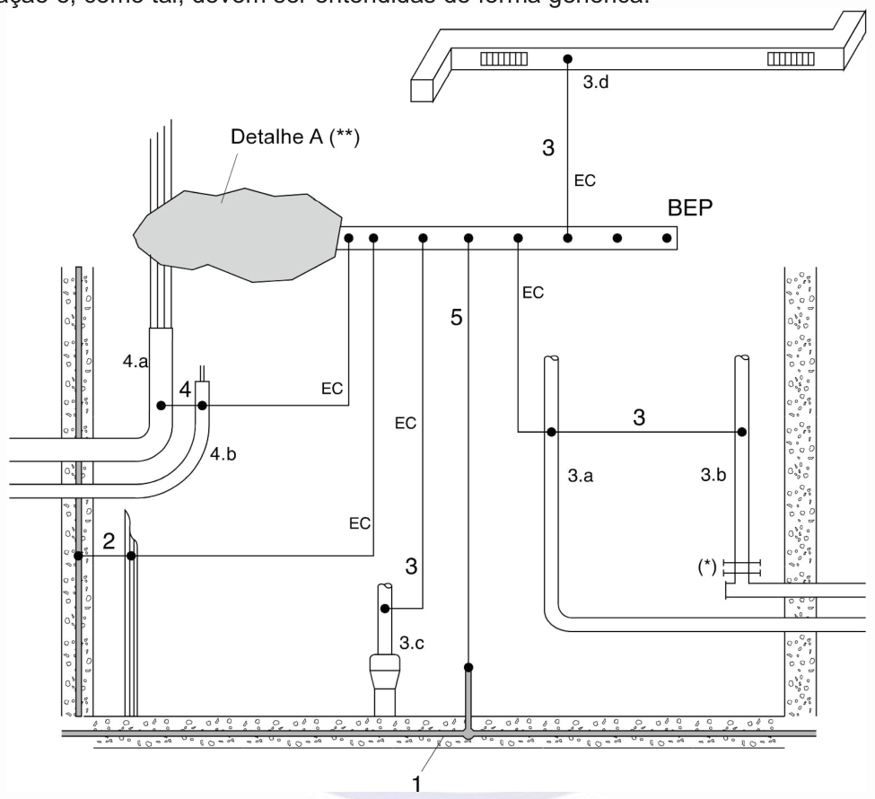
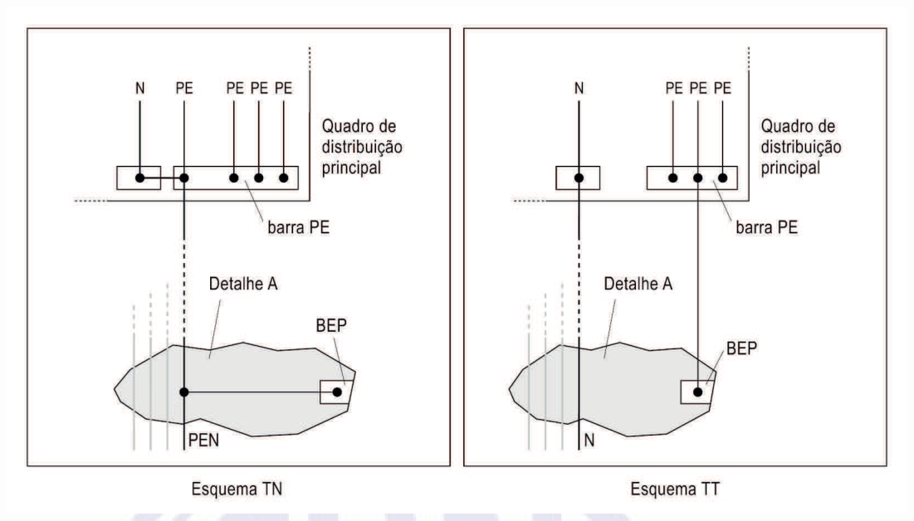
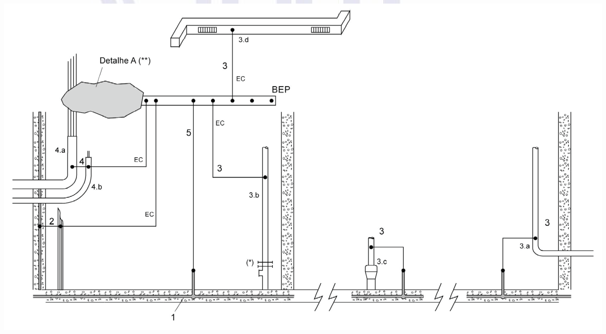

[Arquivo único](../nbr-5410.md)

## Anexo G (informativo) Eqüipotencialização principal

As figuras G.1 e G.2 destinam-se apenas a ilustrar as prescrições referentes a aterramento e eqüipotencialização e, como tal, devem ser entendidas de forma genérica.

**Figura G.1 — Eqüipotencialização principal numa situação hipotética em que todos os elementos nela**

[imagem revisada]
Diagrama de equipotencialização principal em uma situação hipotética, com todos os elementos
incluíveis ligados. A barra BEP, na parte superior, tem pontos de conexão, e os condutores EC ligam
à BEP os elementos numerados: 1 (eletrodo de aterramento, no piso), 2 (tubulação), 3 (3.a, 3.b,
3.c e 3.d, tubulações e elementos metálicos), 4 (4.a e 4.b, tubulações de entrada) e 5 (condutor
ligado ao eletrodo). O Detalhe A (**) é uma área de ligação ao lado esquerdo. Há símbolo (*) junto
a uma conexão. Na parte inferior, o eletrodo de aterramento corre horizontalmente.
Rótulos: BEP, EC, Detalhe A (**), 1, 2, 3, 3.a, 3.b, 3.c, 3.d, 4, 4.a, 4.b, 5, (*).
[/imagem]

Legenda: BEP = Barramento de eqüipotencialização principal EC = Condutores de eqüipotencialização 1 = Eletrodo de aterramento (embutido nas fundações) 2 = Armaduras de concreto armado e outras estruturas metálicas da edificação 3 = Tubulações metálicas de utilidades, bem como os elementos estruturais metálicos a elas associados. Por exemplo: 3.a = água 3.b = gás (*) = luva isolante (ver nota 2 de 6.4.2.1.1) 3.c = esgoto 3.d = ar-condicionado 4 = Condutos metálicos, blindagens, armações, coberturas e capas metálicas de cabos 4.a = Linha elétrica de energia 4.b = Linha elétrica de sinal 5 = Condutor de aterramento principal (**) Ver figura G.2.

**esse ponto e os outros elementos da edificação são também aí acessíveis**

**Figura G.2 — Conexões da alimentação elétrica à eqüipotencialização principal,**

[imagem revisada]
Dois esquemas lado a lado, ambos com o quadro de distribuição principal e a barra PE.
Esquema TN (à esquerda): os condutores N e PE do quadro; o PEN, que sobe do quadro até a região do
Detalhe A e segue ligado ao BEP.
Esquema TT (à direita): o condutor N no quadro, o PE ligado à barra PE do quadro, e a ligação do PE
ao BEP por um condutor vertical.
Rótulos: N, PE, PEN, barra PE, Quadro de distribuição principal, Detalhe A, BEP, Esquema TN,
Esquema TT.
[/imagem]

NOTAS

1 A figura é essencialmente ilustrativa. Se o quadro de distribuição principal se situar junto ou bem próximo do ponto de entrada da linha na edificação, sua barra PE, caso não haja outras restrições, poderia acumular a função de BEP.

2 O detalhe relativo ao esquema TN-C-S ilustra situação conforme 5.4.3.6.

**em função do esquema de aterramento**

**Figura G.3 — Exemplo de eqüipotencialização principal em que os elementos nela incluíveis não se**

[imagem revisada]
Exemplo de equipotencialização principal em que alguns elementos não são incluíveis. A figura tem
a mesma estrutura da anterior: barra BEP com condutores EC ligados aos elementos numerados 1, 2,
3 (3.a, 3.b, 3.c, 3.d), 4 (4.a, 4.b) e 5, e o Detalhe A (**). O eletrodo de aterramento (1) corre
no piso, interrompido por quebras horizontais na parte inferior. Há símbolo (*) junto a uma conexão.
Rótulos: BEP, EC, Detalhe A (**), 1, 2, 3, 3.a, 3.b, 3.c, 3.d, 4, 4.a, 4.b, 5, (*).
[/imagem]

(**) Ver figura G.2.

**concentram ou não são acessíveis num mesmo ponto da edificação**
