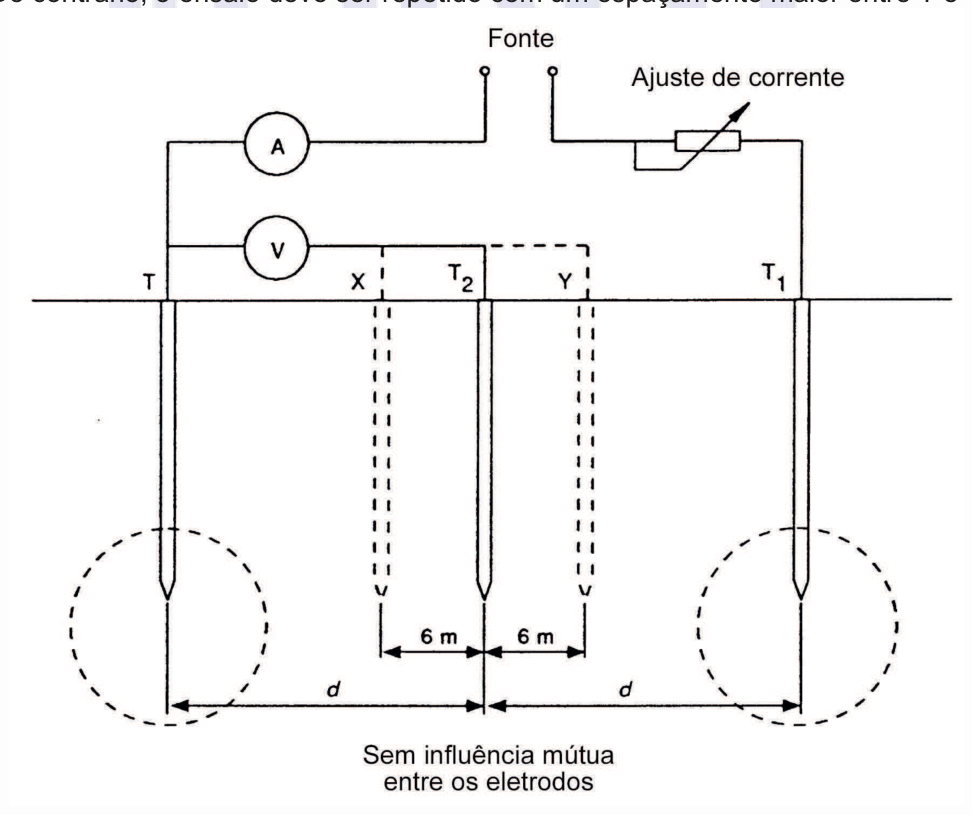

[Arquivo único](../nbr-5410.md)

## Anexo J (normativo) Medição da resistência de aterramento

**J.1** Os métodos descritos em J.1.1 e J.1.2 podem ser utilizados quando for necessária a medição da resistência de aterramento.

#### J.1.1 Método 1 (ver figura J.1)

**J.1.1.1** Uma corrente alternada de valor constante circula entre o eletrodo de aterramento sob ensaio T e o eletrodo auxiliar T1. A localização de T1 deve ser tal que não haja influência mútua entre T e T1.

**J.1.1.2** Um segundo eletrodo auxiliar, T2 , que pode ser uma pequena haste metálica cravada no solo, é inserido a meio caminho entre T e T1. A queda de tensão entre T e T2 é medida.

**J.1.1.3** A resistência de aterramento do eletrodo T é igual à tensão entre T e T2 dividida pela corrente que circula entre T e T1 , presumindo-se que não haja influência mútua entre os eletrodos.

**J.1.1.4** Para verificar se o valor de resistência está correto, duas novas medições devem ser realizadas, deslocando-se T2 cerca de 6 m na direção de T e, depois, 6 m na direção de T1. Se os três resultados forem substancialmente semelhantes, a média das três leituras é tomada como sendo a resistência de aterramento do eletrodo T. Do contrário, o ensaio deve ser repetido com um espaçamento maior entre T e T1.

**Figura J.1 — Medição de resistência de aterramento – Método 1**

[imagem revisada]
Arranjo para medição de resistência de aterramento pelo método de queda de potencial. Uma fonte
alimenta, por meio de um ajuste de corrente (resistor variável), o eletrodo T1 de corrente e o
eletrodo sob ensaio T. Um amperímetro A está no circuito de corrente e um voltímetro V mede a
tensão entre T e o eletrodo de potencial T2. Os pontos X e Y são posições de medição, com 6 m de
afastamento de T2 em cada sentido. As distâncias d entre T e T2 e entre T2 e T1 são indicadas, e
círculos tracejados ao redor de T e T1 indicam as áreas de influência. A legenda inferior diz "Sem
influência mútua entre os eletrodos". No topo, parte de um texto indica que o ensaio deve ser repetido
com um espaçamento maior entre os eletrodos.
Rótulos: Fonte, Ajuste de corrente, A, V, T, T2, T1, X, Y, 6 m, d.
[/imagem]

onde: T é o eletrodo do aterramento a ser medido, desconectado de todas as outras fontes de tensão; T1 é o eletrodo auxiliar; T2 é o segundo eletrodo auxiliar.

#### J.1.2 Método 2

**J.1.2.1** Neste método também são utilizados dois eletrodos auxiliares, mas sem nenhuma necessidade de alinhamento. A corrente injetada deve ser compatível com uma tensão de ensaio máxima de 50 V.

**J.1.2.2** Injeta-se corrente entre os dois eletrodos auxiliares, T1 e T2. Medem-se a corrente injetada e a tensão aplicada e calcula-se então a soma das resistências de T1 e de T2, dividindo-se a tensão aplicada pela corrente injetada:

*R*1+*R*2√*U*1−2 *I*

**J.1.2.3**

Em seguida, injeta-se corrente entre o eletrodo sob ensaio, T0 , e o eletrodo auxiliar T1. Usando-

se o outro eletrodo auxiliar (T2) como referência, medem-se então a tensões entre T0 e T2 e entre T1 e T2. Com os valores medidos da corrente e das tensões, calculam-se as resistências de aterramento de T0 e de T1:

*R*0√*U*0−2 e *R*1√*U*1−2 ′ *I* *I*

**J.1.2.4** Usando agora T1 como referência, injeta-se corrente entre T0 e T2 e medem-se as tensões entre T0 e T1 e entre T2 e T1. Com a corrente e as tensões medidas, calculam-se as resistências de aterramento de T0 e T2:

*R*′0√*U*0−1 e *R*′2√*U*2−1 *I* *I*

**J.1.2.5** Comparam-se os dois valores de resistência obtidos para o eletrodo sob ensaio T0, isto é, R0 e R’0 , bem como a soma das resistências de T1 e de T2 inicialmente obtida (R1 + R2) com a soma das resistências calculadas individualmente para T1 e T2 (isto é, R’1 + R’2). Se essa comparação revelar semelhança entre os valores, eles são considerados válidos. Caso contrário, devem ser realizadas novas medições, com um espaçamento maior entre os eletrodos.

**J.2** Se o ensaio for realizado à freqüência industrial, a fonte utilizada para o ensaio deve ser isolada do sistema de distribuição (por exemplo, pelo uso de transformador de enrolamentos separados) e a impedância interna do voltímetro utilizado deve ser de no mínimo 200 Ω / V.
