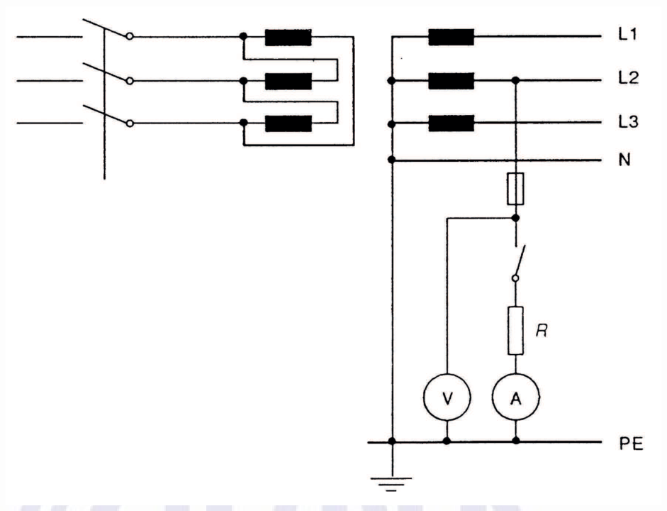
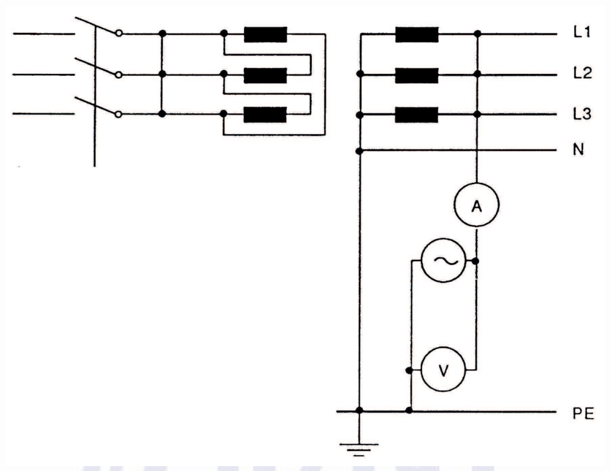

[Arquivo único](../nbr-5410.md)

## Anexo K (normativo) Medição da impedância do percurso da corrente de falta

Os métodos descritos em K.1 e K.2 podem ser adotados para medição da impedância do percurso da corrente de falta.

NOTAS

1 Os métodos propostos fornecem apenas valores aproximados, uma vez que não consideram a natureza vetorial da tensão ou, em outros termos, as condições existentes no instante em que ocorre a falta à terra. O grau de aproximação é, no entanto, aceitável, à medida que a reatância do circuito envolvido possa ser desconsiderada.

2 Recomenda-se a realização de um ensaio de continuidade entre neutro e massas, antes da medição da impedância do percurso da corrente de falta (esquemas TN).

### K.1 Método 1 – Medição da impedância do percurso da corrente de falta por meio da queda de tensão (ver figura K.1)

A tensão do circuito a ser verificado é medida com e sem a conexão de uma carga resistiva variável, cuja corrente também é medida. O valor da impedância resulta:

*Z* √*U*1 −*U*2 *IR*

onde:

*Z* é a impedância do percurso da corrente de falta;

*U*1 é a tensão medida sem a carga;

*U*2 é a tensão medida com a carga;

*I*R é a corrente na carga.

> **NOTA** Convém atentar para o fato de que este método apresenta dificuldades de aplicação e para a necessidade de se ter uma diferença *U*1 – *U*2 significativa.

**Figura K.1 — Medição da impedância do percurso da corrente de falta por meio da queda de tensão**

[imagem]
Esquema de medição da impedância do percurso da corrente de falta pela queda de tensão. À esquerda,
uma chave tripolar com três blocos retangulares pretos ligados em série, em forma de U, como carga.
À direita, os condutores L1, L2, L3 e N, com blocos retangulares pretos nas fases L1, L2 e L3, e o
condutor N ligado ao símbolo de aterramento na parte inferior. Do ponto de fase L2, um ramo passa
por uma chave e por uma resistência R, e segue até o condutor PE. Um amperímetro A e um voltímetro V
estão em paralelo, ligados ao PE na base do ramo.
Rótulos: L1, L2, L3, N, PE, R, A, V.
[/imagem]

### K.2 Método 2 – Medição da impedância do percurso da corrente de falta por meio de fonte separada (ver figura K.2)

O ensaio é realizado com a alimentação normal desconectada e o primário do transformador curto-circuitado. Utiliza-se uma fonte separada para alimentar o circuito de medição. A impedância é dada por:

*Z* √*U* *I*

onde:

*Z* é a impedância do percurso da corrente de falta;

*U* é a tensão medida;

*I* é a corrente medida.

**Figura K.2 — Figura - Medição da impedância do percurso da corrente de falta**

[imagem]
Esquema de medição da impedância do percurso da corrente de falta com fonte de tensão alternada.
À esquerda, a mesma chave tripolar com três blocos retangulares pretos ligados em forma de U.
À direita, os condutores L1, L2, L3 e N, com blocos retangulares pretos nas fases, e o condutor N
ligado ao símbolo de aterramento. Um amperímetro A segue da fase L1 até um ramo que tem uma fonte de
tensão alternada (símbolo de senoide) e um voltímetro V em paralelo com a fonte, ligados ao PE na
base do ramo.
Rótulos: L1, L2, L3, N, PE, A, V.
[/imagem]

**por meio de fonte separada**
