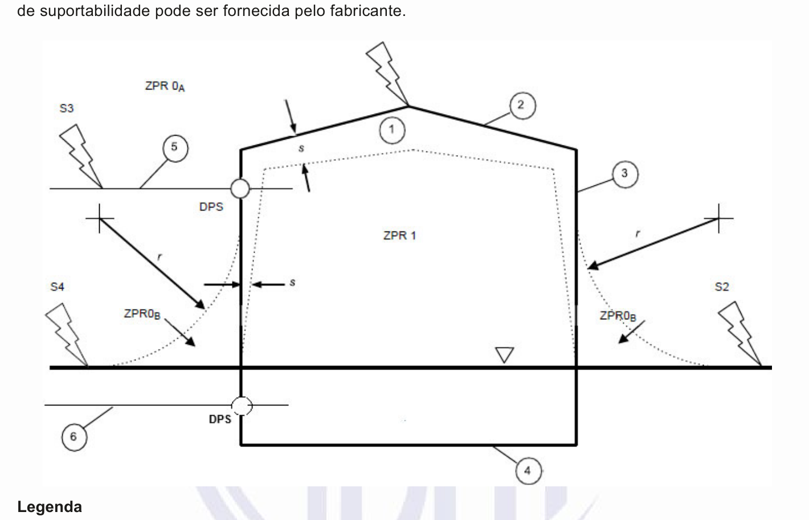
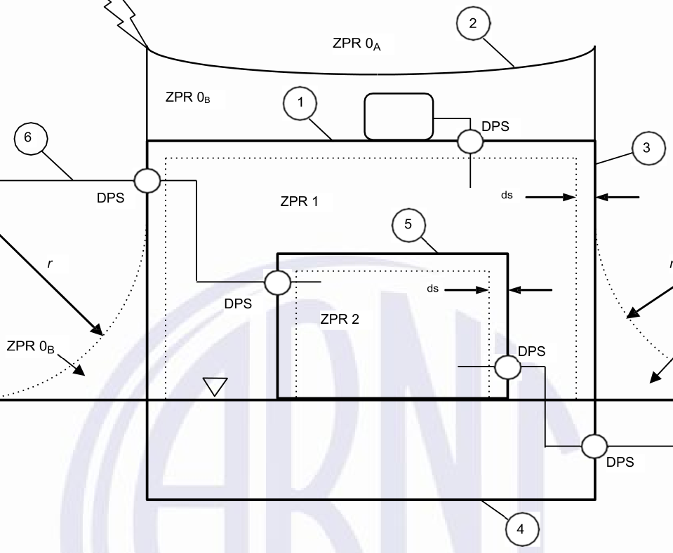
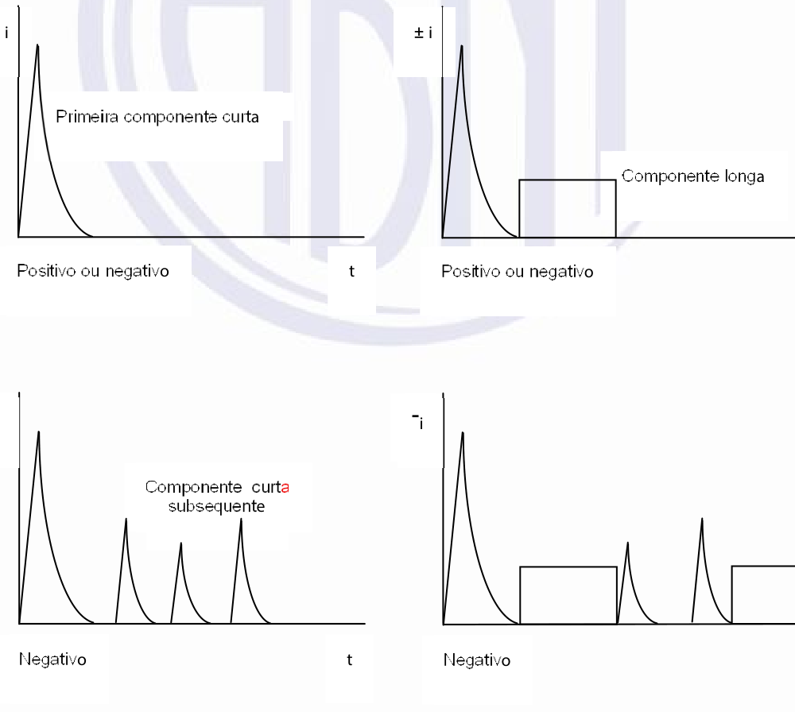
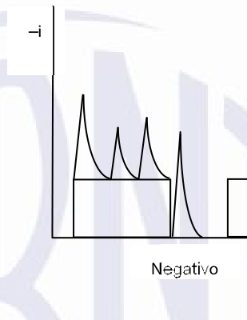
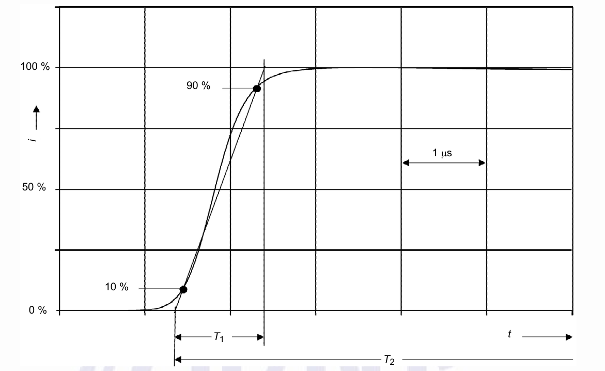
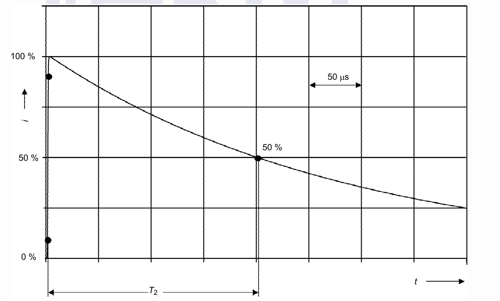
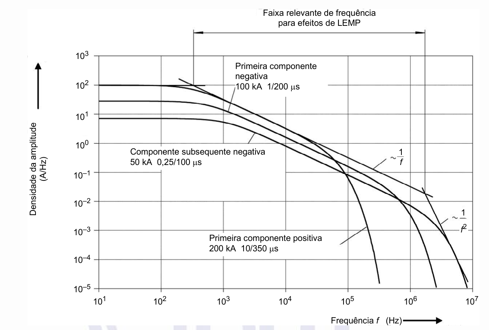

# ABNT NBR 5410 — Proteção contra descargas atmosféricas

<!-- p. 8 -->

## Prefácio

A Associação Brasileira de Normas Técnicas (ABNT) é o Foro Nacional de Normalização. As Normas Brasileiras, cujo conteúdo é de responsabilidade dos Comitês Brasileiros (ABNT/CB), dos Organismos de Normalização Setorial (ABNT/ONS) e das Comissões de Estudo Especiais (ABNT/CEE), são elaboradas por Comissões de Estudo (CE), formadas pelas partes interessadas no tema objeto da normalização.

Os Documentos Técnicos ABNT são elaborados conforme as regras da ABNT Diretiva 2.

A ABNT chama a atenção para que, apesar de ter sido solicitada manifestação sobre eventuais direitos de patentes durante a Consulta Nacional, estes podem ocorrer e devem ser comunicados à ABNT a qualquer momento (Lei nº 9.279, de 14 de maio de 1996).

Os Documentos Técnicos ABNT, assim como as Normas Internacionais (ISO e IEC), são voluntários e não incluem requisitos contratuais, legais ou estatutários. Os Documentos Técnicos ABNT não substituem Leis, Decretos ou Regulamentos, aos quais os usuários devem atender, tendo precedência sobre qualquer Documento Técnico ABNT.

Ressalta-se que os Documentos Técnicos ABNT podem ser objeto de citação em Regulamentos Técnicos. Nestes casos, os órgãos responsáveis pelos Regulamentos Técnicos podem determinar as datas para exigência dos requisitos de quaisquer Documentos Técnicos ABNT.

A ABNT NBR 5419-1 foi elaborada no Comitê Brasileiro de Eletricidade (ABNT/CB-003), pela Comissão de Estudo de Proteção Contra Descargas Atmosféricas (CE-003:064.010). O Projeto de Revisão foi submetido à Consulta Nacional no período de 21.07.2025 a 18.09.2025.

A fim de permitir aos usuários da série ABNT NBR 5419:2026, em suas partes 1 a 4, um prazo para adequação e atendimento aos seus requisitos, é previsto que estes não sejam exigidos antes de 06 meses após a publicação desta Norma. Isto não significa, entretanto, impedimento à adequação e ao atendimento a esta Norma na sua íntegra por quaisquer partes interessadas que se sintam aptas a utilizá-la a qualquer momento durante este período.

Neste ínterim, o conteúdo da série ABNT NBR 5419:2015, em suas partes 1 a 4, continua sendo aplicável pelo prazo acima mencionado.

A ABNT NBR 5419:2026, em suas partes 1 a 4, não se aplica aos projetos de construção que tenham sido protocolados para aprovação no órgão competente pelo licenciamento anteriormente à data de sua publicação como Norma Brasileira, nem àqueles que venham a ser protocolados no prazo de até 180 dias após esta data, devendo, neste caso ser utilizada a versão anterior da ABNT NBR 5419:2015, em suas partes 1 a 4.

A ABNT NBR 5419-1:2026 cancela e substitui a ABNT NBR 5419-1:2015, a qual foi tecnicamente revisada.

A ABNT NBR 5419, sob o título geral “*Proteção contra descargas atmosféricas*”, tem previsão de conter as seguintes partes:

- Parte 1: Princípios gerais;

- Parte 2: Análise de risco;

<!-- p. 9 -->

- Parte 3: Danos físicos a estruturas e perigos à vida;

- Parte 4: Sistemas elétricos e eletrônicos internos na estrutura.

Esta versão corrigida da ABNT NBR 5419-1:2026 incorpora a Errata 1, de 02.04.2026.

O Escopo em inglês da ABNT NBR 5419-1 é o seguinte:

***Scope***

*This Part of ABNT NBR 5419 establishes the requirements for determining protection against* *lightning strikes.*

*This Part of ABNT NBR 5419 provides guidance for the development of lightning protection* *system design.*

*This Part of ABNT NBR 5419 applies to:*

- *new designs and implementations of lightning protection systems (LPS);*

- *renovations in existing lightning protection system installations;*

- *in cases where a lightning protection system is already installed, and there is a change in use* *or in the construction or usage characteristics of the structure, building, or electrical installation* *design that may affect the said protection.*

*NOTE Actions that do not imply changes to the recommendations contained in the original design, such* *as inspections, tests, and component replacement, do not necessarily constitute a renovation of the installation.*

*ABNT NBR 5419 does not apply to:*

- *metro-railway systems external to structures;*

- *cars, trains, airplanes, boats etc.;*

- *power generation, transmission, and distribution systems external to structures.*

<!-- p. 10 -->

**Figura 1 – Conexões entre as Partes da ABNT NBR 5419**

[imagem]
PENDENTE: imagem da figura não localizada no PDF; descrição não escrita.
[/imagem]

## Introdução

Não há dispositivos ou métodos capazes de modificar os fenômenos climáticos naturais a ponto de prevenir a ocorrência de descargas atmosféricas. As descargas atmosféricas que atingem estruturas (ou linhas elétricas e tubulações metálicas que se conectam às estruturas) ou que atingem a terra em suas proximidades são perigosas às pessoas, às próprias estruturas, a seus conteúdos e instalações. Portanto, convém que medidas de proteção contra descargas atmosféricas sejam consideradas.

A necessidade de proteção e a escolha das medidas adequadas de proteção são determinadas em termos da análise de risco. O método de análise de risco está contido na ABNT NBR 5419-2.

As medidas de proteção consideradas nesta Norma são comprovadamente eficazes na redução dos riscos associados às descargas atmosféricas.

Todas essas medidas de proteção contra descargas atmosféricas formam a proteção completa contra descargas atmosféricas. Por razões práticas, os critérios para projeto, instalação e manutenção das medidas de proteção são considerados em dois grupos separados:

- o primeiro grupo se refere às medidas de proteção para reduzir danos físicos e riscos à vida no interior de uma estrutura e está contido na ABNT NBR 5419-3.;

- o segundo grupo se refere às medidas de proteção para reduzir falhas de sistemas elétricos e eletrônicos em uma estrutura e está contido na ABNT NBR 5419-4.

As conexões entre as partes da ABNT NBR 5419 são apresentadas na Figura 1.

A ameaça da descarga atmosférica

ABNT NBR 5419-2

Riscos associados à descarga

PDA

Proteção contra descargas atmosféricas

SPDA MPS

ABNT NBR 5419-4

Medidas de proteção ABNT NBR 5419-3

<!-- p. 11 -->

Cabe também esclarecer que, de maneira a facilitar o atendimento ao conteúdo da ABNT NBR 5419, em suas partes 1 a 4, esta nova versão da Norma Brasileira apresenta a orientação de um período de transição de 180 dias a partir de sua publicação, assim como estimula que, para fins de licenciamento, o documento de 2026 não se aplique aos projetos que tenham sido protocolados tanto antes de sua disponibilização, também por um período de 180 dias subsequentes.

<!-- p. 13 -->

**NORMA BRASILEIRA**

**Proteção contra descargas atmosféricas** **Parte 1: Princípios gerais**

## 1 Escopo

Esta Parte da ABNT NBR 5419 estabelece os requisitos para a determinação de proteção contra descargas atmosféricas.

Esta Parte da ABNT NBR 5419 fornece subsídios para a elaboração de projetos de proteção contra descargas atmosféricas.

Esta Parte da ABNT NBR 5419 se aplica a:

- novos projetos e execuções de proteção contra descargas atmosféricas (*PDA*);

- reformas em instalações de proteção contra descargas atmosféricas existentes;

- quando já existir uma proteção contra descargas atmosféricas instalada e houver alteração nas características construtivas, de uso da estrutura, da edificação, ou do projeto da instalação elétrica, que possa afetar a referida proteção.

> **NOTA** Ações que não impliquem em alteração das recomendações contidas no projeto original, como inspeções, ensaios e substituição de componentes, não caracterizam necessariamente reforma da instalação.

A ABNT NBR 5419 não se aplica a:

- sistemas metroferroviários, exceto as edificações;

- carros, trens, aviões, embarcações etc.;

- sistemas de geração, transmissão e distribuição de energia elétrica externos às estruturas.

## 2 Referências normativas

Os documentos a seguir são citados no texto de tal forma que seus conteúdos, totais ou parciais, constituem requisitos para este Documento. Para referências datadas, aplicam-se somente as edições citadas. Para referências não datadas, aplica-se a edição mais recente do referido documento (incluindo emendas).

ABNT NBR 5419-2:2026, *Proteção contra descargas atmosféricas – Parte 2: Análise de risco*

ABNT NBR 5419-3:2026, *Proteção contra descargas atmosféricas – Parte 3: Danos físicos a estruturas* *e perigos à vida*

ABNT NBR 5419-4:2026, *Proteção contra descargas atmosféricas – Parte 4: Sistemas elétricos* *e eletrônicos internos na estrutura*

ABNT NBR IEC 60079-10-1, *Atmosferas explosivas – Parte 10-1: Classificação de áreas – Atmosferas* *explosivas de gás*

<!-- p. 14 -->

ABNT NBR IEC 60079-10-2, *Atmosferas explosivas – Parte 10-2: Classificação de áreas – Atmosferas* *de poeiras explosivas*

ABNT NBR IEC 61643-11, *Dispositivos de proteção contra surtos de baixa tensão – Parte 11:* *Dispositivos de proteção contra surtos conectados aos sistemas de baixa tensão – Requisitos* *e métodos de ensaio*

ABNT NBR IEC 61643-31, *Dispositivos de proteção contra surtos de baixa tensão – Parte 31: DPS* *para utilização específica em corrente contínua – Requisitos e métodos de ensaio para os dispositivos* *de proteção contra surtos para instalações fotovoltaicas*

IEC 60071-2:2023, *Insulation coordination – Part 2: Application guidelines*

IEC 61643-21, *Low voltage surge protective devices – Part 21: Surge protective devices connected* *to telecommunications and signalling networks – Performance requirements and testing methods*

## 3 Termos e definições

Para os efeitos deste documento, aplicam-se os seguintes termos e definições.

**3.1** **afastamento para a blindagem (*****safety distance*****)**

distância necessária entre os sistemas internos e a blindagem da *ZPR (zona de proteção contra raio)*, na qual o efeito de blindagem da *ZPR* contra a influência do campo magnético é válido

**3.2** **ambiente rural (*****rural environment*****)**

área com baixa densidade de estruturas ao redor de uma linha

**3.3** **ambiente suburbano (*****suburban environment*****)**

área com uma densidade média de estruturas ao redor de uma linha

**3.4** **ambiente urbano (*****urban environment*****)**

área com alta densidade de estruturas ao redor de uma linha

**3.5** **armadura interconectada (*****interconnected reinforcing steel*****)**

conjunto de elementos (vergalhões) de aço no interior de uma estrutura de concreto cuja interligação assegura sua continuidade elétrica conforme a ABNT NBR 5419-2

**3.6** **barramento de equipotencialização local (*****bonding bar*****)** ***BEL***

barramento destinado a servir de via de interligação de todos os elementos que possam ser incluídos na equipotencialização local

**3.7** **barramento de equipotencialização principal (*****bonding bar*****)** ***BEP***

barramento destinado a servir de via de interligação de todos os elementos que possam ser incluídos na equipotencialização principal

<!-- p. 15 -->

**3.8** **blindagem espacial em forma de grade (*****grid-like spatial shield*****)**

blindagem magnética em espaços tridimensionais dotada de aberturas

**3.9** **blindagem magnética (*****magnetic shield*****)**

elemento metálico, em forma de malha, com ou sem abertura, que envolve a estrutura a ser protegida, ou parte dela, a fim de reduzir interferências nos sistemas eletroeletrônicos

**3.10** **cabo protegido contra descargas atmosféricas (*****lightning protective cable*****)**

cabo especial com tensão suportável de impulso nominal (*U*w) maior que *U*w do equipamento e blindagem metálica em contato com o solo, diretamente ou por meio de cobertura plástica condutora

**3.11** **carga da descarga longa (*****long stroke charge*****)** ***Q*****longa**

valor resultante da integral da corrente no tempo da componente longa da descarga atmosférica

**3.12** **carga de uma descarga atmosférica (*****flash charge*****)** ***Q*****flash**

valor resultante da integral da corrente de uma descarga atmosférica em relação ao tempo

**3.13** **carga do impulso (*****impulse charge*****)** ***Q*****curta**

valor resultante da integral da corrente do impulso relacionado às componentes curtas da descarga atmosférica em relação ao tempo

**3.14** **centelhador de separação (*****isolating spark gap*****)**

componente com distância de isolamento suficiente para separar eletricamente partes condutivas da instalação, que desvia ou reduz parte do surto elétrico por meio de centelhamento interno

**3.15** **centelhamento perigoso (*****dangerous sparking*****)**

descarga elétrica devida a uma descarga atmosférica que causa danos físicos a seres vivos ou estruturas a serem protegidos

**3.16** **componente de conexão (*****connecting component*****)**

parte da *PDA (proteção contra descargas atmosféricas)* usada para a conexão entre condutores ou entre um condutor da *PDA* e outras instalações metálicas

**3.17** **componente de fixação (*****fixing component*****)**

parte da *PDA* usada para fixar seus elementos à estrutura a ser protegida

**3.18** **componente de risco (*****risk component*****)**

risco parcial que depende da fonte e do tipo de dano

<!-- p. 16 -->

**3.19** **componente natural do** ***SPDA (sistema de proteção contra descargas atmosféricas)*** **(*****natural*** ***component of LPS*****)**

elemento metálico não instalado especificamente para proteção contra descargas atmosféricas, mas que pode ser integrado ao *SPDA* ou que, em alguns casos, pode prover a função de uma ou mais partes do *SPDA*

**3.20** **condutor de aterramento (*****grounding conductor*****)**

elemento condutivo que faz a ligação elétrica entre a instalação a ser aterrada e o eletrodo de aterramento

**3.21** **condutor de equipotencialização (*****bonding conductor*****)**

condutor que interliga partes condutivas à *PDA*

**3.22** **condutor de interligação em anel (*****ring conductor*****)**

condutor formando um laço fechado ao redor da estrutura e no qual os condutores de descida do *SPDA* são interligados para melhorar a distribuição da corrente da descarga atmosférica entre eles

**3.23** **conexão de ensaio (*****test joint*****)**

conexão projetada para facilitar ensaios elétricos

**3.24** **contato deslizante para tanque de teto flutuante (*****flexible bonding conductors for*** ***floating‑roof tanks*****)**

dispositivo que se move para cima e para baixo com o teto flutuante a fim de fazer contato entre a cobertura e o costado do tanque para conduzir as componentes de uma descarga atmosférica

**3.25** **contato fixo para tanque de teto flutuante (*****fixed contact for floating roof tank*****)**

dispositivo que fornece um contato fixo entre um teto flutuante e o costado do tanque instalado para conduzir as componentes de uma descarga atmosférica

**3.26** **corrente da descarga atmosférica (*****lightning current*****)** ***i***

corrente que flui a partir do ponto de impacto

**3.27** **corrente de continuidade (*****continuing current*****)**

corrente com forma de onda aparentemente contínua, de longa duração e baixa amplitude, que pode ocorrer durante uma descarga atmosférica

**3.28** **corrente de impulso de descarga [para ensaio de** ***DPS (dispositivo de proteção contra surto)*** **classe I] (*****impulse current*****)** ***I*****imp**

valor de pico de uma corrente de descarga pelo *DPS* com transferência de carga *Q* e energia específica *W/R* com uma forma de onda de 10/350 µs

<!-- p. 17 -->

**3.29** **corrente nominal de descarga (para ensaio de** ***DPS*** **classe II) (*****induced surge current*****)** ***I*****n**

valor de pico da corrente pelo *DPS* com uma forma de onda de 8/20 µs

**3.30** **corrente presumida no** ***DPS*** **(*****SPD current*****)** ***I*****SPD**

corrente de pico presumida que circula pelo *DPS*

**3.31** **danos físicos (*****physical damage*****)**

danos a uma estrutura (ou ao seu conteúdo) ou a uma linha devido aos efeitos mecânicos, térmicos, químicos ou explosivos da descarga atmosférica

**3.32** **descarga (de uma descarga atmosférica) (*****lightning stroke*****)**

descarga elétrica singela da descarga atmosférica para o solo

**3.33** **descarga atmosférica ascendente (*****upward flash*****)**

descarga atmosférica iniciada por um líder ascendente do solo para a nuvem

**3.34** **descarga atmosférica descendente (*****downward flash*****)**

descarga atmosférica iniciada por um líder descendente da nuvem para o solo

**3.35** **descarga atmosférica direta em uma linha (*****lightning flash to a line*****)**

descarga atmosférica que atinge uma linha elétrica conectada à estrutura a ser protegida

**3.36** **descarga atmosférica na estrutura (*****lightning flash to a structure*****)**

descarga atmosférica que incide em uma estrutura

**3.37** **descarga atmosférica negativa (*****negative flash*****)**

descarga atmosférica cuja carga liquida transferida para a terra é negativa

**3.38** **descarga atmosférica para terra (*****lightning flash to earth*****)**

descarga elétrica de origem atmosférica entre nuvem e solo, composta pelo conjunto de suas componentes

**3.39** **descarga atmosférica próxima a uma linha (*****negative flash near a line*****)**

descarga atmosférica que ocorre próximo o suficiente de uma estrutura a ser protegida e que pode causar sobretensões perigosas negativas

**3.40** **descarga atmosférica próxima de uma linha (*****lightning flash near a line*****)**

descarga atmosférica que atinge próximo o suficiente de uma linha elétrica conectada à estrutura a ser protegida que pode causar sobretensões perigosas

<!-- p. 18 -->

**3.41** **descarga atmosférica positiva (*****positive flash*****)**

descarga atmosférica cuja carga liquida transferida para a terra é positiva

**3.42** **dispositivo de proteção contra sobrecorrentes (*****overcurrent protection device*****)** ***DP***

dispositivo destinado a proteger um circuito contra sobrecorrentes (correntes de sobrecarga e de curto-circuito) pela interrupção da corrente

**3.43** **dispositivo de proteção contra surtos (*****surge protective device*****)** ***DPS***

dispositivo destinado a limitar sobretensões transitórias e desviar correntes de surto

> **NOTA** Este tipo de dispositivo contém pelo menos um componente não linear.

**3.44** **distância de segurança (*****separation distance*****)** ***s***

distância necessária entre um condutor previsto para conduzir a corrente da descarga atmosférica e outras partes condutivas para que não ocorra centelhamento perigoso

**3.45** ***DPS*** **com duas portas (*****two-port SPD*****)**

*DPS* com uma impedância em série específica conectada entre a entrada e a saída separadas

**3.46** ***DPS*** **com uma porta (*****one-port SPD*****)**

*DPS* sem impedância em série

**3.47** ***DPS*** **do tipo combinado (*****combination type SPD*****)**

*DPS* que comporta ambos os tipos de componentes comutadores e limitadores de tensão

> **NOTA** O *DPS* pode ter uma função de limitação, comutação ou ambos.

**3.48** ***DPS*** **do tipo comutador de tensão (*****voltage-switching type SPD*****)**

*DPS* que apresenta uma impedância elevada quando nenhum surto está presente, mas que pode apresentar uma mudança brusca de impedância, a um valor baixo, em resposta a um surto de tensão

**3.49** ***DPS*** **do tipo limitador de tensão (*****voltage-limiting type SPD*****)**

*DPS* que apresenta uma impedância elevada quando nenhum surto está presente, mas que diminui o valor dessa impedância de maneira proporcional ao aumento da corrente de surto e tensão

**3.50** ***DPS*** **ensaiado com** ***I***imp **(*****SPD tested with I***imp**)**

*DPS*, classe I, que em ensaio suporta correntes impulsivas das descargas atmosféricas ***I***imp com forma de onda típica 10/350 μs

<!-- p. 19 -->

**3.51** ***DPS*** **ensaiado com** ***I***n **(*****SPD tested with I***n**)**

*DPS,* classe II, que em ensaio suporta impulsos de corrente com uma forma de onda típica 8/20 μs

> **NOTA** O ensaio requer impulsos de corrente correspondentes a ***I***n**.**

**3.52** ***DPS*** **ensaiado com uma onda combinada (*****SPD tested with a combination wave*****)**

*DPS*, classe III, que em ensaio suporta impulsos de corrente com uma forma de onda típica 8/20 μs

> **NOTA** O ensaio requer impulsos de corrente correspondentes a *l*sc

**3.53** **duração da corrente da descarga longa (*****duration of long stroke current*****)** ***T*****longa**

intervalo de tempo durante o qual a componente de longa duração da corrente em uma descarga atmosférica permanece entre 10 % do valor de pico no início do crescimento da corrente de continuidade e 10 % do valor de pico ao final do decréscimo desta corrente (ver Figura A.2)

**3.54** **duração da descarga atmosférica (*****flash duration*****)** ***T***

intervalo de tempo durante o qual a corrente da descarga atmosférica flui no ponto de impacto

**3.55** **duto (para cabos) de proteção contra descargas atmosféricas (*****lightning protective cable-duct*****)**

duto ou compartimento, para instalação de cabos, com boa condutividade, em contato com o solo

**3.56** **elemento-vítima**

elemento passível de receber o centelhamento causado pela proximidade ao *SPDA*

**3.57** **eletrodo de aterramento (*****earth electrode*****)**

elemento condutor imerso no solo ou em concreto enterrado, destinado a dissipar correntes elétricas no solo

**3.58** **eletrodo de aterramento em anel (*****ring earth electrode*****)**

eletrodo formado em anel fechado enterrado ao redor da estrutura, destinado a dissipar correntes elétricas no solo

**3.59** **eletrodo de aterramento em malha (*****meshed earth electrode*****)**

conjunto de elementos condutores, não naturais, formando módulos, interligados, enterrados em uma área limitada pela instalação a ser atendida, destinado a dissipar correntes elétricas no solo

**3.60** **eletrodo natural de aterramento (*****foundation earth electrode*****)**

elemento condutivo imerso na terra ou em meio semicondutivo enterrado, cuja finalidade original não é de aterramento, mas que se comporta como um eletrodo de aterramento, destinado a dissipar correntes elétricas no solo

<!-- p. 20 -->

**3.61** **energia específica (*****specific energy*****)** ***W/R***

valor resultante da integral da corrente da descarga atmosférica ao quadrado em relação ao tempo (∫*i dt*) **3.62** **energia específica de um impulso de corrente (*****specific energy of impulse current*****)** valor resultante da integral da corrente ao quadrado no tempo para a duração de uma descarga atmosférica curta

2

**3.63** **equipotencialização (*****equipotential bonding*****)**

conjunto de medidas que visa a redução das diferenças de potencial causadas pelas descargas atmosféricas entre partes metálicas das instalações a níveis suportáveis para elas e seus equipamentos, além de reduzir riscos de choque elétrico

> **NOTA** Estas medidas consistem tipicamente em ligações convenientes entre partes metálicas das instalações e destas ao *SPDA*, direta ou indiretamente pelos meios adequados.

**3.64** **estrutura a ser protegida (*****structure to be protected*****)**

estrutura para qual a proteção contra os efeitos das descargas atmosféricas é necessária

**3.65** **estruturas com risco de explosão (*****structures with risk of explosion*****)**

estruturas contendo materiais explosivos ou zonas perigosas determinadas conforme as ABNT NBR IEC 60079-10-1 e ABNT NBR IEC 60079-10-2

**3.66** **estruturas perigosas ao meio ambiente (*****structures dangerous to the environment*****)**

estruturas que podem causar emissões biológicas, químicas ou radioativas, como consequência de uma descarga atmosférica, que representem perigo para o meio ambiente

**3.67** **evento perigoso (*****dangerous event)***

descarga atmosférica direta ou próxima da estrutura a ser protegida, ou direta ou próxima de uma linha conectada à estrutura a ser protegida, podendo causar danos

**3.68** **falha de sistemas eletroeletrônicos (*****failure of electrical and electronic systems*****)**

danos, permanentes ou temporários, de sistemas eletroeletrônicos devido ao *lightning electromagnetic* *impulse* (*LEMP*)

**3.69** **ferimentos em seres vivos (*****injury of living beings*****)**

ferimentos, incluindo perda da vida, em pessoas ou animais, devido às tensões de toque e de passo causadas pelas descargas atmosféricas

**3.70** **frequência de danos (*****frequency of damage*****)** ***F***

número anual de danos em uma estrutura devido à descarga atmosférica

<!-- p. 21 -->

**3.71** **impedância convencional de aterramento (*****conventional earthing impedance*****)**

relação entre os valores de pico da tensão e da corrente no sistema de aterramento, valores estes que, em geral, não ocorrem simultaneamente

**3.72** **instalações metálicas (*****metallic installations*****)**

elementos metálicos ao longo da estrutura a ser protegida que podem se tornar caminho para a corrente da descarga atmosférica, como tubulações, escadas, trilhos dos elevadores, coifas, dutos de ar-condicionado, armaduras de aço da estrutura e peças metálicas estruturais

**3.73** **instalador de** ***PDA*** **(*****lightning protection installer*****)**

profissional habilitado, com experiência comprovada ou profissional comprovadamente treinado e supervisionado pelo profissional habilitado para instalar PDA

**3.74** **interfaces isolantes (*****isolating interfaces*****)**

dispositivos capazes de bloquear surtos conduzidos nas linhas que adentram as zonas de proteção contra os raios (*ZPR*)

**3.75** **líder ascendente**

etapa de formação da descarga que se inicia na terra em direção à nuvem

**3.76** **líder descendente**

etapa de formação da descarga que se inicia na nuvem em direção à terra

**3.77** **líder ascendente conectante (*****upward connecting leader*****)**

líder ascendente que se conecta ao líder descendente formando o caminho para descarga atmosférica

**3.78** **líder ascendente não conectado (*****upward unconnected leader*****)**

líder ascendente que não se conecta ao líder descendente

**3.79** **ligação equipotencial para descargas atmosféricas (*****lightning equipotential bonding*****)** ***LE***

ligação ao *SPDA* de partes condutivas separadas, por conexões diretas ou via dispositivos apropriados, para reduzir diferenças de potencial causadas pela corrente da descarga atmosférica

**3.80** **linha elétrica (*****line*****)**

linha elétrica de energia ou de sinal que entra ou sai da estrutura a ser protegida

**3.81** **linha elétrica de energia (*****power line*****)**

linha que fornece energia elétrica para o interior de uma estrutura aos equipamentos elétricos e eletrônicos nela localizados, como as linhas de alimentação em baixa tensão (BT) ou alta tensão (AT)

<!-- p. 22 -->

**3.82** **linha elétrica de sinal (*****telecommunication line*****)**

linha em que trafegam sinais eletrônicos, sejam eles de telecomunicações, de intercâmbio de dados, de controle, de automação etc.

**3.83** **malha de equipotencialização do solo (*****equipotential earth grid*****)**

eletrodo de aterramento complementar, com formato reticulado, cujo objetivo é minimizar tensões de passo, reduzindo o risco de choque elétrico

**3.84** **malha para ligações equipotenciais (*****bonding network*****)**

rede de interconexões entre todas as partes condutivas da estrutura e dos sistemas internos (condutores vivos excluídos) para um barramento de aterramento

**3.85** **material explosivo sólido (*****solid explosive material*****)**

componente químico, sólido, mistura ou equipamento que têm a explosão como propósito primário ou comum

**3.86** **medidas de proteção (*****protection measures*****)**

medidas a serem adotadas na estrutura a ser protegida, com o objetivo de reduzir os riscos provenientes de descargas atmosféricas

**3.87** **medidas de proteção contra surtos causados por** ***LEMP*** **(*****LEMP protection measures*****)** ***MPS***

conjunto de medidas tomadas para proteger os sistemas internos contra os efeitos causados por *LEMP*

**3.88** **nível de proteção contra descargas atmosféricas (*****lightning protection level*****)** ***NP***

número associado a um conjunto de parâmetros da corrente da descarga atmosférica para assegurar que os valores especificados em projeto não estejam superdimensionados ou subdimensionados quando da ocorrência de uma descarga atmosférica

**3.89** **nível de tensão de proteção (*****protection level*****)** ***U*****p**

tensão máxima esperada nos terminais do *DPS* devido a uma tensão e uma corrente de impulso com amplitude e forma de onda especificadas

**3.90** **nível de tensão de proteção efetivo (*****effective protection level*****)** ***U*****p/f**

tensão de proteção fornecida pelo conjunto de *DPS* mais a queda de tensão nos seus condutores de ligação na instalação

**3.91** **nó (*****node*****)**

ponto de uma linha a partir do qual a propagação do surto pode ser assumida como desprezável, por exemplo, o ponto em um ramal de distribuição de uma linha elétrica de energia no transformador

<!-- p. 23 -->

AT/BT ou em uma subestação de energia, a estação de sinal ou um equipamento (por exemplo, o multiplexador ou um equipamento xDSL) em uma linha elétrica de sinal

**3.92** **número de eventos perigosos devido às descargas atmosféricas diretas em uma estrutura** **(*****number of dangerous events due to flashes to a structure*****)** ***N*****D**

número médio anual esperado de eventos perigosos devido à descarga atmosférica direta a uma estrutura

**3.93** **número de eventos perigosos devido às descargas atmosféricas diretas em uma linha elétrica** **(*****number of dangerous events due to flashes to a line*****)** ***N*****L**

número médio anual esperado de eventos perigosos devido à descarga atmosférica direta em uma linha

**3.94** **número de eventos perigosos devido às descargas atmosféricas próximas de uma estrutura** **(*****number of dangerous events due to flashes near a structure*****)** ***N*****M**

número médio anual esperado de eventos perigosos devido à descarga atmosférica próxima de uma estrutura

**3.95** **número de eventos perigosos devido às descargas atmosféricas próximas de uma linha** **elétrica (*****number of dangerous events due to flashes near a line*****)** ***N*****l**

número médio anual esperado de eventos perigosos devido à descarga atmosférica próxima de uma linha

**3.96** **origem virtual do impulso de corrente (*****virtual origin of impulse current*****)** ***O*****1**

ponto de intersecção com o eixo dos tempos de uma linha reta traçada por meio dos pontos de referência de 10 % e 90 % do valor de pico (ver Figura A.1); ele precede em 0,1 *T*1 do instante no qual a corrente alcança 10 % do seu valor de pico

**3.97** **partes condutivas externas (*****external conductive parts*****)**

elementos metálicos externos que entram ou saem da estrutura a ser protegida, como eletrocalhas, elementos metálicos de sustentação, dutos metálicos e outros, que possam conduzir parte da corrente de descarga atmosférica para o interior da estrutura

**3.98** **perda (*****loss*****)** ***L*****X**

quantidade média de perda (pessoas e bens) consequente a um tipo específico de dano devido a um evento perigoso, relativo a um valor (pessoas e bens) de uma estrutura a ser protegida

<!-- p. 24 -->

**3.99** **plano de referência (*****reference plane*****)**

superfície, geralmente plana, sobre a qual se faz a projeção do volume de proteção de elementos do sistema de captação ou sobre a qual se movimenta a esfera rolante na aplicação dos cálculos dos métodos de proteção. Vários planos de referência em alturas diferentes podem ser considerados na região dos componentes do sistema de captação sob análise

**3.100** **ponto de impacto (*****point of strike*****)**

ponto onde uma descarga atmosférica atinge o solo ou um objeto elevado (por exemplo, estrutura, *SPDA*, serviços, árvore etc.)

**3.101** **probabilidade de dano (*****probability of damage*****)** ***P*****X**

probabilidade de um evento perigoso causar danos na, ou no interior da, estrutura a ser protegida

**3.102** **projetista de** ***PDA*** **(*****lightning protection designer*****)**

profissional habilitado e que possui qualificação técnica comprovada para desenvolver projetos de *PDA*

**3.103** **proteção contra descargas atmosféricas (*****lightning protection*****)** ***PDA***

sistema completo para proteção de estruturas contra as descargas atmosféricas, incluindo *SPDA* externo, *SPDA* interno e *MPS*

**3.104** **pulso eletromagnético causado por uma descarga atmosférica (*****lightning electromagnetic impulse*****)** ***LEMP***

efeito eletromagnético causado pela corrente das descargas atmosféricas por meio de acoplamento, indutivo, que cria surtos na instalação

**3.105** **risco (*****risk*****)** ***R***

valor da perda média anual provável (pessoas e bens) devido à descarga atmosférica em relação ao valor total (pessoas e bens) da estrutura a ser protegida

**3.106** **risco tolerável (*****tolerable risk*****)** ***R*****T**

valor máximo do risco que pode ser tolerado para a estrutura a ser protegida

**3.107** **sistema coordenado de** ***DPS*** **(*****coordinated SPD system*****)**

*DPS* adequadamente selecionados, coordenados e instalados que, unitariamente ou em conjunto, minimizam as falhas decorrentes das descargas atmosféricas nos sistemas internos

<!-- p. 25 -->

**3.108** **sistema de aterramento (*****earthing system*****)**

conjunto de todos os elementos: eletrodo de aterramento, condutores de aterramento, condutores de proteção e condutores de equipotencialização, assim como partes metálicas que atuem com a mesma função

**3.109** **sistema de proteção contra descargas atmosféricas (*****lightning protection system*****)** ***SPDA***

sistema utilizado para reduzir ferimentos em pessoas e animais, e danos físicos resultantes das descargas atmosféricas diretas na estrutura.

**3.110** **sistema de proteção contra descargas atmosféricas externo (*****external lightning protection system*****)** ***SPDA*** **externo**

parte do *SPDA* composta pelos subsistemas de captação, descida e aterramento

**3.111** **sistema de proteção contra descargas atmosféricas interno (*****internal lightning protection system*****)** ***SPDA*** **interno**

parte do *SPDA* responsável por minimizar os efeitos dos centelhamentos perigosos e choques elétricos, composto por ligações equipotenciais para descargas atmosféricas (equipotencialização) e distância de segurança(*s*)

**3.112** **sistema elétrico (*****electrical system*****)**

sistema que incorpora componentes alimentados em baixa tensão

**3.113** **sistema eletrônico (*****electronic system*****)**

sistema que incorpora os componentes de uma instalação elétrica de sinal, como, por exemplo, equipamentos eletrônicos de telecomunicações, controladores microprocessados, sistemas de instrumentação, sistemas de rádio, instalações de eletrônica de potência

**3.114** **sistemas internos (*****internal systems*****)**

sistemas elétricos e eletrônicos no interior de uma estrutura

**3.115** ***SPDA*** **externo isolado da estrutura a ser protegida (*****external LPS isolated from the structure*** ***to be protected*****)**

*SPDA* com o subsistema de captação e o subsistema de descida posicionados considerando a distância de segurança s de forma que o caminho da corrente da descarga atmosférica não fique em contato ou atrelado à estrutura a ser protegida

**3.116** ***SPDA*** **externo não isolado da estrutura a ser protegida (*****external LPS not isolated from the*** ***structure to be protected*****)**

*SPDA* com o subsistema de captação e o subsistema de descida posicionados de forma que o caminho da corrente da descarga atmosférica possa eventualmente ficar em contato com ou fluir pela estrutura a ser protegida

<!-- p. 26 -->

**3.117** **subsistema de aterramento (*****earth-termination system*****)**

parte de um *SPDA* externo que é destinada a conduzir e dispersar a corrente da descarga atmosférica para o solo

**3.118** **subsistema de captação (*****air-termination system*****)**

parte do *SPDA* externo que utiliza elementos metálicos dispostos em qualquer direção, que são projetados e posicionados para interceptar as descargas atmosféricas

**3.119** **subsistema de descida (*****down-conductor system*****)**

parte do *SPDA* externo projetada para conduzir a corrente da descarga atmosférica desde o subsistema de captação até o subsistema de aterramento

**3.120** **surto (*****surge*****)**

efeitos transitórios causados por *LEMP* que aparecem na forma de sobretensão ou sobrecorrente

**3.121** **taxa média de variação da frente de onda do impulso de corrente (*****average steepness of the*** ***front of impulse current*****)**

taxa média de variação da corrente em sua frente de onda no intervalo entre os instantes em que são alcançados 10 % e 90 % do valor de pico (ver Figura A.1)

**3.122** **tempo até o meio valor na cauda da onda de impulso de corrente (*****time to half value on the tail*** ***of impulse current*****)** ***T*****2**

parâmetro virtual estabelecido como um intervalo de tempo entre a origem virtual *O*1 e o instante no qual a corrente decresce à metade do valor de pico (ver Figura A.1)

**3.123** **tempo de frente da onda de impulso de corrente (*****front time of impulse current*****)** ***T*****1**

parâmetro virtual estabelecido como 1,25 vez o intervalo de tempo entre os instantes em que os valores de 10 % e 90 % do valor de pico são alcançados (ver Figura A.1)

**3.124** **tensão máxima de operação contínua (do** ***DPS*****) (*****maximum continuous operating voltage*****)** ***U*****C**

tensão eficaz máxima, que pode ser aplicada em regime permanente ao modo de proteção do *DPS*

**3.125** **tensão no subsistema de aterramento (*****earth-termination voltage*****)**

diferença de potencial entre o sistema de aterramento e o terra remoto

**3.126** **tensão suportável de impulso nominal (*****rated impulse withstand voltage level*****)** ***U*****w**

tensão suportável de impulso estabelecida pelo fabricante de um equipamento ou de uma parte dele, caracterizando a capacidade de suportabilidade específica da sua isolação contra sobretensões

<!-- p. 27 -->

**3.127** **terra remoto (*****remote earth*****)**

região do solo suficientemente afastada da zona de influência de um eletrodo ou sistema de aterramento, tal que a diferença de potencial entre dois quaisquer de seus pontos, devido à corrente que circula pelo eletrodo para o solo, seja desprezável

> **NOTA** É uma superfície praticamente equipotencial cujo potencial é considerado igual a zero para referência de tensões elétricas.

**3.128** **trecho de uma linha (*****section of a line*****)** ***S*****L**

parte de uma linha com características homogêneas na qual somente um conjunto de parâmetros está envolvido na taxa de um componente de risco

**3.129** **valor de pico da corrente (*****current peak value*****)** ***I***

máximo valor da corrente de descarga atmosférica

**3.130** **zona 0 (*****zone 0*****)**

local no qual uma atmosfera explosiva de gás está presente continuamente ou por longos períodos ou frequentemente (ver ABNT NBR IEC 60079-10-1)

**3.131** **zona 1 (*****zone 1*****)**

local no qual é provável que uma atmosfera explosiva de gás ocorra periodicamente ou eventualmente em condições normais de operação (ver ABNT NBR IEC 60079-10-1)

**3.132** **zona 2 (*****zone 2*****)**

local no qual não é provável que uma atmosfera explosiva de gás ocorra em condições normais de operação, mas, se ocorrer, ela persiste somente por um curto período (ver ABNT NBR IEC 60079-10-1)

**3.133** **zona 20 (*****zone 20*****)**

local no qual uma atmosfera explosiva, na forma de nuvem de poeira explosiva no ar, está presente continuamente ou por longos períodos ou frequentemente (ver ABNT NBR IEC 60079-10-2)

**3.134** **zona 21 (*****zone 21*****)**

local no qual uma atmosfera explosiva, na forma de nuvem de poeira explosiva no ar, pode ocorrer ocasionalmente em operação normal (ver ABNT NBR IEC 60079-10-2)

**3.135** **zona 22 (*****zone 22*****)**

local no qual uma atmosfera explosiva, na forma de nuvem de poeira explosiva no ar, não é provável de ocorrer em operação normal, mas se isso ocorrer, ela persiste somente por um período curto (ver ABNT NBR IEC 60079-10-2)

<!-- p. 28 -->

**3.136** **zona de estudo em uma estrutura (*****zone of a structure*****)** ***Z*****S**

parte de uma estrutura com características homogêneas na qual somente um conjunto de parâmetros está envolvido na taxa de um componente de risco

**3.137** **zona de proteção contra raio (*****lightning protection zone*****)** ***ZPR***

volume no qual o ambiente eletromagnético causado pelo raio é estabelecido

## 4 Parâmetros da corrente da descarga atmosférica

### 4.1 Geral

**4.1.1** Os parâmetros da corrente da descarga atmosférica usados na série ABNT NBR 5419 são relacionados no Anexo A.

**4.1.2** Os parâmetros da corrente da descarga atmosférica em função do tempo usados para a análise são relacionados no Anexo B.

**4.1.3** As informações para simulação da corrente da descarga atmosférica para fins de ensaios são fornecidas no Anexo C.

**4.1.4** Os parâmetros básicos para uso em laboratório para simular os efeitos das descargas atmosféricas nos componentes do SPDA estão relatados no Anexo D.

**4.1.5** Informações sobre surtos devido às descargas atmosféricas em diferentes pontos da instalação são apresentadas no Anexo E.

## 5 Danos devido às descargas atmosféricas

### 5.1 Danos à estrutura

#### 5.1.1 Geral

A descarga atmosférica que atinge uma estrutura pode resultar em danos à própria estrutura, bem como representar riscos para seus ocupantes e conteúdo, podendo ocasionar falhas nos sistemas internos. Além disso, os prejuízos e as falhas podem se estender para estruturas vizinhas e até mesmo afetar o meio ambiente, em função das características tanto da descarga atmosférica quanto das estruturas envolvidas. A extensão dos danos e das falhas na vizinhança é variável e depende das particularidades das estruturas e das descargas atmosféricas.

#### 5.1.2 Efeitos das descargas atmosféricas sobre uma estrutura

**5.1.2.1** As principais características das estruturas que são relevantes para as considerações sobre proteção contra os efeitos das descargas atmosféricas incluem:

- a) tipo de construção (por exemplo, madeira, alvenaria, concreto, concreto armado, aço);

<!-- p. 29 -->

- b) função (por exemplo, residência, escritório, comércio, armazenamento, teatro, hotel, escola, hospital, museu, igreja, prisão, *shopping center*, banco, indústria, área de práticas esportivas e lazer);

- c) ocupantes e conteúdos (presença de pessoas ou animais, existência de áreas classificadas ou explosivos, sistemas elétricos e eletrônicos);

- d) linhas elétricas de energia e sinal e tubulações metálicas que se conectam à estrutura;

- e) medidas de proteção existentes ou projetadas (por exemplo, medidas de proteção para reduzir danos físicos e risco à vida, medidas de proteção para reduzir falhas em sistemas internos);

- f) dimensão do risco (estrutura com dificuldade para evacuação de pessoas ou estrutura na qual pode haver pânico, estrutura perigosa às redondezas, estrutura perigosa ao meio ambiente);

- g) sistemas fotovoltaicos, sistemas de carregamento de veículos e instalações de telefonia móvel.

**5.1.2.2** A Tabela 1 apresenta os efeitos das descargas atmosféricas nos vários tipos de estruturas.

**Tabela 1 – Efeitos das descargas atmosféricas nos vários tipos de estruturas** (continua)

| **Número** | **Tipo de estrutura de acordo** **com sua finalidade** **ou conteúdo** | **Efeitos das descargas atmosféricas** |
| --- | --- | --- |
| 1 | Residência de estrutura robusta: concreto armado ou metálica | Rompimento da isolação dos componentes das instalações elétricas, incêndio e danos materiais. Danos normalmente limitados a objetos expostos no ponto de impacto ou no caminho da corrente da descarga atmosférica. Falha de equipamentos e sistemas elétricos e eletrônicos instalados (por exemplo, aparelhos de TV, computadores, modems, telefones etc.). |
| 2 | Residência de estrutura simples: madeira ou alvenaria (sem armaduras metálicas) | Rompimento da isolação dos componentes das instalações elétricas, incêndio e danos materiais. Incêndio e tensões de passo e toque perigosas, assim como danos materiais. Falha de equipamentos e sistemas elétricos e eletrônicos instalados (por exemplo, aparelhos de TV, computadores, modems, telefones etc.). |
| 3 | Edificação em zona rural | Risco principal: incêndio e tensões de passo e toque perigosas, assim como danos materiais. Risco secundário: perda de energia elétrica e risco de perda dos animais de criação devido à falha de sistemas de controles eletrônicos (automação) etc. |
| 4 | Teatro ou cinema Hotel Escola *Shopping centers* Áreas de esportes | Efeitos da residência adicionando: Danos em instalações elétricas que tendem a causar pânico (por exemplo, iluminação elétrica) Falhas em sistemas de alarme de incêndio, resultando em atrasos nas ações de combate a incêndio. |
| 5 | Banco Empresa de seguros Estabelecimento comercial etc. | Conforme a linha 4, adicionando: Problemas resultantes da perda de comunicação, falha de equipamentos de tecnologia da informação (ETI) e perda de dados. |
| 6 | Hospital Casa de tratamento médico Casa para idosos Creche Prisão | Conforme a linha 4, adicionando: Problemas relacionados a pessoas em tratamento médico intensivo e a dificuldade de resgatar pessoas incapazes de se locomover. |
| 7 | Indústria | Efeitos adicionais dependendo do conteúdo das fábricas, que vão desde os menos graves até danos inaceitáveis e perda de produção. |
| 8 | Museu e sítio arqueológico Igreja | Perda de patrimônio cultural insubstituível. |
| 9 | Estação de telecomunicações Estação de geração e transmissão de energia elétrica | Interrupções inaceitáveis dos serviços. |
| 10 | Fábrica de fogos de artifícios Trabalhos com munição | Incêndio e explosão com consequências à planta e aos arredores. |
| 11 | Indústria química Refinaria Usina nuclear Indústria e laboratório de bioquímica | Incêndio e mau funcionamento da planta com consequências prejudiciais ao meio ambiente local e global. |
| 12 | Mineração: Minas de superfície | Risco de tensões de passo e toque perigosas Risco de danos à planta e a máquinas móveis, incluindo explosões de pneus |
| 13 | Mineração: Minas enterradas | Risco de tensões de passo e toque perigosas Risco devido à perda de energia elétrica Risco de explosão de gás metano ou incêndio em pó de carvão |

<!-- p. 31 -->

#### 5.1.3 Fontes e tipos de danos a uma estrutura

**5.1.3.1** A corrente da descarga atmosférica é a fonte de danos. As seguintes situações devem ser consideradas em função da posição relativa do ponto de impacto:

- a) S1: descargas atmosféricas na estrutura;

- b) S2: descargas atmosféricas próximo da estrutura;

- c) S3: descargas atmosféricas nas linhas elétricas e nas tubulações metálicas que se conectam ou saem da estrutura;

- d) S4: descargas atmosféricas próximo das linhas elétricas e das tubulações metálicas que se conectam ou saem da estrutura.

**5.1.3.2** Descargas atmosféricas na estrutura S1 podem causar:

- a) danos mecânicos imediatos, incêndio ou explosão devido ao próprio plasma do canal da descarga atmosférica, ou devido à corrente que causa superaquecimento resistivo de condutores, ou devido à carga elétrica que pode causar erosão (metal fundido) por arco elétrico;

- b) incêndio ou explosão iniciados por centelhamento devido a sobretensões resultantes de acoplamentos resistivos e indutivos e à passagem de parte da corrente da descarga atmosférica;

- c) danos por choque elétrico em seres vivos devido às tensões de passo e de toque resultantes de acoplamentos resistivos e indutivos;

- d) falha ou mau funcionamento de sistemas internos devido ao *LEMP*.

**5.1.3.3** Descargas atmosféricas próximo da estrutura S2 podem causar:

- a) falha ou mau funcionamento de sistemas internos devido ao *LEMP*.

**5.1.3.4** Descargas atmosféricas nas linhas elétricas e nas tubulações metálicas S3 que se conectam à estrutura podem causar:

- a) incêndio ou explosão iniciados por centelhamento devido a sobretensões e correntes das descargas atmosféricas transmitidas por meio das linhas elétricas e das tubulações metálicas;

- b) danos por choque elétrico em seres vivos devido às tensões de toque no interior da estrutura decorrentes das correntes das descargas atmosféricas transmitidas pelas linhas elétricas e tubulações metálicas;

- c) falha ou mau funcionamento de sistemas internos devido às sobretensões que aparecem nas linhas que se conectam à estrutura.

**5.1.3.5** Descargas atmosféricas próximo das linhas elétricas e das tubulações metálicas S4 que se conectam à estrutura podem causar:

- a) falha ou mau funcionamento de sistemas internos devido às sobretensões induzidas nas linhas que se conectam à estrutura.

<!-- p. 32 -->

**5.1.3.6** Em consequência, as descargas atmosféricas podem causar três tipos básicos de danos:

- a) D1: danos às pessoas causados por choque elétrico decorrente de acoplamento resistivo e indutivo;

- b) D2: danos físicos (fogo, explosão, destruição mecânica, liberação de produtos químicos) causados pelos efeitos das correntes das descargas atmosféricas, incluindo centelhamento;

- c) D3: falhas de sistemas internos devido ao *LEMP.*

### 5.2 Tipos de perdas

**5.2.1** Cada tipo de dano relevante para a estrutura a ser protegida, individualmente ou combinado a outros, pode, consequentemente, produzir diferentes perdas. O tipo de perda que pode ocorrer depende das características da estrutura e seu conteúdo.

**5.2.2** Para efeitos desta Parte da ABNT NBR 5419, são considerados os seguintes tipos de perdas, os quais podem aparecer como consequência da descarga atmosférica:

- a) L1: perda de vida humana, incluindo ferimento permanente;

- b) L3: perda de patrimônio cultural, o valor patrimonial (econômico e cultural) em risco abrange a estrutura e o conteúdo.

**5.2.3** A correspondência entre fonte de danos, tipo de danos e perdas é apresentada na Tabela 2.

<!-- p. 33 -->

**Tabela 2 – Danos e perdas relevantes para uma estrutura para diferentes pontos de impacto**

**da descarga atmosférica**

<table><tr><th colspan="2">**Ponto de impacto**</th><th>**Fonte** **de dano**</th><th>**Tipo** **de dano**</th><th>**Tipo** **de perda**</th></tr><tr><td>Estrutura</td><td></td><td>S1</td><td>D1 D2 D3</td><td>L1, L1, L3 L1a</td></tr><tr><td>Próximo de uma estrutura</td><td></td><td>S2</td><td>D3</td><td>L1a</td></tr><tr><td>Linhas elétricas ou tubulações metálicas conectadas à estrutura</td><td></td><td>S3</td><td>D1 D2 D3</td><td>L1 L1a, L3 L1a</td></tr><tr><td>Proximidades de linha elétrica ou tubulação metálica</td><td></td><td>S4</td><td>D3</td><td>L1a</td></tr><tr><td colspan="5">a Somente para estruturas com risco de explosão ou outras estruturas nas quais falhas em sistemas internos colocam a vida humana diretamente em perigo.</td></tr></table>

<!-- p. 34 -->

## 6 Necessidade da proteção contra descargas atmosféricas

### 6.1 Risco e frequência

**6.1.1** O risco *R* deve ser avaliado em relação à segurança das pessoas, da estrutura e seu conteúdo.

**6.1.2** O risco *R* é avaliado como a soma de seus componentes de risco dependendo da origem do dano ou do tipo de perda. Cada componente de risco pode ser expresso pelo produto de:

- o número de eventos perigosos (*N*) por ano;

- a probabilidade de dano *(P*);

- o montante de perda (*L*) como consequência do dano.

**6.1.3** A frequência de dano (*F*) deve ser avaliada para os equipamentos em relação à disponibilidade de serviços prestados e pode ser avaliada como a soma das frequências parciais do dano dependendo da fonte do dano. Cada frequência parcial de dano é expressa pelo produto do número (N) de eventos perigosos por ano e a probabilidade (P) de seus danos.

> **NOTA** Informações detalhadas sobre avaliação de risco, componentes de risco, frequência de danos e componentes da frequência de danos são relatadas na ABNT NBR 5419-2.

### 6.2 Necessidade da proteção contra descargas atmosféricas para reduzir o risco *R*

**6.2.1** A necessidade de uma estrutura ser protegida contra descargas atmosféricas deve ser avaliada de modo a reduzir as perdas L1 e L3.

**6.2.2** Para se avaliar quando uma proteção contra descargas atmosféricas é necessária, deve ser feita uma análise do risco conforme os procedimentos da ABNT NBR 5419-2. Os seguintes riscos devem ser considerados, em correspondência aos tipos de perdas relacionados em 5.2:

- a) R1: risco de perdas ou danos permanentes em vidas humanas;

- b) R3: risco de perdas do patrimônio cultural

> **NOTA 1** O risco R2 foi substituído pela frequência de danos *F.*

> **NOTA 2** O risco R4 tem caráter informativo e é de uso opcional (ver ABNT NBR 5419-2:2026, Anexo D).

**6.2.3** A proteção contra descargas atmosféricas é necessária se o risco *R* (R1 e R3) for maior que o risco tolerado *R*T.

**6.2.4** Nesse caso, devem ser adotadas medidas de proteção de modo a reduzir o risco *R* (R1 e R3) para *R*T.

**6.2.5** Quando ocorrer mais de um tipo de perda, a condição *R* ≤ *R*T deve ser individualmente atendida (L1 e L3).

> **NOTA** Informações detalhadas sobre avaliação de risco e do procedimento para escolha das medidas de proteção são relatadas na ABNT NBR 5419-2.

<!-- p. 35 -->

### 6.3 Necessidade da proteção contra descargas atmosféricas para reduzir a frequência de dano (*F*)

**6.3.1** A necessidade de sistema interno ser protegido contra descargas atmosféricas deve ser avaliada de modo a reduzir *F*.

**6.3.2** Para se avaliar quando uma proteção contra descargas atmosféricas é necessária, uma avaliação de *F* deve ser realizada conforme os procedimentos da ABNT NBR 5419-2.

**6.3.3** A proteção contra descargas atmosféricas é necessária se *F* for maior que a frequência tolerada *F*T.

**6.3.4** Nesse caso, devem ser adotadas medidas de proteção de modo a reduzir *F* para *F*T.

> **NOTA** Informações detalhadas sobre avaliação de risco e do procedimento para escolha das medidas de proteção são relatadas na ABNT NBR 5419-2.

## 7 Medidas de proteção

### 7.1 Geral

Medidas de proteção podem ser adotadas para reduzir o risco *R* e a frequência dos danos *F*.

### 7.2 Medidas de proteção para reduzir danos a pessoas devido a choque elétrico

São possíveis as seguintes medidas de proteção:

- a) sistema de proteção contra descargas atmosféricas (*SPDA*);

- b) isolação adequada das partes condutoras expostas;

- c) equipotencialização por meio de um eletrodo de aterramento reticulado;

- d) restrições físicas e avisos.

> **NOTA 1** Um eletrodo de aterramento reticulado e o aumento da resistência de contato da superfície do solo, interna ou externamente à estrutura, podem reduzir o risco de perda de vida (ver ABNT NBR 5419-3:2026, Seção 8).

> **NOTA 2** As medidas de proteção são relevantes principalmente em estruturas protegidas por *SPDA*.

> **NOTA 3** O uso de detectores de tempestades e medidas complementares podem reduzir o risco de perda de vida.

### 7.3 Medidas de proteção para redução de danos físicos

A proteção é alcançada por meio de um sistema de proteção contra descargas atmosféricas (*SPDA*), conforme a ABNT NBR 5419-3.

> **NOTA** A redução de danos físicos pode ser obtida com a sugestão do acréscimo de medidas que limitem o desenvolvimento e a propagação de incêndio por meio de um sistema de combate a incêndio adequado.

<!-- p. 36 -->

### 7.4 Medidas de proteção para redução de falhas dos sistemas elétricos e eletrônicos

Medidas de proteção contra surtos (*MPS*), conforme a ABNT NBR 5419-4.

> **NOTA** Quando a fonte de dano S1 for considerada, as medidas de proteção são efetivas apenas em estruturas protegidas por um *SPDA* ou estruturas metálicas eletricamente contínuas, ou estrutura de concreto armado eletricamente contínua atuando como elemento natural.

### 7.5 Escolha das medidas de proteção

**7.5.1** As medidas de proteção relacionadas em 7.2 a 7.4, juntas, compõem a proteção contra descargas atmosféricas (*PDA*).

**7.5.2** Os critérios para a avaliação do risco, para avaliação da frequência de danos *F* e para escolha das medidas de proteção adequadas são fornecidos na ABNT NBR 5419-2.

## 8 Critérios básicos para proteção de estruturas

### 8.1 Geral

**8.1.1** Como exemplo de proteção ideal, pode-se envolver completamente a estrutura a ser protegida com blindagem contínua e condutora, aterrada e de espessura adequada. Além disso, providenciar ligações equipotenciais adequadas para as linhas elétricas e as tubulações metálicas que se conectam à estrutura nos pontos de passagem pela blindagem.

**8.1.2** As medidas estabelecidas em 8.1.1 impedem a penetração da corrente da descarga atmosférica e do campo eletromagnético associado na estrutura a ser protegida e evita efeitos térmicos e eletrodinâmicos perigosos da corrente, assim como centelhamentos e sobretensões perigosas para os sistemas internos.

**8.1.3** Na prática, porém, a aplicação das medidas de 8.1.1 para obter esse tipo de proteção é frequentemente inviável.

**8.1.4** A falta de continuidade da blindagem ou sua espessura inadequada permite a penetração da corrente da descarga atmosférica e seus efeitos pela blindagem, podendo causar:

- a) danos físicos e risco à vida;

- b) dano à isolação das linhas elétricas e falha dos sistemas internos.

**8.1.5** As medidas de proteção, adotadas para reduzir estes danos e perdas relevantes, devem ser projetadas para um conjunto estabelecido de parâmetros das correntes das descargas atmosféricas, frente às quais é requerida a proteção, conforme o nível de proteção contra descargas atmosféricas.

### 8.2 Níveis de proteção contra descargas atmosféricas (*NP*)

**8.2.1** Para efeitos da série ABNT NBR 5419, são considerados quatro níveis de proteção contra descargas atmosféricas (I a IV). Para cada *NP*, é fixado um conjunto de parâmetros máximos e mínimos das correntes das descargas atmosféricas.

> **NOTA 1** A proteção contra descargas atmosféricas cujos parâmetros máximos e mínimos de corrente excedam aqueles correspondentes ao *NP* I requer medidas de proteção mais eficientes, as quais recomenda-se que sejam escolhidas e adotadas para cada caso específico.

<!-- p. 37 -->

> **NOTA 2** A probabilidade de ocorrência de descargas atmosféricas cujos parâmetros de correntes estejam fora do intervalo máximo e mínimo do *NP* I é menor que 2 %.

**8.2.2** Espera-se que os valores máximos dos parâmetros das correntes das descargas atmosféricas correspondentes ao *NP* I não possam ser excedidos com uma probabilidade de 99 %. De acordo com a relação de polaridade assumida (ver A.2), espera-se que os valores máximos assumidos para as descargas atmosféricas positivas tenham probabilidades de ser excedidos inferiores a 10 %, enquanto aqueles para as descargas atmosféricas negativas permanecem abaixo de 1 % (ver A.3).

**8.2.3** Os valores máximos dos parâmetros das correntes das descargas atmosféricas correspondentes ao *NP* I são reduzidos a 75 % para o nível II e a 50 % para os níveis III e IV (reduções lineares para *I*, *Q* e di/dt, mas quadrática para *W/R*). Os parâmetros de tempo não mudam.

> **NOTA 3** Os níveis de proteção contra descargas atmosféricas cujos parâmetros máximos de corrente sejam menores que aqueles correspondentes ao *NP* IV permitem considerar valores de probabilidade de danos maiores que aqueles apresentados na ABNT NBR 5419-2:2026, Anexo B, embora não quantificados, mas que podem ser úteis para um ajuste mais adequado das medidas de proteção a fim de se evitar custos injustificavelmente altos.

**8.2.4** Os valores máximos dos parâmetros das correntes das descargas atmosféricas para os diferentes níveis de proteção são fornecidos na Tabela 3 e são usados para projetar componentes de proteção contra descargas atmosféricas (por exemplo, seção transversal dos condutores, espessuras das chapas metálicas, capacidade de condução de corrente dos *DPS*, distância de segurança contra centelhamentos perigosos) e para estabelecer parâmetros de ensaios que simulam os efeitos das descargas atmosféricas sob tais componentes (ver Anexo D).

**8.2.5** Os valores mínimos de amplitudes das correntes das descargas atmosféricas para os diferentes *NP* são usados para se determinar o raio da esfera rolante (ver A.4) de modo a estabelecer a zona de proteção contra raios *ZPR* 0B, a qual não pode ser alcançada por descargas atmosféricas diretas (ver 8.3 e Figuras 3 e 4). Os valores mínimos dos parâmetros das correntes das descargas atmosféricas junto com os raios das esferas rolantes correspondentes são fornecidos na Tabela 4. Eles são usados para posicionar os componentes do subsistema de captação e para estabelecer a zona de proteção contra raios *ZPR* 0B (ver 8.3).

<!-- p. 38 -->

**Tabela 3 – Valores máximos dos parâmetros das descargas atmosféricas correspondentes**

**aos níveis de proteção (*****NP*****)**

<table><tr><th colspan="3">**Primeiro impulso positivo**</th><th colspan="4">***NP***</th></tr><tr><td>**Parâmetros da corrente**</td><td>**Símbolo**</td><td>**Unidade**</td><td>**I**</td><td>**II**</td><td>**III**</td><td>**IV**</td></tr><tr><td>Corrente de pico</td><td>*I*</td><td>kA</td><td>200</td><td>150</td><td colspan="2">100</td></tr><tr><td>Carga do impulso</td><td>*Q*curta</td><td>C</td><td>100</td><td>75</td><td colspan="2">50</td></tr><tr><td>Energia específica</td><td>*W/R*</td><td>MJ/Ω</td><td>10</td><td>5,6</td><td colspan="2">2,5</td></tr><tr><td>Parâmetros de tempo</td><td>*T*1 */ T*2</td><td>µs / µs</td><td colspan="4">10/350</td></tr><tr><td colspan="3">**Primeiro impulso negativo**a</td><td colspan="4">***NP***</td></tr><tr><td>**Parâmetros da corrente**</td><td>**Símbolo**</td><td>**Unidade**</td><td>**I**</td><td>**II**</td><td>**III**</td><td>**IV**</td></tr><tr><td>Corrente de pico</td><td>*I*</td><td>kA</td><td>100</td><td>75</td><td colspan="2">50</td></tr><tr><td>Taxa média de variação</td><td>d*i/*d*t*</td><td>kA/µs</td><td>100</td><td>75</td><td colspan="2">50</td></tr><tr><td>Parâmetros de tempo</td><td>*T*1 */ T*2</td><td>µs / µs</td><td colspan="4">1/200</td></tr><tr><td colspan="3">**Impulso subsequente**</td><td colspan="4">***NP***</td></tr><tr><td>**Parâmetros da corrente**</td><td>**Símbolo**</td><td>**Unidade**</td><td>**I**</td><td>**II**</td><td>**III**</td><td>**IV**</td></tr><tr><td>Corrente de pico</td><td>*I*</td><td>kA</td><td>50</td><td>37,5</td><td colspan="2">25</td></tr><tr><td>Taxa média de variação</td><td>d*i/*d*t*</td><td>kA/µs</td><td>200</td><td>150</td><td colspan="2">100</td></tr><tr><td>Parâmetros de tempo</td><td>*T*1 */ T*2</td><td>µs / µs</td><td colspan="4">0,25/100</td></tr><tr><td colspan="3">**Componente longa da descarga atmosférica**</td><td colspan="4">***NP***</td></tr><tr><td>**Parâmetros da corrente**</td><td>**Símbolo**</td><td>**Unidade**</td><td>**I**</td><td>**II**</td><td>**III**</td><td>**IV**</td></tr><tr><td>Carga da componente longa</td><td>*Q*longa</td><td>*C*</td><td>200</td><td>150</td><td colspan="2">100</td></tr><tr><td>Parâmetros de tempo</td><td>*T*longa</td><td>*S*</td><td colspan="4">0,5</td></tr><tr><td colspan="3">**Descarga atmosférica**</td><td colspan="4">***NP***</td></tr><tr><td>**Parâmetros da corrente**</td><td>**Símbolo**</td><td>**Unidade**</td><td>**I**</td><td>**II**</td><td>**III**</td><td>**IV**</td></tr><tr><td>Carga da descarga atmosférica</td><td>*Q*flash</td><td>C</td><td>300</td><td>225</td><td colspan="2">150</td></tr><tr><td colspan="7">a O uso desta forma de onda de corrente é de interesse para cálculos somente, não para ensaios.</td></tr></table>

**Tabela 4 – Valores mínimos dos parâmetros das descargas atmosféricas e respectivos raios**

**da esfera rolante, correspondentes aos níveis de proteção (*****NP*****)**

<table><tr><th colspan="3">**Critérios de interceptação**</th><th colspan="4">***NP***</th></tr><tr><td></td><td>**Símbolo**</td><td>**Unidade**</td><td>**I**</td><td>**II**</td><td>**III**</td><td>**IV**</td></tr><tr><td>Corrente de pico mínima</td><td>*I*</td><td>kA</td><td>3</td><td>5</td><td>10</td><td>16</td></tr><tr><td>Raio da esfera rolante</td><td>*r*</td><td>m</td><td>20</td><td>30</td><td>45</td><td>60</td></tr></table>

<!-- p. 39 -->

**8.2.6** Das distribuições estatísticas fornecidas na Figura A.5, pode ser determinada uma probabilidade ponderada, tal que os parâmetros das correntes das descargas atmosféricas são menores que os valores máximos e respectivamente maiores que os valores mínimos estabelecidos para cada nível de proteção (ver Tabela 5).

**Tabela 5 – Probabilidades para os limites dos parâmetros das correntes das descargas atmosféricas**

<table><tr><th rowspan="2">**Probabilidade de que os parâmetros da corrente sejam:**</th><th colspan="4">***NP***</th></tr><tr><td>**I**</td><td>**II**</td><td>**III**</td><td>**IV**</td></tr><tr><td>menores que os máximos valores estabelecidos na Tabela 3</td><td>0,99</td><td>0,98</td><td>0,95</td><td>0,95</td></tr><tr><td>maiores que os mínimos valores estabelecidos na Tabela 4</td><td>0,99</td><td>0,97</td><td>0,91</td><td>0,84</td></tr></table>

**8.2.7** As medidas de proteção especificadas na ABNT NBR 5419, Partes 3 e 4 são efetivas contra descargas atmosféricas cujos parâmetros de corrente estiverem na faixa estabelecida pelo *NP* adotado para o projeto. Desta maneira, assume-se que a eficiência de uma medida de proteção é igual à probabilidade com a qual os parâmetros das correntes das descargas atmosféricas estão no interior desta faixa. Para parâmetros que excedam esta faixa, permanece um risco residual de danos.

### 8.3 Zonas de proteção contra raios (*ZPR*)

**8.3.1** As medidas de proteção como *SPDA*, blindagem das linhas, blindagens espaciais, ligações equipotenciais e *DPS* determinam as zonas de proteção contra raios (*ZPR*).

**8.3.2** As *ZPR* a jusante de uma medida de proteção, são caracterizadas por uma redução dos *LEMP*, em comparação com a *ZPR* a montante.

**8.3.3** Em relação à ameaça de descarga atmosférica, as seguintes ZPR são estabelecidas (ver Figuras 2 e 3):

- a) ZPR 0A: zona onde a ameaça é devida à descarga atmosférica direta e ao campo eletromagnético total proveniente da descarga atmosférica. Os sistemas internos podem estar sujeitos à corrente total ou parcial da descarga atmosférica;

- b) ZPR 0B: zona protegida contra descarga atmosférica direta, mas onde a ameaça é o campo eletromagnético total proveniente da descarga atmosférica. Os sistemas internos podem estar sujeitos à corrente parcial da descarga atmosférica;

- c) ZPR 1: zona onde a corrente de surto é limitada por uma divisão da corrente e pela aplicação de interfaces isolantes, ligações equipotenciais e *DPS,* na fronteira. Uma blindagem espacial pode atenuar o campo eletromagnético da descarga atmosférica;

- d) ZPR 2, ..., n: zona onde a corrente de surto pode ser ainda mais limitada por uma divisão da corrente e pela aplicação de interfaces isolantes, ligações equipotenciais e *DPS,* na fronteira. Uma blindagem espacial adicional pode ser usada para atenuar ainda mais o campo eletromagnético da descarga atmosférica.

> **NOTA** Em geral, quanto maior o número de *ZPR*, menor são os valores dos parâmetros do ambiente eletromagnético.

**8.3.4** Como regra geral de proteção, a estrutura ou o sistema interno a ser protegido devem estar em uma *ZPR* cujas características eletromagnéticas sejam compatíveis com sua capacidade de suportar solicitações que, de outra forma, causariam danos (dano físico ou falha de sistemas elétricos e eletrônicos devido a sobretensões).

<!-- p. 40 -->

> **NOTA** Para grande parte dos sistemas e aparelhos elétricos e eletrônicos, a informação sobre níveis

**Figura 2 – ZPR estabelecidas por um SPDA**

[imagem]
PENDENTE: descrição não escrita.
Rótulos presentes na figura: "de suportabilidade pode ser fornecida pelo fabricante.", "Legenda".
[/imagem]

1 Estrutura S1 descarga atmosférica na estrutura 2 Subsistema de captação S2 descarga atmosférica próxima da estrutura 3 Subsistema de descida S3 descarga atmosférica nas linhas que se conectam à estrutura 4 Subsistema de aterramento S4 descarga atmosférica próximo de linhas que se conectam à estrutura 5 Linhas elétricas conectadas à estrutura *r* raio da esfera rolante 6 Tubulação metálica *s* distância de segurança contra centelhamento perigoso nível do piso ligação equipotencial por meio de *DPS* *ZPR* 0A descarga atmosférica direta, corrente total da descarga atmosférica, campo magnético total *ZPR* 0B é pouco provável a ocorrência de descarga atmosférica, direta, corrente parcial da descarga atmosférica, ou corrente induzida, campo magnético total *ZPR* 1 não há descarga atmosférica direta; corrente de surto e campo magnético são atenuados

> **NOTA** É importante observar que o volume protegido na *ZPR* 1 respeita a distância de segurança *s.*

<!-- p. 41 -->

S1

**Figura 3 – ZPR estabelecidas por MPS**

[imagem]
PENDENTE: descrição não escrita.
Rótulos presentes na figura: "ZPR 0B", "DPS", "DPS", "ZPR 1", "r", "DPS", "ZPR 2", "DPS", "DPS".
[/imagem]

S3

*r*

S4 S2

**Legenda**

1 Blindagem da *ZPR* 1 S1 descarga atmosférica na estrutura 2 Subsistema de captação S2 descarga atmosférica próxima da estrutura 3 Subsistema de descida S3 descarga atmosférica nas linhas que se conectam à estrutura 4 Subsistema de aterramento S4 descarga atmosférica próximo de linhas que se conectam à estrutura 5 Blindagem da *ZPR* 2 6 Linhas elétricas que se conectam *r* raio da esfera rolante à estrutura ds afastamento para a blindagem nível do piso ligação equipotencial para descargas atmosféricas, por meio de *DPS* *ZPR* 0A descarga atmosférica direta, corrente total da descarga atmosférica, campo magnético total *ZPR* 0B é pouco provável a ocorrência de descarga atmosférica, direta, corrente parcial da descarga atmosférica, ou corrente induzida, campo magnético total *ZPR* 1 não há descarga atmosférica direta; corrente de surto e campo magnético são atenuados *ZPR* 2 não há descarga atmosférica direta; corrente induzida e campo magnético são ainda mais atenuados

> **NOTA** É importante observar que os volumes protegidos na *ZPR* 1 e *ZPR* 2 respeitam o afastamento para a blindagem ds*.*

<!-- p. 42 -->

### 8.4 Proteção de estruturas

#### 8.4.1 Proteção para reduzir danos físicos e riscos à vida

**8.4.1.1** A estrutura a ser protegida deve estar em uma *ZPR* 0B ou superior. Isto é alcançado por meio de um sistema de proteção contra descargas atmosféricas (*SPDA*).

**8.4.1.2** Um *SPDA* consiste em:

- a) sistema externo de proteção contra descargas atmosféricas; e

- b) sistema interno de proteção contra descargas atmosféricas.

**8.4.1.3** As funções do SPDA externo são:

- a) interceptar (com um subsistema de captação) uma descarga atmosférica para a estrutura;

- b) conduzir a corrente da descarga atmosférica (com um subsistema de descida) com segurança desde o subsistema de captação até o subsistema de aterramento;

- c) dispersar esta corrente no solo (com um subsistema de aterramento).

**8.4.1.4** A função do *SPDA* interno é evitar centelhamento perigoso na estrutura, utilizando preferencialmente a distância de segurança *s* e consequentemente a isolação elétrica, ou a ligação equipotencial, entre os componentes do *SPDA* e outros elementos condutores posicionados a partir da *ZPR* 0B.

**8.4.1.5** Quando as resistividades superficiais do solo ou do seu revestimento, externo ou interno à estrutura, forem baixas, os riscos à vida devido a tensões de passo e toque pode ser reduzido adotando-se as premissas que constam na ABNT NBR 5419-3:2026, Seção 8.

**8.4.1.6** O SPDA deve estar conforme os requisitos da ABNT NBR 5419-3.

#### 8.4.2 Proteção para reduzir as falhas de sistemas internos

**8.4.2.1** A proteção contra *LEMP* para reduzir o risco de falha de sistemas internos deve limitar:

- a) sobretensões devido a descargas atmosféricas na estrutura, resultado de acoplamento resistivo e indutivo;

- b) sobretensões devido a descargas atmosféricas próximo da estrutura, resultado de acoplamento indutivo;

- c) sobretensões transmitidas por linhas que se conectam à estrutura, devido a descargas atmosféricas diretas nas linhas ou próximas a elas;

- d) campo magnético acoplado diretamente aos aparelhos.

> **NOTA** Falhas de equipamento devidas a campos eletromagnéticos radiados diretamente nos equipamentos são desprezáveis contanto que o equipamento esteja em conformidade com os requisitos de emissão e imunidade a campos eletromagnéticos radiados, estabelecidos pelas normas pertinentes de compatibilidade eletromagnética (EMC) (ver também ABNT NBR 5419, Partes 2 e 4)

**8.4.2.2** O sistema interno a ser protegido deve estar localizado no interior de uma *ZPR* 1 ou superior. Isto é alcançado por meio de medidas de proteção contra surtos (*MPS*) aplicadas aos sistemas elétricos e eletrônicos, as quais consistem em blindagens magnéticas que atenuam o campo magnético indutor ou por meio de roteamento adequado das linhas elétricas, que reduz os laços sujeitos à indução.

<!-- p. 43 -->

**8.4.2.3** Uma ligação equipotencial deve ser provida nas fronteiras entre *ZPR*, para partes metálicas e sistemas que cruzam estas fronteiras. Esta ligação equipotencial pode ser executada por meio de equipotencialização direta ou indireta.

**8.4.2.4** As medidas de proteção para qualquer *ZPR* devem estar em conformidade com a ABNT NBR 5419-4.

**8.4.2.5** Uma eficiente proteção contra sobretensões que causam falhas de sistemas internos pode ser também obtida por meio de interfaces isolantes ou por instalação de DPS coordenados, que limitam estas sobretensões a valores abaixo da tensão suportável de impulso nominal do sistema a ser protegido.

**8.4.2.6** As interfaces isolantes e os *DPS* devem ser selecionados e instalados de acordo com os requisitos da ABNT NBR 5419-4.

<!-- p. 44 -->

**Figura A.1 – Definições dos parâmetros de um impulso de corrente (tipicamente T2 < 2 ms)**

[imagem]
PENDENTE: imagem da figura não localizada no PDF; descrição não escrita.
[/imagem]

## Anexo A (informativo) Parâmetros da corrente das descargas atmosféricas

### A.1 Descarga atmosférica para a terra

**A.1.1** Neste Anexo são tratados dois tipos básicos de descargas atmosféricas:

- a) descargas atmosféricas descendentes iniciadas por um líder descendente, da nuvem para a terra;

- b) descargas atmosféricas ascendentes iniciadas por um líder ascendente, de uma estrutura aterrada para a nuvem.

**A.1.2** Na maioria das vezes ocorrem as descargas atmosféricas descendentes. Entretanto, em estruturas muito altas, as descargas atmosféricas ascendentes podem tornar-se predominantes. A probabilidade de uma descarga atmosférica direta na estrutura aumenta com a altura (ver ABNT NBR 5419-2:2026, Anexo A).

**A.1.3** A corrente de descarga atmosférica consiste em uma ou mais descarga (de uma descarga atmosférica) diferentes:

- a) descargas curtas com duração inferior a 2 ms (ver Figura A.1);

- b) descargas longas com duração superior a 2 ms (ver Figura A.2).

90 % *± i*

50 %

*I*

10 %

O1 *T*1 *t* *T*2

**Legenda**

O1 origem virtual *I* corrente de pico *T*1 tempo de frente da onda de impulso de corrente *T*2 tempo até o meio valor na cauda da onda de impulso de corrente

<!-- p. 45 -->

**Figura A.2 – Definições dos parâmetros da componente longa**

[imagem]
PENDENTE: imagem da figura não localizada no PDF; descrição não escrita.
[/imagem]

*± i*

*Q*longa 10 %

10 %

*T*

*T*longa

**Legenda**

*T*longa tempo de duração (tipicamente 2 ms <*T*longa< 1 s) *Q*longa carga da componente longa da descarga atmosférica

**A.1.4** Uma diferenciação complementar das descargas (de uma descarga atmosférica) provém de suas polaridades (positiva ou negativa) e de suas posições durante a descarga atmosférica (primeira componente, componente subsequente e componente superposta). As descargas (de uma descarga atmosférica) possíveis são indicadas na Figura A.3 para descargas atmosféricas descendentes e na Figura A.4 para as ascendentes.

**Figura A.3 – Representação esquemática, sem escala, de possíveis descargas**

[imagem]
PENDENTE: descrição não escrita.
Rótulos presentes na figura: "± i", "± i", "P r i m e i r a c o m p o n e n t e c u r t a", "C o m p o n e n t e l o n g a", "P o s i t i v o o u n e g a t i v o", "t", "P o s i t i v o o u n e g a t i v o", "- i", "C o m p o n e n t e c u r t a", "s u b s e q u e n t e", "t", "N eg a t i v o", "N eg a t i v o".
[/imagem]

*t*

- - *i*

*t*

**(de uma descarga atmosférica) descendentes (típicas em locais planos e em estruturas baixas)** descargas (de uma descarga atmosférica) curtas superpostos

<!-- p. 46 -->

± *i* ± *i*

descargas (de uma descarga atmosférica) curta descargas (de uma descarga atmosférica) longa P r i m eir a descarga longa

*t* *t*

P o s i t i v o o u n e g a t i v o P o s i t i v o o u ne g a t i v o

**Figura A.4 – Representação esquemática, sem escala de possíveis descargas**

[imagem]
PENDENTE: descrição não escrita.
Rótulos presentes na figura: "– i", "Neg a t i v o".
[/imagem]

- *i*

descargas c u r t a s s u b s e q ue n t e s

*t* *t*

Neg a t i v o

± *i*

S o m e n t e u m a descarga longa

P o s i t i v o o u n e g a t i v o *t*

**A.1.5** A componente adicional nas descargas atmosféricas ascendentes é a primeira componente longa, com ou sem impulsos superpostos (até algo em torno de dez impulsos). Mas todos os parâmetros de um impulso de corrente de uma descarga atmosférica ascendente são inferiores àqueles das descargas atmosféricas descendentes. Cargas maiores de uma componente longa de descargas atmosféricas ascendentes não foram confirmadas até a revisão desta Parte da ABNT NBR 5419. Portanto, considera-se que os parâmetros de corrente de descarga atmosférica ascendentes estão cobertos pelos valores máximos determinados para descargas descendentes.

### A.2 Parâmetros da corrente da descarga atmosférica

**A.2.1** Os parâmetros da corrente da descarga atmosférica que constam nesta Norma são baseados nos resultados do “*International Council on Large Electrical Systems* (CIGRE)” fornecidos na Tabela A.1. A distribuição estatística destes parâmetros pode ser assumida como a distribuição logarítmica normal. O valor médio μ e a dispersão σlog correspondentes constam na Tabela A.2, e a função de distribuição é apresentada na Figura A.5. A probabilidade de ocorrência de qualquer valor de cada parâmetro pode ser determinada com base nesses parâmetros.

<!-- p. 47 -->

**A.2.2** Uma relação de 10 % de descargas atmosféricas positivas e 90 % negativas é assumida. Essa relação é função do local. Se nenhuma informação estiver disponível, é recomendada a relação fornecida.

**A.2.3** Os valores da probabilidade de ocorrência de valores de pico da corrente de descarga atmosférica que excedam os valores previamente considerados estão descritos na Tabela A.3.

**Tabela A.1 – Valores tabulados dos parâmetros da corrente das descargas atmosféricas**

**obtidos do CIGRÉ**

<table><tr><th rowspan="2">**Parâmetro**</th><th rowspan="2">**Valor fixado** **para** ***NP*** **I**</th><th colspan="3">**Valores**</th><th rowspan="2">**Tipo de descarga (de uma** **descarga atmosférica)**</th><th rowspan="2">**Linha na** **Figura** **A.5**</th></tr><tr><td>95 %</td><td>50 %</td><td>5 %</td></tr><tr><td rowspan="3">*I* (kA)</td><td></td><td>4a</td><td>20a</td><td>90</td><td>Primeira curta negativab</td><td>1A+1B</td></tr><tr><td>50</td><td>4,9</td><td>11,8</td><td>28,6</td><td>Subsequente negativa curtab</td><td>2</td></tr><tr><td>200</td><td>4,6</td><td>35</td><td>250</td><td>Primeira curta positiva (única)</td><td>3</td></tr><tr><td rowspan="2">*Q*flash (C)</td><td></td><td>1,3</td><td>7,5</td><td>40</td><td>Descarga atmosférica negativa</td><td>4</td></tr><tr><td>300</td><td>20</td><td>80</td><td>350</td><td>Descarga atmosférica positiva</td><td>5</td></tr><tr><td rowspan="3">*Q*curta (C)</td><td rowspan="2"></td><td>1,1</td><td>4,5</td><td>20</td><td>Primeira curta negativa</td><td>6</td></tr><tr><td>0,22</td><td>0,95</td><td>4</td><td>Subsequente negativa curta</td><td>7</td></tr><tr><td>100</td><td>2</td><td>16</td><td>150</td><td>Primeira curta positiva (única)</td><td>8</td></tr><tr><td rowspan="3">*W/R* (kJ/Ω)</td><td rowspan="2"></td><td>6</td><td>55</td><td>550</td><td>Primeira curta negativa</td><td>9</td></tr><tr><td>0,55</td><td>6</td><td>52</td><td>Subsequente curta negativa</td><td>10</td></tr><tr><td>10 000</td><td>25</td><td>650</td><td>15 000</td><td>Primeira curta positiva</td><td>11</td></tr><tr><td rowspan="3">d*i*/d*t*máx. (kA/μs)</td><td rowspan="2"></td><td>9,1</td><td>24,3</td><td>65</td><td>Primeira curta negativab</td><td>12</td></tr><tr><td>9,9</td><td>39,9</td><td>161,5</td><td>Subsequente curta negativab</td><td>13</td></tr><tr><td>20</td><td>0,2</td><td>2,4</td><td>32</td><td>Primeira curta positiva</td><td>14</td></tr><tr><td>d*i*/d*t*30/90 % (kA/μs)</td><td>200</td><td>4,1</td><td>20,1</td><td>98,5</td><td>Subsequente curta negativab</td><td>15</td></tr><tr><td>*Q*longa (*C*)</td><td>200</td><td></td><td></td><td></td><td>Longa</td><td></td></tr><tr><td>*T*longa (*S*)</td><td>0,5</td><td></td><td></td><td></td><td>Longa</td><td></td></tr><tr><td rowspan="3">Duração da frente de onda (μs)</td><td rowspan="3"></td><td>1,8</td><td>5,5</td><td>18</td><td>Primeira curta negativa</td><td rowspan="3"></td></tr><tr><td>0,22</td><td>1,1</td><td>4,5</td><td>Subsequente curta negativa</td></tr><tr><td>3,5</td><td>22</td><td>200</td><td>Primeira curta positiva (única)</td></tr><tr><td rowspan="3">Duração da componente (μs)</td><td rowspan="3"></td><td>30</td><td>75</td><td>200</td><td>Primeira curta negativa</td><td rowspan="3"></td></tr><tr><td>6,5</td><td>32</td><td>140</td><td>Subsequente curta negativa</td></tr><tr><td>25</td><td>230</td><td>2 000</td><td>Primeira curta positiva (única)</td></tr><tr><td>Intervalo de tempo (ms)</td><td></td><td>7</td><td>33</td><td>150</td><td>Múltiplas negativas</td><td></td></tr><tr><td rowspan="3">Duração total da descarga atmosférica (ms)</td><td rowspan="3"></td><td>0,15</td><td>13</td><td>1 100</td><td>Descarga atmosférica negativa</td><td></td></tr><tr><td>31</td><td>180</td><td>900</td><td>Descarga atmosférica negativa (sem o impulso singelo)</td><td></td></tr><tr><td>14</td><td>85</td><td>500</td><td>Descarga atmosférica positiva</td><td></td></tr><tr><td colspan="7">a Os valores I =4 kA e I =20 kA correspondem às probabilidades de 98 % e 80 %, respectivamente. b Parâmetros e valores relevantes descritos em publicações do CIGRÉ</td></tr></table>

<!-- p. 48 -->

**Tabela A.2 – Distribuição logarítmica normal dos parâmetros da corrente das descargas** **atmosféricas – Média µ e dispersão σlog calculados para 95 % e 5 % dos valores a partir**

**do CIGRÉ**

<table><tr><th>**Parâmetro**</th><th>**Média** **μ**</th><th>**Dispersão** ***σ*****loga**</th><th>**Tipo de descarga (de uma** **descarga atmosférica)**</th><th>**Linha na** **Figura A.5**</th></tr><tr><td rowspan="4">I (kA)</td><td>(61,1)</td><td>0,576</td><td>Primeira curta negativa (80 %)b</td><td>1A</td></tr><tr><td>33,3</td><td>0,263</td><td>Primeira curta negativa (80 %)b</td><td>1B</td></tr><tr><td>11,8</td><td>0,233</td><td>Subsequente curta negativab</td><td>2</td></tr><tr><td>33,9</td><td>0,527</td><td>Primeira curta positiva (única)</td><td>3</td></tr><tr><td rowspan="2">Qflash(C)</td><td>7,21</td><td>0,452</td><td>Descarga atmosférica negativa</td><td>4</td></tr><tr><td>83,7</td><td>0,378</td><td>Descarga atmosférica positiva</td><td>5</td></tr><tr><td rowspan="3">Qcurta(C)</td><td>4,69</td><td>0,383</td><td>Primeira curta negativa</td><td>6</td></tr><tr><td>0,938</td><td>0,383</td><td>Subsequente curta negativa</td><td>7</td></tr><tr><td>17,3</td><td>0,570</td><td>Primeira curta positiva (única)</td><td>8</td></tr><tr><td rowspan="3">W/R (kJ/Ω)</td><td>57,4</td><td>0,596</td><td>Primeira curta negativa</td><td>9</td></tr><tr><td>5,35</td><td>0,600</td><td>Subsequente curta negativa</td><td>10</td></tr><tr><td>612</td><td>0,844</td><td>Primeira curta positiva</td><td>11</td></tr><tr><td rowspan="3">di/dtMáx. (kA/μs)</td><td>24,3</td><td>0,260</td><td>Primeira curta negativab</td><td>12</td></tr><tr><td>40,0</td><td>0,369</td><td>Subsequente curta negativab</td><td>13</td></tr><tr><td>2,53</td><td>0,670</td><td>Primeira curta positiva</td><td>14</td></tr><tr><td>di/dt30/90% (kA/μs)</td><td>20,1</td><td>0,420</td><td>Subsequente curta negativab</td><td>15</td></tr><tr><td>Qlonga(C)</td><td>200</td><td></td><td>Longa</td><td></td></tr><tr><td>Tlonga(s)</td><td>0,5</td><td></td><td>Longa</td><td></td></tr><tr><td rowspan="3">Duração da frente de onda (μs)</td><td>5,69</td><td>0,304</td><td>Primeira curta negativa</td><td></td></tr><tr><td>0,995</td><td>0,398</td><td>Subsequente curta negativa</td><td></td></tr><tr><td>26,5</td><td>0,534</td><td>Primeira curta positiva (única)</td><td></td></tr><tr><td rowspan="3">Duração da componente da descarga atmosférica (μs)</td><td>77,5</td><td>0,250</td><td>Primeira curta negativa</td><td></td></tr><tr><td>30,2</td><td>0,405</td><td>Subsequente curta negativa</td><td></td></tr><tr><td>224</td><td>0,578</td><td>Primeira curta positiva (única)</td><td></td></tr><tr><td>Intervalo de tempo (ms)</td><td>32,4</td><td>0,405</td><td>Múltiplas negativas</td><td></td></tr><tr><td rowspan="3">Duração total da descarga atmosférica (ms)</td><td>12,8</td><td>1,175</td><td>Descarga atmosférica negativa (todos os tipos)</td><td></td></tr><tr><td>167</td><td>0,445</td><td>Descarga atmosférica negativa (sem o impulso singelo)</td><td></td></tr><tr><td>83,7</td><td>0,472</td><td>Descarga atmosférica positiva</td><td></td></tr><tr><td colspan="5">a σlog é o valor que indica a dispersão em torno do valor médio logarítmico da distribuição log-normal do parâmetro: Integral (−σlog, +σlog) [distribuição log-normal] = 68,2 %. b Parâmetros e valores relevantes descritos em publicações do CIGRÉ.</td></tr></table>

<!-- p. 49 -->

**Figura A.5 – Distribuição de frequência cumulativa dos parâmetros de corrente de descarga**

[imagem]
PENDENTE: imagem da figura não localizada no PDF; descrição não escrita.
[/imagem]

**Tabela A.3 – Valores da probabilidade** ***P*** **em função da corrente** ***I*** **da descarga atmosférica**

| *I* **(kA)** | ***P*** |
| --- | --- |
| 0 | 1 |
| 3 | 0,99 |
| 5 | 0,95 |
| 10 | 0,91 |
| 20 | 0,8 |
| 30 | 0,6 |
| 35 | 0,5 |
| 40 | 0,4 |
| 50 | 0,3 |
| 60 | 0,2 |
| 80 | 0,1 |
| 100 | 0,05 |
| 150 | 0,02 |
| 200 | 0,01 |

> **NOTA** Para a numeração das curvas, ver Tabelas A.1 e A.2.

99,8 99,5 99 98 1A Parâmetros fixados

Probabilidade (%) 95 5

13

8

90

80 4 11 70 15 60 50 14 40 9 2 30 1B 7 12 20 3 10 10 6 5

2 1 0,5 0,2 100 2 3 4 6 8 101 2 3 4 6 8 102 2 3 4 6 8 103 2 3 4 6 8 104 Parâmetros

**atmosférica (linha pontilhada pelo valor de 50 %)**

<!-- p. 50 -->

**A.2.4** Todos os valores estabelecidos para os níveis de proteção *NP* fornecidos nesta Norma referem-se tanto a descargas atmosféricas ascendentes quanto descendentes.

> **NOTA** Os valores dos parâmetros das descargas atmosféricas são geralmente obtidos por medições efetuadas em estruturas de grande altura. A distribuição estatística dos valores de pico da corrente de descarga atmosférica, sem considerar o efeito das estruturas de grande altura, pode ser obtida de estimativas dos sistemas de localização de descargas atmosféricas.

### A.3 Estabelecendo os parâmetros máximos da corrente de descarga atmosférica para o nível de proteção *NP* I

#### A.3.1 Geral

**A.3.1.1** Os efeitos mecânicos das descargas atmosféricas estão relacionados à corrente de pico (*I*) e com a energia específica (*W/R*). Os efeitos térmicos estão relacionados à energia específica (*W/R*) quando ocorre um acoplamento resistivo e com a carga (*Q*) quando ocorrem centelhamentos na instalação. Sobretensões e centelhamentos perigosos causados por acoplamento indutivo estão relacionados à taxa média de inclinação (di/dt) da frente de onda da corrente da descarga atmosférica.

**A.3.1.2** Os parâmetros individuais *I*, *Q*, *W/R*, di/dt tendem a ser dominantes em cada mecanismo de defeito. Recomenda-se que isto seja considerado por ocasião do estabelecimento dos procedimentos de ensaios.

#### A.3.2 Primeira componente positiva e componente longa

**A.3.2.1** Os valores *I,* *Q* e *W/R* relacionados aos efeitos mecânicos e térmicos são determinados a partir de descargas atmosféricas positivas, pois mesmo sendo menos frequentes, seus valores a 10 % são mais elevados que aqueles correspondentes aos valores para 1 % das descargas atmosféricas negativas. Da Figura A.5 (linhas 3, 5, 8, 11 e 14), os seguintes valores com probabilidades inferiores a 10 % podem ser obtidos.

- a) *I* = 200 kA;

- b) *Q*flash = 300 *C*;

- c) *Q*curta = 100 *C*;

- d) *W/R* = 10 MJ/Ω;

- e) di/dt = 20 kA/μs.

**A.3.2.2** Para uma primeira componente positiva conforme a Figura A.1, estes valores fornecem uma primeira aproximação do tempo de frente:

T1 = *I* / (di/dt) = 10 μs (T1 é um parâmetro de menor interesse).

**A.3.2.3** Para uma componente com decaimento exponencial, as equações seguintes são aplicáveis para o cálculo aproximado da carga e da energia (T1<< T2):

*Q*curta = (1/0,7) × I × T2 *W/R* = (1/2) × (1/0,7) × I2 × T2

<!-- p. 51 -->

**A.3.2.4** Estas equações, associadas aos valores anteriormente citados, conduzem a uma primeira aproximação do tempo necessário até meio valor:

T2 = 350 μs

**A.3.2.5** Para a componente longa, sua carga pode ser aproximadamente calculada por: *Q*longa = *Q*flash − *Q*curta = 200 C

**A.3.2.6** Sua duração, conforme a Figura A.2, pode ser estimada a partir dos dados da Tabela A.1, como: *T*longa = 0,5 s

#### A.3.3 Primeira componente negativa

**A.3.3.1** Para alguns efeitos de acoplamento indutivo, a primeira componente negativa leva a tensões induzidas mais altas. Da Figura A.5 (linhas 1 e 12), os seguintes valores com probabilidades inferiores a 1 % podem ser utilizados:

- a) *I* = 100 kA;

- b) di/dt = 100 kA/µs.

**A.3.3.2** Para a primeira componente negativa de acordo com a Figura A.1, estes valores dão uma primeira aproximação para os seus tempos de frente de onda de:

T1 = *I* / (di/dt) = 1,0 µs

**A.3.3.3** Seu tempo até o meio valor pode ser estimado da duração da primeira componente de impulsos negativos:

T2 = 200 µs (T2 é um parâmetro de menor interesse)

#### A.3.4 Componente subsequente

**A.3.4.1** O valor máximo da taxa média de variação da corrente di/dt, relacionado a centelhamentos perigosos devido à acoplamento indutivo, é determinado a partir de descargas (de uma descarga atmosférica) curtas subsequentes de descargas atmosféricas negativas [pois seus valores com 1 % de ocorrência são um pouco mais elevados que os valores com 1 % de ocorrência das primeiras descargas (de uma descarga atmosférica) negativas ou que os valores correspondentes com 10 % de ocorrência das descargas atmosféricas positivas]. A partir da Figura A.5 (linhas 2 e 15), os valores seguintes podem ser obtidos com probabilidades inferiores a 1 %:

- a) *I* = 50 kA;

- b) di/dt = 200 kA/μs.

**A.3.4.2** Para uma componente subsequente conforme a Figura A.1, estes valores fornecem uma primeira aproximação do tempo de frente de onda:

T1 = *I* / (di/dt) = 0,25 μs

**A.3.4.3** Seu tempo até meio valor pode ser estimado da duração das descargas (de uma descarga atmosférica) subsequentes negativas:

T2 = 100 μs (T2 é um parâmetro de menor interesse)

<!-- p. 52 -->

### A.4 Estabelecendo os parâmetros mínimos da corrente das descargas atmosféricas

**A.4.1** A eficácia de intercepção de um subsistema de captação depende dos valores mínimos dos parâmetros das correntes das descargas atmosféricas e dos raios correspondentes da esfera rolante. As fronteiras geométricas de áreas protegidas contra impacto direto de descargas atmosféricas podem ser determinadas pelo método da esfera rolante.

**A.4.2** Conforme o modelo eletrogeométrico, o raio da esfera rolante *r* (*striking distance*) está relacionado ao valor de pico da corrente da primeira componente. Em um relatório de um grupo de trabalho do IEEE, a relação é fornecida como:

*r* = 10 × I0,65 (A.1)

onde

*r* é o raio da esfera rolante, expresso em metros (m);

*I* é a corrente de pico, expressa em quiloampères (kA).

**A.4.3** Para um determinado raio da esfera rolante *r*, pode ser assumido que todas as descargas atmosféricas com valores de pico maiores que o valor de pico mínimo correspondente são interceptadas pelos captores. Desta forma, a probabilidade para os valores de pico das primeiras descargas (de uma descarga atmosférica) positivas e negativas, obtida da Figura A.5 (linhas 1A e 3), é assumida como a probabilidade de interceptação. Considerando a razão de polaridade de 10 % de descargas atmosféricas positivas e 90 % de descargas atmosféricas negativas, a probabilidade total de interceptação pode ser calculada (ver Tabela 5).

<!-- p. 53 -->

## Anexo B (informativo) Equação da corrente da descarga atmosférica em função do tempo para efeito de análise

**B.1** As formas de onda da corrente:

- a) da primeira componente positiva 10/350 μs;

- b) da primeira componente negativa 1/200 μs;

- c) das descargas (de uma descarga atmosférica) negativas subsequentes 0,25/100 μs podem ser estabelecidas como:

Ι(τ Τ1)10⋅*e*−τ Τ2

*i* = ⋅ (B.1) *k*1+ τ Τ1)10 (

onde

*I* é o valor de pico da corrente;

*k* é o fator de correção para o valor de pico de corrente;

*t* é o tempo;

T1 é a constante de tempo de frente;

T2 é a constante de tempo de cauda.

**B.2** Para as formas de onda da corrente da primeira componente positiva, e a primeira componente negativa e para as descargas (de uma descarga atmosférica) negativas subsequentes para diferentes *NP*, são aplicados os parâmetros fornecidos na Tabela B.1. As curvas analíticas em função do tempo são apresentadas nas Figuras B.1 a B.6.

**Tabela B.1 – Parâmetros para a Equação B.1**

<table><tr><th rowspan="3">**Parâmetros**</th><th colspan="3">**Primeira componente** **positiva**</th><th colspan="3">**Primeira componente** **negativa**</th><th colspan="3">**Componente negativa** **subsequente**</th></tr><tr><td colspan="3">***NP***</td><td colspan="3">***NP***</td><td colspan="3">***NP***</td></tr><tr><td>**I**</td><td>**II**</td><td>**III - IV**</td><td>**I**</td><td>**II**</td><td>**III-IV**</td><td>**I**</td><td>**II**</td><td>**III-IV**</td></tr><tr><td>I (kA)</td><td>200</td><td>150</td><td>100</td><td>100</td><td>75</td><td>50</td><td>50</td><td>37,5</td><td>25</td></tr><tr><td>*k*</td><td>0,93</td><td>0,93</td><td>0,93</td><td>0,986</td><td>0,986</td><td>0,986</td><td>0,993</td><td>0,993</td><td>0,993</td></tr><tr><td>*T*1 (μs)</td><td>19,0</td><td>19,0</td><td>19,0</td><td>1,82</td><td>1,82</td><td>1,82</td><td>0,454</td><td>0,454</td><td>0,454</td></tr><tr><td>*T*2 (μs)</td><td>485</td><td>485</td><td>485</td><td>285</td><td>285</td><td>285</td><td>143</td><td>143</td><td>143</td></tr></table>

<!-- p. 54 -->

**Figura B.1 – Forma de onda da elevação da corrente da primeira componente positiva**

[imagem]
PENDENTE: imagem da figura não localizada no PDF; descrição não escrita.
[/imagem]

**Figura B.2 – Forma de onda da cauda da corrente da primeira componente positiva**

[imagem]
PENDENTE: imagem da figura não localizada no PDF; descrição não escrita.
[/imagem]

100 %

90 %

*i*

5 μs

50 %

10 %

0 %

*T*1 *t*

*T*2

100 %

200 μs

*i*

50 %

50 %

0 %

*T*2 *t*

<!-- p. 55 -->

**Figura B.3 – Forma de onda da elevação da corrente da primeira componente negativa**

[imagem]
PENDENTE: descrição não escrita.
Rótulos presentes na figura: "100 %", "90 %", "i", "1 μs", "50 %", "10 %", "0 %", "t", "T1", "T2".
[/imagem]

**Figura B.4 – Forma de onda da cauda da corrente da primeira componente negativa**

[imagem]
PENDENTE: descrição não escrita.
Rótulos presentes na figura: "100 %", "50 μs", "i", "50 %", "50 %", "0 %", "t", "T2".
[/imagem]

<!-- p. 56 -->

**Figura B.5 – Forma de onda da elevação da corrente da componente negativa subsequente**

[imagem]
PENDENTE: imagem da figura não localizada no PDF; descrição não escrita.
[/imagem]

**Figura B.6 – Forma de onda da cauda da corrente da componente negativa subsequente**

[imagem]
PENDENTE: imagem da figura não localizada no PDF; descrição não escrita.
[/imagem]

100 %

90 %

*i* 0,2 μs

50 %

10 %

0 %

*T*1 *t*

*T*2

100 %

*i* 50 μs

50 %

50 %

0 %

*T*2

*t*

**B.3** A componente longa pode ser descrita como uma forma de onda retangular com uma corrente média *I* e a duração *T*longa de acordo com a Tabela 3.

<!-- p. 57 -->

**B.4** A densidade da amplitude da corrente da descarga atmosférica (ver Figura B.7) pode ser derivada das curvas analíticas em função do tempo.

**Figura B.7 – Densidade da amplitude da corrente da descarga atmosférica de acordo com o NP I**

[imagem]
PENDENTE: descrição não escrita.
Rótulos presentes na figura: "Faixa relevante de frequência", "para efeitos de LEMP", "103", "Primeira componente", "negativa", "102", "100 kA 1/200 μs", "101", "100", "Componente subsequente negativa", "1", "50 kA 0,25/100 μs", "f", "Densidade da amplitude (A/Hz) 10–1", "10–2", "1", "f2", "10–3", "Primeira componente positiva", "200 kA 10/350 μs", "10–4", "10–5", "101", "102", "103", "104", "105", "106", "107", "Frequência f (Hz)".
[/imagem]

<!-- p. 58 -->

## Anexo C (informativo) Simulação da corrente da descarga atmosférica com a finalidade de ensaios

### C.1 Geral

Quando uma estrutura é atingida por uma descarga atmosférica, a corrente dessa descarga é distribuída por toda a sua extensão. Ao ensaiar descargas (de uma descarga atmosférica) individuais de proteção, é recomendável considerar a escolha apropriada dos parâmetros de ensaio para cada componente. Nesse sentido, recomenda-se realizar uma análise detalhada do sistema.

### C.2 Simulação da energia específica da primeira componente positiva e da carga da componente longa

**C.2.1** Os parâmetros de ensaio estão estabelecidos nas Tabelas C.1 e C.2. Além disso, há um exemplo de gerador de ensaio ilustrado na Figura C.1, que pode ser utilizado para simular a energia específica da primeira componente positiva combinada com a carga da componente longa.

**C.2.2** Os ensaios podem ser usados para avaliar a integridade mecânica, livre dos efeitos adversos de aquecimento e fusão.

**C.2.3** Os parâmetros de ensaio (valor de pico de corrente *I*, a energia específica *W/R*, e a carga *Q*curta), relevantes para simular a primeira componente positiva estão especificados na Tabela C.1. É recomendável obter esses parâmetros em um único impulso. Isso pode ser alcançado por meio de uma corrente com decaimento aproximadamente exponencial, com T2 na faixa de 350 μs e T1 menor que 50μs.

**C.2.4** Os parâmetros de ensaio (carga *Q*longa e duração *T*longa), relevantes para a simulação da componente longa são fornecidos na Tabela C.2.

**C.2.5** Dependendo do item sob ensaio e dos mecanismos de danos esperados, os ensaios para a primeira componente positiva ou para a componente longa podem ser aplicados individualmente ou como um ensaio combinado, no qual a componente longa segue o primeiro impulso imediatamente. Recomenda-se que ensaios para fusão com arco sejam feitos com ambas as polaridades.

> **NOTA** A primeira componente negativa não é utilizada com propósitos de ensaio.

<!-- p. 59 -->

**Figura C.1 – Exemplo de gerador de ensaio para simulação da energia específica da primeira**

[imagem]
PENDENTE: imagem da figura não localizada no PDF; descrição não escrita.
[/imagem]

Chave de partida 100 μH a 300 μH *L*

1,5 Ω 0,5 s

*L*P

20 μF Chave Item sob ensaio Crowbar *R*P

160 kV tensão de 600 V G carga *U*L

*R*2

*R*1 ≈ 0,1 Ω *Shunt*

Gerador de corrente

Gerador de corrente para a primeira para a primeira componente longa componente curta

> **NOTA** Valores aplicáveis para *NP* I.

**componente positiva e da carga da componente longa**

**Tabela C.1 – Parâmetros de ensaios para a primeira componente positiva**

<table><tr><th>**Parâmetros de ensaio**</th><th colspan="3">***NP***</th><th rowspan="2">**Tolerância** **%**</th></tr><tr><td></td><td>I</td><td>II</td><td>III-IV</td></tr><tr><td>(kA) Valor de pico da corrente *I*</td><td>200</td><td>150</td><td>100</td><td>-10 até +10</td></tr><tr><td>Carga *Q*curta (*C*)</td><td>100</td><td>75</td><td>50</td><td>-10 até + 20</td></tr><tr><td>Energia específica *W/R* (MJ/Ω)</td><td>10</td><td>5,6</td><td>2,5</td><td>-10 até +45</td></tr></table>

**Tabela C.2 – Parâmetros de ensaios para a componente longa**

<table><tr><th>**Parâmetros de ensaio**</th><th colspan="3">**Nível de proteção**</th><th rowspan="2">**Tolerância** **%**</th></tr><tr><td></td><td>I</td><td>II</td><td>III-IV</td></tr><tr><td>(*C*) Carga *Q*longa</td><td>200</td><td>150</td><td>100</td><td>± 20</td></tr><tr><td>Duração *T*longa (s)</td><td>0,5</td><td>0,5</td><td>0,5</td><td>± 10</td></tr></table>

### C.3 Simulação da taxa de variação da frente de onda dos impulsos de corrente

**C.3.1** A taxa de variação da corrente determina a tensão induzida em laços instalados próximo de condutores que conduzem as correntes das descargas atmosféricas.

**C.3.2** A taxa de variação da corrente de um impulso é estabelecida como a elevação da corrente Δ*i* durante o tempo de elevação Δ*t* (ver Figura C.2). Os parâmetros de ensaio pertinentes para a simulação desta taxa de variação de corrente são fornecidos na Tabela C.3. Exemplos de geradores de ensaios são apresentados nas Figuras C.3 e C.4, os quais podem ser utilizados para simular a taxa de variação da frente de onda das correntes associadas às descargas atmosféricas diretas. A simulação pode ser feita para a primeira componente positiva e para a componente subsequente negativa.

> **NOTA** Esta simulação cobre a taxa de variação da frente de onda de corrente dos impulsos. A cauda da corrente não tem influência neste tipo de simulação.

<!-- p. 60 -->

**Figura C.2 – Definição para a taxa de variação da corrente de acordo com a Tabela C.3**

[imagem]
PENDENTE: imagem da figura não localizada no PDF; descrição não escrita.
[/imagem]

**Figura C.3 – Exemplo de gerador de ensaio para a simulação da taxa de variação da frente**

[imagem]
PENDENTE: imagem da figura não localizada no PDF; descrição não escrita.
[/imagem]

**C.3.3** A simulação de acordo com C.3 pode ser aplicada independentemente ou em combinação com a simulação de acordo com C.2.

**C.3.4** Para informações adicionais sobre parâmetros de ensaios simulando os efeitos das descargas atmosféricas em componentes do *SPDA*, ver Anexo D.

**Tabela C.3 – Parâmetros de ensaios dos impulsos**

<table><tr><th rowspan="2">**Parâmetros de ensaio**</th><th colspan="3">***NP***</th><th rowspan="2">**Tolerância** **%**</th></tr><tr><td>**I**</td><td>**II**</td><td>**III-IV**</td></tr><tr><td>Primeira componente positiva Δ*i/*Δ*t* (kA/μs)</td><td>20</td><td>15</td><td>10</td><td>± 30</td></tr><tr><td>Componentes subsequentes negativas Δ*i/*Δ*t* (kA/μs)</td><td>200</td><td>150</td><td>100</td><td>± 30</td></tr></table>

*i*

Δ*i*

*t*

Δ*t*

> **NOTA** Valores aplicáveis para *NP* I*.*

0,25 Ω

2 μH

9 μH

300 kV tensão de 10 μF carga *U*L

0,1 Ω

Gerador de corrente Item sob ensaio

> **NOTA** Valores aplicáveis para *NP* I*.*

**de onda da primeira componente positiva para itens sob ensaio de grande porte**

<!-- p. 61 -->

**Figura C.4 – Exemplo de gerador de ensaio para a simulação da taxa de variação da frente**

[imagem]
PENDENTE: imagem da figura não localizada no PDF; descrição não escrita.
[/imagem]

6 μH 10 Ω

9 μH

3,5 MV tensão 10 nF de carga

0,1 Ω

Gerador tipo “Marx” Item sob ensaio

**sob ensaio de grande porte**

<!-- p. 62 -->

## Anexo D (informativo) Parâmetros de ensaio para simular os efeitos da descarga atmosférica sobre os componentes do *SPDA*

### D.1 Geral

Este Anexo apresenta os parâmetros básicos que podem ser empregados em laboratório para simular os efeitos das descargas atmosféricas. Ele abrange todos os componentes de um *SPDA* sujeitos à maior parte da corrente das descargas atmosféricas.

### D.2 Parâmetros de corrente relevantes ao ponto de impacto

**D.2.1** Os parâmetros das correntes das descargas atmosféricas que exercem maior influência na integridade física dos componentes do *SPDA* são, em geral, o valor de pico da corrente *I*, a carga *Q*, a energia específica *W/R*, a duração *T* e a taxa de variação média da corrente di/dt.

**D.2.2** Cada parâmetro tende a influenciar diferentes mecanismos de falha, como analisado em detalhe na Tabela D.1. Os parâmetros de corrente a serem considerados para ensaios são combinações desses valores, selecionados para representar, em laboratório, o mecanismo de falha real da parte do *SPDA* sob ensaio. Os critérios para a seleção das grandezas importantes são fornecidos em D.5.

**D.2.3** A Tabela D.1 apresenta os valores máximos de *I*, *Q*, *W/R*, *T* e di/dt a serem considerados para ensaios em função do nível de proteção requerido.

<!-- p. 63 -->

**Tabela D.1 – Resumo dos parâmetros da descarga atmosférica a serem considerados nos cálculos dos valores de ensaio para e para diferentes níveis de proteçãoNotas**Timpacto(por exemplo, chapas metálicas finas)III - IVO dimensionamento conforme os parâmetros estabelecidos na ABNT NBR 5419- 3 torna estes ensaios desnecessáriosW/R [kJ/10 0005 600 2 500T 2 ms (aplicar I e W/R em um pulso único)Dimensionamento geralmente determinado por aspectos mecânicos e químicos (corrosão etc.) Aplicar I, Qcurta e W/R em 2 ms); aplicar di/dt em um pulso separado Ver ABNT NBR IEC 61643 ] Ω 200 150 200 150 100I [kA]200 150 100

< um pulso único (duração T

di/dt [kA/μs]200 150 100

***SPDA*****Parâmetros das descargas atmosféricas**Qlonga [C] 1 s (aplicar Qlonga em um pulso único)100TAplicar W/R em uma configuração adiabática] W/R [kJ/10 0005 600 2 500T 1 s (aplicar Qlonga em pulso único)Qcurta [C]10075 50 < <

] Ω W/R [kJ/10 0005 600 2 500

<

]

Ω Ω

**diferentes componentes do Problema principal**NPIIIW/R [kJ/10 0005 600 2 500I [kA]200 150 100I [kA]200 150 100Qlonga [C]aterramento Efeitos combinados (térmicos, mecânicos e de arco) Efeitos combinados (térmicos, mecânicos e de arco) Erosão no eletrodo de Aquecimento resistivo Erosão no ponto de Efeitos mecânicos

NPIIIIII - IVNPIIIIII - IVNPIIIIII - IVNPIIIIII - IVNPIIIIII - IV

Componentes de conexão

Captação e descidas Aterramento Centelhador

**Componente**

Captação DPS

<!-- p. 64 -->

### D.3 Distribuição da corrente

**D.3.1** Os parâmetros apresentados na Tabela D.1 são importantes para a análise da corrente da descarga atmosférica no ponto de impacto. No entanto, deve-se considerar que essa corrente se dispersa para o solo por diferentes caminhos, devido à presença de múltiplos condutores de descida, possíveis condutores naturais do *SPDA* externo, das linhas e das tubulações metálicas (de água, gás e energia), que se conectam à estrutura protegida. Para determinar os parâmetros da corrente real que flui em componentes específicos de um *SPDA*, é necessário analisar a distribuição dessa corrente. Idealmente, devem ser avaliados a amplitude e a forma de onda da corrente em cada componente localizado no interior do *SPDA*.

**D.3.2** Para avaliar a distribuição da corrente em um *SPDA* externo, é recomendado utilizar o fator de configuração kc, conforme especificado na ABNT NBR 5419-3:2026, Anexo C. Esse fator fornece uma estimativa da distribuição da corrente da descarga atmosférica pelos condutores de descida.

**D.3.3** Para avaliar a distribuição da corrente na presença de partes condutoras externas e linhas de energia e sinal conectadas à estrutura protegida, é recomendado utilizar os valores aproximados de *k*e e *k*’e conforme descritos no Anexo E. Esses valores consideram condições específicas para a determinação dos parâmetros de corrente.

**D.3.4** A abordagem descrita é adequada para avaliar o valor de pico da corrente que flui por um caminho específico em direção à terra. O cálculo dos demais parâmetros da corrente é fornecido nas equações D.1 a D.4:

*I*p= *k* ×*I* (D.1)

*Q*p= *k* ×*Q* (D.2)

*(W / R )*p= *k*2×*(W / R )* (D.3)

d

d*i*   d*t*p= *k* ×d*ti* (D.4)    

onde

xp é o valor considerado [corrente de pico *I*p, carga *Q*p, energia específica (*W/R*)p, taxa de variação da corrente (di/dt)p], pertinente a um caminho particular para a terra “p”;

x é o valor considerado [corrente de pico *I*, carga *Q*, energia específica (*W/R*), taxa de variação da corrente (di/dt)], pertinente à corrente total da descarga atmosférica;

k é o fator de distribuição da corrente:

para *SPDA* externo (ver ABNT NBR 5419-3:2026, Anexo C)

kc

*k*e, *k*’e na presença de partes condutoras externas e linhas de energia e de sinais que se conectam à estrutura protegida (ver Anexo E).

<!-- p. 65 -->

### D.4 Efeitos da corrente da descarga atmosférica e possíveis danos

#### D.4.1 Geral

##### D.4.1.1 Efeitos térmicos

Os efeitos térmicos associados às correntes da descarga atmosférica incluem o aquecimento resistivo nos condutores e o aquecimento gerado por arcos elétricos nos pontos de impacto e em partes isoladas do *SPDA*, onde possam ocorrer centelhamentos.

##### D.4.1.2 Aquecimento resistivo

**D.4.1.2.1** O aquecimento resistivo ocorre em todos os componentes do *SPDA* que conduzem corrente da descarga atmosférica, e a seção dos condutores deve ser adequada para evitar sobreaquecimento e riscos de incêndio. Apesar dos aspectos térmicos descritos em D.4.1.1, a suportabilidade mecânica e durabilidade são importantes para as partes expostas às condições atmosféricas adversas e à corrosão. A avaliação do aquecimento do condutor devido à corrente da descarga atmosférica é necessária para prevenir ferimentos e danos causados por fogo ou explosão.

**D.4.1.2.2** A seguir, são fornecidas orientações para avaliação da elevação de temperatura dos condutores submetidos às correntes da descarga atmosférica.

**D.4.1.2.3** Uma aproximação analítica é apresentada a seguir.

A potência instantânea dissipada como aquecimento em um condutor devido à corrente elétrica é:

*P*(*t*) = *i*(*t*)2×*R* (D.5)

**D.4.1.2.4** A energia térmica gerada por um pulso completo da descarga atmosférica é, portanto, a resistência ôhmica do caminho da descarga atmosférica por meio de um componente considerado do *SPDA* multiplicado pela energia específica do pulso, sendo expressa em joule ou watt × segundo.

*W* =*R* ×∫*i*(*t*)2 d*t* (D.6)

**D.4.1.2.5** Durante uma descarga atmosférica, as fases de alta energia específica são tão curtas que não há tempo suficiente para dispersar o calor gerado na estrutura, portanto, o fenômeno pode ser considerado adiabático.

**D.4.1.2.6** A temperatura dos condutores de um *SPDA* pode ser avaliada como a seguir:

 W× a × r0  −1

1exp

θ −θ0=aqR× g × Cw (D.7) 2   

onde

θ – θ0 é a elevação de temperatura dos condutores, expressa em kelvins (K)

*W/R* é a energia específica do impulso de corrente, expressa em joule por ohms (J/Ω)

é a resistência ôhmica específica de um condutor em temperatura ambiente, expressa

r0 em ohm metro (Ωm) é a área da seção de um condutor, expressa em metros quadrados (m²)

<!-- p. 66 -->

q

é a densidade do material, expressa em quilogramas por metro cúbico (kg/m³)

g

é a capacidade térmica, expressa em joule por quilograma multiplicado por kelvin (J/kg K)

Cw

é o coeficiente de temperatura da resistência (1/K)

a

**D.4.1.2.7** Os valores característicos dos parâmetros físicos descritos na Equação (D.7), para diferentes materiais utilizados em *SPDA*, são fornecidos na Tabela D.2.

**Tabela D.2 – Características físicas de materiais típicos utilizados em componentes de** ***SPDA***

<table><tr><th>**Grandeza**</th><th colspan="7">**Material**</th></tr><tr><td></td><td>**Alumínio**</td><td>**Aço** **doce**</td><td>**Cobre**</td><td>**Aço** **ino**×**idável**a</td><td>**Aço** **coberto** **por** **cobre** **53 %** **IACS**</td><td>**Aço** **coberto** **por** **cobre** **40 %** **IACS**</td><td>**Aço** **coberto** **por** **cobre** **30 %** **IACS**</td></tr><tr><td>r0[Ωm]</td><td>29×10-9</td><td>120×10-9</td><td>17,8×10-9</td><td>700×10-9</td><td>32×10-9</td><td>40×10-9</td><td>50×10-9</td></tr><tr><td>α [1/K]</td><td>4,0×10-3</td><td>6,5×10-3</td><td>3,92×10-3</td><td>0,8×10-3</td><td>4,24×10-3</td><td>4,43×10-3</td><td>4,65×10-3</td></tr><tr><td>γ [Kg/m³]</td><td>2700</td><td>7 700</td><td>8 920</td><td>8 000</td><td>8 350</td><td>8 200</td><td>8 080</td></tr><tr><td>ϴs [°C]</td><td>658</td><td>1 530</td><td>1 080</td><td>1 500</td><td>-</td><td>-</td><td>-</td></tr><tr><td>Cs [J/kg]</td><td>397×10-3</td><td>272×10-3</td><td>209×10-3</td><td>-</td><td>-</td><td>-</td><td>-</td></tr><tr><td>Cw [J/kg K]</td><td>908</td><td>469</td><td>385</td><td>500</td><td>419</td><td>417</td><td>408</td></tr><tr><td colspan="8">a Material não magnético</td></tr></table>

**D.4.1.2.8** A Tabela D.3 apresenta, como um exemplo de aplicação desta equação, a elevação da temperatura de condutores feitos de diferentes materiais, em função de *W/R* e da área da seção do condutor.

<!-- p. 67 -->

**Aço coberto por cobre 30 % IACS]**10- - -444 16669 16 ***W/R*** 2,5-102121169 33 164

**Ω**

**[MJ/**5,6- -779 18781 369

***W/R***

**por cobre 40 % IACS]**10- -479 13461 287 ***W/R*** -604 15052 25 123

**Tabela D.3.– Elevação de temperatura para condutores de diferentes seções em função de MaterialAço coberto CobreΩ**2,5- - -294 12052 12 2,5- - -938 413 18845

**[MJ/** 5,6

**Aço coberto por cobre 53 % IACS]**10- -787 19485 389 ***W/R*** 2,5-368 10538 199 2

**Ω**

**[MJ/** 5,6- -30194 44 215

**a]**10- - - - -938 188 **[MJ/** 5,6- - - - -460 102

**Aço inoxidávelΩ**

***W/R***

**]**10- -30998 46 225 **Ω** **[MJ/** 5,6-541 14351 25 123 ***W/R*** 2,5-16956 22 115 1

**]** 10- - - -743 21137 **[MJ/**5,6- - -912 25996 20

**Aço doceΩ**

***W/R***

2,5- -111421185 379

**]**10- - -283 11852 12 **[MJ/** 5,6- -454 13260 287

**410 16 25 35 50100**Material não magnético

**AlumínioΩ**

***W/R***

2,5-566 14752 25 123

**Seção ]**

**²**

**[mm**

a

<!-- p. 68 -->

**D.4.1.2.9** A primeira componente positiva da descarga atmosférica é o fator mais importante para o processo de aquecimento.

##### D.4.1.3 Danos térmicos no ponto de impacto

**D.4.1.3.1** Danos térmicos podem ser observados em todos os componentes de um *SPDA* em que ocorre o desenvolvimento de um arco elétrico, como nos subsistemas de captação e nos centelhadores.

**D.4.1.3.2** No ponto de impacto, pode ocorrer fusão e erosão de materiais devido ao aumento de temperatura proveniente da região de contato entre o arco e o metal, além da alta densidade de corrente causando aquecimento resistivo. A energia térmica gerada na descarga atmosférica é principalmente concentrada na superfície do metal ou em sua proximidade, podendo resultar em fusão, vaporização ou perda por irradiação. A severidade do processo depende da amplitude e da duração da corrente.

**D.4.1.3.3** Existem vários modelos teóricos disponíveis para calcular os efeitos térmicos no ponto de impacto do canal da descarga atmosférica em superfícies metálicas. Simplificando o assunto, este documento apresenta apenas o modelo de queda de tensão “anodo-catodo”. O modelo de queda de tensão “anodo-catodo” é especialmente eficaz para chapas de metal finas e fornece resultados conservativos, considerando que toda a energia no ponto de impacto é utilizada para fundir ou vaporizar o material condutor, sem considerar a difusão do calor no metal.

**D.4.1.3.4** Outros modelos consideram a dependência dos danos no ponto de impacto da descarga atmosférica com a duração do impulso de corrente.

##### D.4.1.4 Modelo da queda de tensão “anodo-catodo”

**D.4.1.4.1** Assume-se que a entrada de energia W na região de contato do arco é determinada pela queda de tensão “anodo-catodo” *u*a,c multiplicada pela carga *Q* da corrente da descarga atmosférica: ∞ ∞ *t i*(*t*) (*t* *W =*∫*u*a, c( ) *dt = u*a, c∫*i* )*dt* (D.8) 0 0

**D.4.1.4.2** Como *u*a,c é razoavelmente constante na faixa de corrente aqui considerada, a carga da corrente da descarga atmosférica (*Q*) é a principal responsável pela conversão de energia na região de contato do arco.

**D.4.1.4.3** A queda de tensão “anodo-catodo” *u*a,c tem um valor de algumas dezenas de volts.

**D.4.1.4.4** Em uma abordagem simplificada, assume-se que toda a energia gerada na região de contato do arco é utilizada apenas para a fusão, mas isso pode levar a uma superestimação do volume de metal fundido. A Equação (D.9) é baseada nessa suposição.

U

V = g[C(θ a,cQ) +Lf] (D.9) s−θu

onde

V é o volume de metal fundido, expresso em metros cúbicos (m³)

Ua,c é a queda de tensão “anodo-catodo” (assumido como constante), expressa em volts (V)

Q é a carga da corrente da descarga atmosférica, expressa em coulombs © γ é a densidade do material, expressa em quilogramas por metro cúbico (kg/m³)

<!-- p. 69 -->

Cw é a capacidade térmica, expressa em joules por quilograma multiplicado por kelvin (J/kg K) θs é a temperatura de fusão, expressa em graus Celsius (°C) θu é a temperatura ambiente, expressa em graus Celsius (°C) Lf é o calor latente de fusão, expresso em joules por quilograma (J/kg)

**D.4.1.4.5** Os valores característicos dos parâmetros físicos descritos na Equação (D.9), para diferentes materiais utilizados em *SPDA*, estão registrados na Tabela D.2.

**D.4.1.4.6** Na análise, a carga a ser considerada é a soma da descarga de retorno e da corrente de continuidade. Experimentos de laboratório demonstram que os efeitos da corrente de continuidade são mais significativos em comparação com os efeitos da descarga de retorno.

#### D.4.2 Efeitos mecânicos e interações magnéticas

##### D.4.2.1 Efeitos mecânicos

Os efeitos mecânicos da descarga atmosférica dependem da amplitude e da duração da corrente, bem como das características elásticas da estrutura mecânica afetada. Além disso, as forças de atrito entre as partes do *SPDA* que estejam em contato também influenciam esses efeitos.

##### D.4.2.2 Interação magnética

**D.4.2.2.1** Forças magnéticas são geradas entre dois condutores que conduzem corrente elétrica ou quando um condutor que conduz corrente elétrica forma um ângulo ou um laço.

**D.4.2.2.2** A amplitude das forças eletrodinâmicas desenvolvidas nas diferentes posições do circuito depende da amplitude da corrente da descarga atmosférica e da configuração geométrica do circuito. No entanto, o efeito mecânico dessas forças depende não apenas de suas amplitudes, mas também da forma geral da corrente, sua duração e da configuração geométrica da instalação.

##### D.4.2.3 Forças eletrodinâmicas

**D.4.2.3.1** As forças eletrodinâmicas geradas pela corrente “*i*” fluindo por condutores paralelos por um longo trecho de comprimento “*l*” e distância “*d*” (laço longo e estreito), como apresentado na Figura D.1, podem ser estimadas pela equação a seguir: µo*i (t )l* *F(t )* =2 (D.10) 4π *d* onde

*F*(*t*) é a força eletrodinâmica, expressa em newtons (N);

*i* é a corrente, expressa em ampères (A); *μ*0 é a permeabilidade magnética do ar (4π × 10-7 H/m); *l* é o comprimento dos condutores, expresso em metros (m);

*d* é a distância entre os trechos retos paralelos dos condutores, expressa em metros (m).

<!-- p. 70 -->

**Figura D.1 – Arranjo geral de dois condutores para o cálculo da força eletrodinâmica**

[imagem]
PENDENTE: imagem da figura não localizada no PDF; descrição não escrita.
[/imagem]

**Figura D.2 – Arranjo de condutor típico em um SPDA**

[imagem]
PENDENTE: imagem da figura não localizada no PDF; descrição não escrita.
[/imagem]

*l*

*i*

*d*

- *i*

*i* ou

**D.4.2.3.2** Um exemplo típico é o arranjo de condutores posicionados em cantos simétricos, formando um ângulo de 90°, com uma abraçadeira posicionada nas vizinhanças do canto, como apresentado na Figura D.2. O diagrama dos esforços para esta configuração é apresentado na Figura D.3. A força axial no condutor horizontal tende a puxar o condutor para fora da abraçadeira. O valor numérico da força ao longo do condutor horizontal, considerando o valor de pico da corrente de 100 kA e o comprimento do condutor vertical de 0,5 m, é apresentado na Figura D.4.

2

*a*a 1 3

*l*

**Legenda**

1 Conexão 2 Fixação rígida 3 Condutor

> **NOTA** No exemplo em questão, a cota “a” mostra o local de uma eventual emenda capaz de suportar os esforços calculados neste ponto.

<!-- p. 71 -->

**Figura D.3 – Diagrama de esforços F para a configuração da Figura D.2**

[imagem]
PENDENTE: imagem da figura não localizada no PDF; descrição não escrita.
[/imagem]

**Figura D.4 – Força por unidade de comprimento F’ ao longo do condutor horizontal da Figura D.2**

[imagem]
PENDENTE: imagem da figura não localizada no PDF; descrição não escrita.
[/imagem]

2

*F* 1 2 3

*F*

**Legenda**

1 Conexão 2 Fixação rígida 3 Condutor

80 70

(kN/m) 60 50 40 ′ *F*30 20 10 0 0,1 0,2 0,3 0,4 0,5 *l* (m)

> **NOTA** Considerado o valor de pico de corrente de 100 kA e o comprimento do condutor vertical de 0,5 m.

##### D.4.2.4 Efeitos das forças eletrodinâmicas

**D.4.2.4.1** A força eletrodinâmica, *F*(*t*), é diretamente proporcional ao quadrado da corrente instantânea, *I*(t)², em termos de amplitude. Ao considerar o desenvolvimento dos esforços na estrutura mecânica do *SPDA*, expresso pelo produto da deformação elástica δ(*t*) e a constante elástica *k*, é importante considerar os seguintes dois efeitos. Os parâmetros mais relevantes são a frequência natural mecânica (relacionada à elasticidade da estrutura do *SPDA*) e a deformação permanente (relacionada à plasticidade). Em alguns casos, as forças de atrito da estrutura também têm um papel importante.

**D.4.2.4.2** A amplitude das vibrações da estrutura elástica do *SPDA* devido à força eletrodinâmica pode ser calculada usando equações diferenciais de segunda ordem, em que a relação entre a duração do impulso de corrente e o período da oscilação mecânica natural é o fator-chave. Em instalações de *SPDA*, é comum encontrar períodos de oscilação natural da estrutura muito maiores do que a duração do impulso de corrente da descarga atmosférica. Nesse caso, os esforços mecânicos máximos ocorrem após o término do impulso de corrente e geralmente têm um valor de pico menor do que a força aplicada, podendo ser negligenciados na maioria dos casos.

<!-- p. 72 -->

**D.4.2.4.3** Deformação plástica ocorre quando os esforços de tensão excedem o limite elástico do material. Se o material da estrutura do *SPDA*, como alumínio ou cobre recozido, for dúctil, as forças eletrodinâmicas podem causar deformações nos cantos e nos laços dos condutores. Os componentes do *SPDA* devem ser projetados para suportar essas forças e apresentar um comportamento predominantemente elástico.

**D.4.2.4.4** O esforço mecânico total na estrutura do *SPDA* depende da integral temporal da força aplicada e, portanto, da energia específica associada ao impulso de corrente, bem como da forma de onda e duração do impulso em relação ao período de oscilação natural da estrutura. Todos esses parâmetros devem ser considerados durante os estudos.

##### D.4.2.5 Danos devido às ondas acústicas de choque

Durante uma descarga atmosférica, a corrente de arco produz uma onda de choque cuja severidade depende do valor de pico e da taxa de subida da corrente. Geralmente, os danos causados pela onda acústica de choque são insignificantes nas partes metálicas do *SPDA*, mas podem ocorrer danos nas proximidades.

##### D.4.2.6 Efeitos eletro-hidráulicos

O efeito eletro-hidráulico é a ocorrência de uma alta pressão como resultado da expansão de um canal de arco de descarga elétrica em um líquido. Esse efeito pode causar danos significativos a estruturas se uma descarga atmosférica atingir uma superfície coberta de água.

#### D.4.3 Efeitos combinados

Na prática, os efeitos térmicos e mecânicos ocorrem simultaneamente durante uma descarga atmosférica. Se o aquecimento dos componentes, como mastros e grampos, for suficiente para amolecer o material, danos graves podem ocorrer. Em casos extremos, o condutor pode se fundir explosivamente e causar danos significativos nas proximidades da estrutura. Quando a seção do componente for suficiente para suportar a ação com segurança, apenas a integridade mecânica precisa ser verificada.

#### D.4.4 Centelhamento

**D.4.4.1** O centelhamento é importante em ambientes inflamáveis ou na presença de materiais combustíveis.

**D.4.4.2** Dois tipos diferentes de centelhamento podem ocorrer: centelhamento térmico e centelhamento por tensão. O centelhamento térmico ocorre quando uma corrente elevada passa por uma junção entre dois materiais condutores, principalmente próximo das extremidades, se a pressão da interface for baixa. A intensidade do centelhamento térmico está associada à energia específica, tornando a primeira descarga de retorno a fase mais crítica da descarga atmosférica. Ela é ocasionada pela alta densidade de corrente nos pontos de contato. O centelhamento por tensão ocorre quando a corrente é forçada a seguir caminhos curvos, como no interior de uma junção, se a tensão induzida nesses laços exceder a tensão disruptiva entre as partes metálicas. A tensão induzida é proporcional à indutância própria multiplicada pela taxa de subida da corrente da descarga atmosférica. A fase mais crítica para o centelhamento por tensão é a componente negativa subsequente.

#### D.4.5 Ionização do solo

Em valores de pico elevados da corrente injetada, a intensidade do campo elétrico no solo pode exceder a intensidade do campo de ionização no solo. Isso leva à ionização do solo ao redor do eletrodo de aterramento. O diâmetro do eletrodo de aterramento é aparentemente aumentado. Isso resulta em uma redução da impedância de aterramento. Essa impedância de aterramento pode ser calculada de acordo com a IEC 60071-2:2023, E.3.3.

<!-- p. 73 -->

### D.5 Componentes do *SPDA*, problemas relevantes e parâmetros de ensaios

#### D.5.1 Geral

Os sistemas de proteção contra descargas atmosféricas consistem em vários componentes com funções específicas, requerendo considerações especiais nos ensaios de laboratório para verificar seu desempenho de acordo com os esforços aos quais estão sujeitos.

#### D.5.2 Captação

**D.5.2.1** No subsistema de captação do *SPDA*, ocorrem efeitos mecânicos e térmicos devido à corrente da descarga atmosférica (ver D.5.3), além de possíveis efeitos de erosão por arcos elétricos particularmente em componentes naturais do *SPDA*, como coberturas metálicas finas, acabamentos metálicos de paredes e condutores suspensos.

**D.5.2.2** Para avaliar os efeitos de erosão por arcos elétricos, é importante considerar dois parâmetros principais nos ensaios: a carga da componente longa da descarga atmosférica e a sua duração.

**D.5.2.3** A carga da descarga atmosférica é responsável pela entrada de energia na região de contato do arco. Descargas atmosféricas de longa duração são as mais severas nesse aspecto, enquanto as de curta duração podem ser desprezadas.

**D.5.2.4** A duração da corrente aplicada nos ensaios deve ser comparável à duração das componentes das descargas atmosféricas de longa duração (0,5 s a 1 s), pois desempenha um papel importante na transferência de calor para o material.

#### D.5.3 Descidas

##### D.5.3.1 Geral

**D.5.3.1.1** Os efeitos em condutores de descida causados pelas descargas atmosféricas podem ser divididos em duas categorias principais, efeitos térmicos e efeitos mecânicos, sendo que:

- a) os efeitos térmicos nos condutores de descida ocorrem devido ao aquecimento resistivo causado pela passagem da corrente da descarga atmosférica;

- b) os efeitos mecânicos nos condutores de descida estão relacionados às interações magnéticas, em que a corrente da descarga atmosférica é dividida entre condutores próximos ou ocorrem mudanças de direção da corrente, como dobras ou conexões entre condutores posicionados em ângulo um em relação ao outro.

**D.5.3.1.2** Em geral, os efeitos térmicos e mecânicos atuam independentemente um do outro, permitindo ensaios de laboratório separados para verificar cada efeito. Essa abordagem pode ser adotada quando o aquecimento causado pela corrente da descarga atmosférica não afetar substancialmente as características mecânicas dos condutores.

##### D.5.3.2 Aquecimento resistivo

**D.5.3.2.1** Os cálculos e as medições do aquecimento de condutores causado pelo fluxo da corrente da descarga atmosférica são amplamente documentados, e não é necessário realizar ensaios de laboratório em geral para verificar o comportamento de um condutor em termos de elevação de temperatura.

<!-- p. 74 -->

**D.5.3.2.2** Em todos os casos em que um ensaio de laboratório é necessário, é importante considerar os seguintes aspectos:

- a) os principais parâmetros de ensaio a serem considerados são a energia específica e a duração da corrente de impulso;

- b) a energia específica determina a elevação de temperatura devido ao aquecimento por efeito Joule causado pela passagem da corrente da descarga atmosférica. Valores numéricos relevantes à primeira descarga (de uma descarga atmosférica) devem ser considerados. Dados conservadores são obtidos ao considerar descargas (de uma descarga atmosférica) positivas;

- c) a duração da corrente de impulso tem uma influência decisiva no processo de troca de calor em relação ao ambiente ao redor do condutor considerado. A duração do impulso de corrente é tão curta que o processo de aquecimento pode ser considerado adiabático na maioria das vezes.

##### D.5.3.3 Efeitos mecânicos

**D.5.3.3.1** Conforme explicado em D.4.2.1, as interações mecânicas entre condutores que conduzem a corrente da descarga atmosférica são determinadas pela força, que é proporcional ao produto das correntes que passam pelos condutores (ou ao quadrado da corrente em um condutor com dobra simples) e inversamente proporcional à distância entre eles.

**D.5.3.3.2** Em situações nas quais um condutor forma um laço ou é dobrado, ao conduzir a corrente da descarga atmosférica, ele pode estar sujeito a uma força mecânica que tenta esticar o laço, endireitar a curva e, posteriormente, dobrá-lo para fora. A magnitude dessa força está diretamente relacionada ao quadrado da amplitude de corrente. É importante destacar, porém, que há uma diferença entre a força eletrodinâmica - proporcional ao quadrado da amplitude da corrente - e o esforço correspondente, que depende das características elásticas da estrutura mecânica do *SPDA*. Para estruturas de *SPDA* com frequências naturais relativamente baixas, o esforço interno na estrutura tende a ser significativamente menor do que a força eletrodinâmica. Nesses casos, não é necessário realizar ensaios laboratoriais para verificar o comportamento mecânico de um condutor dobrado em um ângulo reto, desde que as áreas das seções transversais prescritas na norma sejam respeitadas.

**D.5.3.3.3** Em casos que requerem ensaios de laboratório (principalmente para materiais dúcteis), é importante considerar três parâmetros da primeira componente de retorno: duração, energia específica da corrente de impulso e, para sistemas rígidos, a amplitude da corrente.

**D.5.3.3.4** A duração da corrente de impulso em relação ao período de oscilação mecânica natural da estrutura do *SPDA* determina o tipo de resposta mecânica do sistema em termos de deslocamento:

- a) Se a duração do impulso for muito menor que o período de oscilação mecânica natural da estrutura do *SPDA* (o que é comum em estruturas de *SPDA* sujeitas a impulsos de descargas atmosféricas), a massa e elasticidade do sistema impedem que a estrutura seja significativamente deslocada, e o esforço mecânico relevante está relacionado principalmente à energia específica do impulso de corrente. O valor de pico do impulso de corrente tem um efeito limitado nesse caso.

- b) Se a duração do impulso for comparável ou maior que o período de oscilação mecânica natural da estrutura, o deslocamento do sistema é mais sensível à forma de onda do esforço aplicado. Nesse caso, é necessário reproduzir o valor de pico do impulso de corrente e sua energia específica durante o ensaio.

<!-- p. 75 -->

**D.5.3.3.5** A energia específica de um impulso de corrente é responsável pelo esforço que causa deformações elásticas e plásticas na estrutura do *SPDA*. Os valores numéricos relevantes a serem considerados são aqueles relacionados à primeira descarga (de uma descarga atmosférica).

**D.5.3.3.6** Os valores máximos do impulso de corrente determinam a extensão do deslocamento máximo da estrutura do *SPDA* em sistemas rígidos com alta frequência de oscilação natural. Os valores numéricos relevantes a serem considerados são aqueles relacionados à primeira descarga (de uma descarga atmosférica).

##### D.5.3.4 Componentes de conexão

**D.5.3.4.1** Os componentes de conexão entre condutores adjacentes de um *SPDA* podem ser pontos fracos, tanto termicamente quanto mecanicamente, sujeitos a altíssimos esforços.

**D.5.3.4.2** No caso de um conector instalado de maneira que o condutor forme ângulo no ponto de conexão ou próximo deste, os principais efeitos dos esforços estão associados às forças mecânicas que tendem a endireitar o conjunto de condutores e vencer as forças de atrito entre os componentes de conexão e os condutores. Isso pode tracionar as conexões, abrindo-as e causando arcos nos pontos de contato. Além disso, a concentração da corrente sobre pequenas superfícies de contato pode causar um efeito significativo de aquecimento.

**D.5.3.4.3** Ensaios de laboratório demonstram que é difícil separar os efeitos um do outro, pois uma complexa interação de efeitos se estabelece. A resistência mecânica é afetada pela fusão localizada da área de contato, enquanto os deslocamentos relativos entre as partes dos componentes de conexão promovem a ocorrência de arcos e a geração de calor intenso.

**D.5.3.4.4** Na ausência de um modelo válido, é necessário conduzir ensaios de laboratório que representem o mais próximo possível os parâmetros adequados da corrente da descarga atmosférica nas situações mais críticas. Isso significa que os parâmetros da corrente da descarga atmosférica devem ser aplicados por meio de um único ensaio elétrico.

**D.5.3.4.5** Três parâmetros devem ser considerados neste caso: o valor de pico, a energia específica e a duração do impulso de corrente. Eles são importantes para assegurar que os ensaios de laboratório representem adequadamente as situações mais críticas.

**D.5.3.4.6** Os valores máximos do impulso de corrente determinam a força máxima e a extensão do deslocamento máximo da estrutura do *SPDA*, caso a força de tração eletrodinâmica exceda as forças de atrito. Os valores numéricos relevantes são aqueles relacionados à primeira descarga (de uma descarga atmosférica), sendo conservativos ao considerar descargas atmosféricas positivas.

**D.5.3.4.7** A energia específica de um impulso de corrente determina o aquecimento nas superfícies de contato, em que a corrente se concentra em áreas pequenas. Os valores numéricos relevantes são aqueles relacionados à primeira descarga (de uma descarga atmosférica), sendo conservativos ao considerar descargas atmosféricas positivas.

**D.5.3.4.8** A duração do impulso de corrente determina o deslocamento máximo da estrutura depois que as forças de atrito são excedidas e desempenha um papel importante no fenômeno de transferência de calor no interior do material.

##### D.5.3.5 Aterramento

Os problemas reais com eletrodos de aterramento estão relacionados à corrosão química e aos danos mecânicos causados por outras forças que não as eletrodinâmicas. Em casos práticos, a erosão do eletrodo de aterramento na região de contato de arcos é de menor importância. Deve-se considerar que, contrariamente à captação, um *SPDA* típico tem vários componentes em contato com a terra, e a corrente da descarga atmosférica é dividida entre vários eletrodos, resultando em efeitos menos significativos associados a arcos. Dois parâmetros de ensaios principais devem ser considerados neste caso:

<!-- p. 76 -->

- a) a carga determina a entrada de energia na região de contato do arco. Em particular, a contribuição da primeira descarga atmosférica pode ser desprezada, uma vez que descargas de longa duração apresentam-se como mais severas para este subsistema;

- b) a duração do impulso de corrente tem um papel importante no fenômeno de transferência de calor para o material. Portanto, a duração dos impulsos de corrente aplicados durante os ensaios deve ser comparável às durações das descargas atmosféricas de longa duração (0,5 s a 1 s).

### D.6 Dispositivo de proteção contra surtos (*DPS*)

#### D.6.1 Geral

**D.6.1.1** Os efeitos dos esforços em um DPS causados pelas descargas atmosféricas dependem do tipo de DPS considerado, com atenção especial à presença ou à ausência de um centelhador. Ensaios em DPS são descritos nas ABNT NBR IEC 61643-11, ABNT NBR IEC 61643-31 e IEC 61643-21.

**D.6.1.2** Muitos *DPS* são do tipo combinado, incluindo varistores, centelhadores e outros componentes. Os itens D.6.2 e D.6.3 introduzem o efeito das descargas atmosféricas em dois componentes típicos.

#### D.6.2 *DPS* contendo centelhadores

**D.6.2.1** Os efeitos em centelhadores causados pelas descargas atmosféricas podem ser divididos em duas categorias importantes:

- a) a erosão dos eletrodos dos centelhadores por aquecimento, fusão e vaporização do material;

- b) os esforços mecânicos causados pela onda de choque da descarga atmosférica.

**D.6.2.2** É extremamente difícil investigar estes efeitos separadamente, uma vez que ambos são relacionados aos principais parâmetros da corrente da descarga atmosférica por meio de relações complexas.

**D.6.2.3** Para assegurar a precisão dos resultados, os ensaios de laboratório em centelhadores devem representar o mais próximo possível os parâmetros da corrente das descargas atmosféricas em situação crítica, aplicando todos os parâmetros adequados da corrente por meio de um único estresse elétrico.

**D.6.2.4** Cinco parâmetros importantes devem ser considerados neste caso: valor de pico, carga, duração, energia específica e taxa de subida da corrente impulsiva.

**D.6.2.5** O valor de pico de corrente é um fator determinante para a severidade da onda de choque. Os valores numéricos relevantes são aqueles referentes à primeira descarga (de uma descarga atmosférica), e dados conservadores são obtidos ao considerar descargas atmosféricas positivas.

**D.6.2.6** A carga determina a entrada de energia no arco, causando aquecimento, fusão e possível vaporização do material do eletrodo. Os valores numéricos relevantes são aqueles referentes à descarga atmosférica. No entanto, a carga da componente de longa duração da corrente pode ser desprezada em muitos casos, dependendo da configuração do sistema de fornecimento de energia (TN, TT ou IT).

<!-- p. 77 -->

**D.6.2.7** A duração da corrente impulsiva controla a transferência de calor para o eletrodo e a propagação da frente de fusão.

**D.6.2.8** A energia específica da corrente impulsiva influencia a autocompressão magnética do arco e a física dos jatos de plasma no eletrodo, que podem expelir material fundido. Os valores numéricos relevantes referem-se à primeira descarga (de uma descarga atmosférica), e dados conservadores são obtidos ao considerar descargas atmosféricas positivas.

**D.6.2.9** Para os centelhadores utilizados em linhas elétricas de energia, a amplitude da corrente subsequente à frequência industrial é um fator de estresse importante que deve ser considerado.

#### D.6.3 *DPS* contendo varistores de óxido metálico

**D.6.3.1** Os varistores de óxido metálico são afetados por duas categorias principais de esforço causado por descargas atmosféricas: sobrecarga e descarga disruptiva, cada uma com modos de falha diferentes, dominados por diferentes parâmetros. A falha de um *DPS* de óxido metálico está relacionada às suas características mais fracas, tornando improvável a ocorrência de sinergia entre diferentes esforços danosos. Portanto, é aceitável realizar ensaios separados para verificar o comportamento em cada condição de falha.

**D.6.3.2** As sobrecargas são causadas quando a quantidade de energia absorvida excede a capacidade do dispositivo, estando relacionadas aos esforços impostos pela descarga atmosférica. Para DPS conectados às linhas elétricas de energia, a corrente subsequente (à frequência industrial) injetada no dispositivo pelo sistema de potência após a passagem da corrente da descarga atmosférica pode desempenhar um papel importante nos danos fatais do *DPS*. Um *DPS* pode ser fatalmente danificado devido à instabilidade térmica. Na simulação de sobrecarga de varistores de óxido metálico, a carga é o parâmetro principal a ser considerada.

**D.6.3.3** A carga determina a entrada de energia no bloco do resistor de óxido metálico, considerando a tensão residual do bloco do resistor de óxido metálico como constante. Os valores numéricos relevantes à descarga atmosférica devem ser considerados.

**D.6.3.4** Descargas disruptivas e trincas são causadas pela amplitude dos impulsos de corrente que excedem as capacidades dos resistores, resultando em uma descarga disruptiva externa sobre a isolação do bloco. Isso pode levar à formação de trincas ou cavidades no interior do bloco resistor, afetando as propriedades dielétricas da isolação e resultando em falha.

**D.6.3.5** Para simular o fenômeno da descarga atmosférica, é importante considerar dois parâmetros principais: o valor máximo e a duração da corrente impulsiva.

**D.6.3.6** O valor máximo da corrente impulsiva determina se o esforço dielétrico máximo na isolação do resistor é excedido, por meio do nível de tensão residual correspondente. Os valores numéricos relevantes à primeira descarga (de uma descarga atmosférica) devem ser considerados. Para obter dados conservativos, considera-se as descargas atmosféricas positivas.

**D.6.3.7** A duração da corrente impulsiva determina a duração da aplicação dos esforços dielétricos na isolação do resistor.

<!-- p. 78 -->

### D.7 Resumo dos parâmetros de ensaios a serem adotados nos ensaios de componentes de *SPDA*

**D.7.1** A Tabela D.1 resume os aspectos críticos de cada componente do *SPDA* e fornece os parâmetros da corrente da descarga atmosférica para ensaios de laboratório.

**D.7.2** Os valores numéricos apresentados na Tabela D.1 são relevantes para os parâmetros das descargas atmosféricas no ponto de impacto.

**D.7.3** Os valores de ensaio devem ser calculados considerando a distribuição da corrente, que pode ser expressa por meio de um fator de distribuição de corrente, conforme apresentado em D.3

**D.7.4** Os valores numéricos dos parâmetros para os ensaios podem ser calculados usando os dados da Tabela D.1, aplicando os fatores de redução relacionados à distribuição de corrente, conforme descrito nas Equações de D.3.

<!-- p. 79 -->

## Anexo E (informativo) Correntes de surto devido às descargas atmosféricas em diferentes pontos da instalação

### E.1 Geral

**E.1.1** Para dimensionar adequadamente condutores, *DPS* e outros componentes, é fundamental avaliar a ameaça de surtos no ponto específico de instalação. Essa avaliação deve considerar as correntes provenientes de descargas atmosféricas e os efeitos de indução nos laços da instalação. A ameaça identificada deve ser inferior aos níveis de suportabilidade dos componentes utilizados, conforme estabelecido por ensaios apropriados, quando necessário.

**E.1.2** O surto causado por descargas atmosféricas pode ser estimado utilizando valores simplificados, com base nas considerações a seguir.

### E.2 Correntes de surto devidas às descargas atmosféricas na estrutura (fonte de dano S1)

#### E.2.1 Correntes de surto que fluem por partes condutivas externas e linhas conectadas à estrutura

**E.2.1.1** Na proteção contra descargas atmosféricas diretas na estrutura, é fundamental considerar a distribuição da corrente entre as partes condutivas externas, as linhas conectadas à estrutura e o subsistema de aterramento.

**E.2.1.2** Quando a corrente de descarga atmosférica é conduzida à terra, ela se divide entre o subsistema de aterramento, as partes condutivas externas e as linhas elétricas, seja diretamente ou por meio de *DPS* a elas conectados.

(E.1)

*I*F = *k*e *× I / n*

onde

*k*e é o fator de divisão da corrente;

*n* é o número total de partes condutivas externas e linhas elétricas aéreas e enterradas conectadas à estrutura;

*I* é a corrente da descarga atmosférica relevante para o nível de proteção contra descargas atmosféricas (*NP*) considerado;

*I*F é a parcela da corrente da descarga atmosférica que flui por cada parte condutiva e linhas externas.

<!-- p. 80 -->

**E.2.1.3** O fator de divisão da corrente depende de:

- a impedância convencional de aterramento de partes condutivas e linhas enterradas e aéreas conectadas;

- a impedância convencional de aterramento do subsistema de aterramento da estrutura.

**E.2.1.4** Para estruturas com subsistema de aterramento conforme a ABNT NBR 5419-3, o valor do fator de divisão de corrente pode ser assumido como *k*e = 0,5.

> **NOTA** Uma avaliação mais precisa do *k*e é possível considerando as características das linhas conectadas e da impedância de aterramento convencional real da estrutura e das partes conectadas.

#### E.2.2 Fatores que influenciam na divisão da corrente de descargas atmosféricas e sua carga em linhas elétricas de energia

**E.2.2.1** Cada um dos *n*’ condutores da linha leva para fora da estrutura uma parte igual *I*’F da corrente de descarga atmosférica.

**E.2.2.2** O valor de *I*’F depende de:

- o tipo de linha: aérea ou enterrada;

- a característica da linha: blindada ou não blindada;

- o nível de isolação da linha;

- o número de condutores da linha;

- a impedância convencional de aterramento dos postes para linhas aéreas;

- a resistividade do solo para linhas enterradas.

**E.2.2.3** Os maiores valores de *I*’F são obtidos no caso de uma linha aérea não blindada de dois condutores com baixos valores de nível de isolação e de impedância de aterramento dos postes.

**E.2.2.4** Para cálculos detalhados, vários fatores podem influenciar a amplitude e a forma destes surtos:

- o comprimento do cabo pode influenciar a divisão de corrente e as características de forma de onda devido à relação L/R;

- diferentes impedâncias de condutores de neutro e de fase podem influenciar a divisão de corrente e sua carga entre condutores de linha (ver Nota 1);

- diferentes impedâncias do transformador podem influenciar a divisão de corrente e sua carga (este efeito é desprezável, se o transformador estiver protegido por *DPS* que curto-circuita sua impedância);

- a relação entre as impedâncias convencionais de aterramento do transformador e os itens do lado da carga pode influenciar a divisão de corrente e sua carga (quanto menor a impedância do transformador, maior é a corrente de surto que flui para o sistema de baixa tensão);

<!-- p. 81 -->

- instalações consumidoras em paralelo provocam uma redução da impedância do sistema de baixa tensão; isso pode aumentar a corrente de descargas atmosféricas parcial que flui para este sistema.

> **NOTA 1** No caso de esquema TN, se o condutor de neutro (N) tiver vários pontos aterrados, a menor impedância de N em comparação com os condutores de fase L1, L2 e L3 pode resultar em muito mais corrente fluindo pelo condutor de N. O valor da corrente que flui por cada condutor depende do valor da impedância de cada condutor.

> **NOTA 2** Ver ABNT NBR 5419-4:2026, Anexo D, para obter mais informações.

**E.2.2.5** Os valores aproximados da corrente *I*’F que flui por condutores da linha ligada à estrutura podem ser avaliados como indicado em E.2.3.

#### E.2.3 Correntes de surto fluindo por condutores da linha conectada à estrutura

**E.2.3.1** Se as linhas de entrada (por exemplo, linhas elétricas de energia e de sinal) estiverem sem blindagem ou não forem roteadas em condutos metálicos, presume-se que cada um dos *n*’ condutores da linha carrega uma porção igual *I*’F da corrente de descargas atmosféricas

(E.2)

*I’*F = *k’*e *× I*

onde

*I*’F é a parcela da corrente de descargas atmosféricas que flui por cada condutor da linha;

(E.3)

*k’*e = *k*e / *n*’

onde

*n’* é o número total de condutores

**E.2.3.2** Para as linhas blindadas com ligação equipotencial na entrada, os valores do fator de divisão de corrente *k*’e para cada um dos *n’* condutores de uma linha blindada são determinados por:

(E.4)

*k’*e = *k*e × *R*S / (*n*’ × *R*S+ *R*C)

onde

*R*S é a resistência ôhmica por unidade de comprimento da blindagem;

*R*C é a resistência ôhmica por unidade de comprimento do condutor interno.

> **NOTA 1** A Equação (E.4) pode subestimar o papel da blindagem no desvio da corrente de descargas atmosféricas devido à indutância mútua entre o núcleo e a blindagem.

> **NOTA 2** O uso das Equações (E.3) e (E.4) pode superestimar a corrente que flui pelos condutores das linhas de sinal.

#### E.2.4 Correntes de surto fluindo por partes condutivas e cabos internos à estrutura conectada ao *SPDA*

**E.2.4.1** Se as linhas internas (linhas elétricas de energia e de sinal) tiverem uma ligação equipotencial ao *SPDA* no nível da cobertura (ou seja, a distância de segurança não é obtida) e na barra de ligação equipotencial no nível do solo, cada um dos *n’* condutores da linha transporta uma parte igual *I’*F da corrente das descargas atmosféricas

<!-- p. 82 -->

(E.5)

*I’*F = *k’*c × I

onde

(E.6)

*k’*c = *k*c / 2*n’*

*k*c é o coeficiente de acordo com a ABNT NBR 5419-3;

*n’* é o número total de condutores.

**E.2.4.2** Para linhas blindadas, os valores do fator de divisão de corrente *k’*c para cada um dos condutores *n’* de uma linha blindada são determinados por:

(E.7)

*k’*c = *K*c × *R*S / 2 (*n’* × *R*S+ *R*C)

onde

*R*S é a resistência ôhmica por unidade de comprimento da blindagem;

*R*C é a resistência ôhmica por unidade de comprimento do condutor interno.

> **NOTA 1** A Equação (E.7) pode subestimar o papel da blindagem no desvio da corrente de descarga atmosférica, devido à indutância mútua entre o núcleo e a blindagem.

> **NOTA 2** Em certas situações, tanto a Equação (E.5) quanto a Equação (E.6) podem subestimar a corrente parcial de descarga atmosférica que passa pelos *DPS* no nível da cobertura.

> **NOTA 3** Usando as Equações (E.6) e (E.7), pode-se superestimar a corrente que flui pelos condutores das linhas de sinal.

#### E.2.5 Correntes de surto fluindo por cabos conectados a diferentes pontos do subsistema de aterramento

**E.2.5.1** Se uma linha é ligada em dois pontos diferentes de um subsistema de aterramento projetado conforme a ABNT NBR 5419-3, cada um dos *n’* condutores da linha carrega uma parte igual *I’*F da corrente de descarga atmosférica:

- no caso de uma linha não blindada:

(E.8)

*I’*F = *0,1* × *I* × *n’ / (2 n’* − *1)*

- no caso de uma linha blindada:

(E.9)

*I’*F = *0,1* × *I × R*S*/ (n’ × R*S*+ R*C*)*

onde

*n’* é o número total de condutores;

*R*S é a resistência ôhmica por unidade de comprimento da blindagem;

<!-- p. 83 -->

*R*C é a resistência ôhmica por unidade de comprimento do condutor interno.

> **NOTA 1** A Equação (E.9) pode subestimar o papel da blindagem no desvio da corrente de descarga atmosférica, devido à indutância mútua entre o núcleo e a blindagem.

> **NOTA 2** Uma avaliação mais precisa da *I’*F é possível considerando as características das linhas ligadas e do arranjo de aterramento.

**E.2.5.2** No caso de um eletrodo de aterramento pelas fundações de acordo com a ABNT NBR 5419-3 em que haja muitos módulos (na ordem de 1 m × 1 m), assume-se que a corrente que flui por estas linhas é desprezável, exceto para interligações realizadas em grandes distâncias.

### E.3 Correntes de surto devido a descargas atmosféricas nas linhas (fonte de dano S3)

**E.3.1** Para proteger linhas conectadas contra descargas atmosféricas diretas, é importante considerar a divisão da corrente de descarga em ambos os sentidos da linha e a possibilidade de falha de isolação.

**E.3.2** Cada um dos *n’* condutores da linha conduz uma parte igual a *I*’F da corrente de descarga atmosférica.

**E.3.3** O valor de *I*’F depende de:

- o tipo de linha: aérea ou enterrada;

- a característica da linha: blindada ou não blindada;

- o nível de isolação da linha;

- o número de condutores da linha;

- a impedância de aterramento associada aos postes para linhas aéreas;

- a resistividade do solo para linhas enterradas.

**E.3.4** Os maiores valores da corrente *I*’F são observados quando ocorre o impacto da descarga atmosférica em um poste próximo ao consumidor e quando a linha aérea não é blindada, possuindo dois condutores com altos níveis de isolação e alto nível de impedância de aterramento nos postes.

**E.3.5** No entanto, a carga da corrente que flui pelo *DPS* na entrada da linha na estrutura não muda com o ponto onde a corrente da descarga atmosférica atinge a linha.

**E.3.6** Os valores máximos aproximados de corrente *I*’F são apresentados na Tabela E.1 para linha de baixa tensão e na Tabela E.2 para sistemas de sinal, de acordo com o nível de proteção contra descargas atmosféricas (*NP*).

A seleção de um *DPS* deve considerar diversos fatores inter-relacionados, além dos valores de pico das correntes de surto. Na ausência de avaliações precisas desses fatores, os valores de corrente relatados nas Tabelas E.1 e E.2 podem ser utilizados como valores convencionais para a seleção do conjunto de DPS com uma determinada probabilidade (*P*DPS).

> **NOTA** Nas linhas de energia em AT e MT, a proteção a ser utilizada está relacionada com os para-raios de linha.

<!-- p. 84 -->

### E.4 Correntes de surto devido a descargas atmosféricas próximo das linhas (fonte de dano S4)

**E.4.1** Os surtos de descargas atmosféricas próximos às linhas possuem uma quantidade de energia significativamente menor em comparação com as descargas atmosféricas diretas nas linhas (fonte de dano S3).

**E.4.2** Assume-se que cada um dos *n’* condutores da linha carrega a mesma parcela de *I*’F da corrente da descarga atmosférica.

**E.4.3** O valor de *I*’F depende de:

- o tipo de linha: aérea ou enterrada;

- a característica da linha: blindada ou não blindada;

- o nível de isolação da linha;

- a altura dos condutores para linhas aéreas;

- a resistividade do solo para linhas enterradas.

**E.4.4** Os maiores valores de corrente *I*’F são obtidos quando ocorre o impacto direto no solo de alta resistividade próximo à linha e quando a linha é aérea não blindada e apresenta altos níveis de isolação.

**E.4.5** Para as linhas blindadas, assume-se que os valores de corrente apresentados nas Tabelas E.1 e E.2 podem ser reduzidos por um fator de 0,5.

**E.4.6** Os valores máximos aproximados de corrente *I*’F são apresentados na Tabela E.1 para linhas de baixa tensão e na Tabela E.2 para sistemas de sinal, de acordo com o nível de proteção contra descargas atmosféricas (*NP*).

**E.4.7** A seleção de um *DPS* deve considerar diversos fatores inter-relacionados, além dos valores de pico das correntes de surto. Na ausência de avaliações precisas desses fatores, os valores de corrente relatados nas Tabelas E.1 e E.2 podem ser utilizados como valores convencionais para a seleção de um *DPS* com uma determinada probabilidade *P*SPD.

### E.5 Correntes de surto devido a efeitos de indução (fontes de dano S1 ou S2)

#### E.5.1 Geral

**E.5.1.1** Surtos são causados pelos efeitos de indução de campos magnéticos gerados por descargas atmosféricas próximas (fonte S2) ou correntes de descargas atmosféricas que fluem no *SPDA* externo ou na blindagem espacial da *ZPR* 1 (fonte S1).

**E.5.1.2** Os efeitos de indução de campos magnéticos também podem ser gerados quando correntes de descargas atmosféricas fluem em estruturas que possuem uma estrutura metálica contínua ou são feitas de concreto armado e atuam como elemento natural do *SPDA*.

**E.5.1.3** A corrente induzida *I*’F é influenciada, em termos de amplitude e forma de onda, pela indutância e resistência do circuito em laço.

<!-- p. 85 -->

**E.5.1.4** Esses surtos devem ser considerados próximo ou no equipamento, no interior da *ZPR* 1 e na fronteira da *ZPR* 1 com a *ZPR* 2.

#### E.5.2 Correntes de surto no interior de uma *ZPR* 1 sem blindagem

**E.5.2.1** No interior de uma *ZPR* 1 não blindada, como aquela protegida apenas por um *SPDA* externo de acordo com a ABNT NBR 5419-3 e com largura de malha superior a 5 m, podem ocorrer surtos relativamente altos devido aos efeitos de indução do campo magnético não atenuado.

**E.5.2.2** Para a fonte de danos S1, os maiores valores de *I*’F são obtidos quando em um *SPDA* há longos trechos paralelos entre os condutores de descida e laços formados pelo sistema interno e uma curta distância entre eles com altos coeficientes de divisão de corrente *k*c entre os condutores do *SPDA*.

**E.5.2.3** Para a fonte S2, os maiores valores de *I*’F estão presentes quando houver grandes laços formados pelos condutores do sistema interno.

**E.5.2.4** Os valores máximos aproximados de corrente *I*’F são apresentados na Tabela E.1 para linhas de baixa tensão e na Tabela E.2 para linhas de sinal, de acordo com o nível de proteção contra descargas atmosféricas (*NP*).

A seleção de um *DPS* deve considerar diversos fatores inter-relacionados, além dos valores de pico das correntes de surto. Na ausência de avaliações precisas desses fatores, os valores de corrente relatados nas Tabelas E.1 e E.2 podem ser utilizados como valores convencionais para a seleção de um *DPS* com uma determinada probabilidade *P*SPD.

#### E.5.3 Correntes de surto no interior de *ZPR* com blindagem espacial

**E.5.3.1** No interior de uma *ZPR* com blindagem espacial cuja largura de malha seja inferior a 5 m, a geração de surtos devido aos efeitos de indução de campos magnéticos é significativamente reduzida. Nessas situações, os picos são significativamente menores do que os indicados em E.5.2.

**E.5.3.2** No interior da *ZPR* 1 os efeitos de indução são menores devido ao efeito de amortecimento da blindagem espacial.

**E.5.3.3** No interior da *ZPR* 2 os surtos são ainda mais reduzidos devido ao efeito cascata das blindagens espaciais de *ZPR* 1 e *ZPR* 2.

### E.6 Correntes típicas de surto

**E.6.1** Os efeitos das sobretensões de todas as fontes de dano (S1, S2, S3 e S4) podem ser determinados usando os parâmetros típicos apresentados nas Tabelas E.1 e E.2.

> **NOTA** É possível realizar o cálculo específico da divisão de corrente. No entanto, pode-se consultar a Tabela E.1 e a Tabela E.2 quando nenhum cálculo específico for realizado.

<!-- p. 86 -->

**Tabela E.1 – Correntes típicas de surto devido a descargas atmosféricas em linhas de energia**

**em baixa tensão**

<table><tr><th rowspan="3">***NP***</th><th colspan="5">**Linhas de energia em baixa tensão**</th></tr><tr><td colspan="2">**Descargas atmosféricas** **diretas e próximas à linha**</td><td>**Descarga** **atmosférica** **próximo da** **estrutura** a</td><td>**Descarga** **atmosférica na** **estrutura** b, f</td><td>**Descarga** **atmosférica** **na estrutura**</td></tr><tr><td>**Fonte de** **danos** **S3**c kA 10/350 μs</td><td>**Fonte de dano** **S4**d kA 8/20 μs</td><td>**Fonte de dano** **S2** kA 8/20 μs</td><td>**Fonte de** **dano S1** **(acoplamento** **indutivo)** kA 8/20 μs</td><td>**Fonte de** **dano S1**e **(acoplamento** **resistivo)** kA 10/350 μs</td></tr><tr><td>III e IV</td><td>5</td><td>2,5g</td><td>0,1f</td><td>5</td><td>12,5</td></tr><tr><td>II</td><td>7,5</td><td>3,75g</td><td>0,15 f</td><td>7,5</td><td>18,75</td></tr><tr><td>I</td><td>10</td><td>5g</td><td>0,2 f</td><td>10</td><td>25</td></tr></table>

> **NOTA** Todos os valores referem-se a cada condutor da linha. a Para outras características de laço e estrutura (área de laço da ordem de 50 m², largura igual a 0,5 m), os valores devem ser multiplicados pelos fatores kS1, kS2 e kS3 *(*ver ABNT NBR 5419-2:2026, B.4*).* b Para outras características de laço e estrutura (área de laço da ordem de 50 m², largura igual a 0,5 m), os valores devem ser multiplicados pelos fatores *k*S1, *k*S2 e *k*S3 (ver ABNT NBR 5419-2:2026, B.4)*.* c Os valores apresentados são relevantes para as primeiras descargas (de uma descarga atmosférica) positivas e negativas em caso de impacto direto na linha aérea trifásica com condutores de neutro, considerando uma impedância de aterramento dos postes da linha de *Z*p = 50 Ω. Para linhas com apenas dois condutores, os valores podem ser dobrados. Já para linhas enterradas em solos com baixa resistividade (ρ < 250 Ωm), os valores podem ser reduzidos pela metade. d Os valores apresentados são relevantes para as primeiras descargas (de uma descarga atmosférica) positivas e negativas em linhas aéreas localizadas em solos de alta resistividade (ρ ≥ 3 000 Ωm). No caso de linhas enterradas ou linhas aéreas em solos de baixa resistividade, os valores podem ser significativamente reduzidos. e Os valores atuais são relevantes para as primeiras descargas (de uma descarga atmosférica) positivas e negativas e são aplicáveis quando *n* = 1, considerando uma linha de serviço com condutores trifásicos mais condutor de neutro (*n’* = 4) e um fator de divisão *k*e = 0,5. Informações mais detalhadas podem ser encontradas em E.2. f Geralmente, os *DPS* projetados para S1 (acoplamento indutivo) cobrem a necessidade de eventos S2 e S4. g Os valores reportados nessa coluna estão estabelecidos na IEC 60364-5-53 e são associados a probabilidades significativamente mais baixas do que os valores de outras colunas. Esses valores só podem ser utilizados quando não é realizada uma análise de risco específica. Para probabilidades associadas, ver ABNT NBR 5419-2.

<!-- p. 87 -->

**Tabela E.2 – Correntes típicas de surto devido a descargas atmosféricas em linhas de sinal**

<table><tr><th rowspan="3">***NP***</th><th colspan="5">**Linhas de sinal**a</th></tr><tr><td colspan="2">**Descargas atmosféricas** **diretas e próximas à linha**</td><td>**Descarga** **atmosférica** **próximo da** **estrutura** b</td><td>**Descarga** **atmosférica** **na estrutura** c</td><td>**Descarga** **atmosférica** **na estrutura**</td></tr><tr><td>**Fonte de** **dano S3**d kA 10/350 μs</td><td>**Fonte de** **dano S4**e kA 8/20 μs</td><td>**Fonte de dano** **S2** kA 8/20 μs</td><td>**Fonte de** **dano S1** **(acoplamento** **indutivo)** kA 8/20 μs</td><td>**Fonte de** **dano S1**d **(acoplamento** **resistivo)** kA 10/350 μs</td></tr><tr><td>III e IV</td><td>1</td><td>0,3</td><td>0,1</td><td>5</td><td>1,25</td></tr><tr><td>II</td><td>1,5</td><td>0,45</td><td>0,15</td><td>7,5</td><td>1,875</td></tr><tr><td>I</td><td>2</td><td>0,6</td><td>0,2</td><td>10</td><td>2,5</td></tr></table>

> **NOTA** Todos os valores referem-se a cada condutor da linha. a Ver Recomendação K.67 da UIT-T [20] para obter mais informações. b Para outras características de laço e estrutura (área de laço da ordem de 50 m², largura igual a 0,5 m), os valores devem ser multiplicados pelos fatores *k*S1, *k*S2 e *k*S3 (ver ABNT NBR 5419-2:2026, B.4)*.* c Para outras características de laço e estrutura, os valores devem ser multiplicados pelos fatores kS1, kS2 e kS3 (ver ABNT NBR 5419-2:2026, B.4)*.* d Os valores são aplicáveis às primeiras descargas (de uma descarga atmosférica) positivas e negativas, tanto para linhas aéreas não blindadas com múltiplos pares, quanto para uma ou duas linhas não blindadas em uma linha metálica convencional. No caso de linhas enterradas em solos com baixa resistividade (ρ < 250 Ωm), os valores podem ser reduzidos pela metade. e Os valores são relevantes para as primeiras descargas (de uma descarga atmosférica) de descargas atmosféricas negativas e para linhas aéreas e não blindadas. No caso de linhas enterradas em solos com baixa resistividade (ρ < 250 Ωm), os valores podem ser reduzidos pela metade

**E.6.2** Para as linhas blindadas, assume-se que os valores de corrente apresentados nas Tabelas E.1 e E.2 podem ser reduzidos por um fator de 0,5.

> **NOTA** Assume-se que a resistência da blindagem é aproximadamente igual à resistência de todos os condutores de linha em paralelo.
