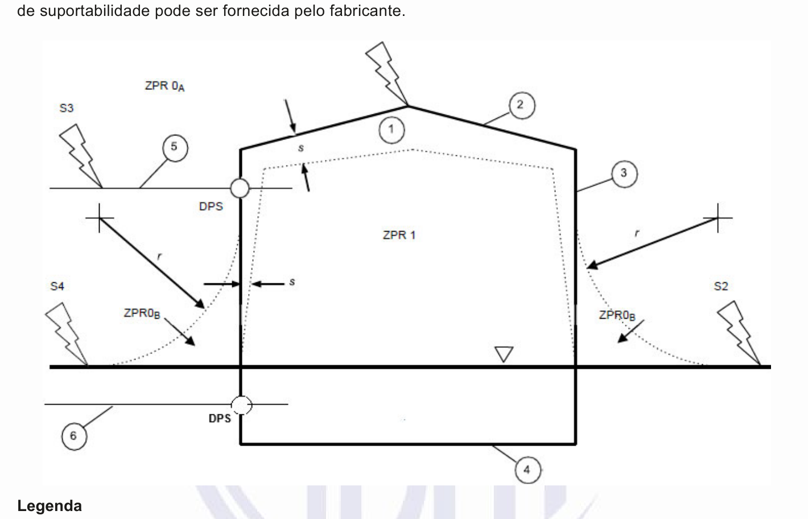
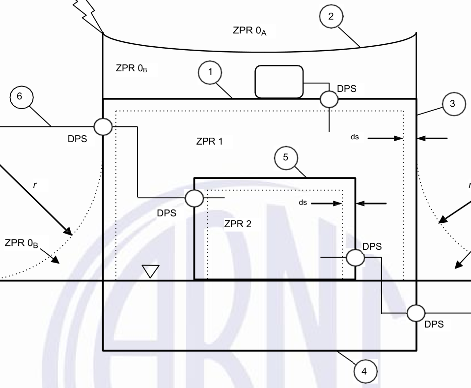

[Arquivo único](../nbr-5419-1.md)

## 8 Critérios básicos para proteção de estruturas

### 8.1 Geral

**8.1.1** Como exemplo de proteção ideal, pode-se envolver completamente a estrutura a ser protegida com blindagem contínua e condutora, aterrada e de espessura adequada. Além disso, providenciar ligações equipotenciais adequadas para as linhas elétricas e as tubulações metálicas que se conectam à estrutura nos pontos de passagem pela blindagem.

**8.1.2** As medidas estabelecidas em 8.1.1 impedem a penetração da corrente da descarga atmosférica e do campo eletromagnético associado na estrutura a ser protegida e evita efeitos térmicos e eletrodinâmicos perigosos da corrente, assim como centelhamentos e sobretensões perigosas para os sistemas internos.

**8.1.3** Na prática, porém, a aplicação das medidas de 8.1.1 para obter esse tipo de proteção é frequentemente inviável.

**8.1.4** A falta de continuidade da blindagem ou sua espessura inadequada permite a penetração da corrente da descarga atmosférica e seus efeitos pela blindagem, podendo causar:

- a) danos físicos e risco à vida;

- b) dano à isolação das linhas elétricas e falha dos sistemas internos.

**8.1.5** As medidas de proteção, adotadas para reduzir estes danos e perdas relevantes, devem ser projetadas para um conjunto estabelecido de parâmetros das correntes das descargas atmosféricas, frente às quais é requerida a proteção, conforme o nível de proteção contra descargas atmosféricas.

### 8.2 Níveis de proteção contra descargas atmosféricas (*NP*)

**8.2.1** Para efeitos da série ABNT NBR 5419, são considerados quatro níveis de proteção contra descargas atmosféricas (I a IV). Para cada *NP*, é fixado um conjunto de parâmetros máximos e mínimos das correntes das descargas atmosféricas.

> **NOTA 1** A proteção contra descargas atmosféricas cujos parâmetros máximos e mínimos de corrente excedam aqueles correspondentes ao *NP* I requer medidas de proteção mais eficientes, as quais recomenda-se que sejam escolhidas e adotadas para cada caso específico.

> **NOTA 2** A probabilidade de ocorrência de descargas atmosféricas cujos parâmetros de correntes estejam fora do intervalo máximo e mínimo do *NP* I é menor que 2 %.

**8.2.2** Espera-se que os valores máximos dos parâmetros das correntes das descargas atmosféricas correspondentes ao *NP* I não possam ser excedidos com uma probabilidade de 99 %. De acordo com a relação de polaridade assumida (ver A.2), espera-se que os valores máximos assumidos para as descargas atmosféricas positivas tenham probabilidades de ser excedidos inferiores a 10 %, enquanto aqueles para as descargas atmosféricas negativas permanecem abaixo de 1 % (ver A.3).

**8.2.3** Os valores máximos dos parâmetros das correntes das descargas atmosféricas correspondentes ao *NP* I são reduzidos a 75 % para o nível II e a 50 % para os níveis III e IV (reduções lineares para *I*, *Q* e di/dt, mas quadrática para *W/R*). Os parâmetros de tempo não mudam.

> **NOTA 3** Os níveis de proteção contra descargas atmosféricas cujos parâmetros máximos de corrente sejam menores que aqueles correspondentes ao *NP* IV permitem considerar valores de probabilidade de danos maiores que aqueles apresentados na ABNT NBR 5419-2:2026, Anexo B, embora não quantificados, mas que podem ser úteis para um ajuste mais adequado das medidas de proteção a fim de se evitar custos injustificavelmente altos.

**8.2.4** Os valores máximos dos parâmetros das correntes das descargas atmosféricas para os diferentes níveis de proteção são fornecidos na Tabela 3 e são usados para projetar componentes de proteção contra descargas atmosféricas (por exemplo, seção transversal dos condutores, espessuras das chapas metálicas, capacidade de condução de corrente dos *DPS*, distância de segurança contra centelhamentos perigosos) e para estabelecer parâmetros de ensaios que simulam os efeitos das descargas atmosféricas sob tais componentes (ver Anexo D).

**8.2.5** Os valores mínimos de amplitudes das correntes das descargas atmosféricas para os diferentes *NP* são usados para se determinar o raio da esfera rolante (ver A.4) de modo a estabelecer a zona de proteção contra raios *ZPR* 0B, a qual não pode ser alcançada por descargas atmosféricas diretas (ver 8.3 e Figuras 3 e 4). Os valores mínimos dos parâmetros das correntes das descargas atmosféricas junto com os raios das esferas rolantes correspondentes são fornecidos na Tabela 4. Eles são usados para posicionar os componentes do subsistema de captação e para estabelecer a zona de proteção contra raios *ZPR* 0B (ver 8.3).

**Tabela 3 – Valores máximos dos parâmetros das descargas atmosféricas correspondentes**

**aos níveis de proteção (*****NP*****)**

<table><tr><th colspan="3">**Primeiro impulso positivo**</th><th colspan="4">***NP***</th></tr><tr><td>**Parâmetros da corrente**</td><td>**Símbolo**</td><td>**Unidade**</td><td>**I**</td><td>**II**</td><td>**III**</td><td>**IV**</td></tr><tr><td>Corrente de pico</td><td>*I*</td><td>kA</td><td>200</td><td>150</td><td colspan="2">100</td></tr><tr><td>Carga do impulso</td><td>*Q*curta</td><td>C</td><td>100</td><td>75</td><td colspan="2">50</td></tr><tr><td>Energia específica</td><td>*W/R*</td><td>MJ/Ω</td><td>10</td><td>5,6</td><td colspan="2">2,5</td></tr><tr><td>Parâmetros de tempo</td><td>*T*1 */ T*2</td><td>µs / µs</td><td colspan="4">10/350</td></tr><tr><td colspan="3">**Primeiro impulso negativo**a</td><td colspan="4">***NP***</td></tr><tr><td>**Parâmetros da corrente**</td><td>**Símbolo**</td><td>**Unidade**</td><td>**I**</td><td>**II**</td><td>**III**</td><td>**IV**</td></tr><tr><td>Corrente de pico</td><td>*I*</td><td>kA</td><td>100</td><td>75</td><td colspan="2">50</td></tr><tr><td>Taxa média de variação</td><td>d*i/*d*t*</td><td>kA/µs</td><td>100</td><td>75</td><td colspan="2">50</td></tr><tr><td>Parâmetros de tempo</td><td>*T*1 */ T*2</td><td>µs / µs</td><td colspan="4">1/200</td></tr><tr><td colspan="3">**Impulso subsequente**</td><td colspan="4">***NP***</td></tr><tr><td>**Parâmetros da corrente**</td><td>**Símbolo**</td><td>**Unidade**</td><td>**I**</td><td>**II**</td><td>**III**</td><td>**IV**</td></tr><tr><td>Corrente de pico</td><td>*I*</td><td>kA</td><td>50</td><td>37,5</td><td colspan="2">25</td></tr><tr><td>Taxa média de variação</td><td>d*i/*d*t*</td><td>kA/µs</td><td>200</td><td>150</td><td colspan="2">100</td></tr><tr><td>Parâmetros de tempo</td><td>*T*1 */ T*2</td><td>µs / µs</td><td colspan="4">0,25/100</td></tr><tr><td colspan="3">**Componente longa da descarga atmosférica**</td><td colspan="4">***NP***</td></tr><tr><td>**Parâmetros da corrente**</td><td>**Símbolo**</td><td>**Unidade**</td><td>**I**</td><td>**II**</td><td>**III**</td><td>**IV**</td></tr><tr><td>Carga da componente longa</td><td>*Q*longa</td><td>*C*</td><td>200</td><td>150</td><td colspan="2">100</td></tr><tr><td>Parâmetros de tempo</td><td>*T*longa</td><td>*S*</td><td colspan="4">0,5</td></tr><tr><td colspan="3">**Descarga atmosférica**</td><td colspan="4">***NP***</td></tr><tr><td>**Parâmetros da corrente**</td><td>**Símbolo**</td><td>**Unidade**</td><td>**I**</td><td>**II**</td><td>**III**</td><td>**IV**</td></tr><tr><td>Carga da descarga atmosférica</td><td>*Q*flash</td><td>C</td><td>300</td><td>225</td><td colspan="2">150</td></tr><tr><td colspan="7">a O uso desta forma de onda de corrente é de interesse para cálculos somente, não para ensaios.</td></tr></table>

**Tabela 4 – Valores mínimos dos parâmetros das descargas atmosféricas e respectivos raios**

**da esfera rolante, correspondentes aos níveis de proteção (*****NP*****)**

<table><tr><th colspan="3">**Critérios de interceptação**</th><th colspan="4">***NP***</th></tr><tr><td></td><td>**Símbolo**</td><td>**Unidade**</td><td>**I**</td><td>**II**</td><td>**III**</td><td>**IV**</td></tr><tr><td>Corrente de pico mínima</td><td>*I*</td><td>kA</td><td>3</td><td>5</td><td>10</td><td>16</td></tr><tr><td>Raio da esfera rolante</td><td>*r*</td><td>m</td><td>20</td><td>30</td><td>45</td><td>60</td></tr></table>

**8.2.6** Das distribuições estatísticas fornecidas na Figura A.5, pode ser determinada uma probabilidade ponderada, tal que os parâmetros das correntes das descargas atmosféricas são menores que os valores máximos e respectivamente maiores que os valores mínimos estabelecidos para cada nível de proteção (ver Tabela 5).

**Tabela 5 – Probabilidades para os limites dos parâmetros das correntes das descargas atmosféricas**

<table><tr><th rowspan="2">**Probabilidade de que os parâmetros da corrente sejam:**</th><th colspan="4">***NP***</th></tr><tr><td>**I**</td><td>**II**</td><td>**III**</td><td>**IV**</td></tr><tr><td>menores que os máximos valores estabelecidos na Tabela 3</td><td>0,99</td><td>0,98</td><td>0,95</td><td>0,95</td></tr><tr><td>maiores que os mínimos valores estabelecidos na Tabela 4</td><td>0,99</td><td>0,97</td><td>0,91</td><td>0,84</td></tr></table>

**8.2.7** As medidas de proteção especificadas na ABNT NBR 5419, Partes 3 e 4 são efetivas contra descargas atmosféricas cujos parâmetros de corrente estiverem na faixa estabelecida pelo *NP* adotado para o projeto. Desta maneira, assume-se que a eficiência de uma medida de proteção é igual à probabilidade com a qual os parâmetros das correntes das descargas atmosféricas estão no interior desta faixa. Para parâmetros que excedam esta faixa, permanece um risco residual de danos.

### 8.3 Zonas de proteção contra raios (*ZPR*)

**8.3.1** As medidas de proteção como *SPDA*, blindagem das linhas, blindagens espaciais, ligações equipotenciais e *DPS* determinam as zonas de proteção contra raios (*ZPR*).

**8.3.2** As *ZPR* a jusante de uma medida de proteção, são caracterizadas por uma redução dos *LEMP*, em comparação com a *ZPR* a montante.

**8.3.3** Em relação à ameaça de descarga atmosférica, as seguintes ZPR são estabelecidas (ver Figuras 2 e 3):

- a) ZPR 0A: zona onde a ameaça é devida à descarga atmosférica direta e ao campo eletromagnético total proveniente da descarga atmosférica. Os sistemas internos podem estar sujeitos à corrente total ou parcial da descarga atmosférica;

- b) ZPR 0B: zona protegida contra descarga atmosférica direta, mas onde a ameaça é o campo eletromagnético total proveniente da descarga atmosférica. Os sistemas internos podem estar sujeitos à corrente parcial da descarga atmosférica;

- c) ZPR 1: zona onde a corrente de surto é limitada por uma divisão da corrente e pela aplicação de interfaces isolantes, ligações equipotenciais e *DPS,* na fronteira. Uma blindagem espacial pode atenuar o campo eletromagnético da descarga atmosférica;

- d) ZPR 2, ..., n: zona onde a corrente de surto pode ser ainda mais limitada por uma divisão da corrente e pela aplicação de interfaces isolantes, ligações equipotenciais e *DPS,* na fronteira. Uma blindagem espacial adicional pode ser usada para atenuar ainda mais o campo eletromagnético da descarga atmosférica.

> **NOTA** Em geral, quanto maior o número de *ZPR*, menor são os valores dos parâmetros do ambiente eletromagnético.

**8.3.4** Como regra geral de proteção, a estrutura ou o sistema interno a ser protegido devem estar em uma *ZPR* cujas características eletromagnéticas sejam compatíveis com sua capacidade de suportar solicitações que, de outra forma, causariam danos (dano físico ou falha de sistemas elétricos e eletrônicos devido a sobretensões).

> **NOTA** Para grande parte dos sistemas e aparelhos elétricos e eletrônicos, a informação sobre níveis

**Figura 2 – ZPR estabelecidas por um SPDA**

[imagem]
PENDENTE: descrição não escrita.
Rótulos presentes na figura: "de suportabilidade pode ser fornecida pelo fabricante.", "Legenda".
[/imagem]

1 Estrutura S1 descarga atmosférica na estrutura 2 Subsistema de captação S2 descarga atmosférica próxima da estrutura 3 Subsistema de descida S3 descarga atmosférica nas linhas que se conectam à estrutura 4 Subsistema de aterramento S4 descarga atmosférica próximo de linhas que se conectam à estrutura 5 Linhas elétricas conectadas à estrutura *r* raio da esfera rolante 6 Tubulação metálica *s* distância de segurança contra centelhamento perigoso nível do piso ligação equipotencial por meio de *DPS* *ZPR* 0A descarga atmosférica direta, corrente total da descarga atmosférica, campo magnético total *ZPR* 0B é pouco provável a ocorrência de descarga atmosférica, direta, corrente parcial da descarga atmosférica, ou corrente induzida, campo magnético total *ZPR* 1 não há descarga atmosférica direta; corrente de surto e campo magnético são atenuados

> **NOTA** É importante observar que o volume protegido na *ZPR* 1 respeita a distância de segurança *s.*

S1

**Figura 3 – ZPR estabelecidas por MPS**

[imagem]
PENDENTE: descrição não escrita.
Rótulos presentes na figura: "ZPR 0B", "DPS", "DPS", "ZPR 1", "r", "DPS", "ZPR 2", "DPS", "DPS".
[/imagem]

S3

*r*

S4 S2

**Legenda**

1 Blindagem da *ZPR* 1 S1 descarga atmosférica na estrutura 2 Subsistema de captação S2 descarga atmosférica próxima da estrutura 3 Subsistema de descida S3 descarga atmosférica nas linhas que se conectam à estrutura 4 Subsistema de aterramento S4 descarga atmosférica próximo de linhas que se conectam à estrutura 5 Blindagem da *ZPR* 2 6 Linhas elétricas que se conectam *r* raio da esfera rolante à estrutura ds afastamento para a blindagem nível do piso ligação equipotencial para descargas atmosféricas, por meio de *DPS* *ZPR* 0A descarga atmosférica direta, corrente total da descarga atmosférica, campo magnético total *ZPR* 0B é pouco provável a ocorrência de descarga atmosférica, direta, corrente parcial da descarga atmosférica, ou corrente induzida, campo magnético total *ZPR* 1 não há descarga atmosférica direta; corrente de surto e campo magnético são atenuados *ZPR* 2 não há descarga atmosférica direta; corrente induzida e campo magnético são ainda mais atenuados

> **NOTA** É importante observar que os volumes protegidos na *ZPR* 1 e *ZPR* 2 respeitam o afastamento para a blindagem ds*.*

### 8.4 Proteção de estruturas

#### 8.4.1 Proteção para reduzir danos físicos e riscos à vida

**8.4.1.1** A estrutura a ser protegida deve estar em uma *ZPR* 0B ou superior. Isto é alcançado por meio de um sistema de proteção contra descargas atmosféricas (*SPDA*).

**8.4.1.2** Um *SPDA* consiste em:

- a) sistema externo de proteção contra descargas atmosféricas; e

- b) sistema interno de proteção contra descargas atmosféricas.

**8.4.1.3** As funções do SPDA externo são:

- a) interceptar (com um subsistema de captação) uma descarga atmosférica para a estrutura;

- b) conduzir a corrente da descarga atmosférica (com um subsistema de descida) com segurança desde o subsistema de captação até o subsistema de aterramento;

- c) dispersar esta corrente no solo (com um subsistema de aterramento).

**8.4.1.4** A função do *SPDA* interno é evitar centelhamento perigoso na estrutura, utilizando preferencialmente a distância de segurança *s* e consequentemente a isolação elétrica, ou a ligação equipotencial, entre os componentes do *SPDA* e outros elementos condutores posicionados a partir da *ZPR* 0B.

**8.4.1.5** Quando as resistividades superficiais do solo ou do seu revestimento, externo ou interno à estrutura, forem baixas, os riscos à vida devido a tensões de passo e toque pode ser reduzido adotando-se as premissas que constam na ABNT NBR 5419-3:2026, Seção 8.

**8.4.1.6** O SPDA deve estar conforme os requisitos da ABNT NBR 5419-3.

#### 8.4.2 Proteção para reduzir as falhas de sistemas internos

**8.4.2.1** A proteção contra *LEMP* para reduzir o risco de falha de sistemas internos deve limitar:

- a) sobretensões devido a descargas atmosféricas na estrutura, resultado de acoplamento resistivo e indutivo;

- b) sobretensões devido a descargas atmosféricas próximo da estrutura, resultado de acoplamento indutivo;

- c) sobretensões transmitidas por linhas que se conectam à estrutura, devido a descargas atmosféricas diretas nas linhas ou próximas a elas;

- d) campo magnético acoplado diretamente aos aparelhos.

> **NOTA** Falhas de equipamento devidas a campos eletromagnéticos radiados diretamente nos equipamentos são desprezáveis contanto que o equipamento esteja em conformidade com os requisitos de emissão e imunidade a campos eletromagnéticos radiados, estabelecidos pelas normas pertinentes de compatibilidade eletromagnética (EMC) (ver também ABNT NBR 5419, Partes 2 e 4)

**8.4.2.2** O sistema interno a ser protegido deve estar localizado no interior de uma *ZPR* 1 ou superior. Isto é alcançado por meio de medidas de proteção contra surtos (*MPS*) aplicadas aos sistemas elétricos e eletrônicos, as quais consistem em blindagens magnéticas que atenuam o campo magnético indutor ou por meio de roteamento adequado das linhas elétricas, que reduz os laços sujeitos à indução.

**8.4.2.3** Uma ligação equipotencial deve ser provida nas fronteiras entre *ZPR*, para partes metálicas e sistemas que cruzam estas fronteiras. Esta ligação equipotencial pode ser executada por meio de equipotencialização direta ou indireta.

**8.4.2.4** As medidas de proteção para qualquer *ZPR* devem estar em conformidade com a ABNT NBR 5419-4.

**8.4.2.5** Uma eficiente proteção contra sobretensões que causam falhas de sistemas internos pode ser também obtida por meio de interfaces isolantes ou por instalação de DPS coordenados, que limitam estas sobretensões a valores abaixo da tensão suportável de impulso nominal do sistema a ser protegido.

**8.4.2.6** As interfaces isolantes e os *DPS* devem ser selecionados e instalados de acordo com os requisitos da ABNT NBR 5419-4.

**Figura A.1 – Definições dos parâmetros de um impulso de corrente (tipicamente T2 < 2 ms)**

[imagem]
PENDENTE: imagem da figura não localizada no PDF; descrição não escrita.
[/imagem]
