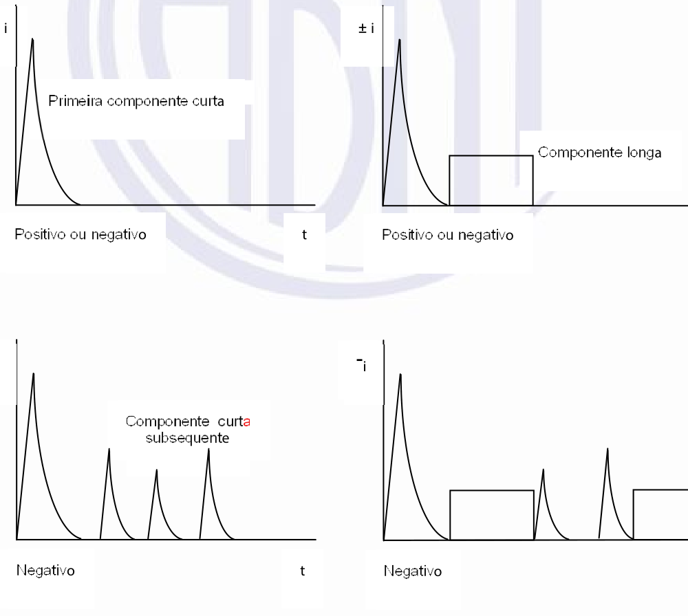
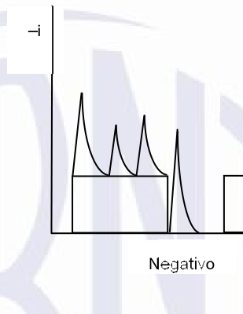

[Arquivo único](../nbr-5419-1.md)

## Anexo A (informativo) Parâmetros da corrente das descargas atmosféricas

### A.1 Descarga atmosférica para a terra

**A.1.1** Neste Anexo são tratados dois tipos básicos de descargas atmosféricas:

- a) descargas atmosféricas descendentes iniciadas por um líder descendente, da nuvem para a terra;

- b) descargas atmosféricas ascendentes iniciadas por um líder ascendente, de uma estrutura aterrada para a nuvem.

**A.1.2** Na maioria das vezes ocorrem as descargas atmosféricas descendentes. Entretanto, em estruturas muito altas, as descargas atmosféricas ascendentes podem tornar-se predominantes. A probabilidade de uma descarga atmosférica direta na estrutura aumenta com a altura (ver ABNT NBR 5419-2:2026, Anexo A).

**A.1.3** A corrente de descarga atmosférica consiste em uma ou mais descarga (de uma descarga atmosférica) diferentes:

- a) descargas curtas com duração inferior a 2 ms (ver Figura A.1);

- b) descargas longas com duração superior a 2 ms (ver Figura A.2).

90 % *± i*

50 %

*I*

10 %

O1 *T*1 *t* *T*2

**Legenda**

O1 origem virtual *I* corrente de pico *T*1 tempo de frente da onda de impulso de corrente *T*2 tempo até o meio valor na cauda da onda de impulso de corrente

**Figura A.2 – Definições dos parâmetros da componente longa**

[imagem]
PENDENTE: imagem da figura não localizada no PDF; descrição não escrita.
[/imagem]

*± i*

*Q*longa 10 %

10 %

*T*

*T*longa

**Legenda**

*T*longa tempo de duração (tipicamente 2 ms <*T*longa< 1 s) *Q*longa carga da componente longa da descarga atmosférica

**A.1.4** Uma diferenciação complementar das descargas (de uma descarga atmosférica) provém de suas polaridades (positiva ou negativa) e de suas posições durante a descarga atmosférica (primeira componente, componente subsequente e componente superposta). As descargas (de uma descarga atmosférica) possíveis são indicadas na Figura A.3 para descargas atmosféricas descendentes e na Figura A.4 para as ascendentes.

**Figura A.3 – Representação esquemática, sem escala, de possíveis descargas**

[imagem]
PENDENTE: descrição não escrita.
Rótulos presentes na figura: "± i", "± i", "P r i m e i r a c o m p o n e n t e c u r t a", "C o m p o n e n t e l o n g a", "P o s i t i v o o u n e g a t i v o", "t", "P o s i t i v o o u n e g a t i v o", "- i", "C o m p o n e n t e c u r t a", "s u b s e q u e n t e", "t", "N eg a t i v o", "N eg a t i v o".
[/imagem]

*t*

- - *i*

*t*

**(de uma descarga atmosférica) descendentes (típicas em locais planos e em estruturas baixas)** descargas (de uma descarga atmosférica) curtas superpostos

± *i* ± *i*

descargas (de uma descarga atmosférica) curta descargas (de uma descarga atmosférica) longa P r i m eir a descarga longa

*t* *t*

P o s i t i v o o u n e g a t i v o P o s i t i v o o u ne g a t i v o

**Figura A.4 – Representação esquemática, sem escala de possíveis descargas**

[imagem]
PENDENTE: descrição não escrita.
Rótulos presentes na figura: "– i", "Neg a t i v o".
[/imagem]

- *i*

descargas c u r t a s s u b s e q ue n t e s

*t* *t*

Neg a t i v o

± *i*

S o m e n t e u m a descarga longa

P o s i t i v o o u n e g a t i v o *t*

**A.1.5** A componente adicional nas descargas atmosféricas ascendentes é a primeira componente longa, com ou sem impulsos superpostos (até algo em torno de dez impulsos). Mas todos os parâmetros de um impulso de corrente de uma descarga atmosférica ascendente são inferiores àqueles das descargas atmosféricas descendentes. Cargas maiores de uma componente longa de descargas atmosféricas ascendentes não foram confirmadas até a revisão desta Parte da ABNT NBR 5419. Portanto, considera-se que os parâmetros de corrente de descarga atmosférica ascendentes estão cobertos pelos valores máximos determinados para descargas descendentes.

### A.2 Parâmetros da corrente da descarga atmosférica

**A.2.1** Os parâmetros da corrente da descarga atmosférica que constam nesta Norma são baseados nos resultados do “*International Council on Large Electrical Systems* (CIGRE)” fornecidos na Tabela A.1. A distribuição estatística destes parâmetros pode ser assumida como a distribuição logarítmica normal. O valor médio μ e a dispersão σlog correspondentes constam na Tabela A.2, e a função de distribuição é apresentada na Figura A.5. A probabilidade de ocorrência de qualquer valor de cada parâmetro pode ser determinada com base nesses parâmetros.

**A.2.2** Uma relação de 10 % de descargas atmosféricas positivas e 90 % negativas é assumida. Essa relação é função do local. Se nenhuma informação estiver disponível, é recomendada a relação fornecida.

**A.2.3** Os valores da probabilidade de ocorrência de valores de pico da corrente de descarga atmosférica que excedam os valores previamente considerados estão descritos na Tabela A.3.

**Tabela A.1 – Valores tabulados dos parâmetros da corrente das descargas atmosféricas**

**obtidos do CIGRÉ**

<table><tr><th rowspan="2">**Parâmetro**</th><th rowspan="2">**Valor fixado** **para** ***NP*** **I**</th><th colspan="3">**Valores**</th><th rowspan="2">**Tipo de descarga (de uma** **descarga atmosférica)**</th><th rowspan="2">**Linha na** **Figura** **A.5**</th></tr><tr><td>95 %</td><td>50 %</td><td>5 %</td></tr><tr><td rowspan="3">*I* (kA)</td><td></td><td>4a</td><td>20a</td><td>90</td><td>Primeira curta negativab</td><td>1A+1B</td></tr><tr><td>50</td><td>4,9</td><td>11,8</td><td>28,6</td><td>Subsequente negativa curtab</td><td>2</td></tr><tr><td>200</td><td>4,6</td><td>35</td><td>250</td><td>Primeira curta positiva (única)</td><td>3</td></tr><tr><td rowspan="2">*Q*flash (C)</td><td></td><td>1,3</td><td>7,5</td><td>40</td><td>Descarga atmosférica negativa</td><td>4</td></tr><tr><td>300</td><td>20</td><td>80</td><td>350</td><td>Descarga atmosférica positiva</td><td>5</td></tr><tr><td rowspan="3">*Q*curta (C)</td><td rowspan="2"></td><td>1,1</td><td>4,5</td><td>20</td><td>Primeira curta negativa</td><td>6</td></tr><tr><td>0,22</td><td>0,95</td><td>4</td><td>Subsequente negativa curta</td><td>7</td></tr><tr><td>100</td><td>2</td><td>16</td><td>150</td><td>Primeira curta positiva (única)</td><td>8</td></tr><tr><td rowspan="3">*W/R* (kJ/Ω)</td><td rowspan="2"></td><td>6</td><td>55</td><td>550</td><td>Primeira curta negativa</td><td>9</td></tr><tr><td>0,55</td><td>6</td><td>52</td><td>Subsequente curta negativa</td><td>10</td></tr><tr><td>10 000</td><td>25</td><td>650</td><td>15 000</td><td>Primeira curta positiva</td><td>11</td></tr><tr><td rowspan="3">d*i*/d*t*máx. (kA/μs)</td><td rowspan="2"></td><td>9,1</td><td>24,3</td><td>65</td><td>Primeira curta negativab</td><td>12</td></tr><tr><td>9,9</td><td>39,9</td><td>161,5</td><td>Subsequente curta negativab</td><td>13</td></tr><tr><td>20</td><td>0,2</td><td>2,4</td><td>32</td><td>Primeira curta positiva</td><td>14</td></tr><tr><td>d*i*/d*t*30/90 % (kA/μs)</td><td>200</td><td>4,1</td><td>20,1</td><td>98,5</td><td>Subsequente curta negativab</td><td>15</td></tr><tr><td>*Q*longa (*C*)</td><td>200</td><td></td><td></td><td></td><td>Longa</td><td></td></tr><tr><td>*T*longa (*S*)</td><td>0,5</td><td></td><td></td><td></td><td>Longa</td><td></td></tr><tr><td rowspan="3">Duração da frente de onda (μs)</td><td rowspan="3"></td><td>1,8</td><td>5,5</td><td>18</td><td>Primeira curta negativa</td><td rowspan="3"></td></tr><tr><td>0,22</td><td>1,1</td><td>4,5</td><td>Subsequente curta negativa</td></tr><tr><td>3,5</td><td>22</td><td>200</td><td>Primeira curta positiva (única)</td></tr><tr><td rowspan="3">Duração da componente (μs)</td><td rowspan="3"></td><td>30</td><td>75</td><td>200</td><td>Primeira curta negativa</td><td rowspan="3"></td></tr><tr><td>6,5</td><td>32</td><td>140</td><td>Subsequente curta negativa</td></tr><tr><td>25</td><td>230</td><td>2 000</td><td>Primeira curta positiva (única)</td></tr><tr><td>Intervalo de tempo (ms)</td><td></td><td>7</td><td>33</td><td>150</td><td>Múltiplas negativas</td><td></td></tr><tr><td rowspan="3">Duração total da descarga atmosférica (ms)</td><td rowspan="3"></td><td>0,15</td><td>13</td><td>1 100</td><td>Descarga atmosférica negativa</td><td></td></tr><tr><td>31</td><td>180</td><td>900</td><td>Descarga atmosférica negativa (sem o impulso singelo)</td><td></td></tr><tr><td>14</td><td>85</td><td>500</td><td>Descarga atmosférica positiva</td><td></td></tr><tr><td colspan="7">a Os valores I =4 kA e I =20 kA correspondem às probabilidades de 98 % e 80 %, respectivamente. b Parâmetros e valores relevantes descritos em publicações do CIGRÉ</td></tr></table>

**Tabela A.2 – Distribuição logarítmica normal dos parâmetros da corrente das descargas** **atmosféricas – Média µ e dispersão σlog calculados para 95 % e 5 % dos valores a partir**

**do CIGRÉ**

<table><tr><th>**Parâmetro**</th><th>**Média** **μ**</th><th>**Dispersão** ***σ*****loga**</th><th>**Tipo de descarga (de uma** **descarga atmosférica)**</th><th>**Linha na** **Figura A.5**</th></tr><tr><td rowspan="4">I (kA)</td><td>(61,1)</td><td>0,576</td><td>Primeira curta negativa (80 %)b</td><td>1A</td></tr><tr><td>33,3</td><td>0,263</td><td>Primeira curta negativa (80 %)b</td><td>1B</td></tr><tr><td>11,8</td><td>0,233</td><td>Subsequente curta negativab</td><td>2</td></tr><tr><td>33,9</td><td>0,527</td><td>Primeira curta positiva (única)</td><td>3</td></tr><tr><td rowspan="2">Qflash(C)</td><td>7,21</td><td>0,452</td><td>Descarga atmosférica negativa</td><td>4</td></tr><tr><td>83,7</td><td>0,378</td><td>Descarga atmosférica positiva</td><td>5</td></tr><tr><td rowspan="3">Qcurta(C)</td><td>4,69</td><td>0,383</td><td>Primeira curta negativa</td><td>6</td></tr><tr><td>0,938</td><td>0,383</td><td>Subsequente curta negativa</td><td>7</td></tr><tr><td>17,3</td><td>0,570</td><td>Primeira curta positiva (única)</td><td>8</td></tr><tr><td rowspan="3">W/R (kJ/Ω)</td><td>57,4</td><td>0,596</td><td>Primeira curta negativa</td><td>9</td></tr><tr><td>5,35</td><td>0,600</td><td>Subsequente curta negativa</td><td>10</td></tr><tr><td>612</td><td>0,844</td><td>Primeira curta positiva</td><td>11</td></tr><tr><td rowspan="3">di/dtMáx. (kA/μs)</td><td>24,3</td><td>0,260</td><td>Primeira curta negativab</td><td>12</td></tr><tr><td>40,0</td><td>0,369</td><td>Subsequente curta negativab</td><td>13</td></tr><tr><td>2,53</td><td>0,670</td><td>Primeira curta positiva</td><td>14</td></tr><tr><td>di/dt30/90% (kA/μs)</td><td>20,1</td><td>0,420</td><td>Subsequente curta negativab</td><td>15</td></tr><tr><td>Qlonga(C)</td><td>200</td><td></td><td>Longa</td><td></td></tr><tr><td>Tlonga(s)</td><td>0,5</td><td></td><td>Longa</td><td></td></tr><tr><td rowspan="3">Duração da frente de onda (μs)</td><td>5,69</td><td>0,304</td><td>Primeira curta negativa</td><td></td></tr><tr><td>0,995</td><td>0,398</td><td>Subsequente curta negativa</td><td></td></tr><tr><td>26,5</td><td>0,534</td><td>Primeira curta positiva (única)</td><td></td></tr><tr><td rowspan="3">Duração da componente da descarga atmosférica (μs)</td><td>77,5</td><td>0,250</td><td>Primeira curta negativa</td><td></td></tr><tr><td>30,2</td><td>0,405</td><td>Subsequente curta negativa</td><td></td></tr><tr><td>224</td><td>0,578</td><td>Primeira curta positiva (única)</td><td></td></tr><tr><td>Intervalo de tempo (ms)</td><td>32,4</td><td>0,405</td><td>Múltiplas negativas</td><td></td></tr><tr><td rowspan="3">Duração total da descarga atmosférica (ms)</td><td>12,8</td><td>1,175</td><td>Descarga atmosférica negativa (todos os tipos)</td><td></td></tr><tr><td>167</td><td>0,445</td><td>Descarga atmosférica negativa (sem o impulso singelo)</td><td></td></tr><tr><td>83,7</td><td>0,472</td><td>Descarga atmosférica positiva</td><td></td></tr><tr><td colspan="5">a σlog é o valor que indica a dispersão em torno do valor médio logarítmico da distribuição log-normal do parâmetro: Integral (−σlog, +σlog) [distribuição log-normal] = 68,2 %. b Parâmetros e valores relevantes descritos em publicações do CIGRÉ.</td></tr></table>

**Figura A.5 – Distribuição de frequência cumulativa dos parâmetros de corrente de descarga**

[imagem]
PENDENTE: imagem da figura não localizada no PDF; descrição não escrita.
[/imagem]

**Tabela A.3 – Valores da probabilidade** ***P*** **em função da corrente** ***I*** **da descarga atmosférica**

| *I* **(kA)** | ***P*** |
| --- | --- |
| 0 | 1 |
| 3 | 0,99 |
| 5 | 0,95 |
| 10 | 0,91 |
| 20 | 0,8 |
| 30 | 0,6 |
| 35 | 0,5 |
| 40 | 0,4 |
| 50 | 0,3 |
| 60 | 0,2 |
| 80 | 0,1 |
| 100 | 0,05 |
| 150 | 0,02 |
| 200 | 0,01 |

> **NOTA** Para a numeração das curvas, ver Tabelas A.1 e A.2.

99,8 99,5 99 98 1A Parâmetros fixados

Probabilidade (%) 95 5

13

8

90

80 4 11 70 15 60 50 14 40 9 2 30 1B 7 12 20 3 10 10 6 5

2 1 0,5 0,2 100 2 3 4 6 8 101 2 3 4 6 8 102 2 3 4 6 8 103 2 3 4 6 8 104 Parâmetros

**atmosférica (linha pontilhada pelo valor de 50 %)**

**A.2.4** Todos os valores estabelecidos para os níveis de proteção *NP* fornecidos nesta Norma referem-se tanto a descargas atmosféricas ascendentes quanto descendentes.

> **NOTA** Os valores dos parâmetros das descargas atmosféricas são geralmente obtidos por medições efetuadas em estruturas de grande altura. A distribuição estatística dos valores de pico da corrente de descarga atmosférica, sem considerar o efeito das estruturas de grande altura, pode ser obtida de estimativas dos sistemas de localização de descargas atmosféricas.

### A.3 Estabelecendo os parâmetros máximos da corrente de descarga atmosférica para o nível de proteção *NP* I

#### A.3.1 Geral

**A.3.1.1** Os efeitos mecânicos das descargas atmosféricas estão relacionados à corrente de pico (*I*) e com a energia específica (*W/R*). Os efeitos térmicos estão relacionados à energia específica (*W/R*) quando ocorre um acoplamento resistivo e com a carga (*Q*) quando ocorrem centelhamentos na instalação. Sobretensões e centelhamentos perigosos causados por acoplamento indutivo estão relacionados à taxa média de inclinação (di/dt) da frente de onda da corrente da descarga atmosférica.

**A.3.1.2** Os parâmetros individuais *I*, *Q*, *W/R*, di/dt tendem a ser dominantes em cada mecanismo de defeito. Recomenda-se que isto seja considerado por ocasião do estabelecimento dos procedimentos de ensaios.

#### A.3.2 Primeira componente positiva e componente longa

**A.3.2.1** Os valores *I,* *Q* e *W/R* relacionados aos efeitos mecânicos e térmicos são determinados a partir de descargas atmosféricas positivas, pois mesmo sendo menos frequentes, seus valores a 10 % são mais elevados que aqueles correspondentes aos valores para 1 % das descargas atmosféricas negativas. Da Figura A.5 (linhas 3, 5, 8, 11 e 14), os seguintes valores com probabilidades inferiores a 10 % podem ser obtidos.

- a) *I* = 200 kA;

- b) *Q*flash = 300 *C*;

- c) *Q*curta = 100 *C*;

- d) *W/R* = 10 MJ/Ω;

- e) di/dt = 20 kA/μs.

**A.3.2.2** Para uma primeira componente positiva conforme a Figura A.1, estes valores fornecem uma primeira aproximação do tempo de frente:

T1 = *I* / (di/dt) = 10 μs (T1 é um parâmetro de menor interesse).

**A.3.2.3** Para uma componente com decaimento exponencial, as equações seguintes são aplicáveis para o cálculo aproximado da carga e da energia (T1<< T2):

*Q*curta = (1/0,7) × I × T2 *W/R* = (1/2) × (1/0,7) × I2 × T2

**A.3.2.4** Estas equações, associadas aos valores anteriormente citados, conduzem a uma primeira aproximação do tempo necessário até meio valor:

T2 = 350 μs

**A.3.2.5** Para a componente longa, sua carga pode ser aproximadamente calculada por: *Q*longa = *Q*flash − *Q*curta = 200 C

**A.3.2.6** Sua duração, conforme a Figura A.2, pode ser estimada a partir dos dados da Tabela A.1, como: *T*longa = 0,5 s

#### A.3.3 Primeira componente negativa

**A.3.3.1** Para alguns efeitos de acoplamento indutivo, a primeira componente negativa leva a tensões induzidas mais altas. Da Figura A.5 (linhas 1 e 12), os seguintes valores com probabilidades inferiores a 1 % podem ser utilizados:

- a) *I* = 100 kA;

- b) di/dt = 100 kA/µs.

**A.3.3.2** Para a primeira componente negativa de acordo com a Figura A.1, estes valores dão uma primeira aproximação para os seus tempos de frente de onda de:

T1 = *I* / (di/dt) = 1,0 µs

**A.3.3.3** Seu tempo até o meio valor pode ser estimado da duração da primeira componente de impulsos negativos:

T2 = 200 µs (T2 é um parâmetro de menor interesse)

#### A.3.4 Componente subsequente

**A.3.4.1** O valor máximo da taxa média de variação da corrente di/dt, relacionado a centelhamentos perigosos devido à acoplamento indutivo, é determinado a partir de descargas (de uma descarga atmosférica) curtas subsequentes de descargas atmosféricas negativas [pois seus valores com 1 % de ocorrência são um pouco mais elevados que os valores com 1 % de ocorrência das primeiras descargas (de uma descarga atmosférica) negativas ou que os valores correspondentes com 10 % de ocorrência das descargas atmosféricas positivas]. A partir da Figura A.5 (linhas 2 e 15), os valores seguintes podem ser obtidos com probabilidades inferiores a 1 %:

- a) *I* = 50 kA;

- b) di/dt = 200 kA/μs.

**A.3.4.2** Para uma componente subsequente conforme a Figura A.1, estes valores fornecem uma primeira aproximação do tempo de frente de onda:

T1 = *I* / (di/dt) = 0,25 μs

**A.3.4.3** Seu tempo até meio valor pode ser estimado da duração das descargas (de uma descarga atmosférica) subsequentes negativas:

T2 = 100 μs (T2 é um parâmetro de menor interesse)

### A.4 Estabelecendo os parâmetros mínimos da corrente das descargas atmosféricas

**A.4.1** A eficácia de intercepção de um subsistema de captação depende dos valores mínimos dos parâmetros das correntes das descargas atmosféricas e dos raios correspondentes da esfera rolante. As fronteiras geométricas de áreas protegidas contra impacto direto de descargas atmosféricas podem ser determinadas pelo método da esfera rolante.

**A.4.2** Conforme o modelo eletrogeométrico, o raio da esfera rolante *r* (*striking distance*) está relacionado ao valor de pico da corrente da primeira componente. Em um relatório de um grupo de trabalho do IEEE, a relação é fornecida como:

*r* = 10 × I0,65 (A.1)

onde

*r* é o raio da esfera rolante, expresso em metros (m);

*I* é a corrente de pico, expressa em quiloampères (kA).

**A.4.3** Para um determinado raio da esfera rolante *r*, pode ser assumido que todas as descargas atmosféricas com valores de pico maiores que o valor de pico mínimo correspondente são interceptadas pelos captores. Desta forma, a probabilidade para os valores de pico das primeiras descargas (de uma descarga atmosférica) positivas e negativas, obtida da Figura A.5 (linhas 1A e 3), é assumida como a probabilidade de interceptação. Considerando a razão de polaridade de 10 % de descargas atmosféricas positivas e 90 % de descargas atmosféricas negativas, a probabilidade total de interceptação pode ser calculada (ver Tabela 5).
