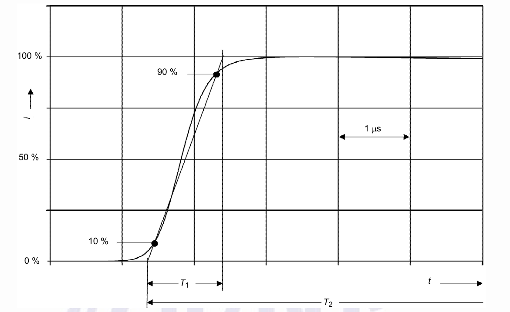
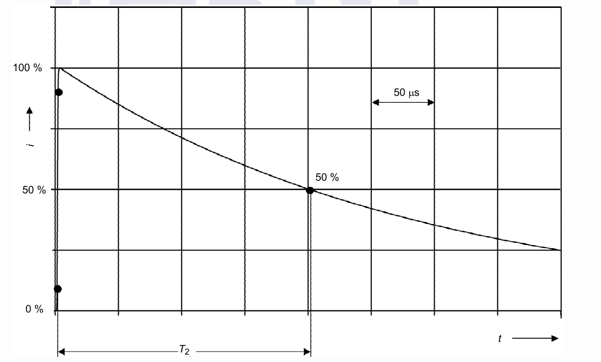
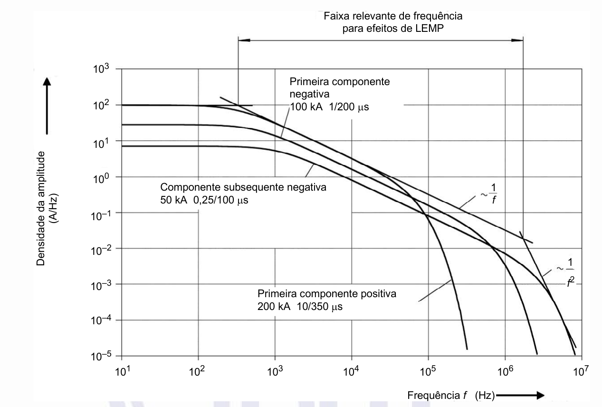

[Arquivo único](../nbr-5419-1.md)

## Anexo B (informativo) Equação da corrente da descarga atmosférica em função do tempo para efeito de análise

**B.1** As formas de onda da corrente:

- a) da primeira componente positiva 10/350 μs;

- b) da primeira componente negativa 1/200 μs;

- c) das descargas (de uma descarga atmosférica) negativas subsequentes 0,25/100 μs podem ser estabelecidas como:

Ι(τ Τ1)10⋅*e*−τ Τ2

*i* = ⋅ (B.1) *k*1+ τ Τ1)10 (

onde

*I* é o valor de pico da corrente;

*k* é o fator de correção para o valor de pico de corrente;

*t* é o tempo;

T1 é a constante de tempo de frente;

T2 é a constante de tempo de cauda.

**B.2** Para as formas de onda da corrente da primeira componente positiva, e a primeira componente negativa e para as descargas (de uma descarga atmosférica) negativas subsequentes para diferentes *NP*, são aplicados os parâmetros fornecidos na Tabela B.1. As curvas analíticas em função do tempo são apresentadas nas Figuras B.1 a B.6.

**Tabela B.1 – Parâmetros para a Equação B.1**

<table><tr><th rowspan="3">**Parâmetros**</th><th colspan="3">**Primeira componente** **positiva**</th><th colspan="3">**Primeira componente** **negativa**</th><th colspan="3">**Componente negativa** **subsequente**</th></tr><tr><td colspan="3">***NP***</td><td colspan="3">***NP***</td><td colspan="3">***NP***</td></tr><tr><td>**I**</td><td>**II**</td><td>**III - IV**</td><td>**I**</td><td>**II**</td><td>**III-IV**</td><td>**I**</td><td>**II**</td><td>**III-IV**</td></tr><tr><td>I (kA)</td><td>200</td><td>150</td><td>100</td><td>100</td><td>75</td><td>50</td><td>50</td><td>37,5</td><td>25</td></tr><tr><td>*k*</td><td>0,93</td><td>0,93</td><td>0,93</td><td>0,986</td><td>0,986</td><td>0,986</td><td>0,993</td><td>0,993</td><td>0,993</td></tr><tr><td>*T*1 (μs)</td><td>19,0</td><td>19,0</td><td>19,0</td><td>1,82</td><td>1,82</td><td>1,82</td><td>0,454</td><td>0,454</td><td>0,454</td></tr><tr><td>*T*2 (μs)</td><td>485</td><td>485</td><td>485</td><td>285</td><td>285</td><td>285</td><td>143</td><td>143</td><td>143</td></tr></table>

**Figura B.1 – Forma de onda da elevação da corrente da primeira componente positiva**

[imagem]
PENDENTE: imagem da figura não localizada no PDF; descrição não escrita.
[/imagem]

**Figura B.2 – Forma de onda da cauda da corrente da primeira componente positiva**

[imagem]
PENDENTE: imagem da figura não localizada no PDF; descrição não escrita.
[/imagem]

100 %

90 %

*i*

5 μs

50 %

10 %

0 %

*T*1 *t*

*T*2

100 %

200 μs

*i*

50 %

50 %

0 %

*T*2 *t*

**Figura B.3 – Forma de onda da elevação da corrente da primeira componente negativa**

[imagem]
PENDENTE: descrição não escrita.
Rótulos presentes na figura: "100 %", "90 %", "i", "1 μs", "50 %", "10 %", "0 %", "t", "T1", "T2".
[/imagem]

**Figura B.4 – Forma de onda da cauda da corrente da primeira componente negativa**

[imagem]
PENDENTE: descrição não escrita.
Rótulos presentes na figura: "100 %", "50 μs", "i", "50 %", "50 %", "0 %", "t", "T2".
[/imagem]

**Figura B.5 – Forma de onda da elevação da corrente da componente negativa subsequente**

[imagem]
PENDENTE: imagem da figura não localizada no PDF; descrição não escrita.
[/imagem]

**Figura B.6 – Forma de onda da cauda da corrente da componente negativa subsequente**

[imagem]
PENDENTE: imagem da figura não localizada no PDF; descrição não escrita.
[/imagem]

100 %

90 %

*i* 0,2 μs

50 %

10 %

0 %

*T*1 *t*

*T*2

100 %

*i* 50 μs

50 %

50 %

0 %

*T*2

*t*

**B.3** A componente longa pode ser descrita como uma forma de onda retangular com uma corrente média *I* e a duração *T*longa de acordo com a Tabela 3.

**B.4** A densidade da amplitude da corrente da descarga atmosférica (ver Figura B.7) pode ser derivada das curvas analíticas em função do tempo.

**Figura B.7 – Densidade da amplitude da corrente da descarga atmosférica de acordo com o NP I**

[imagem]
PENDENTE: descrição não escrita.
Rótulos presentes na figura: "Faixa relevante de frequência", "para efeitos de LEMP", "103", "Primeira componente", "negativa", "102", "100 kA 1/200 μs", "101", "100", "Componente subsequente negativa", "1", "50 kA 0,25/100 μs", "f", "Densidade da amplitude (A/Hz) 10–1", "10–2", "1", "f2", "10–3", "Primeira componente positiva", "200 kA 10/350 μs", "10–4", "10–5", "101", "102", "103", "104", "105", "106", "107", "Frequência f (Hz)".
[/imagem]
